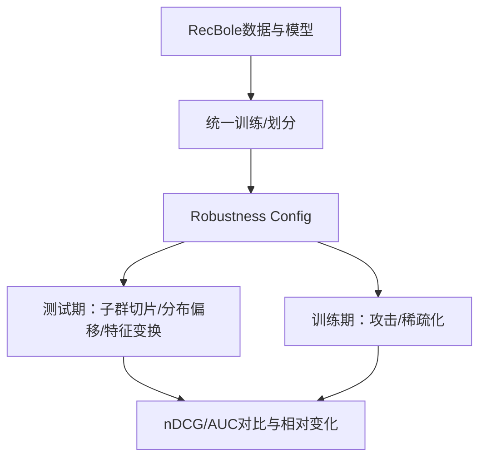

# RGRecSys: A Toolkit for Robustness Evaluation of Recommender Systems (RGRecSys：推荐系统鲁棒性评估工具包)

- **会议/期刊**: WSDM 2022
- **作者与机构**: Zohreh Ovaisi, Shelby Heinecke, Jia Li, Yongfeng Zhang, Elena Zheleva, Caiming Xiong；UIC / Salesforce Research / Rutgers University
- **推荐链路定位**: 离线评测基准（覆盖召回/排序/上下文推荐模型）
- **研究方向**: 去偏公平、可信隐私与工业架构 / 鲁棒性评估
- **论文原文**: [论文原文链接](https://arxiv.org/abs/2201.04399v1)
- **开源代码**: [开源代码仓库链接](https://github.com/salesforce/RGRecSys)

## TL;DR (1分钟核心速览)

RGRecSys 针对推荐系统仅在 i.i.d.、充足且干净数据下评测的盲点，把子群体、分布偏移、特征变换、攻击与稀疏统一为可配置鲁棒性算子，并封装 RecBole 模型。MovieLens-100k 案例显示：女性子群、性别分布偏移、10% 评分攻击与 25% 交互稀疏均会显著改变模型表现，DSSM、LR、NeuMF 等脆弱点被快速暴露。

## Background & Motivation (背景与核心矛盾)

- **主流范式**: RecBole、LibRec、LensKit 等库已支持多模型统一训练与标准离线指标比较，但默认假设训练/测试同分布、数据干净且充足。
- **前人局限**: 现有库主要报告全体用户平均指标，无法揭示女性/男性等子群体差异；也缺少对特征损坏、分布偏移、攻击与稀疏的统一压力测试接口。
- **核心洞察 (Key Insight)**: 鲁棒性不应只等于“抗攻击/抗稀疏”，而应覆盖子群体、变换、分布差异、攻击、稀疏五个正交维度；只要固定模型与划分，仅改变数据切片或扰动，就能隔离模型脆弱性。
- **本文切入点**: 不做新推荐模型，而是在 RecBole 之上加一层模型无关、配置驱动的鲁棒性评估工具。

## Method (核心方法设计)

### 1. 整体框架 (Overall Architecture)

RGRecSys 复用 RecBole 的数据、模型与评测模块：先按统一随机种子完成 80%/10%/10% 划分并训练基线模型；随后由 `robustness config` 指定评估维度——测试期执行子群体切片、分布重采样、用户/物品特征变换，训练期执行评分攻击或交互稀疏化；最后在同一测试集上对比原始与扰动后的 nDCG/AUC，并输出相对变化。工具不引入新推荐损失，训练沿用各模型默认目标与 RecBole 默认超参。

### 2. 关键设计拆解 (Key Designs)

1. **五维鲁棒性扰动层（统一评估算子）**：前人只给整体均值，本文把鲁棒性形式化为基准集 $D_0$与扰动集$D_c$上的指标相对变化$\Delta_m^{c}=\frac{M_m(D_c)-M_m(D_0)}{M_m(D_0)}\times100\%$。这样同一模型、同一划分只改数据条件，可直接比较不同鲁棒性来源，避免“平均指标好即鲁棒”的误判。

2. **训练/测试扰动边界（防止评估污染）**：子群体切片、分布偏移与特征变换只作用于测试数据，模拟部署后用户特征损坏或测试分布变化；攻击与稀疏化作用于训练数据，模拟 CSRF 式评分篡改与日志缺失。该边界保证“模型训练分布”和“评估压力”可解释，物理直觉是分别刻画泛化脆弱性与学习脆弱性。

3. **RecBole 兼容与可复现评测**：工具直接调用 RecBole 内置 Pop、NeuMF、LightGCN、ItemKNN、SpectralCF、DCN、DSSM、AFM、LR、FM 等模型；所有案例固定同一随机种子与默认超参，报告 nDCG/AUC。本文无新负采样策略，也未明确 Full-Ranking 或 Sampled Ranking，复现时应按 RecBole 默认评测协议理解。

## Experimental Setup & Evaluation Protocol (实验设置与评估协议)

- **数据集与预处理**: 仅用 MovieLens 100k 做案例展示，未做 `5-core` 过滤：

| 数据集 | #Users | #Items | #Interactions | 稀疏度/密度 | 特征/场景说明 |
| :--- | :---: | :---: | :---: | :---: | :--- |
| MovieLens 100k | 943 | 1,682 | 100,000 | 密度约 6.3% | 评分 1–5；含性别、年龄，用于子群与特征变换 |

- **数据划分与防穿越 (Splitting Strategy)**: 比例划分 80%/10%/10%，所有案例使用同一随机种子；未采用 `Leave-One-Out`、全局时间戳切分或冷启动划分。
- **排名评测协议 (Ranking Protocol)**: 报告 nDCG 与 AUC；论文未明确是无偏 `Full-Ranking` 还是 `Sampled Ranking`，也未说明负采样比例。案例目标是展示工具能力，不宜当作排行榜结论。
- **对比基线与超参设置**: 通用模型 Pop、NeuMF、LightGCN、ItemKNN、SpectralCF；上下文模型 DCN、DSSM、AFM、LR、FM。Embedding 维度与训练轮次沿用 RecBole 默认值；未报告显著性检验。

## Key Experimental Results (实验关键数据)

### 1. 主实验对比 (Main Results)

原文为 4 页工具论文，图 1–5 仅给出相对百分比变化，未列出精确 nDCG/AUC 数值，故下表只记录可核验的基线与趋势，不填造数值或 `Improv.%`。

| 基线 | 类别 | 涉及鲁棒性场景 | 原文可核验结果 |
| :--- | :--- | :--- | :--- |
| NeuMF | 神经 CF | 稀疏 | **对稀疏最脆弱之一** |
| LightGCN | 图 CF | 子群/分布/稀疏 | 图 1–5 对照，未列数值 |
| ItemKNN | 邻域 CF | 分布偏移 | **通用模型中对分布偏移最不脆弱** |
| SpectralCF | 谱 CF | 性别子群 | **通用模型中女性性能差距最大** |
| DCN | 上下文 | 稀疏 | **对稀疏最脆弱之一** |
| DSSM | 双塔 | 分布偏移/年龄变换 | **分布偏移下上下文模型最稳；年龄扰动最脆弱** |
| LR | 线性上下文 | 子群/攻击 | **攻击下受影响最小；上下文模型中女性差距最大** |
| FM | 因子分解 | 攻击/稀疏 | 图 4–5 对照，未列数值 |

案例设置与关键趋势：

| 案例 | 扰动规模 | 结果趋势 |
| :--- | :--- | :--- |
| 性别子群体 | 女/男测试切片 | 多模型女性表现更差；SpectralCF、LR 差距最大 |
| 性别分布偏移 | 训练 74% 男/26% 女 → 测试 50%/50% | 所有模型退化；ItemKNN、DSSM 最不脆弱 |
| 年龄变换 | 每用户年龄扰动 ≤10% | DSSM 最敏感 |
| 评分攻击 | 随机篡改 10% 训练交互评分 | 上下文模型均退化；LR 受影响最小 |
| 交互稀疏化 | 每用户随机删除 25% 交互 | NeuMF、DCN 最脆弱 |

### 2. 消融实验 (Ablation Study)

本文是工具论文，未做模型性能消融；下表为“功能覆盖消融”的概念性对照，非精确性能实验。

| 移除能力 | 可观测损失 | 结论 |
| :--- | :--- | :--- |
| w/o 子群体切片 | 只剩整体均值，女性子群退化被掩盖 | 公平性风险不可见 |
| w/o 测试期变换 | 特征损坏鲁棒性被高估 | DSSM 类特征敏感模型无法暴露 |
| w/o 训练期攻击/稀疏 | 只测 i.i.d. 泛化，缺少学习脆弱性 | 无法区分攻击与稀疏敏感性 |
| w/o 相对变化报告 | 跨指标、跨模型难以统一比较 | 工具价值下降 |

### 3. 关键实验发现 (Key Findings)

1. **10% 评分篡改即可让上下文模型集体退化，LR 反而最稳**：说明低容量线性模型对训练噪声不敏感，但可能是以整体拟合能力换鲁棒性，不能直接等同于更优推荐质量。
2. **每用户删 25% 交互后，NeuMF 与 DCN 最脆弱**：高容量神经模型在稀疏日志下更易过拟合/不稳；ItemKNN 等简单模型在分布偏移下反而更稳，提示工业评估应同时看稀疏分桶。
3. **训练性别比 74/26 改为测试 50/50 后所有模型退化，且女性子群差距更大**：平均 nDCG/AUC 会掩盖子群风险；SpectralCF、LR 的差距最大，说明图传播或线性特征使用可能放大子群偏差。

## Highlights & Limitations (亮点、对比与审稿批判)

- **与代表作对比 (vs. Prior Work)**: RecBole/LibRec 强在模型复现与标准离线指标，但默认 i.i.d. 评测；LensKit/MyMediaLite 更偏传统 CF；RGRecSys 首次把子群、分布、变换、攻击、稀疏做成统一配置层，类似 NLP 的 Robustness Gym 在推荐侧的迁移。
- **可迁移亮点**: “固定模型与划分、只改数据条件、报告相对变化”的协议可直接嵌入现有推荐 benchmark；训练期扰动与测试期扰动分离，适合做公平性/鲁棒性联合审计。
- **审稿级局限批判**: 仅 MovieLens-100k、默认超参与单一种子，图 1–5 无精确数值和显著性检验，结论只能算案例演示；工具依赖 RecBole，尚未覆盖序列/生成式/LLM 推荐，冷启动与更多攻击类型仅列入未来工作。

## Rating (四维评分)

- **方法创新性 (Novelty)**: ⭐⭐⭐ （首个面向推荐系统的五维鲁棒性评估工具，但非新模型或新理论）
- **评估协议与实验扎实度 (Protocol & Experiments)**: ⭐⭐ （单数据集、默认超参、仅图形百分比，无显著性检验与完整数值表）
- **写作与数学规范度 (Clarity & Rigor)**: ⭐⭐⭐ （概念与 API 边界清楚，形式化较轻，未展开候选打分协议）
- **工业落地与复现价值 (Industrial & Practical Value)**: ⭐⭐⭐⭐ （开源、配置化、可快速包裹 RecBole 模型做鲁棒性审计，适合作为评测基线）

