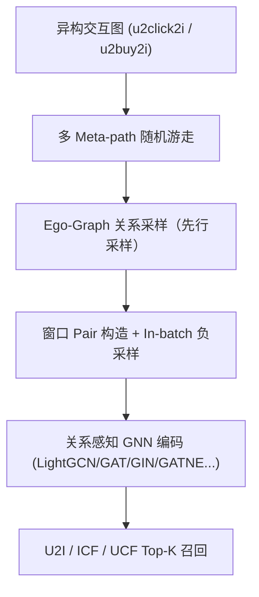
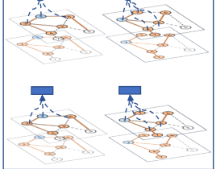

# Graph4Rec: A Universal Toolkit with Graph Neural Networks for Recommender Systems (面向推荐系统的通用 GNN 训练工具箱)

- **会议/期刊**: WSDM 2022
- **作者与机构**: Weibin Li, Mingkai He, Zhengjie Huang, Xianming Wang, Shikun Feng, Zhihua Wu, Weiyue Su, Yu Sun（百度）
- **推荐链路定位**: 召回（用户/物品表征学习 + U2I 向量检索）
- **研究方向**: 图神经网络与知识图谱推荐 / 工业级全链路架构与评测基准
- **论文原文**: [https://arxiv.org/abs/2112.01035v2](https://arxiv.org/abs/2112.01035v2)
- **开源代码**: [https://github.com/PaddlePaddle/PGL](https://github.com/PaddlePaddle/PGL)（子目录 `apps/Graph4Rec`）

## TL;DR (1分钟核心速览)

针对 GNN4Rec 领域"各写各的"、数据集与指标不统一、开源代码多为小数据 demo 难以复现与扩展的痛点，Graph4Rec 把 GNN 训练统一为"图输入 → 随机游走 → ego-graph 采样 → 样本对构造 → GNN 选择"五段式流水线，并配套分布式图引擎与参数服务器。在 4 个公开电商数据集、按用户时间戳 8:1:1 划分、ICF/UCF/U2I 三种 Top-K 召回协议下，LightGCN 的 U2I@100 达 0.1602，相对最佳基线提升 21.7%，单机训练速度比 GraphVite 快约 2×。

## Background & Motivation (背景与核心矛盾)

- **主流范式**: 用 Skip-gram 类随机游走（DeepWalk/metapath2vec）或消息传递 GNN（GCN/GraphSAGE/LightGCN/NGCF）从用户-物品交互图中学习低维节点表征，再以下游 U2I/ICF/UCF 相似度召回物品。
- **前人局限 1（评测不可比）**: 各论文自选数据集、负采样规模与指标口径（有的只报采样排序、有的只报单数据集），导致"谁更好"无法裁决；同时缺少统一的图采样与 side-info 接口。
- **前人局限 2（系统不可用）**: PBG 擅长多关系知识图谱但不支持异构 GNN 与节点 side-info，GraphVite 仅单机多卡、只跑 walk-based 模型；两者都无法覆盖真实推荐场景中十亿级交互与冷启动需求。
- **核心洞察 (Key Insight)**: 无论 walk-based 还是 GNN-based，其训练目标本质同构——都是"同路径/同窗口节点拉近、随机节点推开"的对比式损失；差异只在编码器（是否做多跳邻居聚合）。因此可用一套流水线统一表达，并把 GNN 架构作为可插拔配置项。
- **本文切入点**: 以"五段式范式 + 可配置组件"把模型创新与工程实现解耦，再用一套统一协议横向扫遍 8 类 GNN，沉淀出实践结论（side-info、负采样、采样顺序、热启动）。

## Method (核心方法设计)

### 1. 整体框架 (Overall Architecture)

输入是异构交互图（三元组 `u2click2i`、`u2buy2i`，可自动补反向关系），先按 meta-path 做多路径随机游走生成节点序列；对序列中每个节点先做**关系感知 ego-graph 采样**（子图即一个训练样本），再在路径窗口内构造正样本对并配 in-batch 负采样；随后由关系感知 GNN 编码 ego-graph 得到中心节点表征，最后用 U2I 内积检索或 ICF/UCF 近邻扩展产出 Top-K 召回列表。稀疏 ID/特征存于参数服务器、邻接表按节点分区存于分布式图引擎，支持多机线性加速。

<figure class="paper-figure" markdown="span">
  <figcaption>图 1：Graph4Rec 将训练 GNN 模型的范式统一为以下部分：图输入、随机游走生成、自我图生成、样本对生成和 GNN 选择。</figcaption>
</figure>

### 2. 关键设计拆解 (Key Designs)

1. **关系感知聚合 + 残差抗过平滑**：异构图中不同行为（点击/加购/购买）语义差异大，单关系 GCN 会混淆。本文按 R-GCN 思路对每个关系 $r$ 单独聚合，并对多关系结果加权求和，同时引入底层特征残差抑制深层过平滑：
$h_v^k = \alpha h_v^{0} + (1-\alpha)\sum_{r\in R}\varphi_r h_{v,r}^{k},\quad h_{v,r}^{k}=\mathrm{GNN}_r(h_v^{k-1},\{h_u^{k-1}:u\in\mathcal{N}_{v,r}\})$其中$\varphi_r$可取均匀常数或 GATNE 式注意力$\mathrm{softmax}(\boldsymbol{w}^\top\tanh(\mathbf{W}h_{v,r}))$，$\alpha$ 等价于 Personalized PageRank 的复位概率——直觉是"保留自身 ID 信号、避免多跳均值化把节点表征抹平"。
2. **采样顺序交换（Walk → Ego → Pair）**：朴素顺序"先构对再采 ego-graph"会让同一路径节点被重复采样，复杂度 $O(wL)$，且每个重复样本都要跨机通信取邻居。本文交换为"先对路径上所有节点采 ego-graph，再在其上构对"，采样次数降到$O(L)$，代价是批内样本多样性下降。ego-graph 定义为$S_{v,r}=\{u: d(u,r,v)\le K\}$，可视作 K 跳邻域诱导子图，天然适配邻居爆炸的采样需求。
3. **训练目标、负采样与推理开销**：目标沿用统一的对比/自监督形式，正样本来自路径窗口共现，负样本用 in-batch 采样替代全局随机采样（免去跨机拉取负节点特征）：
$\mathcal{L}=-\log\sigma(y_{vu})-\sum_{m=1}^{M}\mathbb{E}_{w_m\sim P(w)}\big[\log\sigma(-y_{w_m u})\big],\ y_{vu}=h_v^\top h_u$
另提供 metapath2vec 预训练稀疏 embedding 的热启动策略。推理阶段仅需一次前向得到用户/物品向量，U2I 走 ANN 内积检索，无额外在线开销。

## Experimental Setup & Evaluation Protocol (实验设置与评估协议)

- **数据集与预处理**: 过滤交互数 < 10 的用户（RetailRocket 为 < 5），RetailRocket 额外去重并剔除交互 < 5 的物品。

| 数据集 | #Users | #Items | #Interactions(Train) | 稀疏度 | 特征/场景说明 |
| :--- | :---: | :---: | :---: | :---: | :--- |
| RetailRocket | 38,317 | 54,937 | 373,717 | ~0.018% | 电商浏览/加购/购买，最小规模 |
| Rec15 | 506,495 | 39,656 | 5,553,047 | ~0.028% | RecSys Challenge 2015，点击+购买 |
| Tmall | 199,314 | 464,995 | 7,406,022 | ~0.008% | IJCAI 2015，四类行为（点击/购买/加购/收藏） |
| UB | 969,529 | 4,158,142 | 75,032,899 | ~0.002% | 真实电商用户行为，千万级物品最稀疏场景 |

- **数据划分与防穿越**: 按每个用户交互的**时间戳排序**后做 `8:1:1` 比例切分（前 80% 训练、次 10% 验证、末 10% 测试），属逐用户时序划分。
- **排名评测协议**: **非 Full-Ranking**。采用三种召回策略的 Top-K 命中率（Recall，K=100 或 1000）：`ICF@K`（每个历史物品取 Top-20 相似物品、按频次聚合推荐）、`UCF@K`（每个用户取 Top-20 相似用户、聚合其历史物品）、`U2I@K`（直接用用户向量检索物品向量）。该协议是"种子扩展式"近似评估，非全库未交互排序。
- **对比基线与超参设置**: 系统级基线 GraphVite（1 机）、PBG/DistMult（1 机）；模型级基线 DeepWalk、metapath2vec、GraphSAGE(mean/sum)、GAT、GIN、NGCF、GATNE、LightGCN。隐藏维/嵌入维 64、残差系数 $\alpha=0.9$、窗口 5、每正样本 10 负；每个模型训练 20 亿（Rec15）/30 亿（Tmall）样本对；40 核 CPU。原文未报告方差与显著性检验。

## Key Experimental Results (实验关键数据)

### 1. 主实验对比 (Main Results)

| 系统 / 模型 | RetailRocket ICF@100 | UCF@100 | U2I@100 | Rec15 ICF@100 | UCF@100 | U2I@100 | Tmall ICF@1k | UCF@1k | U2I@1k | UB ICF@1k | UCF@1k | U2I@1k |
| :--- | :---: | :---: | :---: | :---: | :---: | :---: | :---: | :---: | :---: | :---: | :---: | :---: |
| DistMult (PBG) | 0.0987 | 0.1106 | 0.0673 | 0.3830 | 0.4549 | 0.3258 | 0.1480 | 0.0829 | 0.1270 | 0.1122 | 0.0415 | 0.0441 |
| DeepWalk (GraphVite) | 0.1343 | 0.1551 | 0.1034 | **0.4809** | 0.4448 | 0.3504 | 0.1765 | 0.1351 | 0.1281 | **0.1304** | **0.0769** | 0.0756 |
| DeepWalk (Graph4Rec) | 0.1314 | 0.1639 | 0.1316 | 0.4527 | 0.4768 | 0.4348 | 0.1643 | 0.1162 | 0.1398 | 0.1028 | 0.0638 | 0.0519 |
| metapath2vec (Graph4Rec) | 0.1392 | 0.1650 | 0.1354 | 0.4563 | **0.4828** | 0.4362 | 0.1654 | 0.1165 | 0.1407 | 0.1021 | 0.0638 | 0.0523 |
| **LightGCN (Graph4Rec)** | **0.1625** | **0.1684** | **0.1602** | 0.4517 | 0.4730 | **0.4473** | **0.1870** | **0.1361** | **0.1752** | 0.1252 | 0.0751 | **0.0774** |
| **Improv.%** (vs 最佳基线) | **+16.7%** | **+7.8%** | **+21.7%** | -6.1% | -1.2% | **+27.6%** | **+5.9%** | **+0.7%** | **+36.8%** | -4.0% | -2.3% | **+2.4%** |

训练速度（Rec15，20 亿样本对）：GraphVite 3166s、PBG 1623s、Graph4Rec 单机 1516s、2 机 851s、4 机 491s。

### 2. 消融实验 (Ablation Study)

| 组件 / 配置 | 移除或替换 | 关键指标变化 | 耗时变化 |
| :--- | :--- | :--- | :--- |
| GNN 架构（Tmall，ID-only） | LightGCN → NGCF / GAT / GIN | ICF@1k 0.1848 / 0.1620 / 0.1680 / 0.1829 | — |
| 关系感知 + 残差（全模型统一） | 单关系 GCN 均值聚合 | 所有 GNN 均按关系加权 + $\alpha=0.9$ 残差校正 | — |
| Side-info（Tmall） | LightGCN → LightGCN+side / GATNE+side | ICF@1k 0.1848 → **0.1897** / **0.1904**；U2I 0.1705 → 0.1760 / 0.1606 | — |
| In-batch 负采样（对比随机负采样） | Rec15 / Tmall | ICF 0.4477→0.4443 / 0.1654→0.1696（基本持平） | **5788s→1516s（3.8×）/ 10779s→2675s（4.0×）** |
| 采样顺序（Tmall，LightGCN） | Walk→Pair→Ego 换为 Walk→Ego→Pair | ICF@1k 0.1392→0.1341，U2I 0.1068→0.1059 | **10025s→6195s（1.6×）** |
| 热启动（metapath2vec 预训练） | 冷启动 → 热启动 | RetailRocket/Tmall/UB 上多数 GNN 的 ICF@K 均上升 | 收敛更快 |

### 3. 关键实验发现 (Key Findings)

1. **LightGCN 在纯 ID 场景是性价比最高的默认值，但优势会被 side-info 抹平**：RetailRocket 上其 ICF@100 比 metapath2vec 高 16.7%，复现了"线性传播优于非线性变换"的结论；但加入类别/品牌等稀疏特征后 GATNE+side 反超 LightGCN+side（Tmall ICF@1k 0.1904 vs 0.1897），说明注意力式关系加权在富特征场景才真正生效。
2. **两类工程优化的"性能折扣"远小于"速度收益"**：in-batch 负采样换来约 4× 加速而 Recall 波动仅在 1% 量级（Rec15 UCF 甚至从 0.4647 升到 0.4680）；ego-graph 先行采样提速 1.6×、ICF@1k 仅降 3.7%，因此在工业级图采样中是划算的默认配置。
3. **样本效率差异揭示 GNN 的真正优势来源**：相同训练时间下 metapath2vec 消耗的样本对约为 LightGCN 的 10×，但 LightGCN 收敛后的 ICF@1k 仍更高（0.1848 vs 0.1654）——因为一次聚合吸收多邻居信息，说明"多跳聚合的样本效率"而非"更多样本"是收益关键；配合 4 机近线性加速（1516s → 491s），大规模落地的瓶颈在 ego-graph 采样的数据管线而非模型本身。

## Highlights & Limitations (亮点、对比与审稿批判)

- **与代表作对比**: 相较 DeepWalk/metapath2vec（仅用共现窗口、无邻居聚合），本文框架下的 GNN 分支通过 ego-graph 编码把"结构邻近"从路径级提升到子图级；相较 GraphVite/PBG 这两套"嵌入系统"，Graph4Rec 是首个同时覆盖异构关系、GNN 模型、side-info、分布式训练与热启动的统一工具链（表 2 的功能矩阵），并以 2× 单机速度优势与可线性扩展的分布式能力拉开差距。
- **可迁移亮点**: ①"先采 ego-graph 再构样本对"的顺序交换，可直接迁移到任何需要多跳邻居采样的图训练管线（如 SGL/SimGCL 的图增广），以微小精度代价换取近 2× 吞吐；②in-batch 负采样在分布式参数服务器架构下的落地方式，是"免跨机拉取负样本"的通用工程技巧；③walk-based 表征热启动 GNN 的训练范式，对冷启动与收敛速度均有正收益。
- **审稿级局限批判**: ①**评测协议偏弱**：采用 ICF/UCF 种子扩展 + Top-K 命中率替代全库 Full-Ranking，未报告采样负例比例，且未做方差/显著性检验，LightGCN 相对 GraphVite 在 Rec15 ICF@100（-6.1%）与 UB ICF@1k（-4.0%）上的落后无法判断是真实差距还是划分噪声；②**GNN 训练开销大**：ego-graph 采样是分布式通信瓶颈，文中 4×/1.6× 加速全部来自采样优化，未给出显存/通信量剖面与超参（窗口 $w$、路径长$L$、邻居采样数$K$）敏感度分析，异构 metapath 在 UB 上甚至不如同构 DeepWalk，说明大规模稀疏场景下 meta-path 设计仍需人工调优。

## Rating (四维评分)

- **方法创新性 (Novelty)**: ⭐⭐⭐ （核心贡献是范式统一与系统抽象，采样顺序交换算得上小巧的工程洞察，但算法层面无新算子，模型均为已有 GNN 复用）
- **评估协议与实验扎实度 (Protocol & Experiments)**: ⭐⭐⭐ （4 数据集 × 12 指标 × 8 模型横评覆盖面优秀，但仅用 ICF/UCF 近似召回评估、无 Full-Ranking 与显著性检验，speed-performance 权衡实验较完整）
- **写作与数学规范度 (Clarity & Rigor)**: ⭐⭐⭐⭐ （五段式流程与公式（1)(2)(3）定义紧凑清晰，符号一致；模块细节（如关系权重两种取法）交代到位，但复杂度与实际通信开销分析略简）
- **工业落地与复现价值 (Industrial & Practical Value)**: ⭐⭐⭐⭐⭐ （开源 PGL/Graph4Rec、含分布式图引擎与参数服务器、发布预处理数据，单机 2× 快于 GraphVite 且多机近线性加速，可直接作为 GNN 召回的统一实验基线与工程骨架）

