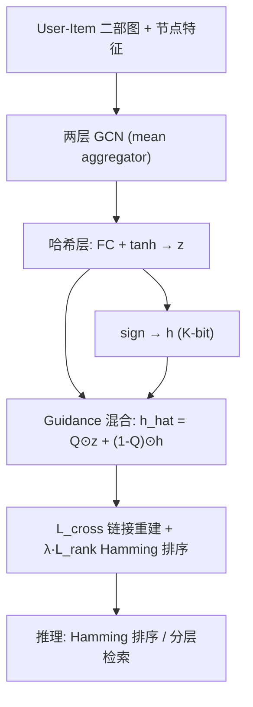
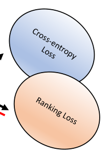

# Learning to Hash with Graph Neural Networks for Recommender Systems (基于图神经网络的推荐哈希学习)

- **会议/期刊**: WWW 2020 (The Web Conference)
- **作者与机构**: Qiaoyu Tan, Ninghao Liu, Xing Zhao, Xia Hu (Texas A&M University)；Hongxia Yang, Jingren Zhou (Alibaba Group)
- **推荐链路定位**: 召回（候选检索）
- **研究方向**: 图神经网络与知识图谱推荐 / 协同过滤与双塔召回
- **论文原文**: [https://arxiv.org/abs/2003.01917v1](https://arxiv.org/abs/2003.01917v1)
- **开源代码**: 暂未开源

## TL;DR (1分钟核心速览)

GNN 召回的瓶颈在于连续 embedding 线性扫描的 $O(Nd)$ 开销。本文提出 HashGNN：GCN 编码器 + tanh 哈希层 + sign 二值化，端到端联合优化「链接重建交叉熵 + Hamming 空间 triplet 排序损失」，并用 Guidance STE（以连续 embedding 随机替换哈希码回传梯度并退火）解决 sign 梯度为零与 STE 梯度放大的矛盾。在 4 个数据集、全库未交互物品排序协议下，HR@50 相对 GraphSage 提升 4.1%–9.8%，Alibaba 上检索耗时降至 1/3.6。

## Background & Motivation (背景与核心矛盾)

- **主流范式**: 用 GraphSage/GCN 在 user-item 二部图上学习连续 embedding，召回阶段做内积全库扫描或 ANN 检索。
- **前人局限**: ① 哈希方法多为「先学连续表征、再 sign 后处理二值化」的两阶段范式，优化目标与实际哈希目标偏离，量化误差大；② 以重建似然为唯一损失的深度哈希不保序，Hamming 球内难以聚合同偏好物品，导致二值检索精度显著低于连续 counterpart（图 1 中 GraphSage 的 HR 曲线远高于 HashNet/LSH）。
- **核心洞察 (Key Insight)**: STE 把 $h$的梯度原样拷回$z$，由于$|z_j|\le 1 = |h_j|$，每步更新尺度被系统性放大（作者以 Lemma 4.1 给出证明），等价于在连续学习问题上持续迈大步，训练抖动、易陷次优。
- **本文切入点**: 既然 STE 与连续学习只差一个梯度放大因子，那就先用连续 embedding 引导训练、再退火回硬 STE。

## Method (核心方法设计)

### 1. 整体框架 (Overall Architecture)

输入 user-item 二部图与节点特征，两层 mean-aggregator GCN 生成 $d$维中间表征$u_i$；全连接哈希层接$\tanh$得到$K$维连续码$z_i$，前向再经$\mathrm{sign}(\cdot)$得$h_i\in\{-1,1\}^K$。训练时哈希码与连续码通过伯努利掩码混合后参与损失计算，反向传播经 Guidance STE 同时更新 GNN 与哈希层参数。推理时输出$h_i$用于 Hamming 检索，$z_i$ 用于候选精细重排，构成「纯哈希检索」与「哈希粗筛 + 连续精排」两种可切换模式。

<figure class="paper-figure" markdown="span">
  <figcaption>图 2：HashGNN 的架构（彩色查看效果更佳）。我们的方法包括两个主要组件：（1）用于学习每个节点 vi 深层表示的图神经网络；（2）带 tanh 激活的全连接哈希层，将深层表示转换为 K 维连续嵌入 zi ∈ R^K，再输入 sign 函数生成 K 位哈希码 hi ∈ {1, −1}^K。整个架构通过联合优化两个损失进行端到端训练，即用于恢复观测链接的交叉熵损失和用于保持相对相似顺序的排序损失。</figcaption>
</figure>

### 2. 关键设计拆解 (Key Designs)

1. **Hamming 空间的排序保持损失**：重建损失只保证邻居相似，不保证「邻居比非邻居更近」。作者采样三元组 $(v_i,v_j,v_m)$（$v_j$为正、$v_m$为负），用内积近似 Hamming 距离（$\mathrm{hamdist}=\frac{1}{2}(K-\langle h_i,h_j\rangle)$），施加 margin 排序约束$\max(0,-\sigma(\langle h_i,h_j\rangle)+\sigma(\langle h_i,h_m\rangle)+\alpha)$。直觉是：仅把相似节点拉近还不够，必须把正样本压进以$v_i$为中心的小 Hamming 球内，二值检索的 top-$n$ 才有意义。
2. **Guidance STE（本文最核心增量）**：针对 STE 梯度放大，训练时用 $\hat{h}_i = Q\odot z_i + (1-Q)\odot h_i,\; Q\sim\mathrm{Bernoulli}(p)$代替纯哈希码进入损失。$p=1$时模型退化为纯 GraphSage 连续学习（易优化），$p$ 每 250 步衰减 5% 直至趋近硬 STE，把原始难解离散问题拆成一串由易到难的子问题。这一形式同时是 Dropout 的变体：以连续值而非零替换激活，起正则作用。
3. **训练目标、负采样与推理开销**：总损失 $\mathcal{L}=\mathcal{L}_{cross}+\lambda\mathcal{L}_{rank}$，负样本从未交互物品中均匀采样，每节点取 5 个三元组，$\lambda=0.5$、$K=32$为默认。推理无需负采样，Hamming 距离可用位运算/多级索引，复杂度由$O(Nd)$浮点乘法降为$O(NK)$ 异或- popcount。

## Experimental Setup & Evaluation Protocol (实验设置与评估协议)

- **数据集与预处理**: 三个公开集 + 一个阿里工业集；二部图仅保留隐式交互（MovieLens 评分二值化为 0/1）。

| 数据集 | #Users | #Items | #Interactions | 稀疏度/密度 | 特征/场景说明 |
| :--- | :---: | :---: | :---: | :---: | :--- |
| MovieLens-1M | 6,040 | 3,952 | 1,000,209 | 4.19% | 电影评分，二值化 |
| Gowalla | 29,585 | 40,981 | 1,027,370 | 0.085% | LBSN 签到，≥10 交互过滤 |
| Pinterest | 55,187 | 9,916 | 1,500,809 | 0.274% | 图像 pin，每用户 ≥20 交互 |
| Alibaba | 601,946 | 4,167,708 | 28,489,957 | 0.0011% | 阿里线上点击/加购/购买 |

- **数据划分与防穿越 (Splitting Strategy)**: 前三个数据集按**每用户随机 70%/10%/20%** 划分 train/valid/test（非时间序）；Alibaba 采用**全局时间戳切分**——前 6 天训练、第 7 天测试，符合线上防穿越要求。
- **排名评测协议 (Ranking Protocol)**: 无偏 **Full-Ranking**——测试时将该用户所有未交互物品作为候选负样本参与全库排序，不做负采样；指标为 HR@50/100 与 NDCG@50/100。
- **对比基线与超参设置**: 基线含网络嵌入类（MF、PTE、BiNE、GraphSage）、哈希类（LSH、HashNet、Hash_gumb、Hash_ste）及两个受控变体（HashGNN_sp 分离训练、HashGNN_nr 去排序损失）。统一两层 GCN（128→68 维），Adam、batch 256、lr 0.001，$K=32$，$\alpha=0.2$。

## Key Experimental Results (实验关键数据)

### 1. 主实验对比 (Main Results)

分层检索（Hierarchical Search，哈希粗筛 + 连续重排）结果：

| 方法 | MovieLens HR@50 | MovieLens N@50 | Gowalla HR@50 | Gowalla N@50 | Pinterest HR@50 | Pinterest N@50 |
| :--- | :---: | :---: | :---: | :---: | :---: | :---: |
| LSH | 0.063 | 0.143 | 0.165 | 0.282 | 0.044 | 0.066 |
| Hash_gumb | 0.136 | 0.234 | 0.264 | 0.452 | 0.098 | 0.104 |
| Hash_ste | 0.145 | 0.249 | 0.331 | 0.485 | 0.126 | 0.127 |
| HashNet | 0.185 | 0.266 | 0.346 | 0.502 | 0.169 | 0.147 |
| MF | 0.187 | 0.276 | 0.345 | 0.504 | 0.041 | 0.104 |
| BiNE | 0.209 | 0.283 | 0.363 | 0.515 | 0.109 | 0.117 |
| GraphSage (连续) | 0.228 | 0.304 | 0.389 | 0.542 | 0.193 | 0.166 |
| **HashGNN** | **0.248** | **0.325** | **0.405** | **0.551** | **0.212** | **0.176** |
| Improv. vs GraphSage | +8.8% | +6.9% | +4.1% | +1.7% | +9.8% | +6.0% |
| Improv. vs HashNet | +34.1% | +22.2% | +17.1% | +9.8% | +25.4% | +19.7% |

工业集 Alibaba（分层检索）：HashGNN HR@50/100 = **5.17%/10.66%**，NDCG@50/100 = **7.75%/12.84%**；超过连续基线 GraphSage（4.73%/9.86%）、最强哈希基线 HashNet（3.63%/7.37%）与 BiNE（3.94%/8.29%）。

推理耗时（秒，全库线性扫描）：

| 数据集 | 连续检索 CeS | 分层检索 HieS | 纯 Hamming HamR |
| :--- | :---: | :---: | :---: |
| MovieLens | 3.8 | 2.8 (×1.3) | 1.5 (×2.5) |
| Pinterest | 73.5 | 41.2 (×1.7) | 27.8 (×2.6) |
| Gowalla | 189.6 | 82.1 (×2.3) | 66.1 (×2.8) |
| Alibaba | 15181.7 | 4295.8 (×3.5) | 4163.9 (×3.6) |

### 2. 消融实验 (Ablation Study)

分层检索 HR@50：

| 变体 | MovieLens | Gowalla | Pinterest | 说明 |
| :--- | :---: | :---: | :---: | :--- |
| **HashGNN (Full)** | **0.248** | **0.405** | **0.212** | 完整模型 |
| w/o Ranking Loss (HashGNN_nr) | 0.223 | 0.378 | 0.189 | 仅链接重建 |
| w/o Guidance (Hash_ste) | 0.145 | 0.331 | 0.126 | 标准 STE |
| w/o Joint Training (HashGNN_sp) | 0.108 | 0.219 | 0.052 | 两阶段，先 GraphSage 后哈希层 |
| w/o Rank. & Joint (HashNet) | 0.185 | 0.346 | 0.169 | 连续松弛 + 后二值化 |
| w/o 二值化 (GraphSage) | 0.228 | 0.389 | 0.193 | 纯连续表征上界参照 |

### 3. 关键实验发现 (Key Findings)

1. **Guidance STE 是最大增益来源，而非排序损失**：MovieLens 上从 Hash_ste 的 0.145 提升到 HashGNN_nr 的 0.223（+53.8%），远超排序损失带来的 0.223→0.248（+11.2%）。这定量印证了「离散优化的梯度噪声才是二值哈希落后于连续嵌入的主因」，而非目标函数缺失保序性。
2. **联合训练不可替代**：HashGNN_sp（先训练 GraphSage 再训哈希层）仅 0.108，说明哈希层不能脱离 GNN 表征独立拟合，端到端反传是二值码可用的前提；而 $p$分析显示$p$固定或$p<0.5$ 时性能下降，动态退火显著最优。
3. **效率与精度非零和**：Alibaba 上纯 Hamming 检索 4163.9s，仅为连续检索 15181.7s 的 1/3.6，而 HR@50 反而高于 GraphSage（5.17% vs 4.73%），说明排序损失把「保序信息」编码进了二值码；$K$从 16 增至 64 时 HR@100 单调上升但边际递减，$K=32$ 是性价比拐点。

## Highlights & Limitations (亮点、对比与审稿批判)

- **与代表作对比 (vs. Prior Work)**: 相比 LSH/两阶段哈希，本文把量化误差纳入端到端优化；相比 HashNet 的 $\tanh(\beta z)$连续松弛，本文前向始终输出严格$\pm 1$ 码，不存在训练-推理目标不一致；相比标准 STE，用退火式连续引导把梯度放大问题转化为课程学习问题，这是最主要的理论/工程增量。
- **可迁移亮点**: ①「连续–离散混合激活 + 概率退火」可迁移到语义 ID 量化、RQ-VAE 码本坍缩等生成式推荐的离散瓶颈；②在召回目标里显式加入 triplet 保序项，可推广到任何以 Hamming/量化距离为度量空间的检索场景。
- **审稿级局限批判**: ① 前三个数据集的 70%/10%/20% 是**随机划分而非时间切分**，存在未来交互泄漏风险，只有 Alibaba 做了时间切分，削弱了公开集结论的外部效度；② 效率对比全部基于**单机 Python 线性扫描**，未使用多表 LSH/IVF 索引，$O(N)$扫描对十亿级物品的真实加速比可能被高估；③ 二值码表达容量受$K$ 强约束（默认仅 32 bit），在长尾/高基数物品集上的召回上限未做分桶分析。

## Rating (四维评分)

- **方法创新性 (Novelty)**: ⭐⭐⭐⭐ （Guidance STE 从梯度放大角度重释离散优化难点，并给出 Lemma 4.1 的定量论证，思路简洁且有别于 HashNet 的连续松弛路线）
- **评估协议与实验扎实度 (Protocol & Experiments)**: ⭐⭐⭐⭐ （采用无偏 Full-Ranking 且覆盖阿里工业集与耗时对比，但公开集随机划分未做时间切分、缺少显著性检验与长尾分桶）
- **写作与数学规范度 (Clarity & Rigor)**: ⭐⭐⭐⭐ （符号统一、Lemma 证明清晰，Hamming 与内积的关系交代到位；但 $Q$混合后的前向一致性与$p$ 退火调度理论依据略简）
- **工业落地与复现价值 (Industrial & Practical Value)**: ⭐⭐⭐⭐⭐ （哈希检索天然支持位运算与多级索引，实测 3.5–3.6 倍加速且精度不降，对大规模召回的工程收益直接；遗憾未开源）

