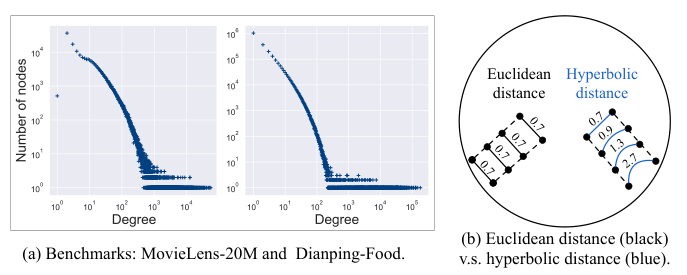
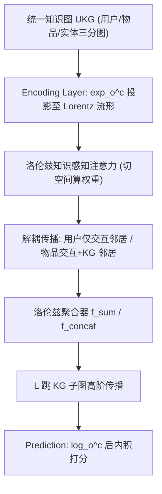

# Modeling Scale-free Graphs with Hyperbolic Geometry for Knowledge-aware Recommendation (基于双曲几何的无标度图建模知识感知推荐)

- **会议/期刊**: WSDM 2022
- **作者与机构**: Yankai Chen, Menglin Yang, Yingxue Zhang, Mengchen Zhao, Ziqiao Meng, Jianye Hao, Irwin King（香港中文大学 / 华为诺亚方舟实验室）
- **推荐链路定位**: 召回（用户-物品匹配打分）
- **研究方向**: 图神经网络与知识图谱推荐 / 冷启动与长尾推荐
- **论文原文**: [https://arxiv.org/abs/2108.06468v3](https://arxiv.org/abs/2108.06468v3)
- **开源代码**: 暂未开源

## TL;DR (1分钟核心速览)

知识图谱增强推荐通常把用户-物品交互与 KG 拼成三分图，但这类图是**无标度（幂律/层级）**的，欧氏空间对树状数据的嵌入畸变高。本文提出 LKGR：把节点投影到**洛伦兹双曲流形**（曲率可学习），在切空间做知识感知注意力，并对用户（仅交互邻居）与物品（交互邻居 + KG 实体）设计**解耦的双通道传播**，最后在对数映射后的切空间内积打分。三个真实数据集上（6:2:2 随机划分、1:1 负采样训练），Recall@20 相对最优基线提升 3.61%–15.32%。

## Background & Motivation (背景与核心矛盾)

- **主流范式**: KGCN / KGNN-LS / CKAN 等把交互图与 KG 统一为三分图，在欧氏空间上用 GCN 做邻域聚合，再把用户/物品嵌入做内积匹配。
- **前人局限一（几何失配）**: 真实三分图度分布近似幂律（图 1(a) 显示 MovieLens-20M 与 Dianping-Food 均如此），按 Bourgain 定理，欧氏空间无法对树状数据给出低畸变嵌入；欧氏距离对节点"位置"不敏感，无法区分靠近图心的 hub 与边界叶子。
- **前人局限二（信息同质化）**: KGCN/KGNN-LS 主要挖掘 KG 侧信息，KGAT 依赖 KG 补全式的正则化训练；这些方法对用户-物品交互信号与 KG 知识做**无差别卷积**，忽略了三分图中节点类型的异构性。
- **核心洞察 (Key Insight)**: 双曲空间体积指数增长，天然是"连续树空间"；度数大的节点像树根居于中心、度数小的节点像叶子贴近边界，测地距离随位置指数变化（图 1(b)），恰好契合无标度图。
- **本文切入点**: 用洛伦兹模型（数值稳定、便于线性变换）承载嵌入，并把"交互信号"与"知识信号"分离后再融合。

<figure class="paper-figure" markdown="span">
  <figcaption>图1：(a) 两个真实世界基准的度分布。(b) 欧几里得空间与双曲空间中的距离比较。</figcaption>
</figure>

## Method (核心方法设计)

### 1. 整体框架 (Overall Architecture)

输入为统一知识图 $\mathcal{G}=\{(h,r,t)\mid h,t\in\mathcal{E}\cup\mathcal{U}\}$。Encoding Layer 把欧氏初始化嵌入经指数映射抬到洛伦兹流形$\mathbb{H}^{d,c}$（曲率$-1/c$作为可训练变量，动态衡量层级强度）；Attentive Lorentzian Convolutional Layer 分别对用户、物品采样 ego-network 子图，在切空间做加权线性组合后经指数映射回到流形；对物品再做$L\le 2$跳 KG 子图的高阶知识抽取；Prediction Layer 把双曲嵌入$\log_o^c(\cdot)$拉回原点切空间做内积，输出$\hat{y}_{u,i}$。训练用交叉熵 +$L_2$ 正则，推理时按分数取 Top-K。

### 2. 关键设计拆解 (Key Designs)

1. **洛伦兹流形嵌入与可学习曲率（解决欧氏畸变）**: 洛伦兹内积 $\langle\boldsymbol{x},\boldsymbol{y}\rangle_{\mathcal{H}}=-x_0y_0+\sum_{i=1}^{d-1}x_iy_i$定义了恒定负曲率空间；欧氏输入$\boldsymbol{x}^{E}$经$\boldsymbol{x}^{H}=\exp_{\boldsymbol{o}}^{c}([0,\boldsymbol{x}^{E}])$抬升到流形，反向用$\log_{\boldsymbol{o}}^{c}$落回切空间。关键增量是令$-1/c$ 可学习，让模型自行调节"层级有多深"——稠密数据集倾向浅曲率、稀疏层级数据倾向强曲率，避免人工调几何先验。

2. **洛伦兹知识感知注意力 + 异构解耦传播（解决信息同质化）**: 注意力在原点切空间计算 $\pi(h,r,t)=\log_{\boldsymbol{o}}^{c}(\boldsymbol{h})^{\top}\boldsymbol{W}_{r}\log_{\boldsymbol{o}}^{c}(\boldsymbol{t})$，再对 $h$的邻居 softmax 归一化；关系特定的$\boldsymbol{W}_r$让同一物品的不同 KG 边（ActedBy / Genre）获得不同贡献度。传播上用户只聚合物品邻居$\boldsymbol{s}_{\mathcal{N}(u)}=\exp_{\boldsymbol{u}}^{c}\big(\sum_{i\in\mathcal{N}(u)}\hat{\pi}(u,r^{*},i)\log_{\boldsymbol{u}}^{c}(\boldsymbol{i})\big)$，物品则拼接交互项与 KG 项两条和式，实现"协同信号 + 知识信号"的显式分离后再融合。直觉：物品同时是"被消费对象"和"知识实体"，同质卷积会让 KG 语义淹没直接的协同证据。

3. **训练目标、负采样与推理效率**: 损失为逐用户的交叉熵差式 $\mathcal{L}=\sum_{u}\big(\sum_{i\in\mathcal{S}_u^{+}}\mathcal{J}(y_{u,i},\hat{y}_{u,i})-\sum_{i\in\mathcal{S}_u^{-}}\mathcal{J}(y_{u,i},\hat{y}_{u,i})\big)+\lambda\|\Theta\|_2^2$，训练时令$|\mathcal{S}_u^{+}|=|\mathcal{S}_u^{-}|$做 **1:1 均匀负采样**并逐 epoch 刷新。打分$\hat{y}_{u,i}=(\log_{\boldsymbol{o}}^{c}(\boldsymbol{u}))^{\top}\log_{\boldsymbol{o}}^{c}(\boldsymbol{i})$保持欧氏内积形式，可直接接入现有 ANN 检索。复杂度$O(\alpha Y(|\mathcal{N}(u)|+|\mathcal{N}_{UI}(i)|+|\mathcal{N}_{KG}(i)|^{L}))$，采样邻居数$\le 8$。

## Experimental Setup & Evaluation Protocol (实验设置与评估协议)

- **数据集与预处理**:

| 数据集 | #Users | #Items | #Interactions | #KG triples | 场景说明 |
| :--- | :---: | :---: | :---: | :---: | :--- |
| Book-Crossing | 17,860 | 14,967 | 139,746 | 151,500 (25 关系) | 图书评分，最稀疏 |
| MovieLens-20M | 138,159 | 16,954 | 13,501,622 | 499,474 (32 关系) | 电影评分 |
| Dianping-Food | 2,298,698 | 1,362 | 23,416,418 | 160,519 (7 关系) | 点评商户（点击/收藏/购买），物品极稀缺 |

- **数据划分与防穿越 (Splitting Strategy)**: **随机比例划分 6:2:2**，重复 5 次取平均与标准差；非时间戳切分，故不存在严格意义上的未来穿越防护，但也无法评估时序泛化。
- **排名评测协议 (Ranking Protocol)**: 使用 Recall@K 与 NDCG@K（K∈{1,5,10,20,50,100}），主表报 Top-20；按预测分对候选物品排序。**原文未明确声明是否过滤训练集已交互物品**，从指标量级推断接近全库排序，但该细节缺失构成复现歧义；训练阶段负采样比例为 1:1。
- **对比基线与超参设置**: 三类基线共 8 个——CF 类（BPRMF、NFM）、正则化类（CKE、KGAT）、传播类（RippleNet、KGCN、KGNN-LS、CKAN）。Adam 优化，学习率网格 $\{10^{-3},5\times10^{-2},10^{-2},5\times10^{-1}\}$，$L_2$系数$\{10^{-6}\sim10^{-3}\}$，嵌入维度$\{8,16,32,64,128\}$网格搜索；显著性用 Wilcoxon signed-rank 检验（$p<0.05$，表中以$*$ 标注）。

## Key Experimental Results (实验关键数据)

### 1. 主实验对比 (Main Results)

| Model | Book R@20 | Book N@20 | Movie R@20 | Movie N@20 | Rest. R@20 | Rest. N@20 |
| :--- | :---: | :---: | :---: | :---: | :---: | :---: |
| BPRMF | 4.67 | 2.80 | 20.48 | 15.77 | 19.90 | 10.79 |
| NFM | 3.93 | 2.17 | 19.79 | 14.28 | 23.85 | 12.48 |
| CKE | 4.38 | 2.24 | 21.52 | 15.73 | 22.24 | 12.09 |
| RippleNet | 7.12 | 5.09 | 13.74 | 9.77 | 21.20 | 10.99 |
| KGCN | 7.85 | 5.93 | 19.24 | 13.87 | 19.03 | 9.34 |
| KGNN-LS | 8.51 | 6.06 | 20.20 | 15.49 | 15.52 | 7.92 |
| KGAT | 5.34 | 3.01 | 21.80 | 16.81 | 15.57 | 7.67 |
| CKAN | 6.19 | 3.47 | 17.48 | 12.48 | 24.10 | **13.33** |
| **LKGR** | **9.48\*** | **6.50\*** | **25.14\*** | **18.34\*** | **24.97\*** | 10.45 |
| Improv. | +11.40% | +7.26% | +15.32% | +9.10% | +3.61% | −21.6% |

### 2. 消融实验 (Ablation Study)

| 变体 | Book R@20 (Δ) | Movie R@20 (Δ) | Rest. R@20 (Δ) | Movie N@20 (Δ) |
| :--- | :---: | :---: | :---: | :---: |
| w/o IS（去交互传播） | 4.75 (−49.9%) | 12.45 (−50.5%) | 11.22 (−55.1%) | 8.76 (−52.2%) |
| w/o KE（去 KG 抽取） | 5.79 (−38.9%) | 11.73 (−53.3%) | 9.86 (−60.5%) | 7.92 (−56.8%) |
| w/o HG（退回欧氏） | 8.11 (−14.5%) | 22.19 (−11.7%) | 21.47 (−14.0%) | 15.47 (−15.7%) |
| w/o LKA（注意力置 1） | 8.35 (−11.9%) | 23.94 (−4.8%) | 23.17 (−7.2%) | 17.03 (−7.1%) |
| LKGR（全量） | **9.48** | **25.14** | **24.97** | **18.34** |

### 3. 关键实验发现 (Key Findings)

1. **双曲几何是"锦上添花"而非"雪中送炭"**：在保留完整传播逻辑的前提下仅把算子换成欧氏（w/o HG），Movie 上 Recall@20 就从 25.14 掉到 22.19（−11.7%），NDCG@20 掉 15.7%；但删掉交互信号（w/o IS）损失高达 50%，说明**几何适配的价值量级远小于信息源本身**，双曲是"同等信息下少掉点"的增益。
2. **异构解耦传播的双通道缺一不可**：去掉 KG 抽取（w/o KE）后 Movie Recall 腰斩（−53.3%）、Restaurant 掉 60.5%，说明在物品数极少的点评场景中，KG 几乎是唯一可扩展的物品表征来源；反过来移除交互通道同样掉一半，证明二者是互补而非替代关系。
3. **排序内序能力仍是短板**：Restaurant 上 LKGR 的 Recall@20 领先 CKAN 3.61%，但 NDCG@20 落后 21.6%（10.45 vs 13.33），作者自承"能召回但未能精细刻画列表内序"；同时深度 $L$需按数据集调（Book/Restaurant 最优$L=1$，Movie 最优$L=2$），$L=3$ 全面下滑（Movie 25.14→21.48），过平滑与远距离噪声知识同时发作。

## Highlights & Limitations (亮点、对比与审稿批判)

- **与代表作对比 (vs. Prior Work)**: 相比 KGCN/KGNN-LS（仅挖 KG 侧、欧氏聚合），LKGR 显式分离交互与知识两条通道并把几何搬到洛伦兹流形；相比 KGAT（正则化式联合训练 + TransR 补全，Movie 21.80），LKGR 不依赖 KG 补全任务即达 25.14；相比 HyperKnow 等 Poincaré-ball 方案（仍属正则化范式），LKGR 是首个把**传播式 GCN 整体搬进洛伦兹模型**的工作，规避了 Poincaré 球坐标运算的数值不稳定。
- **可迁移亮点**: (1) "曲率可学习"的指数/对数映射封装，可直接套到双塔召回的双曲 embedding 头，推理侧只需一次 $\log_o^c$后接内积，无需改 ANN 索引；(2) 用户/物品差异化邻居集合 + 关系特定$\boldsymbol{W}_r$ 注意力的写法，可迁移到任意异质图推荐。
- **审稿级局限批判**: (1) **效率并不占优**——每 epoch 训练耗时 43.26/250.88/337.10 s，Movie 上比 KGCN（15.27 s）慢约 16 倍，双曲算子需在切空间与流形间反复 exp/log，工业规模下开销敏感；(2) **评测协议披露不足**：未说明候选集是否过滤训练交互、未报告维度 $d$ 与最终曲率取值，且 Restaurant 的 NDCG 显著劣化被轻描淡写为"未来工作"，削弱结论的完整性。

## Rating (四维评分)

- **方法创新性 (Novelty)**: ⭐⭐⭐⭐ （首个把传播式 GCN 完整移植到洛伦兹流形做 KG 推荐，异构解耦传播与切空间注意力在机制上有实质新意，但"双曲建模层级图"本身非首创）
- **评估协议与实验扎实度 (Protocol & Experiments)**: ⭐⭐⭐ （三个跨域数据集 + 5 次重复 + Wilcoxon 检验与完整消融较扎实，但候选集过滤规则未披露、缺时序切分与冷启动专项评测）
- **写作与数学规范度 (Clarity & Rigor)**: ⭐⭐⭐⭐ （洛伦兹内积、指数/对数映射、聚合算子与复杂度分析链条完整自洽，但部分符号排版与聚合器记号略显冗余）
- **工业落地与复现价值 (Industrial & Practical Value)**: ⭐⭐⭐ （推理只需切空间内积、可复用现有检索架构是加分项，但训练慢一个数量级、代码未开源，短中期难以直接上线）

