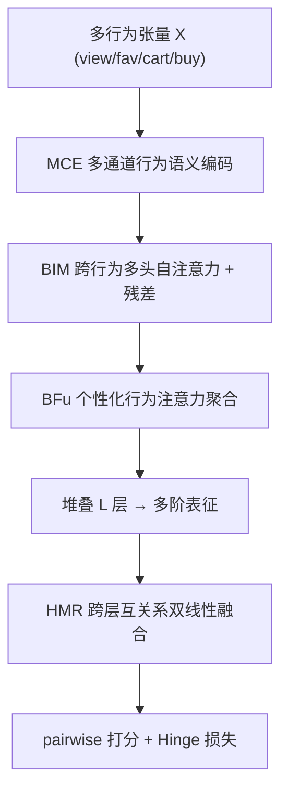
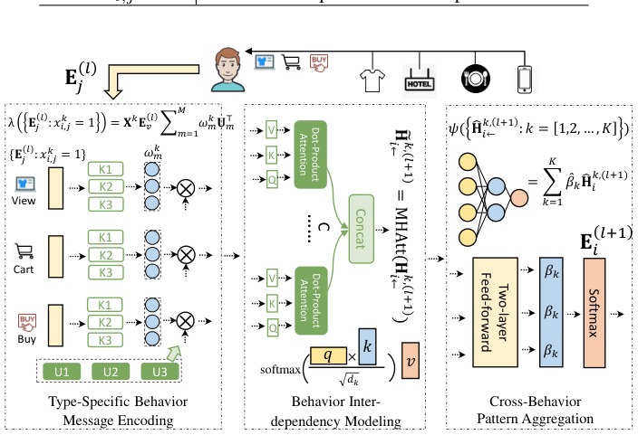

# Multi-Behavior Graph Neural Networks for Recommender System (多行为图神经网络推荐)

- **会议/期刊**: WSDM 2022（正式刊于 IEEE TNNLS 2022，arXiv 2302.08678）
- **作者与机构**: Lianghao Xia, Chao Huang (HKU), Yong Xu (SCUT), Peng Dai, Liefeng Bo (JD Silicon Valley)
- **推荐链路定位**: 召回 / 协同过滤全库打分
- **研究方向**: 图神经网络与知识图谱推荐 / 多行为增强协同过滤
- **论文原文**: [https://arxiv.org/abs/2302.08678v1](https://arxiv.org/abs/2302.08678v1)
- **开源代码**: [https://github.com/akaxlh/MBRec](https://github.com/akaxlh/MBRec)

## TL;DR (1分钟核心速览)

针对单行为协同过滤抹掉"浏览 / 收藏 / 加购 / 购买"类型语义的痛点，本文提出 MBRec：以多通道行为编码刻画类型专属语义、以多头自注意力挖掘跨行为依赖、以跨层互关系编码自适应融合各跳表征。在 Tmall / BeiBei / IJCAI 三数据集上按 Leave-One-Out 划分、1 正 99 负采样排序评估，HR@10 达 0.444 / 0.670 / 0.554，相对最强基线提升 4.7%–6.7%。

## Background & Motivation (背景与核心矛盾)

- **主流范式**: GNN-based CF（NGCF、ST-GCN）在 user-item 二部图上做高阶消息传递；多行为工作（NMTR、MATN、MBGCN）把辅助行为作为额外通道或按预定义级联关系（click→cart→buy）做多任务联合训练。
- **前人局限**: (i) 级联依赖是人工先验，真实场景中"收藏不加购""加购后退货"普遍存在，预设顺序会把噪声当作信号；(ii) 多数模型把 K 类行为边压进同一邻接矩阵或只看最高层输出，既丢失行为类型语义，也丢弃低阶协同信号。
- **核心洞察 (Key Insight)**: 多行为图本质是 multiplex 图——行为类型既是边标签，又存在跨类型统计相关；且不同用户对不同跳数邻域的依赖不同（有人靠 1 跳即时证据，有人靠 2 跳兴趣扩散）。
- **本文切入点**: 按"行为内 → 行为间 → 层级间"三级依赖显式分层建模，全部依赖权重由数据学习而非预设。

## Method (核心方法设计)

### 1. 整体框架 (Overall Architecture)

输入为三阶交互张量 $\mathbf{X}\in\mathbb{R}^{I\times J\times K}$，先用 Autoencoder 预训练得到低维初始嵌入$\mathbf{E}^{(0)}$；每一图层的处理顺序为：多通道行为语义编码（MCE，按行为类型生成消息）→ 跨行为多头自注意力加残差（BIM，重标定各行为消息）→ 个性化行为注意力聚合（BFu，融合为单节点嵌入）；如此堆叠$L$ 层得到多阶表征；最后由跨层互关系编码（HMR）在所有层对之间做双线性打分与张量式融合，经 FFN 输出 pairwise 打分，用 Hinge 损失训练。训练时以随机游走式图采样生成稠密子图，避免全批聚合的开销。

<figure class="paper-figure" markdown="span">
  <figcaption>图2：多行为图依赖建模。</figcaption>
</figure>

### 2. 关键设计拆解 (Key Designs)

1. **多通道行为语义编码 (MCE)**：把 K 类行为边混进一张邻接矩阵会让"浏览"与"购买"权重不可区分。MCE 为行为 $k$维护$M$个通道变换，权重由邻居聚合结果动态生成：$\mathbf{H}^{k,(l+1)}_{i\leftarrow}=\sum_{m=1}^{M}\omega^{k}_{m}\mathbf{U}_{m}\sum_{x^{k}_{i,j}=1}\mathbf{E}^{(l)}_{j}$，其中$\omega^{k}_{m}=\delta(\mathbf{K}\sum_{x^{k}_{i,j}=1}\mathbf{E}^{(l)}_{j}+\mathbf{b})^{(m)}$。直觉上这是 behavior-conditioned 的维度级门控：同一用户在不同行为子空间里应被投影到不同语义基。
2. **跨行为依赖建模 + 个性化聚合 (BIM / BFu)**：痛点是不再信任人工级联顺序。把 $K$条行为消息当作$K$个 token 做多头自注意力并残差保留原语义，$\hat{\mathbf{H}}^{k}_{i\leftarrow}=\text{MH-Att}(\mathbf{H}^{k}_{i\leftarrow})+\mathbf{H}^{k}_{i\leftarrow}$；再用两层 FFN 打分$\hat{\beta}_{k}=\text{softmax}\big(w_{2}^{\top}\delta(W_{1}\hat{\mathbf{H}}^{k}_{i\leftarrow}+b_{1})+b_{2}\big)$，$\mathbf{E}^{(l+1)}_{i}=\sum_{k=1}^{K}\hat{\beta}_{k}\hat{\mathbf{H}}^{k}_{i\leftarrow}$。$\hat{\beta}$ 直接刻画"该用户更信任哪种行为"，替代了 MBGCN 的固定通道权重。
3. **跨层互关系编码 (HMR)**：GNN 固定用最后一层会丢弃低阶信号。先归一化各层嵌入 $\hat{\mathbf{E}}^{(l)}=\mathbf{E}^{(l)}/\sqrt{\|\mathbf{E}^{(l)}\|_{2}^{2}}$，再用$C$头双线性打分跨层对：$\phi^{c}_{l,l'}=\delta\big((\mathbf{P}_{c}\hat{\mathbf{E}}^{(l)}_{i})^{\top}(\mathbf{P}_{c}\hat{\mathbf{E}}^{(l')}_{j})\big)$，并融合$\Gamma_{i,j}=\big\|_{c=1}^{C}\sum_{l=0}^{L}\sum_{l'=0}^{L}\phi^{c}_{l,l'}(\mathbf{T}_{c}\hat{\mathbf{E}}^{(l)}_{i})\circ(\mathbf{T}_{c}\hat{\mathbf{E}}^{(l')}_{j})$。关键增量在于允许"用户 0 跳 × 物品 2 跳"这类非对称层对组合，把跳数变成可选证据源，而非固定读出。

**训练目标、负采样与推理效率**：$\mathcal{L}=\sum_{i=1}^{I}\sum_{s=1}^{S}\max(1-Pr_{i,p_{s}}+Pr_{i,n_{s}},0)+\lambda\|\Theta\|_{F}^{2}$，每正样本配$S$个均匀负样本（无 hard negative、无对比学习项）。子图采样按$\bar{X}_{i,j}=X_{i,j}/\sqrt{\|X_{i}\|_{1}\|X_{j}\|_{1}}$累积节点权重、以$\bar{P}=P^{2}/\|P\|_{2}^{2}$优先采样高频节点。复杂度主项为$O(|\mathbf{X}|L^{2}d^{2})$（由 HMR 的层对打分贡献），在线仅需$O(d)$ 内积。

## Experimental Setup & Evaluation Protocol (实验设置与评估协议)

- **数据集与预处理**: 三个真实电商数据集，保留全部交互、无 k-core 过滤；目标行为统一为 purchase，其余为辅助行为。

| 数据集 | #Users | #Items | #Interactions | 密度 | 行为类型 |
| :--- | :---: | :---: | :---: | :---: | :--- |
| Tmall | 147,894 | 99,037 | 7,658,926 | 0.052% | view, fav, cart, buy |
| BeiBei | 21,716 | 7,977 | 3,338,068 | 0.193% | view, cart, buy |
| IJCAI | 423,423 | 874,328 | 36,203,512 | 0.0096% | view, fav, cart, buy |

- **数据划分与防穿越**: `Leave-One-Out`——每个用户最后一次 target 行为（购买）交互作测试正样本，其余为训练集，无时间戳切分。
- **排名评测协议**: `Sampled Ranking`——为每用户从全库非交互物品中随机抽 99 个负样本，与 1 个正样本混排，报告 HR@N / NDCG@N；主表 $N=10$，另给 @5/@20/@50 与负样本数 {400…6400} 的敏感性分析（非 Full-Ranking，存在采样偏差）。
- **对比基线与超参设置**: 覆盖 MF（BiasMF）、神经 CF（NCF/DMF）、自编码器（AutoRec/CDAE）、自回归（NADE/CF-UIcA）、GNN（NGCF/ST-GCN）、多行为（NMTR/DIPN/MBGCN/MATN/NGCF+M）及作者前作 GNMR，共 16 个基线。$d=16$、通道数 8、注意力头 2、$L=2$、lr=1e-3、batch=32、weight decay 网格 {0.05, 0.01, 0.005, 0.001}。原文未报告显著性检验（仅给相对提升百分比）。

## Key Experimental Results (实验关键数据)

### 1. 主实验对比 (Main Results)

| 模型 | BeiBei HR | BeiBei NDCG | Tmall HR | Tmall NDCG | IJCAI HR | IJCAI NDCG |
| :--- | :---: | :---: | :---: | :---: | :---: | :---: |
| BiasMF | 0.588 | 0.333 | 0.262 | 0.153 | 0.285 | 0.185 |
| NCF | 0.595 | 0.332 | 0.319 | 0.191 | 0.449 | 0.284 |
| AutoRec | 0.607 | 0.341 | 0.313 | 0.190 | 0.448 | 0.287 |
| NGCF | 0.611 | 0.375 | 0.302 | 0.185 | 0.461 | 0.292 |
| MBGCN | 0.642 | 0.376 | 0.369 | 0.222 | 0.463 | 0.277 |
| MATN | 0.626 | 0.385 | 0.354 | 0.209 | 0.489 | 0.309 |
| GNMR (前作) | 0.631 | 0.380 | 0.424 | 0.249 | 0.519 | 0.312 |
| **MBRec** | **0.670** | **0.402** | **0.444** | **0.262** | **0.554** | **0.338** |
| Improv.% vs 最强基线 | +6.18% | +5.79% | +4.72% | +5.22% | +6.74% | +8.33% |

### 2. 消融实验 (Ablation Study)

| 变体 | BeiBei HR/NDCG | Tmall HR/NDCG | IJCAI HR/NDCG |
| :--- | :---: | :---: | :---: |
| w/o-MCE（去多通道编码） | 0.6549 / 0.3876 | 0.4399 / 0.2580 | 0.5420 / 0.3289 |
| w/o-BIM（去跨行为注意力） | 0.6696 / 0.4000 | 0.4391 / 0.2554 | 0.5358 / 0.3228 |
| w/o-BFu（均值池化替代注意力聚合） | 0.6572 / 0.3907 | 0.4238 / 0.2487 | 0.5494 / 0.3321 |
| w/o-HMR（仅取最高层读出） | 0.6169 / 0.3470 | 0.3856 / 0.2240 | 0.3445 / 0.1760 |
| **MBRec** | **0.6701 / 0.4021** | **0.4435 / 0.2624** | **0.5535 / 0.3376** |

### 3. 关键实验发现 (Key Findings)

1. **HMR 是绝对主力且收益随图规模放大**：去掉跨层互关系后 IJCAI 的 HR@10 从 0.5535 崩到 0.3445（-37.8%）、NDCG 近乎腰斩（0.3376→0.1760）；但在最小的 BeiBei 只降 7.9%（0.6701→0.6169）——稀疏大图上单靠最高层嵌入严重信息不足，层对融合才是救命稻草。
2. **行为类型越多，个性化聚合越值钱**：4 行为的 Tmall 上去掉 BFu 使 HR 降 4.4%（0.4435→0.4238），IJCAI 上 NDCG 降 1.6%；而 3 行为的 BeiBei 仅降 1.9%。同时表 VII 显示 $L=2$最优、$L=3$在 Tmall 反降至 0.408（过平滑），通道数 8 最佳（16 时 BeiBei 0.670→0.646），$d=16$。
3. **精度提升不以效率为代价**：单轮训练 Tmall 58.6s、IJCAI 101.1s，低于 MBGCN（85.3s / 186.5s）与 MATN（74.7s / 196.5s），接近 NGCF+M；采样子图规模实验显示"训练子图变大并非总是更好"（训练 5k 节点 HR 0.365 vs 40k 节点 0.322 于 5k 测试子图），小采样起正则化作用，而测试子图越大分数越高（5k→60k 时 HR 0.365→0.552）。

## Highlights & Limitations (亮点、对比与审稿批判)

- **与代表作对比**: NGCF+M 只是把多行为塞进单图消息传递，MBGCN 用固定通道权重在同构图上卷积，MATN 依赖预定义行为转移且无高阶传播；MBRec 首次把"行为内 / 行为间 / 层间"三级依赖拆开分别参数化。相较作者前作 GNMR（已含多通道 + 自注意力），本文增量就是 HMR，仍换来 Tmall HR +4.7%、IJCAI NDCG +8.3% 的稳定增益。
- **可迁移亮点**: (a) 把不同行为/场景/目标的特征组视为 token 做跨组自注意力，可直接迁移到多场景多目标融合；(b) 双线性跨层打分 $\phi_{l,l'}$是替换 GNN "固定 last-layer 读出" 的通用即插件，仅$O(L^2)$ 额外开销。
- **审稿级局限批判**: (i) 仅报告 1 正 99 负的 Sampled Ranking 与 Leave-One-Out，缺少 Full-Ranking 与全局时间切分，热门物品易被高估，且无显著性检验——w/o-BIM 在 BeiBei 的 0.07% 差异不足以下结论；(ii) Tmall 用户数在正文写作 47,894、表格写作 147,894，数据统计自相矛盾；HMR 的 $L^{2}$层对打分对层数/维度敏感（$L=3$ 即过平滑），超参迁移成本高；(iii) 未建模行为的时间顺序与因果效应（作者在结论中亦承认留作 future work），"收藏→购买"的时序因果被当成静态相关处理。

## Rating (四维评分)

- **方法创新性 (Novelty)**: ⭐⭐⭐⭐ （三级依赖分层建模思路清晰，HMR 的跨层双线性打分是相对 GNMR/MBGCN 的实在增量，但多通道 + 自注意力骨架与作者前作高度重叠）
- **评估协议与实验扎实度 (Protocol & Experiments)**: ⭐⭐⭐ （三数据集 × 16 基线 + Top-N/负样本数/稀疏度/超参/效率多角度分析完整，但仅 1:99 采样排序、无 Full-Ranking 与显著性检验，数据统计存在笔误）
- **写作与数学规范度 (Clarity & Rigor)**: ⭐⭐⭐⭐ （公式与符号表齐备、复杂度分析到项，图 2/图 3 与公式一一对应；但部分符号如 $\lambda(\cdot)$与正则系数$\lambda$重名、$L$与$l$ 混用）
- **工业落地与复现价值 (Industrial & Practical Value)**: ⭐⭐⭐⭐ （代码开源、图采样算法可直接支撑亿级行为图，训练效率优于 MBGCN，但线上需维护 K 套行为邻接与 $L^{2}$ 层对打分，工程复杂度不低）

