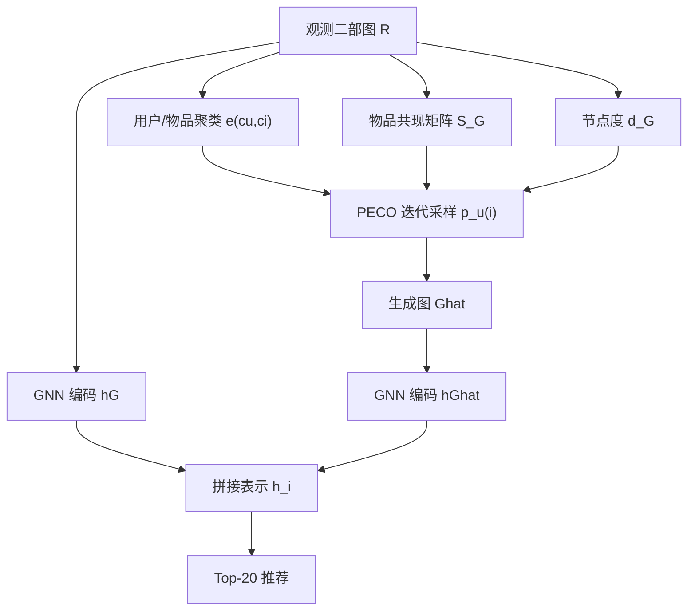
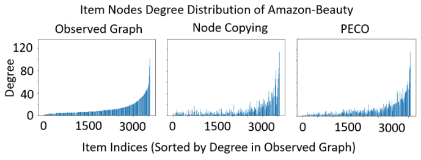

# Preference and Concurrence Aware Bayesian Graph Neural Networks for Recommender Systems (偏好与共现感知的贝叶斯图神经网络推荐)

- **会议/期刊**: WSDM 2022
- **作者与机构**: Hongjian Gu, Yaochen Hu, Yingxue Zhang；Huawei Technologies Canada
- **推荐链路定位**: 召回（Top-N 排序）
- **研究方向**: 图神经网络与知识图谱推荐 / 自监督对比学习与交互去噪
- **论文原文**: [论文原文链接](https://arxiv.org/abs/2312.11486v2)
- **开源代码**: 暂未开源

## TL;DR (1分钟核心速览)

针对 BGNN 的 Node-Copy 只能复制已有用户物品集、无法生成新组合且忽略结构先验，本文提出 PECO：联合用户簇偏好、物品共现与节点度约束逐用户迭代采样新图，再与原图经 GNN 编码拼接。四基准 Recall@20 均优于 Multi-GCCF、LightGCN、Node-Copy，较 Node-Copy 最高提升 1.44%；但 MovieLens-1m NDCG@20 仍低于 LightGCN。

## Background & Motivation (背景与核心矛盾)

- **主流范式**: 图协同过滤把用户-物品交互视为二部图，用 GNN 捕获高阶协同信号；BGNN 进一步用图生成模型采样新图，以缓解观测图缺边、假阳性边带来的不确定性。
- **前人局限**: Node-Copy 以用户相似度把某用户的物品集整体替换为另一用户的物品集，只能产生“已有物品组合”，无法生成未见过的用户-物品边；同时无法注入物品共现、节点度等推荐图结构先验，采样图易偏离原图分布。
- **核心洞察 (Key Insight)**: 好的生成图应与观测图共享三类性质——用户偏好一致、物品共现一致、节点度分布一致；三者分别抑制明显假边、保留协同信号、稳定图结构。
- **本文切入点**: 将图生成建模为逐用户条件分布 $p(\hat{R}|G)=\prod_u p_u(\hat{R}_{u*}|G)$，用轻量迭代启发式采样实现偏好、共现与度约束的联合注入。

## Method (核心方法设计)

### 1. 整体框架 (Overall Architecture)

输入观测交互矩阵 $R$，先对用户/物品聚类并统计簇间交互、物品共现矩阵$S_G$与节点度$d_G$。对每个用户$u$，初始化保留$r|N(u)|$个原邻居，再按“簇偏好 + 物品共现”概率迭代补边至$|N(u)|$，得到生成图$\hat{G}$。随后在观测图$G$与采样图$\hat{G}$上分别跑 GNN，节点表示为两者拼接$h_i=h_i^G||h_i^{\hat{G}}$，用于 Top-20 推荐。整体是 BGNN 框架下的生成器替换：不改主干 GNN，只改图采样分布。

### 2. 关键设计拆解 (Key Designs)

1. **用户偏好先验（簇级偏好，避免明显假边）**：Node-Copy 只能复制整组物品，本文先用 $d(u,v)=\langle R_{u*},R_{v*}\rangle/|R_{u*}+R_{v*}|_0$做用户/物品聚类，再以簇间交互数$e(c_u,c_i)$构造偏好分$q_u(i)\propto e(c_u,c_i)d_i^G/|\{j|c_j=c_i\}|$。这样采样仍偏向“该用户簇常交互的物品簇”，但允许产生原图中不存在的新组合。

2. **物品共现先验（保留协同信号）**：定义 $S_{ij}=\langle R_{*i},R_{*j}\rangle/|R_{*i}+R_{*j}|_0$，并以$s_{\hat{S}_u}(i)=\frac{1}{|\hat{S}_u|}\sum_{j\in\hat{S}_u}S_{ij}$度量待采样物品与当前已采样集合的共现强度。最终采样概率为$p_u(i)\propto q_u(i)+\alpha s_{\hat{S}_u}(i)$；$\alpha$ 控制共现信号强度，使“电视—天线”“花种—花盆”式共现组合更易被保留。

3. **度约束、训练与推理**：初始化保留 $r|N(u)|$个原邻居，再迭代补到$|N(u)|$，因此用户度精确保持；物品度以$E(d_i^{\hat{G}})=d_i^G$为目标，抑制结构漂移。BGNN 在观测图与采样图上联合训练，最终节点表示为$h_i=h_i^G||h_i^{\hat{G}}$。原文未展开总损失、负采样与推理延迟；额外图编码使训练/推理开销高于单图 LightGCN。

## Experimental Setup & Evaluation Protocol (实验设置与评估协议)

- **数据集与预处理**: 原文未提 `5-core` 等过滤，统计如下：

| 数据集 | #Users | #Items | #Interactions | 稀疏度/密度 | 特征/场景说明 |
| :--- | :---: | :---: | :---: | :---: | :--- |
| Amazon-Beauty | 7,068 | 3,750 | 70,506 | 0.299% | 美妆产品评论 |
| MovieLens-1m | 6,034 | 3,247 | 574,631 | 2.932% | 电影评分 |
| yelp2018 | 45,919 | 45,538 | 930,030 | 0.044% | 本地商户评论 |
| Amazon-CDs | 43,169 | 35,648 | 777,426 | 0.051% | CD 类产品评论 |

- **数据划分与防穿越 (Splitting Strategy)**: 每用户随机保留 20% 验证、20% 测试，其余 60% 训练；属于按用户比例划分，非 `Leave-One-Out`，也未做全局时间戳切分，存在时间穿越风险（原文未讨论）。
- **排名评测协议 (Ranking Protocol)**: 指标为 Recall@20、NDCG@20；原文未说明是 `Full-Ranking` 还是采样排序，也未给训练负采样策略，复现需补齐该协议。
- **对比基线与超参设置**: 基线为 Multi-GCCF、LightGCN、Node-Copy；学习率 0.001–0.01、500 epochs、$\alpha\in\{0,10,100,1000\}$、$r\in\{0,0.5\}$（按数据集验证集选取）。未报告嵌入维度$d$ 与显著性检验。

## Key Experimental Results (实验关键数据)

### 1. 主实验对比 (Main Results)

| 数据集 | 方法 | Recall@20 | NDCG@20 |
| :--- | :--- | ---: | ---: |
| Amazon-Beauty | Multi-GCCF | 0.1194 | 0.0654 |
| | LightGCN | 0.1109 | 0.0621 |
| | Node-Copy | 0.1247 | 0.0701 |
| | **PECO** | **0.1265** | **0.0706** |
| | PECO vs 最优基线 | +1.44% | +0.71% |
| MovieLens-1m | Multi-GCCF | 0.2212 | 0.2239 |
| | LightGCN | 0.2238 | **0.2319** |
| | Node-Copy | 0.2223 | 0.2258 |
| | PECO | **0.2245** | 0.2280 |
| | PECO vs 最优基线 | +0.31% | -1.68% |
| yelp2018 | Multi-GCCF | 0.0804 | 0.0481 |
| | LightGCN | 0.0717 | 0.0429 |
| | Node-Copy | 0.0812 | 0.0485 |
| | **PECO** | **0.0820** | **0.0489** |
| | PECO vs 最优基线 | +0.99% | +0.82% |
| Amazon-CDs | Multi-GCCF | 0.1135 | 0.0683 |
| | LightGCN | 0.1055 | 0.0636 |
| | Node-Copy | 0.1167 | 0.0705 |
| | **PECO** | **0.1172** | **0.0708** |
| | PECO vs 最优基线 | +0.43% | +0.43% |

### 2. 消融实验 (Ablation Study)

原文未给逐组件 `w/o` 表；以下按“生成器替换”归纳，可视为图生成模块的消融证据。

| 生成器替换 | Beauty R@20 | ML-1m R@20 | yelp R@20 | CDs R@20 |
| :--- | ---: | ---: | ---: | ---: |
| 无 BGNN 采样（Multi-GCCF） | 0.1194 | 0.2212 | 0.0804 | 0.1135 |
| Node-Copy | 0.1247 | 0.2223 | 0.0812 | 0.1167 |
| PECO | **0.1265** | **0.2245** | **0.0820** | **0.1172** |

### 3. 关键实验发现 (Key Findings)

- **BGNN 采样本身有效**：PECO 相对无采样的 Multi-GCCF，Recall@20 在 Beauty、CDs、yelp、ML-1m 分别提升 5.95%、3.26%、1.99%、1.49%，说明对噪声图做生成式增强能稳定提升图协同过滤。
- **PECO 稳定优于 Node-Copy，但增益幅度有限**：Recall@20 分别提升 1.44%、0.99%、0.99%、0.43%，NDCG@20 提升 0.71%、0.97%、0.82%、0.43%；然而 ML-1m 的 NDCG@20 仍比 LightGCN 低 1.68%，并非全面 SOTA。
- **物品共现先验高度依赖数据集**：最优 $\alpha$ 在 Beauty 为 1000、yelp 为 100、ML-1m/CDs 为 0；MovieLens 几乎不需要共现信号，Beauty 则明显受益。图1进一步显示 PECO 采样图的物品度分布更贴近原图，用户度因同数采样而精确保持。

<figure class="paper-figure" markdown="span">
  <figcaption>图 1：物品度分布。物品索引按原始图中的物品度排序。</figcaption>
</figure>

## Highlights & Limitations (亮点、对比与审稿批判)

- **与代表作对比 (vs. Prior Work)**: Node-Copy 依赖用户相似度复制整组物品，无法生成新物品组合；PECO 用簇偏好、共现与度约束生成新边，灵活性更高。相比 LightGCN，BGNN/PECO 显式建模图不确定性，但 ML-1m NDCG 仍输给 LightGCN，说明增益依赖数据噪声形态。
- **可迁移亮点**: 簇级偏好先验可迁移到冷启动/长尾图增广；共现加权采样可用于会话推荐、篮子推荐等需要保留组合关系的场景。
- **审稿级局限批判**: 采样器为启发式，$\alpha/r$ 数据集敏感，且未给复杂度与线上延迟；评测未披露全库/采样排序协议与负采样，基线仅 3 个且无显著性检验，复现与工业结论需谨慎。

## Rating (四维评分)

- **方法创新性 (Novelty)**: ⭐⭐⭐ （将用户偏好、物品共现、节点度三先验注入 BGNN 图生成器，思路清晰，但属启发式增量而非端到端学习）
- **评估协议与实验扎实度 (Protocol & Experiments)**: ⭐⭐ （四数据集覆盖尚可，但仅 3 个基线，未报告全库/采样协议、负采样与显著性，ML-1m NDCG 未胜 LightGCN）
- **写作与数学规范度 (Clarity & Rigor)**: ⭐⭐⭐ （生成概率与三类约束公式较清楚，但训练损失、复杂度与逐组件消融缺失）
- **工业落地与复现价值 (Industrial & Practical Value)**: ⭐⭐⭐ （采样器轻量可插拔，但需额外图编码且未开源，线上延迟与调参成本需实测）

