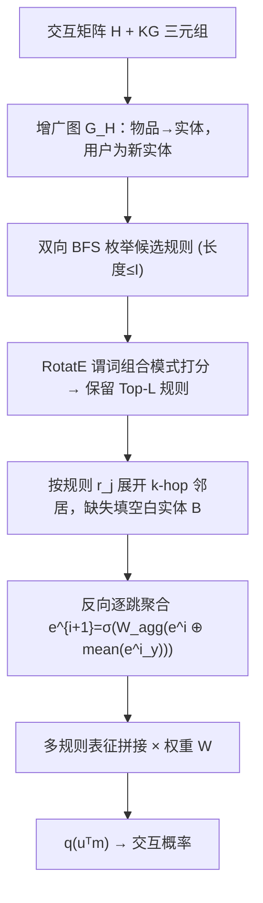
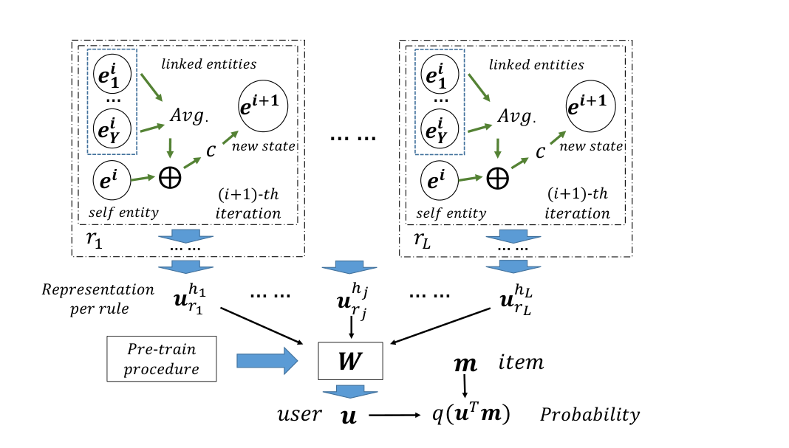

# Rule-Guided Graph Neural Networks for Recommender Systems (规则引导的图神经网络推荐)

- **会议/期刊**: ISWC 2020（第 19 届国际语义网会议；注：任务给定目录标识为 WSDM 2022，实际发表信息以论文为准）
- **作者与机构**: Xinze Lyu, Guangyao Li, Jiacheng Huang, Wei Hu（南京大学计算机软件新技术国家重点实验室）
- **推荐链路定位**: 召回/精排（用户-物品交互概率打分）
- **研究方向**: 图神经网络与知识图谱推荐 / 冷启动与长尾推荐
- **论文原文**: [https://arxiv.org/abs/2009.04104v1](https://arxiv.org/abs/2009.04104v1)
- **开源代码**: [https://github.com/nju-websoft/RGRec](https://github.com/nju-websoft/RGRec)

## TL;DR (1分钟核心速览)

知识图谱增强推荐存在两难：路径/规则类方法能刻画用户-物品间的**显式长程语义**，但只沿规则取信息、丢弃规则外的邻域连通性；聚合式 GNN 方法保留丰富连通性，却因随机采样邻居而引入噪声且无法解释间接邻居关系。RGRec 把二者缝合：先用 RotatE 谓词组合模式自动学习并过滤 `interacts` 推理规则，再让每条规则**引导**一次 GraphSAGE 式的多跳展开-聚合，最后按预训练的规则权重加权拼接。在 Last.FM / MovieLens-1M / Dianping-Food 上，以 1:1 采样的 AUC 与 1 正 100 负采样的 Hits@k/NDCG@k 评测，Dianping-Food AUC 0.884（较 KGCN 0.842 相对 +5.0%），且训练数据仅用 20% 时 AUC 仍达 0.882。

## Background & Motivation (背景与核心矛盾)

- **主流范式**: KG 增强推荐分三派——嵌入式（CKE/MKR 只建模实体直接关系）、路径式（PER 手工元路径、RKGE/KPRN 自动挖路径）、聚合式（RippleNet/KGCN/KGAT 做 k-hop 邻居加权聚合）。
- **前人局限**: ① 嵌入式缺乏长程语义，无法表达"同作曲人→同专辑"式跨跳推理；② 路径式虽精确，但 RKGE/KPRN 官方实现只**随机采样极少量规则**，且忽略规则谓词之外的实体连通性，泛化弱；③ 聚合式为保证效率对中心实体随机采样邻居，间接邻居与中心的显式关系不可知，低质邻居被当作噪声吸收。
- **核心洞察 (Key Insight)**: 规则控制"取哪些实体"（高精度），GNN 聚合控制"如何共享信息"（高泛化），两者是互补而非替代；规则的置信度可由 KG 嵌入的**谓词组合模式**（$\mathbf{p}=\mathbf{p}_1\circ\cdots\circ\mathbf{p}_h$）在复平面上度量，从而绕开 CWA 对 KG 完备性的强假设。
- **本文切入点**: 用自动学到的规则作为 GNN 的**采样先验与表征维度**，一条规则 = 用户表征的一个语义维度。

## Method (核心方法设计)

### 1. 整体框架 (Overall Architecture)

先把物品映射到 KG 实体，并把每个用户作为新实体加入图，补入 $(\text{user},\ \texttt{interacts},\ e)$三元组得到增广图$G_H$；随后对每个 `interacts(s,o)` 用**双向 BFS** 枚举长度$\le I$的连通路径作为候选规则（对每条边补逆谓词使图无向），再用 RotatE 嵌入算规则置信度保留 Top-$L$；训练时对每条规则从用户出发沿谓词逐跳展开固定规模邻居，遇缺失则填空白实体$B$作负反馈，再反向逐跳聚合得到该规则下的用户表征；最后用规则权重$W$ 加权拼接多规则表征，与物品嵌入做内积经 Sigmoid 得交互概率，以平方损失端到端训练。

<figure class="paper-figure" markdown="span">
  <figcaption>图3. RGRec的框架</figcaption>
</figure>

### 2. 关键设计拆解 (Key Designs)

1. **基于 RotatE 谓词组合的规则过滤（解决 CWA 不可靠）**：痛点在于 `interacts` 在推荐场景极度不完备，CWA 置信度会严重失真，而随机采样规则会漏信息。RGRec 借用 RotatE 将谓词视为复平面旋转的假设：若规则 $r: p \Leftarrow p_1\wedge\cdots\wedge p_h$成立，则$\mathbf{p}=\mathbf{p}_1\circ\cdots\circ\mathbf{p}_h$ 应成立，于是
$$\mathrm{conf}(r)=-\left\|\mathbf{p}-\mathbf{p}_1\circ\cdots\circ\mathbf{p}_h\right\|_2 ,$$
按此保留 Top-$L$ 条。直觉：嵌入本身具备补全图的能力，用"谓词向量能否复合"来度量规则合理性，等价于在 KG 不完备时做一次软闭合，而非硬性统计。

2. **单规则引导的展开-聚合（解决邻居采样噪声）**：定义第 $k$跳展开集$D_u^k(r)=\{o\mid (s,p_k,o),\,s\in D_u^{k-1}(r)\}$，$D_u^0(r)=\{u\}$；若某实体无法用第$k$个谓词继续展开，则返回空白实体$B$，为"该规则对$u$不可行"提供显式负反馈。聚合反向外向内执行$i=1..h$ 轮：
$$\mathbf{e}^{i+1}=\sigma\!\left(W_{agg}\left(\mathbf{e}^{i}\oplus \frac{1}{Y}\sum_{y=1}^{Y}\mathbf{e}^{i}_{y}\right)+b\right),$$
最终得到 $u^{h}_{r}$。物理直觉：规则保证"取谁"的精度，GNN 的均值聚合让规则路径上的实体互相共享信息，从而补回规则外连通性。

3. **多规则加权与规则权重预训练（解决规则孤立评估）**：规则置信度只单独衡量某条规则能否解释 `interacts`，忽略规则间的互补/冗余（如同作曲人与同专辑同时命中的增益）。最终表征为
$$u=\left[u^{h_1}_{r_1};u^{h_2}_{r_2};\cdots;u^{h_L}_{r_L}\right]W ,$$
其中 $W\in\mathbb{R}^{L\times 1}$先用 0/1 规则命中特征$X_i\in\{0,1\}^L$做二分类预训练$\mathcal{L}_{pre}=\frac{1}{N}\sum_i\left(l_i-z(W^\top X_i)\right)^2+\lambda\|W\|^2$，再在主损失$\mathcal{L}=\frac{1}{N}\sum_i\left(l_i-q(u_i^\top m_i)\right)^2+\mu\|W\|^2$ 中微调。训练负样本按场景取 1:1（AUC/F1）与 1:100（Top-k 评测）；推理时规则只需预先搜索**一次**，无需在线逐对搜索路径，这是相对 RKGE 的关键效率差异。

## Experimental Setup & Evaluation Protocol (实验设置与评估协议)

- **数据集与预处理**: 三个真实数据集均由 Microsoft Satori 构建 KG，统计如下（实体/谓词/三元组数为补入交互前的原始规模）：

| 数据集 | #Users | #Items | #Interactions | #Entities | #Predicates | #KG triples |
| :--- | :---: | :---: | :---: | :---: | :---: | :---: |
| Last.FM | 1,872 | 3,864 | 42,346 | 9,366 | 60 | 15,518 |
| MovieLens-1M | 6,036 | 2,445 | 753,772 | 182,011 | 12 | 1,241,995 |
| Dianping-Food | 2,298,698 | 1,362 | 23,416,418 | 28,115 | 7 | 160,519 |

- **数据划分与防穿越 (Splitting Strategy)**: 沿用 KGCN/RippleNet 惯例的 `6:2:2` **随机比例划分**，未做全局时间戳切分（存在隐式未来信息泄漏风险）；"冷启动"实验以缩减训练比例（20%/40%/60%）模拟稀疏场景，而非严格的新用户/新物品划分。
- **排名评测协议 (Ranking Protocol)**: 未做 Full-Ranking。CTR 场景用 `1:1` 正负采样的 AUC/F1；Top-k 场景沿用 KPRN 的 `1 正 : 100 负` 采样排序计算 Hits@5/10 与 NDCG@5/10。各实验重复 5 次取均值，未报告显著性检验。
- **对比基线与超参设置**: 基线覆盖三类——经典（SVD、LibFM、LibFM+TransE）、路径式（PER、RKGE）、嵌入/聚合式（CKE、KGCN、KGAT）。规则最大长度 $I=3$、规则数$L=30$、实体嵌入维度$d_r=8$、每实体邻居数$Y=4$、$\mu=\lambda=10^{-4}$，RotatE 谓词嵌入 1,024 维，按验证集 AUC 早停调参。

## Key Experimental Results (实验关键数据)

### 1. 主实验对比 (Main Results)

CTR 场景（AUC / F1，**加粗为最优**）：

| 方法 | Last.FM AUC | Last.FM F1 | ML-1M AUC | ML-1M F1 | Dianping AUC | Dianping F1 |
| :--- | :---: | :---: | :---: | :---: | :---: | :---: |
| SVD | 0.772 | 0.683 | 0.833 | 0.757 | 0.787 | 0.729 |
| LibFM | 0.773 | 0.716 | 0.830 | 0.777 | 0.809 | 0.766 |
| PER (元路径) | 0.633 | 0.596 | 0.712 | – | 0.746 | – |
| CKE | 0.727 | 0.649 | 0.771 | 0.680 | 0.773 | 0.703 |
| RKGE | 0.745 | 0.689 | 0.894 | 0.825 | 0.847 | 0.766 |
| KGCN | 0.797 | 0.719 | 0.869 | 0.789 | 0.842 | 0.774 |
| KGAT | 0.706 | 0.709 | 0.906 | 0.838 | – | – |
| **RGRec** | **0.825** | **0.747** | **0.913** | **0.838** | **0.884** | **0.809** |
| Improv. | +3.51% | +3.89% | +0.77% | ±0.00% | +4.37% | +4.52% |

Top-k 场景（Hits@10 / NDCG@10）：

| 方法 | Last.FM | ML-1M | Dianping |
| :--- | :---: | :---: | :---: |
| LibFM | 0.539 / 0.313 | 0.513 / 0.250 | 0.582 / 0.303 |
| CKE | 0.294 / 0.156 | 0.134 / 0.063 | 0.526 / 0.288 |
| RKGE | 0.122 / 0.053 | 0.251 / 0.126 | 0.167 / 0.079 |
| KGCN | 0.551 / **0.373** | 0.537 / 0.306 | 0.479 / 0.279 |
| KGAT | 0.394 / 0.233 | 0.340 / 0.188 | – |
| **RGRec** | **0.571** / 0.363 | **0.562** / **0.325** | **0.606** / **0.354** |

### 2. 消融实验 (Ablation Study)

Last.FM（规则长度 $\le 3$）上的模块与规则过滤策略消融（AUC / F1）：

| 变体 | 配置 | AUC | F1 |
| :--- | :--- | :---: | :---: |
| 最佳基线 KGCN | – | 0.797 | 0.719 |
| RGRec w/o $W$ | 去掉规则权重预训练 | 0.787 | 0.703 |
| RGRec + 全部规则 | 不过滤（57 条） | 0.8191 | 0.7442 |
| RGRec + CWA 过滤 | Top-30 | 0.8179 | 0.7466 |
| RGRec + RLvLR 过滤 | Top-30 | 0.8244 | 0.7479 |
| RGRec + TransE 过滤 | Top-30 | 0.8202 | 0.7476 |
| **RGRec + RotatE 过滤** | Top-30 | **0.8251** | 0.7474 |

### 3. 关键实验发现 (Key Findings)

1. **规则过滤不是"越多越好"，而是"越准越好"**：Last.FM 上使用全部 57 条规则 AUC 仅 0.8191，而 RotatE 保留 Top-30 提升到 0.8251；Top-10/30/50 三点均高于 All，直接量化了低质规则（如"同母语→同语言歌曲"）的负迁移，也解释了为何 RKGE 随机采样规则的 Top-k 指标极差（Hits@10 仅 0.122）。
2. **规则 + GNN 的组合严格优于二者单独使用**：去掉规则权重预训练的 RGRec w/o $W$ 在 Last.FM 上 AUC 0.787，甚至低于 KGCN（0.797），而完整模型达 0.825；说明收益并非来自聚合器容量，而来自规则提供的采样先验与多维度语义分解。
3. **稀疏场景下规则迁移优势被放大**：Dianping-Food 训练数据降至 20% 时，RGRec AUC 0.882/F1 0.808 几乎不降（60% 时为 0.884/0.809），而 KGCN 从 0.842 掉到 0.774、CKE 从 0.773 掉到 0.710，说明 KG 上的显式规则在交互稀缺时承担了主要监督信号；此外规则长度 3→4 的增益很小（Last.FM 尤甚），提示 GNN 过平滑已开始抵消更长路径的信息增益。

## Highlights & Limitations (亮点、对比与审稿批判)

- **与代表作对比 (vs. Prior Work)**: 相比 KPRN/RKGE 的"规则=打分路径"，RGRec 把规则变成**表征的分解维度**而非独立打分器，且规则在测试阶段全程可用（RKGE 测试时退化为纯内积）；相比 KGCN/KGAT 的注意力聚合，它用规则约束采样空间，把"随机邻居"换成"语义可控邻居"，在精度上补齐聚合式的短板。
- **可迁移亮点**: ① 用 KG 嵌入的谓词组合模式给结构化规则打分，可迁移到任意"逻辑规则 + 神经聚合"的混合模型做规则剪枝；② 用 0/1 规则命中特征预训练一组专家权重 $W$ 再端到端微调，是一种轻量的规则级 MoE 式门控技巧。
- **审稿级局限批判**: ① 评测采用 `6:2:2` 随机划分且 Top-k 为 1:100 采样排序，既未做时间切分也未做 Full-Ranking，冷启动结论实为"训练比例缩减"而非真正的新用户/新物品冷启动，结论强度需打折；② 规则挖掘需对每个用户-物品对做双向 BFS 并预训练 1,024 维 RotatE，规则数量随 $I$爆炸（$I=4$时 Last.FM 达 335 条），预处理与存储开销在大规模工业场景（千万级用户）中难以直接落地，论文亦未给出训练/推理耗时对比；③ 嵌入维度$d_r=8$极小、$I$、$L$ 均按数据集网格搜索，超参敏感且缺乏理论分析。

## Rating (四维评分)

- **方法创新性 (Novelty)**: ⭐⭐⭐⭐ （"规则引导采样 + GNN 聚合"的双向互补定位清晰，RotatE 组合模式做规则剪枝是有理论依据的巧思，但整体仍是既有模块的组合式创新）
- **评估协议与实验扎实度 (Protocol & Experiments)**: ⭐⭐⭐ （三数据集、三类基线覆盖完整，含冷启动与过滤策略消融，但随机 6:2:2 划分、采样排序、无显著性检验削弱说服力）
- **写作与数学规范度 (Clarity & Rigor)**: ⭐⭐⭐⭐ （展开集、空白实体、多轮聚合的形式化定义干净，公式与图示对应良好；复杂度与收敛性分析缺失）
- **工业落地与复现价值 (Industrial & Practical Value)**: ⭐⭐⭐ （代码开源、规则离线一次搜索可离线化，但 BFS 规则挖掘与 KG 嵌入预训练成本高，$d_r=8$ 的轻量表征反而已具备在线打分潜力）

