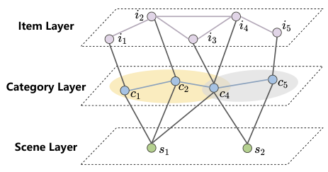
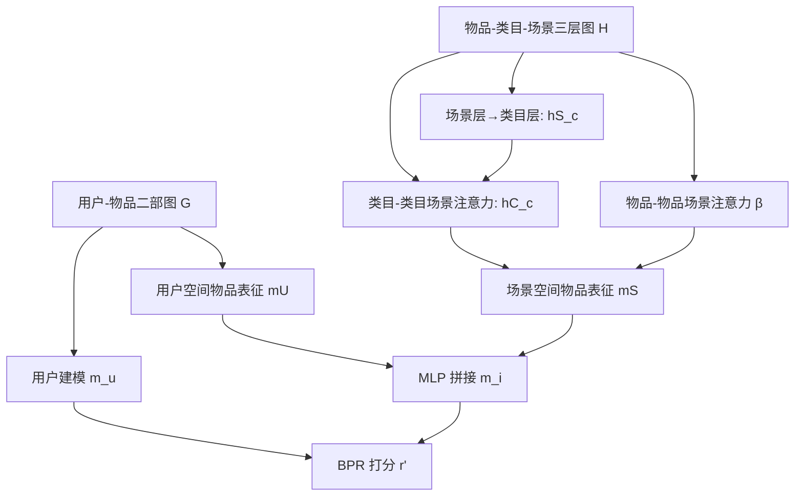
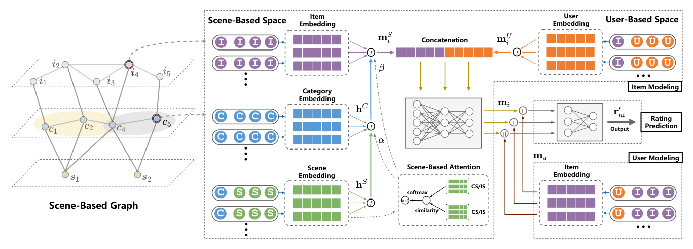

# SceneRec: Scene-Based Graph Neural Networks for Recommender Systems (基于场景图神经网络的推荐系统)

- **会议/期刊**: WSDM 2022（论文版权页标注 EDBT 2021）
- **作者与机构**: Gang Wang, Shuai Ma（北航 SKLSDE）；Ziyi Guo（京东）；Xiang Li（华东师大）；Dawei Yin（百度）
- **推荐链路定位**: 召回（表征学习）
- **研究方向**: 图神经网络与知识图谱推荐
- **论文原文**: [https://arxiv.org/abs/2102.06401v1](https://arxiv.org/abs/2102.06401v1)
- **开源代码**: 暂未开源

## TL;DR (1分钟核心速览)

电商缩略图几乎全是白底商品图，"场景"信息无法像图文匹配任务那样从图像获取，而现有 CF 只吃用户-物品交互。SceneRec 将场景形式化为"在真实生活中同时出现的精细类目集合"，构建物品-类目-场景三层图，用场景注意力把场景层信息自底向上传播到物品节点，得到与协同信号互补的场景空间物品表征并拼接。在 JD 四个类目数据集、Leave-One-Out + 1:100 采样排序协议下，NDCG@10 / HR@10 相对最强基线平均提升 14.8% / 12.1%。

## Background & Motivation (背景与核心矛盾)

- **主流范式**: MF、NCF 与 NGCF/KGAT 等 GNN 方法在用户-物品二部图上做高阶邻域聚合，学习用户与物品的低维协同表征。
- **前人局限一**: 场景增强推荐几乎都依赖输入图像（互补/替代品匹配），但电商场景图不可得，场景定义本身缺失，任务直接不可行。
- **前人局限二**: 类目等 side information 只被当作扁平属性或扁平 KG 实体接入，无法表达"类目共同出现构成一个生活场景"这种层次共现语义。
- **核心洞察 (Key Insight)**: 场景可由领域知识编码为"同时高频共现的精细类目集合"（如 {键盘, 鼠标, 鼠标垫, 充电器, 耳机} → "外设"），该结构恰好编码了商品互补性，可作为图像之外的场景信号来源。
- **本文切入点**: 显式定义三层异质图，让场景→类目→物品的信息流与用户-物品协同信息流并行，两路表征拼接后预测。

<figure class="paper-figure" markdown="span">
  <figcaption>图 1：基于场景的图示例，该图由物品层、类别层和场景层组成。每个物品关联一个类别。在物品层和类别层中，边集分别表示物品-物品关系和类别-类别关系。类别与场景之间存在连接，表示一个类别属于一个场景。</figcaption>
</figure>

## Method (核心方法设计)

### 1. 整体框架 (Overall Architecture)

模型分三块：用户建模在用户-物品二部图上聚合邻居物品得到 $m_{u_p}$；物品建模走双空间——用户空间聚合交互用户得$m^U_{i_p}$，场景空间沿"场景层→类目层→物品层"传播得$m^S_{i_p}$，二者经 MLP 拼接为通用物品表征；最后由 MLP 打分并用 BPR 成对训练。全部图结构离线预构建（物品共视 top-300、类目共视 top-100、人工编码场景），线上推理仅需一次前向，可预计算物品向量。

<figure class="paper-figure" markdown="span">
  <figcaption>图 2：SceneRec 架构示意图（带箭头的线表示自底向上的信息流）。用户和物品的嵌入分别通过用户建模和物品建模学习得到。</figcaption>
</figure>

### 2. 关键设计拆解 (Key Designs)

1. **场景引导的类目层次传播**：扁平类目属性无法刻画共现场景 $\to$先令类目的场景表征为所属场景向量之和$h^S_{c_p}=\sum_{s_q\in CS(c_p)}e_{s_q}$，再用共享场景度量类目相关性做注意力聚合：$\alpha^*_{pq}=f\big(\sum_{s_a\in CS(c_p)}e_{s_a},\sum_{s_b\in CS(c_q)}e_{s_b}\big)$后 softmax 归一，$h^C_{c_p}=\sum_{c_q\in CC(c_p)}\alpha_{pq}e_{c_q}$ $\to$ 共享场景越多，类目越可能互补/替代，权重应越大，比固定共现频次更贴合语义。
2. **场景空间的物品-物品注意力**：直接把共视频次当边权会放大热门共现、且"共视不等于同场景" $\to$用物品所属类目的场景集合替换频次：$\beta^*_{pq}=f\big(\sum_{s_a\in IS(i_p)}e_{s_a},\sum_{s_b\in IS(i_q)}e_{s_b}\big)$，使"同场景不同类目"（键盘 vs 鼠标）也获高权重。最终$m^S_{i_p}=\sigma\big(W_{ii}[h^C_{i_p}\|h^I_{i_p}]+b_{ii}\big)$，其中物品只连一个预定义类目，故$h^C_{i_p}=m_{C(i_p)}$。
3. **双空间融合、训练与效率**：$m_{i_p}=F\big(W_i[m^U_{i_p}\|m^S_{i_p}]+b_i\big)$将协同信号与场景信号解耦后拼接；总损失为 BPR$\mathcal{L}=\sum_{(p,x,y)\in\mathcal{O}}-\ln\sigma(r'_{px}-r'_{py})+\lambda\|\Theta\|_2^2$，负样本从未观测交互中采样（非 hard negative、非 in-batch）；推理 O(1) 前向，图聚合可离线缓存。

## Experimental Setup & Evaluation Protocol (实验设置与评估协议)

- **数据集与预处理**: 自建 JD.com 四类目数据集（无公开场景图基准），交互定义为点击；物品-物品由 2 个月同会话共视构建（保留 top-300），类目-类目由 6 个月共视 + 3 名标注员共识判定，场景由约 10 名运营专家手工编码：

| 数据集 | #Users | #Items | #Interactions | 稀疏度(密度) | #类目 / #场景 / 场景-类目边 |
| :--- | :---: | :---: | :---: | :---: | :---: |
| Baby & Toy | 4,521 | 51,759 | 481,831 | 0.21% | 103 / 323 / 1,370 |
| Electronics | 3,842 | 52,025 | 539,066 | 0.27% | 78 / 54 / 281 |
| Fashion | 3,959 | 53,005 | 541,238 | 0.26% | 91 / 438 / 1,646 |
| Food & Drink | 3,236 | 47,402 | 463,391 | 0.30% | 105 / 136 / 630 |

- **数据划分与防穿越 (Splitting Strategy)**: `Leave-One-Out`（每用户随机留 1 正样本 + 100 负样本作验证，再另留 1 正 + 100 负作测试，其余为训练）。
- **排名评测协议 (Ranking Protocol)**: `Sampled Ranking`，正负比 1:100（**非**全库 Full-Ranking），指标 HR@10、NDCG@10。
- **对比基线与超参设置**: BPR-MF、NCF、CMN、PinSAGE、NGCF、KGAT 共 6 个基线 + 3 个模型变体；$d=64$（NCF 因高维退化取$d=8$），NGCF/KGAT 深度$L=4$，RMSProp，学习率$\{10^{-4},\dots,10^{-1}\}$、$\lambda\in\{0,10^{-6},10^{-4},10^{-2}\}$ 网格搜索；未见显著性检验报告。

## Key Experimental Results (实验关键数据)

### 1. 主实验对比 (Main Results)

| 方法 | Baby NDCG | Baby HR | Elec NDCG | Elec HR | Fashion NDCG | Fashion HR | Food NDCG | Food HR |
| :--- | :---: | :---: | :---: | :---: | :---: | :---: | :---: | :---: |
| BPR-MF | 0.3117 | 0.5213 | 0.4005 | 0.6082 | 0.3142 | 0.5294 | 0.3663 | 0.5445 |
| NCF | 0.2232 | 0.3800 | 0.3324 | 0.5364 | 0.1518 | 0.3090 | 0.3068 | 0.4628 |
| CMN | 0.2136 | 0.3840 | **0.4447**\* | **0.6725**\* | 0.2616 | 0.4516 | **0.4028**\* | **0.5854**\* |
| PinSAGE | 0.2124 | 0.4145 | 0.2954 | 0.5200 | 0.1770 | 0.3724 | 0.2791 | 0.4798 |
| NGCF | **0.3679**\* | **0.6000**\* | 0.4308 | 0.6559 | **0.3361**\* | **0.5749**\* | 0.3487 | 0.5228 |
| KGAT | 0.3055 | 0.5421 | 0.3616 | 0.6172 | 0.3115 | 0.5580 | 0.3221 | 0.5093 |
| **SceneRec** | **0.4298** | **0.6771** | **0.4926** | **0.7524** | **0.4220** | **0.6763** | **0.4266** | **0.6211** |
| Improv.% vs 最强基线 | +16.8% | +12.9% | +10.8% | +11.9% | +25.6% | +17.6% | +5.9% | +6.1% |

（\* 为各列最强基线；表中加粗为全列最优。）

### 2. 消融实验 (Ablation Study)

| 变体 (NDCG@10 / HR@10) | Baby | Electronics | Fashion | Food |
| :--- | :---: | :---: | :---: | :---: |
| SceneRec-noitem（去物品-物品子图） | 0.3977 / 0.6475 | 0.4748 / 0.7007 | 0.3936 / 0.6454 | 0.4080 / 0.6029 |
| SceneRec-nosce（仅留物品-物品图） | 0.4193 / 0.6617 | 0.4715 / 0.7156 | 0.3933 / 0.6499 | 0.4156 / 0.6074 |
| SceneRec-noatt（去注意力，等权聚合） | 0.3950 / 0.6357 | 0.4665 / 0.7053 | 0.3953 / 0.6410 | 0.4138 / 0.6154 |
| **SceneRec (full)** | **0.4298 / 0.6771** | **0.4926 / 0.7524** | **0.4220 / 0.6763** | **0.4266 / 0.6211** |

### 3. 关键实验发现 (Key Findings)

1. **两层图结构互补但贡献不均**：仅保留物品共视图（nosce, Baby 0.4193）反而高于仅保留类目-场景层次（noitem, 0.3977），说明物品共视边是主力信号；但两者都低于完整模型 0.4298，场景层次的增量是"补充"而非"替代"。
2. **注意力机制比图结构更关键**：去注意力后在 Baby/Fashion 上损失最大（0.3950、0.3953，低于两个结构变体），因为等权聚合把弱相关共视边与同场景强相关边混为一谈；而 Food & Drink 的 HR 对去注意力几乎不敏感（0.6154 vs 0.6211），说明其类目-场景粒度太粗（136 场景覆盖 105 类目），注意力无从区分。
3. **场景定义的信噪比决定收益上限**：Fashion 场景最细（438 场景 / 91 类目，1,646 条边）取得最大增益（NDCG +25.6%、HR +17.6%），Food & Drink 场景最冗余，增益仅 +5.9% / +6.1%；案例中用户 u1428 的候选 Keyboard 预测分 0.916、平均场景注意力 0.238 均为最高，其类目与已购 PC 同属"Peripheral Devices"场景，印证增益来自场景互补而非热门偏置。

## Highlights & Limitations (亮点、对比与审稿批判)

- **与代表作对比 (vs. Prior Work)**: NGCF 仅在用户-物品二部图上做高阶传播，完全无场景语义；KGAT 需外部 KG，本文实验把场景退化为扁平 item-scene 实体后 KGAT 在 Fashion 仅 0.3115（vs 0.4220），说明"三层显式层次 + 类目桥接"比扁平 KG 边更有信息量；PinSAGE/CMN 只在物品共视图或邻域记忆上建模，缺少自顶向下的场景约束。
- **可迁移亮点**: ① 用"共享上层节点（场景/主题/品类）"计算下层节点注意力的思路，可直接替换频次共现边权，迁移到短视频话题图、POI 商圈图；② 协同空间与结构空间解耦后 MLP 拼接的双通道表征，可作即插即用的增广模块。
- **审稿级局限批判**: ① 场景完全由约 10 人运营团队手工编码 + 3 人标注，无自动场景挖掘，跨域迁移与维护成本极高，论文也自认"scene mining is future work"；② 评估仅 1:100 采样排序、无全库排序与显著性检验，且缺冷启动/长尾分桶与去掉协同分支 $m^U$ 的消融，无法排除增益部分来自额外图结构的正则效应；构图依赖离线 top-300 物品边与 top-100 类目边的启发式截断，工业级增量更新与延迟未讨论。

## Rating (四维评分)

- **方法创新性 (Novelty)**: ⭐⭐⭐ （场景=共现类目集合的定义有新意，但整体仍是"双路聚合 + 拼接 + BPR"的常规 GNN 组合，缺少理论刻画）
- **评估协议与实验扎实度 (Protocol & Experiments)**: ⭐⭐⭐ （4 个真实工业数据集 + 6 基线 + 3 变体较完整，但仅 1:100 采样排序、无显著性检验与冷启动分桶）
- **写作与数学规范度 (Clarity & Rigor)**: ⭐⭐⭐⭐ （三层图定义与公式链条清晰、符号统一，缺复杂度与收敛性分析）
- **工业落地与复现价值 (Industrial & Practical Value)**: ⭐⭐⭐ （离线图 + 单次前向推理工程友好，但场景需人工编码、无开源代码、构图更新成本高）

