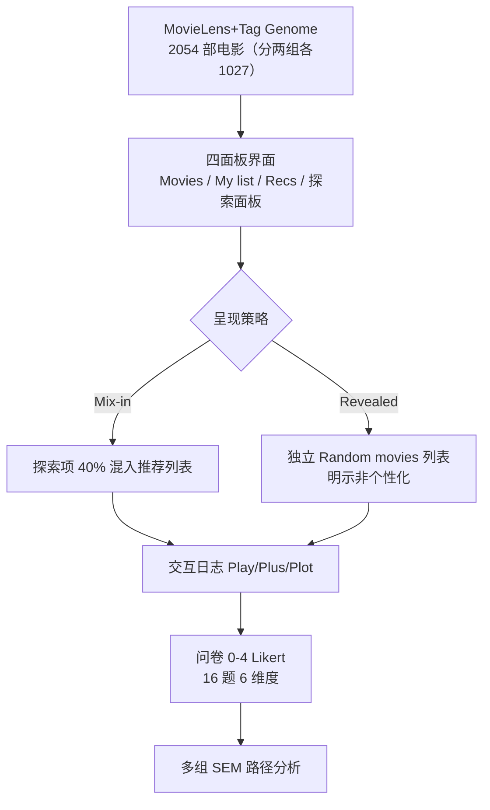
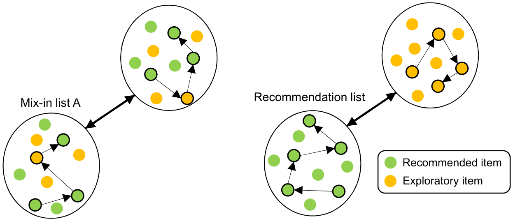
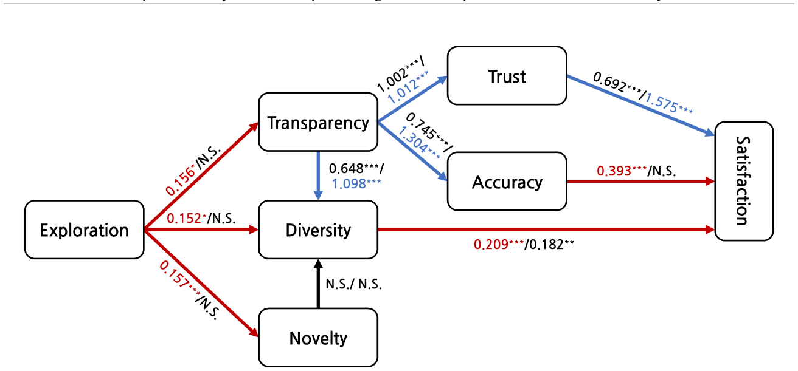

# An Empirical Analysis on Transparent Algorithmic Exploration in Recommender Systems (推荐系统中透明化算法探索的实证分析)

- **会议/期刊**: WSDM 2022
- **作者与机构**: Kihwan Kim（UNIST 计算机科学与工程系）
- **推荐链路定位**: 交互呈现层 / 重排（Exploration 展示策略，可与任意召回-排序算法解耦叠加）
- **研究方向**: 强化学习与动态探索推荐 / 对话推荐与智能体仿真（人机交互侧）
- **论文原文**: [https://arxiv.org/abs/2108.00151v2](https://arxiv.org/abs/2108.00151v2)
- **开源代码**: 暂未开源

## TL;DR (1分钟核心速览)

本文针对 bandit 式算法探索的经典困局：探索项与用户兴趣天然错配，工业界普遍采用「混入式（mix-in）」把探索项伪装成推荐项以骗取反馈，但这一欺骗性策略的收益从未被严格检验。作者提出「揭示式（revealed）」界面，将推荐项与探索项分列两个面板并明示其属性。基于 MovieLens + Tag Genome 构建的会话式电影选择环境，对 94 名 MTurk 被试开展 50% 随机平衡的被试内实验：揭示界面的探索项交互量由 0.97 升至 1.71（$p=0.005$），而推荐项交互量无显著差异（$p=0.65$），Novelty、Diversity、Transparency、Trust、Satisfaction 全面显著占优，感知准确率无损。

## Background & Motivation (背景与核心矛盾)

- **主流范式**: Contextual bandit 类探索算法（如 LinUCB、Smart Exploration）关注「选哪些物品去探索」，而工程侧普遍用 mix-in 列表把探索项插入推荐列表，靠"伪装"降低用户对低质量项的抵触。
- **前人局限**: ①Schnabel 等的用户实验显示探索比例超过 60% 时用户可察觉列表失准，mix-in 会显著侵蚀 trust 与 transparency，且探索比例越高损害越大；②现有工作只调节"探索数量"，从未回答"是否必须欺骗用户才能拿到反馈"这一根本问题。
- **核心洞察 (Key Insight)**: 用户未必排斥探索本身，排斥的是"无法解释为何出现不匹配项"的认知失调。若把探索意图显式告知用户，探索项从"算法噪声"转化为"用户可控的新奇入口"，负向体验即可翻转为正向动机。
- **本文切入点**: 不改动探索算法，只改呈现方式——用双列表 + 明示标签把探索过程透明化，并用结构方程模型（SEM）验证"探索量→感知质量→满意度"的因果链。

## Method (核心方法设计)

### 1. 整体框架 (Overall Architecture)

系统是一个会话式电影选择界面，四面板结构：Movies（全量 1027 部按流行度排序）、My list（用户候选取舍池）、Recommendations（基于 My list 的 50 部个性化结果）、以及关键的第四面板。在 mix-in 条件下第四面板是第二个混入 40% 探索项（随机采样）的推荐列表；在 revealed 条件下则替换为独立的 "Random movies" 探索列表，界面文案明示其非个性化来源。用户每次增删 My list 触发推荐面板实时刷新（可勾选锁定），推荐相似度用 Tag Genome 标签向量经 SVD 降维至 25 维后的余弦相似度计算（作者报告在该小规模数据上优于 CF）。交互日志（Play/Plus/Plot）与五点 Likert 问卷共同作为分析输入，最终进入多组路径分析。

<figure class="paper-figure" markdown="span">
  <figcaption>图1：本研究使用两种界面。混合式界面（左）在推荐列表中将探索性项目与推荐项目混合。揭示式界面（右）告知用户探索列表仅包含探索性项目。</figcaption>
</figure>

### 2. 关键设计拆解 (Key Designs)

1. **揭示式双列表呈现（Revealed Presentation）**：痛点是探索项被伪装后用户归因错误，把不匹配项误判为算法能力不足，从而同时压低 trust 与后续点击。本文的核心"算子"是呈现函数而非打分函数：设推荐集合 $R$、探索集合$E$，mix-in 输出单个混合序$L = \mathrm{interleave}(R, E, 0.4)$，而 revealed 输出二元组$(L_R, L_E)$并对$L_E$ 附加显式语义标签"Random movies"。物理直觉：把不可解释的低相关项从"预测失败"重新框定为"主动探索选项"，用户的信息处理目标由"评估准确性"切换为"浏览新奇性"，负向期望被前置消解。

2. **被试内平衡实验设计（Within-Subject Counterbalanced Protocol）**：痛点是用跨被试比较界面时个体品味差异会淹没界面效应。设计上每名被试在两种界面各完成一次 "Find Good Items / One-Choice" 任务，以 50% 概率随机分配先验条件（revealed-first 或 mix-in-first）抵消顺序与疲劳效应；两套电影池互斥（各 1027 部），保证第二次会话不出现重复物品，从而把界面策略从混杂因素中剥离。

3. **训练目标、负采样与推理开销**：本文非学习型工作，无损失函数与负采样；探索项采用全库均匀随机采样（非 bandit 自适应选择），这正是其可迁移性所在——呈现层设计与任意探索策略正交。推理开销仅为一次内容相似度检索（25 维余弦）+ 前端分面板渲染，无额外模型成本；代价是需多占一个 UI 面板位，在移动端窄屏下需额外设计。

## Experimental Setup & Evaluation Protocol (实验设置与评估协议)

- **数据集与预处理**: 物品侧来自 MovieLens Latest + Tag Genome + OMDb，过滤规则为「评分人数 $\geq 1800$ 且 1980 年后上映且有 Tag Genome 向量」，共 2054 部，对半拆成两个互斥池。

| 数据集 | #Users | #Items | #Interactions | 稀疏度/密度 | 特征/场景说明 |
| :--- | :---: | :---: | :---: | :---: | :--- |
| MovieLens Latest + Tag Genome | 94（有效被试） | 2,054（1,027/组） | 94 × 2 会话 | 非矩阵型，会话级日志 | 电影海报/简介/类型/年份；Tag Genome 1128 维标签经 SVD 降至 25 维 |

- **数据划分与防穿越 (Splitting Strategy)**: 非传统留一/时间切分，而是「被试内双条件 + 物品池互斥划分」；117 名招募者经质量过滤（停留 $<15$s、静默$>90$s、刷新页面、终选电影评分$\leq 2$）后保留 94 人，避免重复参与。
- **排名评测协议 (Ranking Protocol)**: 不使用 Full-Ranking 或 Sampled Ranking，而采用 **会话内行为 + 主观量表** 协议：交互计数（Play/Plus/Plot）为客观指标，16 题 0–4 Likert 为感知指标；先做 Bartlett 方差齐性检验再行独立样本 $t$检验并报告 Cohen's$d$；因果关系用 SEM 多组路径分析（CFI=0.910、TLI=0.880、SRMR=0.072、RMSEA=0.094，达到 metric invariance），组间模型差异$\chi^2(68)=49.97, p<0.001$。
- **对比基线与超参设置**: 唯一对照组为传统 mix-in 界面，探索比例固定 40%（沿用 Schnabel 设置），相似度维度 $d=25$；无算法超参搜索，显著性阈值$p<0.05$。

## Key Experimental Results (实验关键数据)

### 1. 主实验对比 (Main Results)

| 指标（0–4 Likert / 交互次数） | Mix-in 基线 | Revealed（本文） | 变化 | $p$ 值 |
| :--- | :---: | :---: | :---: | :---: |
| 探索项交互量（Play+Plus+Plot） | 0.97 | **1.71** | +76.3% | 0.005** |
| 推荐项交互量 | 3.78 | 3.88 | +2.6%（N.S.） | 0.646 |
| 总交互量 | 4.74 | **5.60** | +18.1% | 0.010** |
| 感知准确率 Q4（匹配兴趣） | 2.862 | 3.064 | +7.1%（N.S.） | 0.082 |
| 感知准确率 Q5（与 My list 相似） | 2.787 | 2.872 | +3.1%（N.S.） | 0.403 |
| Novelty Q6 | 2.255 | **2.660** | +18.0% | 0.001*** |
| Diversity Q8 | 2.670 | **2.957** | +10.7% | 0.017* |
| Transparency Q11（理解推荐理由） | 3.085 | **3.309** | +7.3% | 0.030* |
| Trust Q13（系统可信） | 2.936 | **3.170** | +8.0% | 0.021* |
| 总体满意度 Q14 | 3.011 | **3.298** | +9.5% | 0.007** |
| 有帮助性 Q15 | 3.064 | **3.287** | +7.3% | 0.037* |
| 终选满意度 Q16 | 3.596 | 3.649 | +1.5%（N.S.） | 0.455 |

### 2. 消融实验 (Ablation Study)

本文无组件消融，机制归因由多组路径分析承担（$\beta$ 为标准化路径系数，斜杠左为 Revealed、右为 Mix-in）：

| 因果路径 | Revealed $\beta$| Mix-in$\beta$ | 结论 |
| :--- | :---: | :---: | :--- |
| Exploration $\to$ Transparency | 0.156*** | N.S. | 仅揭示界面成立 |
| Exploration $\to$ Diversity | 0.152* | N.S. | 仅揭示界面成立 |
| Exploration $\to$ Novelty | 0.157*** | N.S. | 仅揭示界面成立 |
| Transparency $\to$ Trust | 0.648*** | **1.098*** | mix-in 更依赖解释缺口 |
| Accuracy $\to$ Satisfaction | **0.393*** | N.S. | 揭示界面下准确率驱动满意 |
| Diversity $\to$ Satisfaction | **0.209*** | 0.182** | 两条件均成立 |
| Novelty $\to$ Diversity | N.S. | N.S. | 未复现前人正相关 |

<figure class="paper-figure" markdown="span">
  <figcaption>图6：揭示组与混合组之间的多组路径模型分析。红色突出显示揭示组中更高的β系数，蓝色突出显示混合组中更高的β系数。斜线（“/”）左侧的值表示揭示组的β系数，右侧表示混合组的β系数。N.S.表示不显著值（p &gt; 0.05）。（* p&lt;0.05，** p&lt;0.01，*** p&lt;0.001）</figcaption>
</figure>

### 3. 关键实验发现 (Key Findings)

1. **透明度不损准确率，却换来 76.3% 的探索反馈增量**：探索项交互从 0.97 涨到 1.71（$p=0.005$），而推荐项交互几乎不变（3.78 vs 3.88），说明新增反馈是纯粹的探索侧增益而非注意力重分配，直接打破"探索必然牺牲体验"的行业假设。
2. **满意度提升走两条不同因果路径**：revealed 条件下 Accuracy（$\beta=0.393$）与 Diversity（$\beta=0.209$）直接驱动满意度；mix-in 条件下仅 Trust 显著（Transparency$\to$Trust 系数高达 1.098），说明伪装策略把用户满意度绑死在"信任别崩塌"这一脆弱前提上，一旦探索比例升高即失效。
3. **Novelty 的提升不等于选择行为改变**：Novelty Q6 显著提升（2.255$\to$2.660,$p=0.001$），但"最终所选不同于平常口味"（Q7, 1.394 vs 1.617,$p=0.176$）与终选满意度 Q16（$p=0.455$）均不显著，表明透明探索改善的是过程性体验与数据采集，而非即刻的消费决策漂移——这也印证 novelty$\to$diversity 路径在单会话内不可观测。

## Highlights & Limitations (亮点、对比与审稿批判)

- **与代表作对比 (vs. Prior Work)**: 相较 Schnabel 等仅把"探索比例"当作自变量的 mix-in 研究，本文首次把"是否告知"作为独立变量；相较 Pu 等的 ResQue 回溯式问卷，本文在同一系统上做被试内因果检验并用 SEM 控制测量不变性；相较 Aharon 的 Smart Exploration 聚焦物品/用户选择，本文的呈现层可与之正交叠加。
- **可迁移亮点**: ①把 exploration 从"算法内部隐变量"提升为"界面显式契约"，可迁移至冷启动物品扶持、新品冷启动与多样性重排的 UI 设计；②被试内 + 物品池互斥 + 50% 平衡的实验协议，是评估任何推荐界面改动的低成本可复用范式。
- **审稿级局限批判**: ①样本仅 94 名 MTurk 被试、单会话约 12 分钟，长周期下"新奇面板"的新鲜感衰减与探索疲劳完全未被测量，长期留存结论缺失；②领域单一且电影高度依赖视觉海报，向音乐/图书/电商等低视觉线索域外推存疑；③探索项为全库均匀随机而非 bandit 自适应，界面效应与探索策略质量存在潜在交互，40% 固定比例的敏感性也未做扫描。

## Rating (四维评分)

- **方法创新性 (Novelty)**: ⭐⭐⭐ （思路是"把欺骗换成坦诚"的呈现层反转，概念清晰且反直觉，但无新算法与理论刻画，属 HCI 驱动的设计创新）
- **评估协议与实验扎实度 (Protocol & Experiments)**: ⭐⭐⭐⭐ （被试内 50% 平衡、物品池互斥、离群剔除、方差齐性检验 + Cohen's $d$ + SEM 测量不变性，链条完整；扣分在样本量与单域单会话）
- **写作与数学规范度 (Clarity & Rigor)**: ⭐⭐⭐⭐ （统计流程交代详尽、假设逐条检验，但形式化程度低，全文仅有呈现映射的朴素符号，缺少探索收益的量化建模）
- **工业落地与复现价值 (Industrial & Practical Value)**: ⭐⭐⭐ （零额外模型开销、可与任意 bandit 策略叠加，落地门槛极低；但缺开源实现，且移动端窄屏 UI 与长期效果验证仍需工业侧补足）

