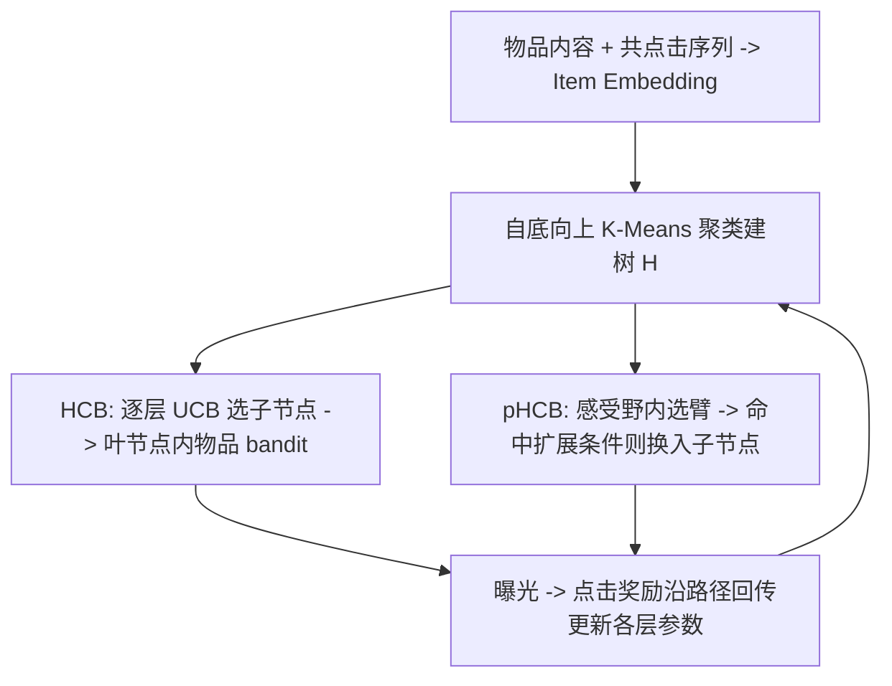
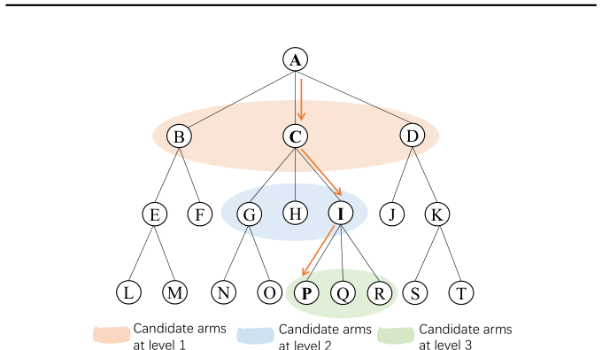
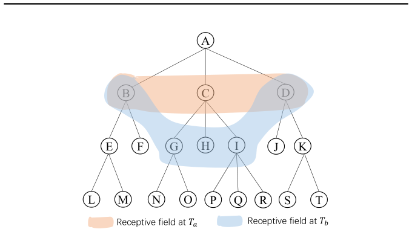

# Show Me the Whole World: Towards Entire Item Space Exploration for Interactive Personalized Recommendations (向全物品空间要探索：交互式个性化推荐的全库兴趣探索)

- **会议/期刊**: WSDM 2022
- **作者与机构**: Yu Song, Shuai Sun, Hong Huang, Hai Jin (华中科技大学)；Jianxun Lian, Xing Xie (微软亚洲研究院)；Yu Li (美团)
- **推荐链路定位**: 召回（作者明确主张把 bandit 从重排上移到召回，候选池 = 全物品库）
- **研究方向**: 强化学习与动态探索推荐 / 协同过滤与双塔召回（层级索引）
- **论文原文**: [https://arxiv.org/abs/2110.09905v1](https://arxiv.org/abs/2110.09905v1)
- **开源代码**: 暂未开源

## TL;DR (1分钟核心速览)

经典 Contextual Bandit 需对每个臂逐一打分，因此只能在数百规模的采样候选池上工作，被迫停留在重排、首页置顶、广告创意等后链路，无法真正打破闭环效应。本文用物品表征（内容 + 共点击）自底向上 K-Means 聚出一棵粗到细的层级树，把全库探索改写为「根到叶子的序列决策」(HCB)，再以「渐进扩展感受野」(pHCB) 替代单路径 DFS 抑制误差传播。在 MIND / Taobao 的 IPS 离线模拟器上，累积奖励相对 LinUCB 最高提升 280.0%（Taobao 2000 轮）。

## Background & Motivation (背景与核心矛盾)

- **主流范式**: 以 LinUCB / Thompson Sampling 为代表，把物品当臂，在每轮 $K$（通常 50 左右）个候选上计算$\text{reward}+\text{UCB}$ 上限做探索-利用折中。
- **前人局限**: ① 工业落地只能放在重排 / 首页 Top 榜 / 广告创意 / A/B 选型等小候选池场景，而那里的候选本身由利用型模型生成，探索价值被上游过滤稀释；② 学术评测普遍从 $N$个物品里随机采样$K$ 个再跑 bandit，等于直接放弃全库探索。
- **核心洞察 (Key Insight)**: 用户兴趣在物品空间上具有语义层级性（同簇物品共享统计量）；若用树做索引，每层只在兄弟节点间比较，全库打分即可从 $O(N)$降到$O(\log N)$，使「召回阶段做 bandit」在算力上可行。
- **本文切入点**: 用聚类树 + 层级 UCB 把整个物品库纳入探索，并以感受野渐进扩展解决深层树上的误差传播。

## Method (核心方法设计)

### 1. 整体框架 (Overall Architecture)

先由新闻/商品内容与用户共点击序列学习物品向量（MIND 64 维、Taobao 32 维），再以自底向上 K-Means 反复聚合，建成节点数逐层递减的层级树（MIND 为 `{1,100,10000}`，Taobao 为 `{1,50,5000,50000}`，保证叶节点挂载物品数可控且各层负载均衡）；节点特征取子节点/挂载物品向量的均值池化。HCB 从根出发逐层用 LinUCB 选子节点直到叶子，再在叶内跑一次物品级 bandit 给出最终曝光；用户反馈沿路径回传，同时更新路径上每一层的 $(\mathbf{A}^{(l)},\mathbf{b}^{(l)})$。pHCB 则改为在用户专属「感受野」节点集合上直接选臂并从中出物品，命中扩展条件后以子节点替换之，周而复始完成粗到细的下潜。

<figure class="paper-figure" markdown="span">
  <figcaption>图 1：HCB 的示意图。策略从根节点到某个叶节点选择路径 { A, C, I, P }。</figcaption>
</figure>

### 2. 关键设计拆解 (Key Designs)

1. **层级 UCB 序列决策 (HCB)**：痛点是在 4M 物品上无法枚举打分。每层维护用户专属参数 $\boldsymbol{\theta}_u^{(l)}=(\mathbf{D}^{(l)T}\mathbf{D}^{(l)}+\mathbf{I})^{-1}\mathbf{D}^{(l)T}\mathbf{r}_l$，子节点选择为
$$n^{(l+1)}(t)=\arg\max_{n\in Ch(n^{(l)}(t))}\left[\boldsymbol{\theta}_u^{(l)T}\mathbf{X}_n+\alpha\sqrt{\mathbf{X}_n^{T}\mathbf{A}^{(l)-1}\mathbf{X}_n}\right]$$
其中 $\mathbf{A}^{(l)}=\mathbf{D}^{(l)T}\mathbf{D}^{(l)}+\mathbf{I}$。关键在于「同簇共享」：一次点击经路径回传同时校正$L+1$组参数，上层节点的统计量由上千物品共同支撑，样本效率远超逐物品更新；而$\log N$ 层的打分预算让全库探索的在线延迟可控。
2. **渐进感受野 pHCB**：DFS 单路径有两个硬伤——上层错一步则后续全错（error propagation，树越深越严重）；且用户兴趣多样，贪心选一支只能覆盖单一语义方向。pHCB 把「走到某个节点后是否继续下潜」变成可验证的统计决策：对第 $l$层非叶节点$n$，若 (1) 被选次数$\ge\lfloor q/\log l\rfloor$且 (2) 平均奖励$>p/\log l$，则将其替换为子节点集合$\mathcal{V}_u(t)\leftarrow \mathcal{V}_u(t)\setminus\{n\}\cup Ch(n)$；同时放宽出物品的粒度，任意节点可出物品，$I(n)=\bigcup_{n_c\in Ch(n)}I(n_c)$。分母的$\log l$让粗粒度上层更快被验证与展开，形成 BFS 式自适应下潜；默认$p=0.1,q=10$。
3. **训练目标、负采样与推理效率**：整个 bandit 侧完全闭式（岭回归增量更新），无梯度、无负采样——奖励直接取点击 0/1（负采样只用于 Taobao 学 embedding 的阶段，与 bandit 训练无关）。regret 分析给出 HCB 为 $\tilde{O}\big((\sigma d+\sqrt{d})\log_m(N)\sqrt{mT}\big)$、pHCB 为$\tilde{O}\big((\sigma d+\sqrt{d})\sqrt{rT}\big)$，显著优于固定$N$臂全库 CB 的$O\big(\sqrt{Td\ln^{3/2}(NT\ln(T)/\delta)}\big)$，探索复杂度由$O(N)$降为$O(\log N)$。工程上每轮打分预算固定 50，层级方法将预算均摊到各层（pHCB 两层则每层 25）。

<figure class="paper-figure" markdown="span">
  <figcaption>图 2：pHCB 的示意图。在轮次 𝑇𝑎，感受野由节点 B、C 和 D 组成；经过若干次试验后，在轮次 𝑇𝑏，节点 C 满足扩展条件，因此感受野变为节点 B、D、G、H 和 I。</figcaption>
</figure>

## Experimental Setup & Evaluation Protocol (实验设置与评估协议)

- **数据集与预处理**:

| 数据集 | #Users | #Items | #Interactions | 特征/场景说明 |
| :--- | :---: | :---: | :---: | :--- |
| MIND | 1,000,000 | 161,013 | 24,155,470 | 285 类新闻；SentenceBERT 内容向量 + GRU 序列微调，64 维 |
| Taobao | 987,994 | 4,162,024 | 100,150,807 | 9,439 类电商；GRU 学行为序列表征，32 维；滤除行为 <10 的用户与出现 <10 次的物品 |

- **数据划分与防穿越 (Splitting Strategy)**: MIND 沿用官方 train/valid/test，**仅用训练集点击日志**学 embedding 与建树；Taobao 随机取 10,000 测试用户、1,000 验证用户，其余用户日志用于学 embedding。未使用 Leave-One-Out 或全局时间戳切分。
- **排名评测协议 (Ranking Protocol)**: 非 Top-N 排序，而是**离线策略评估**——用 IPS 训练无偏用户模拟器（奖励由无偏用户/物品表征内积给出），在同一模拟器上比较 100/1000/2000 轮累积奖励；一轮 = 全体用户各收到一次推荐。
- **对比基线与超参设置**: 基线含 LinUCB（仅物品级）、HMAB（人工类目 + 需遍历全路径）、ICTRUCB（扁平聚类、context-free）、ConUCB（关键词 + 对话反馈）；变体包括 CB-Category（类别目录替代聚类树）与 CB-Leaf（单层聚类）；并在 LinUCB / Thompson Sampling / $\epsilon$-greedy 三种基座上验证通用性。$\alpha=0.5$、$\epsilon=0.05$，所有方法统一每轮 50 次打分预算，重复 10 次取均值。

## Key Experimental Results (实验关键数据)

### 1. 主实验对比 (Main Results)

| 方法 | MIND@100 | MIND@1000 | MIND@2000 | Taobao@100 | Taobao@1000 | Taobao@2000 |
| :--- | :---: | :---: | :---: | :---: | :---: | :---: |
| LinUCB | 4.76 | 158.41 | 357.91 | 10.70 | 106.12 | 212.26 |
| HMAB | 4.41 | 217.40 | 520.97 | 10.74 | 120.89 | 255.22 |
| ICTRUCB | 5.60 | 300.83 | 709.05 | 10.98 | 135.99 | 290.33 |
| ConUCB | 7.47 | 188.50 | 409.23 | 13.04 | 273.86 | 584.84 |
| HUCB (HCB+LinUCB) | 7.48 | 407.82 | **918.38** | 16.20 | 320.68 | 699.29 |
| **pHUCB (本文)** | **7.93** | **419.74** | 866.60 | **16.51** | **391.36** | **806.66** |
| **Improv. vs LinUCB** | +66.6% | +164.9% | +156.6% | +54.3% | +268.8% | +280.0% |

### 2. 消融实验 (Ablation Study)

| 变体 | MIND@1000 | MIND@2000 | Taobao@1000 | Taobao@2000 | 结论 |
| :--- | :---: | :---: | :---: | :---: | :--- |
| pHUCB（完整） | **419.74** | 866.60 | **391.36** | **806.66** | 层级 + 渐进感受野 |
| w/o 渐进扩展（= HUCB，单路径 DFS） | 407.82 | **918.38** | 320.68 | 699.29 | 浅树上单路径反而更好 |
| w/o 层级（LinUCB 全库随机抽 50 臂） | 158.41 | 357.91 | 106.12 | 212.26 | 采样式探索严重退化 |
| w/o 聚类树（CB-Category，人工类目） | — | — | — | — | 图 3 曲线全面低于 HUCB/pHCB |
| w/o 多级结构（CB-Leaf，扁平聚类） | — | — | — | — | 图 3 曲线仍逊于层级方法 |

闭环效应专项（用 3 条点击冷启 200 位高 Gini 多样性用户，以各策略曝光日志训练 MF 评测模型）：

| 部署策略 | MIND LogLoss | MIND AUC | Taobao LogLoss | Taobao AUC |
| :--- | :---: | :---: | :---: | :---: |
| Linear | 1.679 | 0.703 | 0.693 | 0.530 |
| GRU | 1.759 | 0.686 | 0.688 | 0.535 |
| Transformer | 1.377 | 0.695 | 0.683 | 0.546 |
| HUCB | **0.681** | 0.720 | **0.660** | **0.649** |
| **pHUCB** | 0.680 | **0.723** | 0.661 | 0.647 |

### 3. 关键实验发现 (Key Findings)

1. **收益随物品库规模放大**：Taobao（4.16M 物品）上 pHUCB 相对 LinUCB 在 100/1000/2000 轮分别提升 54.3%/268.8%/280.0%，而 MIND（161K）为 66.6%/164.9%/142.1%。这正对应 $O(N)\to O(\log N)$ 的复杂度分析——候选池越大，层级索引打分的相对省算力越显著，采样式 bandit 的缺陷也越致命。
2. **树深决定 HCB 与 pHCB 的取舍**：MIND 的 2 层非叶树上，2000 轮 HUCB 918.38 反超 pHUCB 866.60（单路径 DFS 已足够，感受野扩展引入额外噪声）；但 Taobao 的 4 层树上 pHUCB 在 1000/2000 轮为 391.36/806.66，优于 HUCB 的 320.68/699.29（+22.0%/+15.4%），说明渐进感受野真正对症的是「深层树上上层误判污染整条路径」这一瓶颈，而非普遍增益。
3. **探索日志确实打破信息茧房**：仅用 3 条历史点击冷启的高兴趣多样性用户，经 HUCB/pHUCB 交互 200 次后，其日志训练出的 MF 在测试集上 AUC 0.720/0.723、LogLoss 约 0.68，远优于 Transformer(1.377/0.695) 与 GRU(1.759/0.686)——探索产生的曝光多样性直接转化为下游画像质量的提升，而非仅累积奖励虚高。

## Highlights & Limitations (亮点、对比与审稿批判)

- **与代表作对比 (vs. Prior Work)**: HMAB 依赖人工类目且需遍历全部路径，无法规模化；ICTRUCB 只做 context-free 扁平聚类，浪费丰富的上下文侧信息；ConUCB 须向用户主动追问关键词，交互成本高。本文用共点击表征聚类 + context-aware 层级 UCB，在**不打扰用户**的前提下完成全库探索，无需类别先验。
- **可迁移亮点**: ① 任何单次打分 $O(N)$的模块（召回、粗排、双塔打分）都可套用「聚类树 + 逐层 UCB」把搜索预算压到$O(\log N)$；② 扩展条件中用$\lfloor q/\log l\rfloor$与$p/\log l$ 施加层数惩罚，使粗粒度节点优先被验证，这套自适应分支控制技巧可迁移到其他树搜索/束搜索。
- **审稿级局限批判**: ① **树完全静态**，物品上新与兴趣漂移均未建模，作者也承认需周期性重建（重建期间新物品不可探索，恰是最该探索的冷启物品）；② 评估完全依赖 IPS 离线模拟器，模拟器与待评策略同源于一份日志，且无真实线上 A/B，累积奖励的绝对值可信度有限；③ 超参 $q$ 敏感（过小则扩展条件不可靠，Fig.4 明显下滑），且全文未报告显著性检验；④ 固定 50 次打分预算均摊到各层后，单层候选宽度被压缩，层级化在浅树上可能得不偿失。

## Rating (四维评分)

- **方法创新性 (Novelty)**: ⭐⭐⭐⭐ （首个把 CB 推向百万级全物品空间的工作，层级 UCB + 感受野渐进扩展均有清晰的 regret 与复杂度支撑，但单点机制（树 + UCB）组合成分多于理论突破）
- **评估协议与实验扎实度 (Protocol & Experiments)**: ⭐⭐⭐ （IPS 无偏模拟器 + 三种基座 + 闭环专项设计颇具说服力，但无线上验证、无显著性检验，CB-Category/CB-Leaf 消融仅给曲线未给数值）
- **写作与数学规范度 (Clarity & Rigor)**: ⭐⭐⭐⭐ （HCB/pHCB 伪代码、各层参数增量更新与 regret 推导链条完整；代价是记号较密，$p/q$ 的层数惩罚缺乏理论最优性论证）
- **工业落地与复现价值 (Industrial & Practical Value)**: ⭐⭐⭐⭐ （闭式更新、无梯度、每轮 50 次打分预算与线上延迟约束对齐，召回阶段即可部署；扣分在于树需离线构建且未开源、静态假设限制长期使用）

