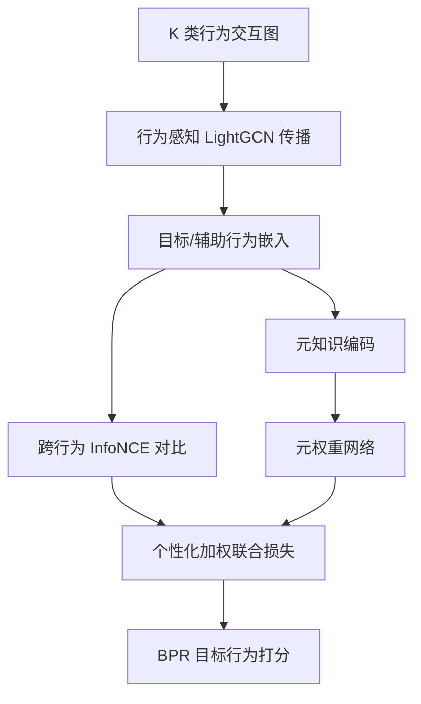
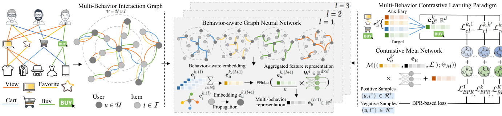

# Contrastive Meta Learning with Behavior Multiplicity for Recommendation (多行为推荐中的对比元学习)

- **会议/期刊**: WSDM 2022（Best Paper Candidate）
- **作者与机构**: Wei Wei, Chao Huang, Lianghao Xia, Yong Xu, Jiashu Zhao, Dawei Yin；HKU、SCUT、WLU、Baidu
- **推荐链路定位**: 召回/精排
- **研究方向**: 自监督对比学习与交互去噪 / 图神经网络与知识图谱推荐
- **论文原文**: [论文原文链接](https://arxiv.org/abs/2202.08523v1)
- **开源代码**: [开源代码仓库链接](https://github.com/weiwei1206/CML.git)

## TL;DR (1分钟核心速览)

针对目标行为（如购买）监督稀疏、多行为依赖又高度个性化，CML 用行为感知 LightGCN、跨行为 InfoNCE 对比与元权重网络联合建模。在 Tmall/IJCAI/Retail 的 Leave-One-Out HR@10/NDCG@10 上，较最强基线分别提升 25.4%/25.8%、16.6%/19.4%、9.9%/7.3%，$p<0.01$。

## Background & Motivation (背景与核心矛盾)

- **主流范式**: 多行为推荐将浏览、收藏、加购等辅助行为嵌入聚合到目标行为表征，代表作为 MATN、MBGCN、KHGT、EHCF。
- **前人局限**: 目标行为标签稀疏，端到端监督不足；不同用户的多行为依赖模式不同，统一聚合或统一损失权重会抹平个性化。
- **核心洞察 (Key Insight)**: 同一用户在不同行为视图下的表征应一致，不同用户应可区分；辅助行为可提供自监督信号，行为间依赖强度应由用户定制。
- **本文切入点**: 将“跨行为对比”作为辅助监督，并用元网络为每个用户、每对行为生成对比损失权重。

## Method (核心方法设计)

### 1. 整体框架 (Overall Architecture)

输入 $K$类行为交互图，行为感知 GNN 先在每类行为子图上传播，再按行为维聚合用户/物品表征；目标行为与辅助行为嵌入构成对比视图，InfoNCE 拉近同一用户跨行为表征、推远其他用户；元知识编码器从行为嵌入与对比损失中抽取用户模式，元权重网络输出个性化$\omega_u^{k,k'}$，最终与 BPR 联合优化。推理仅用目标行为打分。

<figure class="paper-figure" markdown="span">
  <figcaption>图1：CML 框架的模型流程。i) 所设计的图神经网络 G(A; ΘG) 在多行为交互图 𝐺= {V, E} 上执行行为感知的消息传递。ii) 在辅助行为嵌入与目标行为嵌入 e𝑘𝑢、e𝑘′ 之间构建对比视图。</figcaption>
</figure>

### 2. 关键设计拆解 (Key Designs)

1. **行为感知图传播与聚合**：单行为图会混淆行为语义；CML 对每个行为 $k$ 单独做轻量传播，再 PReLU 融合：
$\mathbf{e}_u^{k,(l+1)}=\sum_{i\in\mathcal{N}_u^k}\mathbf{e}_i^{k,(l)},\quad
\mathbf{e}_u^{(l+1)}=\mathrm{PReLU}\left(W_l\cdot\frac{1}{K}\sum_k\mathbf{e}_u^{k,(l+1)}\right)$。
保留行为特异性，同时注入高阶协同信号。

2. **跨行为对比学习**：目标行为监督少，但辅助行为视图天然可作正样本。同一用户 $u$的$(\mathbf{e}_u^k,\mathbf{e}_u^{k'})$ 为正，其他用户为负：
$\mathcal{L}_{cl}^{k,k'}=\sum_{u\in\mathcal{U}}-\log\frac{\exp(\varphi(\mathbf{e}_u^k,\mathbf{e}_u^{k'})/\tau)}{\sum_{u'\in\mathcal{U}}\exp(\varphi(\mathbf{e}_u^k,\mathbf{e}_{u'}^{k'})/\tau)}$。
该损失把“行为间可迁移知识”转成额外监督，缓解购买等目标行为标签稀缺。

3. **元对比编码与训练目标**：统一权重忽略个性化；CML 将行为嵌入与对比损失编码为元知识，再生成用户级权重：
$\omega_u^{k,k'}=\xi(Z_{u,1}^{k,k'})+\xi(Z_{u,2}^{k,k'}),\quad
\xi(Z)=\mathrm{PReLU}(ZW_\xi+b_\xi)$。
总目标为各行为 BPR 与个性化加权 InfoNCE：
$\mathcal{L}=\sum_k\mathcal{L}_{BPR}^k+\lambda_{cl}\sum_{k'}\omega_u^{k,k'}\mathcal{L}_{cl}^{k,k'}+\lambda\|\Theta\|_2^2$。
BPR 每正例配未交互负例；对比负例为 batch 内其他用户并按 $S$采样；推理无对比分支，复杂度约$O(LK|\mathcal{R}^+|d)$。

## Experimental Setup & Evaluation Protocol (实验设置与评估协议)

- **数据集与预处理**:

| 数据集 | #Users | #Items | #Interactions | 稀疏度/密度 | 特征/场景说明 |
| :--- | :---: | :---: | :---: | :---: | :--- |
| Tmall | 31,882 | 31,232 | 1,451,219 | 0.146% | 浏览、收藏、加购、购买；Tmall 保留至少 3 次购买用户 |
| IJCAI-Contest | 17,435 | 35,920 | 799,368 | 0.128% | 同类电商多行为 |
| Retail Rocket | 2,174 | 30,113 | 97,381 | 0.149% | 浏览、加购、交易 |

- **数据划分与防穿越 (Splitting Strategy)**: 采用 `Leave-One-Out`，以用户最后一条目标行为交互为测试正样本。
- **排名评测协议 (Ranking Protocol)**: 报告 HR@10、NDCG@10。原文未明示候选集为 `Full-Ranking` 还是固定负采样比例，按结果量级更接近采样排序；复现需补齐负例构造。
- **对比基线与超参设置**: 对比 BPR、LightGCN、SGL、MBGCN、MATN、KHGT、EHCF 等；嵌入维度 16–32 较优，图传播层 $L\le3$较优，AdamW + CyclicLR，$p<0.05$ 显著性检验。

## Key Experimental Results (实验关键数据)

### 1. 主实验对比 (Main Results)

| 方法 | Tmall HR | Tmall NDCG | IJCAI HR | IJCAI NDCG | Retail HR | Retail NDCG |
| :--- | :---: | :---: | :---: | :---: | :---: | :---: |
| BPR | .243 | .143 | .163 | .085 | .235 | .146 |
| LightGCN | .342 | .205 | .257 | .122 | .261 | .152 |
| SGL | .350 | .210 | .249 | .123 | .263 | .165 |
| MBGCN | .381 | .213 | .304 | .160 | .308 | .181 |
| MATN | .406 | .225 | .369 | .209 | .301 | .181 |
| KHGT | .391 | .232 | .317 | .182 | .324 | .202 |
| EHCF | .433 | .260 | .409 | .237 | .321 | .207 |
| **CML** | **.543** | **.327** | **.477** | **.283** | **.356** | **.222** |
| Improv. | +25.4% | +25.8% | +16.6% | +19.4% | +9.9% | +7.3% |

粗体为最优；Improv. 相对最强基线；各数据集 $p$ 值均小于 0.01。

### 2. 消融实验 (Ablation Study)

| 变体 | Tmall HR | Tmall NDCG | IJCAI HR | IJCAI NDCG | Retail HR | Retail NDCG |
| :--- | :---: | :---: | :---: | :---: | :---: | :---: |
| w/o-CLF | .4665 | .2752 | .3636 | .1978 | .3032 | .1864 |
| w/o-MCN | .5211 | .3097 | .4527 | .2703 | .3523 | .2185 |
| w/o-MKE | .5237 | .2988 | .4601 | .2715 | .3506 | .2079 |
| **CML** | **.5431** | **.3266** | **.4769** | **.2829** | **.3560** | **.2219** |

### 3. 关键实验发现 (Key Findings)

- **对比学习是最大增益源**：Tmall 去 CLF 后 HR 从 .5431 降至 .4665（相对 -14.1%），NDCG 从 .3266 降至 .2752（-15.7%），说明辅助行为视图提供的自监督比单纯多行为聚合更关键。
- **元权重与元知识均有效但侧重点不同**：去 MCN 后 Tmall HR/NDCG 降至 .5211/.3097，去 MKE 后 NDCG 降至 .2988，表明个性化权重主要提升排序质量，元知识编码增强用户模式区分。
- **稀疏场景优势稳定**：Tmall 按交互数分桶（<4、<5、<6、<7、<9、<600）后，CML 在各桶 HR/NDCG 均领先 KHGT、MBGCN、EHCF，证明跨行为对比能把稀疏目标行为监督转化为可迁移辅助监督。

## Highlights & Limitations (亮点、对比与审稿批判)

- **与代表作对比 (vs. Prior Work)**: MBGCN/MATN 只做关系感知传播或注意力聚合，缺少自监督；EHCF 依赖监督式知识迁移；SGL 做图增广对比但非行为语义视图。CML 的核心差异是“行为视图对比 + 用户级元权重”。
- **可迁移亮点**: 多行为/多任务标签可构造天然对比视图；用元网络为不同辅助任务动态调权，可迁移到跨域或多场景推荐。
- **审稿级局限批判**: 其一，候选集构造未明确，若实际为 1:99 采样，则结论需在 Full-Ranking 下重验；其二，元网络与 GNN 交替优化带来额外训练开销，且静态用户级权重难以刻画会话内意图漂移。

## Rating (四维评分)

- **方法创新性 (Novelty)**: ⭐⭐⭐⭐ （行为视图对比与元权重结合较新，虽组件不全新但问题切分清晰）
- **评估协议与实验扎实度 (Protocol & Experiments)**: ⭐⭐⭐ （三数据集、消融与显著性完整，但候选集协议未交代，影响复现）
- **写作与数学规范度 (Clarity & Rigor)**: ⭐⭐⭐⭐ （公式与复杂度分析清楚，元知识编码符号稍密）
- **工业落地与复现价值 (Industrial & Practical Value)**: ⭐⭐⭐⭐ （代码开源、LightGCN 主干高效，元训练开销需工程权衡）

