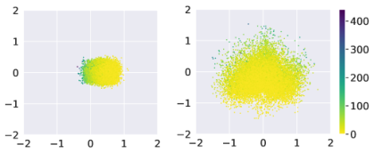
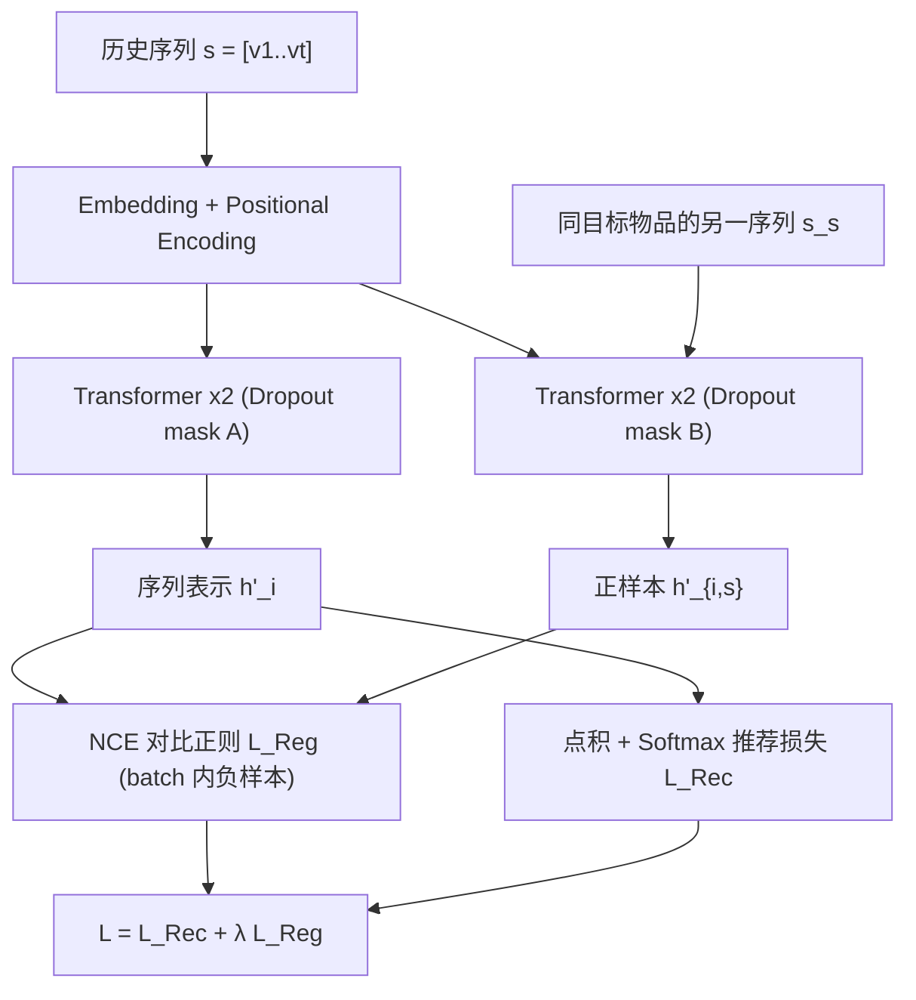

# Contrastive Learning for Representation Degeneration Problem in Sequential Recommendation (面向序列推荐表示退化问题的对比学习)

- **会议/期刊**: WSDM 2022
- **作者与机构**: Ruihong Qiu, Zi Huang, Hongzhi Yin, Zijian Wang（The University of Queensland）
- **推荐链路定位**: 精排（Next-Item 全库打分）
- **研究方向**: 序列与会话推荐 / 自监督对比学习与表示去噪
- **论文原文**: [https://arxiv.org/abs/2110.05730v2](https://arxiv.org/abs/2110.05730v2)
- **开源代码**: 暂未开源（原文未给出代码仓库链接）

## TL;DR (1分钟核心速览)

本文指出 SASRec 类 Transformer 序列推荐器的物品嵌入会退化为各向异性的"窄锥"：奇异值快速衰减、低频物品彼此高度相似。作者先从 softmax 梯度推出稀有物品的梯度方向被上下文向量 $\boldsymbol{h}_c$ 垄断，再提出 DuoRec——在**序列表示**上加对比正则（均匀性经点积耦合"传染"给物品嵌入），并用 Dropout 双视图替代破坏语义的数据级增广、以"同目标物品"构造监督难正样本。5 个数据集 Leave-One-Out + Full-Ranking 下，Beauty HR@5 相对最强基线 CL4SRec 提升 35.91%，ML-1M HR@5 提升 77.68%，Yelp NDCG@5 提升 150%。

## Background & Motivation (背景与核心矛盾)

- **主流范式**: 以 Transformer 单向自注意力（SASRec）为骨干，将历史序列编码为 $\boldsymbol{h}$，与物品嵌入矩阵$\boldsymbol{V}$ 做点积后经全库 softmax 的交叉熵训练。
- **前人局限**: ① 物品嵌入矩阵近似极端低秩——奇异值第一维独大，其余维度失效，导致几乎所有物品在几何上正相关，长尾物品无法被区分；② 补救手段（BERT4Rec/S³Rec 的掩码物品预测、CL4SRec 的裁剪/掩码/重排增广）都在**离散物品序列**上做数据级扰动，难以保证增广视图与原序列语义一致，甚至引入假阳性对。
- **核心洞察 (Key Insight)**: 对不出现在输入中的物品 $\boldsymbol{v}_*$，其梯度为

$$\frac{\partial J}{\partial \boldsymbol{v}_*}\approx -p(v_*|c_n)\,\boldsymbol{h}_c,$$

  即低频物品绝大多数时候只作为负样本、由**同一条上下文方向**推动，故被压进同一窄锥；而推荐靠 $\langle \boldsymbol{h},\boldsymbol{v}\rangle$ 打分，只要正则化序列表示的**均匀性 (uniformity)**，就能隐式重塑物品嵌入分布。
- **本文切入点**: 沿"梯度视角的退化诊断"给出解药——在序列表示上加对比正则，配合语义保真的模型级增广与目标监督正采样。

<figure class="paper-figure" markdown="span">
  <figcaption>图1：Amazon Clothing 数据集的物品嵌入矩阵通过 SVD 投影到二维，颜色表示数据集中物品的频率。(a) SASRec 学习到的物品嵌入。多数稀有物品落入狭窄锥体，因几何性质而彼此高度相似。(b) DuoRec 学习到的物品嵌入。物品嵌入分布在幅度与频率上均更均匀。(c) 物品嵌入矩阵的归一化奇异值。SASRec 的奇异值快速下降表明物品嵌入...</figcaption>
</figure>

## Method (核心方法设计)

### 1. 整体框架 (Overall Architecture)

输入为用户交互序列，经嵌入层 + 位置编码后送入 $L$层多头 Transformer，取末位隐向量作为序列（用户）表示$\boldsymbol{h}$。同一序列用两套随机 Dropout 掩码各前向一次得到$\boldsymbol{h}'_i$与$\boldsymbol{h}'_{i,s}$（后者额外把正样本换成"同目标物品序列"的视图），batch 内其余$2(|\mathcal{B}|-1)$ 个视图作为负样本构造 NCE；该对比项仅作为正则与推荐交叉熵联合优化，推理时只跑单次编码器、无任何额外开销。

### 2. 关键设计拆解 (Key Designs)

1. **模型级 Dropout 增广（替代数据级增广）**：离散物品序列做 crop/mask/reorder 后语义漂移严重（如删掉关键物品即改变偏好）→ 改为在嵌入层与 Transformer 内部使用两组不同 Dropout 掩码，同权重两次前向得 $\boldsymbol{h}'=\mathrm{Trm}(\boldsymbol{H}^{0\prime})[-1]$，$\boldsymbol{h}'_s=\mathrm{Trm}(\boldsymbol{H}^{0\prime}_s)[-1]$。直觉：Dropout 只在隐空间扰动特征通道、不删改物品身份，因而两个视图天然语义一致。
2. **同目标物品的监督难正样本**：仅靠无监督视图会把"语义本相近但物品不同"的序列错划为负样本（false negative）→ 定义"若 $s_i,s_j$的下一物品相同（$v_{i,t_i+1}=v_{j,t_j+1}$），则二者语义相似"，随机采一条作为正样本并从负集合中剔除：

$$\ell_{\text{Reg}}=-\log\frac{e^{(\boldsymbol{h}'_i)^\top(\boldsymbol{h}'_{i,s})/\tau}}{e^{(\boldsymbol{h}'_i)^\top(\boldsymbol{h}'_{i,s})/\tau}+\sum_{\boldsymbol{s}^-\in\mathcal{S}^-_i}e^{(\boldsymbol{h}'_i)^\top(\boldsymbol{s}^-)/\tau}},$$

   并对称计算一次。目标物品是天然的偏好监督信号，比任何启发式增广都更"难"且更准。
3. **训练目标与推理效率**：总损失 $\mathcal{L}=\ell_{\text{Rec}}+\lambda\,\ell_{\text{Reg}}$，$\lambda\in[0.1,0.5]$；负采样为**免额外负采样**的 in-batch 方式，无需 hard-negative 挖掘。对比项按 alignment/uniformity 分解为$\ell_{\text{align}}=\mathbb{E}\|\boldsymbol{h}'_i-\boldsymbol{h}'_{i,s}\|^2$与$\ell_{\text{uniform}}=\log\mathbb{E}_{\boldsymbol{s}}\,e^{-2\|\boldsymbol{h}'_i-\boldsymbol{s}\|^2}$，前者拉近同偏好序列、后者把序列表示推离原点均匀铺开，再经点积反向约束$\boldsymbol{V}$。

## Experimental Setup & Evaluation Protocol (实验设置与评估协议)

- **数据集与预处理**（隐式反馈，**5-core 过滤**，最大序列长度 50）：

| 数据集 | #Users | #Items | #Interactions | 稀疏度 | 场景说明 |
| :--- | :---: | :---: | :---: | :---: | :--- |
| Beauty | 22,363 | 12,101 | 198,502 | 99.93% | Amazon 美妆，短序列 (8.9) |
| Sports | 35,598 | 18,357 | 296,337 | 99.95% | Amazon 运动户外 (8.3) |
| Clothing | 39,387 | 23,033 | 278,677 | 99.97% | Amazon 服饰，最稀疏 (7.1) |
| ML-1M | 6,041 | 3,417 | 999,611 | 95.16% | 电影，长序列 (165.5)，密度最高 |
| Yelp | 30,499 | 20,068 | 317,182 | 99.95% | 2019 年后商户评论 (10.4) |

- **数据划分与防穿越**: `Leave-One-Out`（每用户最后 1 个交互为测试、倒数第 2 个为验证，其余训练），与 SASRec/CL4SRec 完全对齐。
- **排名评测协议**: **Full-Ranking（全库未交互物品排序，不做负采样）**，指标 HR@{5,10} 与 NDCG@{5,10}，遵循 Krichene & Rendle 关于采样指标有偏的告诫。
- **对比基线与超参**: BPR-MF（非序列）、GRU4Rec、Caser、SASRec、BERT4Rec、S³Rec_MIP、CL4SRec；嵌入维度 $d=64$，Transformer 2 层 2 头，batch 256，Adam$lr=10^{-3}$，Dropout 与$\lambda$均在$\{0.1,\dots,0.5\}$ 网格搜索；结果报告 5 次运行的均值 ± 标准差（原文未报告显式显著性检验）。

## Key Experimental Results (实验关键数据)

### 1. 主实验对比 (Main Results)

| 数据集 | 指标 | BPR-MF | GRU4Rec | Caser | SASRec | BERT4Rec | CL4SRec | **DuoRec** | Improv. |
| :--- | :---: | :---: | :---: | :---: | :---: | :---: | :---: | :---: | :---: |
| Beauty | HR@5 | 0.0120 | 0.0164 | 0.0259 | 0.0365 | 0.0193 | 0.0401 | **0.0546** | +35.91% |
| Beauty | NDCG@5 | 0.0040 | 0.0086 | 0.0127 | 0.0236 | 0.0187 | 0.0223 | **0.0352** | +57.85% |
| Clothing | HR@5 | 0.0067 | 0.0095 | 0.0108 | 0.0168 | 0.0125 | 0.0168 | **0.0193** | +14.88% |
| Clothing | NDCG@5 | 0.0052 | 0.0061 | 0.0067 | 0.0091 | 0.0075 | 0.0090 | **0.0113** | +11.88% |
| Sports | HR@5 | 0.0092 | 0.0137 | 0.0139 | 0.0218 | 0.0176 | 0.0227 | **0.0326** | +43.61% |
| Sports | NDCG@5 | 0.0040 | 0.0096 | 0.0085 | 0.0127 | 0.0105 | 0.0129 | **0.0208** | +61.24% |
| ML-1M | HR@5 | 0.0078 | 0.0763 | 0.0816 | 0.1087 | 0.0733 | 0.1147 | **0.2038** | +77.68% |
| ML-1M | NDCG@5 | 0.0052 | 0.0385 | 0.0372 | 0.0638 | 0.0432 | 0.0662 | **0.1390** | +109.97% |
| Yelp | HR@5 | 0.0127 | 0.0152 | 0.0156 | 0.0161 | 0.0186 | 0.0216 | **0.0441** | +104.17% |
| Yelp | NDCG@5 | 0.0076* | 0.0104 | 0.0096 | 0.0102 | 0.0118 | 0.0130 | **0.0325** | +150.00% |

*（Yelp 的 BPR-MF NDCG@5 在原文表中印为 0.076，按同行量级应为 0.0076 的排版错误。）*

### 2. 消融实验 (Ablation Study)

原文以图 2（分组柱状图）给出各对比目标变体的结果，未列具体数值，此处按原图趋势整理：

| 变体 | 正样本构造方式 | 相对 SASRec | 相对 CL4SRec | 结论 |
| :--- | :--- | :---: | :---: | :--- |
| CL4SRec | 裁剪/掩码/重排（数据级） | ↑ | — | 数据级增广仅小幅受益 |
| UCL | Dropout 双视图（模型级，无监督） | ↑ | ↑（稳定超越） | 语义保真的增广更优 |
| SCL | 同目标物品序列（监督） | ↑↑ | ↑↑（大幅） | 目标监督信号最强 |
| UCL+SCL | 两个损失直接相加 | ↑ | 波动 | **相加反而掉点**，两目标对齐不兼容 |
| **DuoRec** | 统一框架内联合两类正样本 | **↑↑↑** | **最优** | 无监督 + 监督协同 |

### 3. 关键实验发现 (Key Findings)

1. **稠密数据收益最大，验证"梯度主导"诊断**：ML-1M（密度 4.84%、平均长度 165.5）HR@5 从 CL4SRec 的 0.1147 跳到 0.2038（+77.68%），Yelp NDCG@5 +150%；而极稀疏的 Clothing 仅 +11.88%——说明退化主要发生在"长尾物品被反复当负样本刷梯度"的场景，正则化正是对该梯度路径的矫正。
2. **监督正样本 ≫ 无监督增广 ≫ 数据级增广**：SCL 单独使用已显著超过 CL4SRec，但 UCL+SCL 直接相加会掉点（两套对比目标对"谁作正样本"的定义互斥，负集合构造冲突）；DuoRec 的贡献本质是把二者放进**同一负集合、同一 NCE 项**内统一，而非简单多任务叠加。
3. **可视化闭环验证**：SASRec 的物品嵌入奇异值快速衰减至近零（极端低秩、稀有物品挤在窄锥），DuoRec 奇异值衰减明显放缓、高低频物品环绕原点分布；训练曲线显示 DuoRec 的 uniformity loss 随验证 HR@5 上升而单调下降，而 CL4SRec 的 uniformity loss 反而上升（分布更各向异性）——即"均匀性"是可优化的性能代理指标。

## Highlights & Limitations (亮点、对比与审稿批判)

- **与代表作对比 (vs. Prior Work)**: 相比 SASRec，本文不改骨干、只加一项正则即解决嵌入塌缩，且推理零额外开销；相比 BERT4Rec/S³Rec，避开了"掩码物品预测与 next-item 目标不对齐"（S³Rec 需预训练+微调两阶段）；相比 CL4SRec 的裁剪/掩码/重排，本文指出增广应做在**连续隐空间**而非离散物品序列，这是序列推荐对比学习的关键差异点。
- **可迁移亮点**: ① "在序列侧加正则、经点积隐式约束物品侧"的解耦思路，可直接移植到双塔召回/生成式语义 ID 码本的码本塌缩治理；② 用**标签（target item）作为正样本相似度定义**的监督正采样，比任何启发式增广都更廉价可靠。
- **审稿级局限批判**: ① 训练成本翻倍——每个样本需 2 次（含正样本则更多）Transformer 前向，且正样本检索需离线维护"同目标物品 → 序列"倒排索引，大规模工业场景需额外采样工程；② 消融仅以柱状图呈现、缺具体数值与显著性检验，UCL+SCL 掉点的"对齐不兼容"解释停留在定性层面；③ ML-1M 平均长度 165.5 但最大长度截断为 50，截断策略对长序列结论的外推性未讨论，且缺少线上 A/B 与长尾分桶实验。

## Rating (四维评分)

- **方法创新性 (Novelty)**: ⭐⭐⭐⭐ （从 softmax 梯度推导出"稀有物品梯度方向单一"的退化机理，并用均匀性-点积耦合给出隐式正则路径，问题定义本身即贡献）
- **评估协议与实验扎实度 (Protocol & Experiments)**: ⭐⭐⭐⭐ （5 数据集 + Leave-One-Out + Full-Ranking 全库排序 + 均值±方差，协议规范；扣分在消融仅有图形、无显著性与长尾分桶）
- **写作与数学规范度 (Clarity & Rigor)**: ⭐⭐⭐⭐ （PMI 分解、alignment/uniformity 分解与梯度分析链条完整清晰；Yelp 表格数量级排版错误与部分符号重载略显粗糙）
- **工业落地与复现价值 (Industrial & Practical Value)**: ⭐⭐⭐⭐ （推理无额外开销、超参 $\lambda$ 与 Dropout 在宽区间内稳定，工程友好；但训练前向翻倍与正样本倒排索引维护成本需额外设计）

