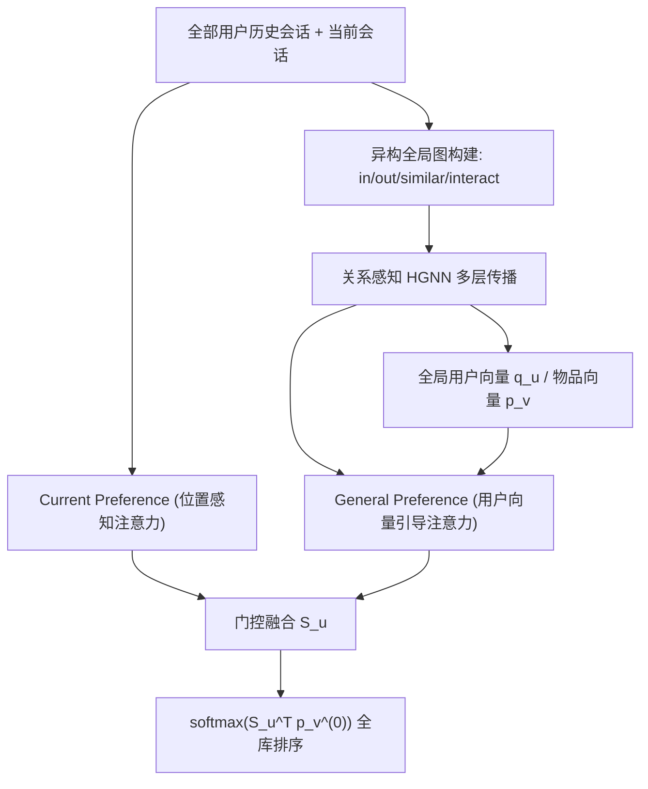
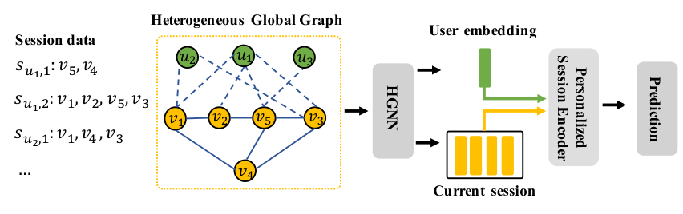

# Heterogeneous Global Graph Neural Networks for Personalized Session-based Recommendation (面向个性化会话推荐的异构全局图神经网络)

- **会议/期刊**: WSDM 2022
- **作者与机构**: Yitong Pang, Lingfei Wu, Qi Shen, Yiming Zhang, Zhihua Wei (同济大学 / JD.com 硅谷研究中心 / Squirrel AI / SFU)
- **推荐链路定位**: 召回（会话级 Next-Item 排序）
- **研究方向**: 序列与会话推荐 / 图神经网络与知识图谱推荐
- **论文原文**: [https://arxiv.org/abs/2107.03813v4](https://arxiv.org/abs/2107.03813v4)
- **开源代码**: [https://github.com/0215Arthur/HG-GNN](https://github.com/0215Arthur/HG-GNN)

## TL;DR (1分钟核心速览)

针对会话推荐中"匿名假设导致非个性化"与"个性化方法只用当前用户自身历史、浪费他人会话中物品转移模式"两大痛点，本文把**所有用户的所有会话**编织成一张含四类关系的异构图（会话内 in/out 转移、全局共现 similar、用户-物品 interact），用关系感知 HGNN 学全局用户/物品表征，再以"当前偏好 + 历史偏好"双注意力门控融合成会话表征。在 Last.fm/Xing/Reddit 上以 HR@5/10、MRR@5/10 全库评测，Reddit 相对最强基线 A-PGNN 提升 4.03%(HR@5)/5.72%(MRR@5)，且单 epoch 训练耗时低于 GCE-GNN 与 A-PGNN。

## Background & Motivation (背景与核心矛盾)

- **主流范式**: GRU4Rec/NARM 用 RNN 建模会话内序列，SR-GNN/LESSR/GCE-GNN 把会话转成有向图（GCE-GNN 另建无向全局物品图）做图卷积，本质都是"物品转移模式驱动"。
- **前人局限**: ① 绝大多数工作假定用户匿名，同一会话序列对不同用户输出几乎相同的候选（图 1 中两位用户都得到 Screen protector / AirPods Pro）；② 少数个性化工作（H-RNN、A-PGNN）只沿当前用户自身的跨会话历史建模，无法利用**其他用户**历史会话中蕴含的物品共现/转移信号；GCE-GNN 虽有全局物品图，却丢弃了用户身份。
- **核心洞察 (Key Insight)**: 转移关系（序列内相邻）与共现关系（跨会话同现）是互补的两类物品关联，前者刻画意图流、后者刻画潜在替代/搭配；而用户-物品历史交互是长时稳定偏好的天然载体——三者应统一到一张图里做同构消息传递。
- **本文切入点**: 用一张异构全局图同时承载节点（用户 + 物品）与四种边类型，用类型专属参数聚合，再用双粒度偏好编码器把全局知识注入当前会话。

## Method (核心方法设计)

### 1. 整体框架 (Overall Architecture)

全部训练会话被转成有向异构图 $\mathcal{G}=(\mathcal{V},\mathcal{E})$：物品节点间建$r_{in}/r_{out}$（会话内相邻转移，边权为全局出现频次并按 top-$S$截断）与$r_{similar}$（全局共现 top-$K$）；用户与物品间建$r_{interact}/r_{interacted\_by}$。HGNN 在$\mathcal{G}$上按边类型做邻域均值聚合，逐层加权求和得全局用户向量$\mathbf{q}_u$与物品向量$\mathbf{p}_v$。随后 Personalized Session Encoder 用两路注意力分别抽取"当前会话内的时变兴趣"与"受全局偏好调制的稳定兴趣"，门控融合为$\mathbf{S}_u$，最终与物品初始 embedding 内积并 softmax 全库打分，交叉熵训练。

<figure class="paper-figure" markdown="span">
  <figcaption>图2：HG-GNN的总体概览。</figcaption>
</figure>

### 2. 关键设计拆解 (Key Designs)

1. **异构全局图构建（把"他人历史"变成可用信号）**：现有方法只用会话内相邻边或单一全局物品图，信息面窄。本文对每个物品 $v_i$以频次为权保留 top-$S$的$r_{in}/r_{out}$边，并用带会话长度归一化的共现相似度补$r_{similar}$ 边：
$f_v(v_i,v_j)=\frac{\sum_{s\in N(v_i)\cap N(v_j)}1/|N(s)|}{\sqrt{|N(v_i)||N(v_j)|}}$再以$K'_{v_i}=\min\{K,|N_{v_i}|\}$自适应截断。直觉：除以$|N(s)|$ 抑制超长会话（如 Reddit 平均 3.02 长度的噪声会话）对相似度的稀释，让"小众但强共现"的艺术家对不被热门物品淹没。

2. **关系感知 HGNN + 层级组合**：同一物品的 in/out/similar 邻居语义完全不同，混在一个邻接矩阵里会互相污染。因此每种关系 $r_x$ 独立聚合与变换：
$\mathbf{p}^{(k+1)}_{v_i,r_x}=f\!\left(\mathbf{W}^{(k+1)}_{r_x}\left[\mathbf{p}^{(k+1)}_{\mathcal{N}_{r_x}(v_i)}\Vert\mathbf{p}^{(k)}_{v_i}\right]+\mathbf{b}^{(k+1)}_{r_x}\right)$其中邻域项为类型内均值$\frac{1}{|\mathcal{N}_{r_x}(v_i)|}\sum_{n}\mathbf{e}^{(k)}_n$，再对$r_u,r_{in},r_{out},r_{similar}$做 mean 累积；输出按$\mathbf{p}_{v_i}=\sum_{k=0}^{K}\alpha_k\mathbf{p}^{(k)}_{v_i}$、$\alpha_k=1/(K+1)$融合。$\alpha_k$ 均匀取值等价于"低频物品多靠浅层 ID 语义、高频物品靠深层图语义"，无需额外调参即缓解稀疏物品过平滑。

3. **双粒度偏好门控与训练/推理**：当前偏好用逆位置 embedding 拼接 + soft attention（$\epsilon_i=\mathbf{v}_0^\top\sigma(\mathbf{W}_0\mathbf{p}'_{v_{s,i}}+\mathbf{W}_1\mathbf{p}'_s+\mathbf{b}_0)$）得$\mathbf{C}_u$；历史偏好用全局$\mathbf{q}_u$引导注意力（$\mathbf{e}_i=\mathbf{v}_1^\top\sigma(\mathbf{W}_2\mathbf{p}_{v_{s,i}}+\mathbf{W}_3\mathbf{q}_u+\mathbf{b}_1)$）得$\mathbf{O}_u$；门控$\mathbf{S}_u=\alpha_c\mathbf{C}_u+(1-\alpha_c)\mathbf{O}_u$，$\alpha_c=\sigma(\mathbf{W}_s[\mathbf{C}_u\Vert\mathbf{O}_u])$。损失为交叉熵$\mathcal{L}=-\sum_i y_i\log\hat{y}_i+(1-y_i)\log(1-\hat{y}_i)$，**无显式负采样**（全库 softmax）；推理时物品侧向量离线预计算，线上仅需一次会话编码 + ANN 内积检索，图构建为离线一次性开销。

## Experimental Setup & Evaluation Protocol (实验设置与评估协议)

- **数据集与预处理**: 统一过滤——会话长度 $<3$剔除、用户会话数$<5$ 剔除（保证有足够历史），测试集中未在训练集出现的物品交互亦剔除。

| 数据集 | #Users | #Items | #Sessions | 平均会话长度 | 场景说明 |
| :--- | :---: | :---: | :---: | :---: | :--- |
| Last.fm | 992 | 38,615 | 385,135 | 8.16 | 音乐艺术家收听，8 小时间隔切会话，保留 top 40k 艺术家 |
| Xing | 11,479 | 59,121 | 91,683 | 5.78 | 招聘职位点击，按 RecSys'16 Challenge 方式切会话 |
| Reddit | 18,271 | 27,452 | 1,135,488 | 3.02 | 子版块评论，60 分钟阈值切会话 |

- **数据划分与防穿越**: **全局时间比例划分**——按用户时间序取最后 20% 会话为测试集、其余 80% 训练；每个会话再切分为历史会话 $S_{u_h}$、当前会话$S_{u_c}$（前$l$个物品）与标签（第$l+1$ 个物品），严格单向不穿越。
- **排名评测协议**: HR@$\{5,10\}$与 MRR@$\{5,10\}$，对全部$|\mathcal{V}|$候选打分（**全库 Full-Ranking**，原文未采用采样负例），按测试用户平均；显著性用配对 t 检验，$p<0.01$ 标 †。
- **对比基线与超参**: 基线覆盖传统 ItemKNN、RNN 系（GRU4Rec/NARM/H-RNN）、GNN 系（SR-GNN/LESSR/GCE-GNN）与个性化 A-PGNN；Adam + batch 512，$d\in\{32,...,256\}$、$S\in\{4,8,12,16\}$、$K\in\{5,...,30\}$、GNN 层数$\{1,2,3,4\}$ 网格搜索，取 10% 训练数据作验证。

## Key Experimental Results (实验关键数据)

### 1. 主实验对比 (Main Results)

| 模型 | Last.fm HR@5 | HR@10 | MRR@5 | MRR@10 | Xing HR@5 | HR@10 | MRR@5 | MRR@10 | Reddit HR@5 | HR@10 | MRR@5 | MRR@10 |
| :--- | :---: | :---: | :---: | :---: | :---: | :---: | :---: | :---: | :---: | :---: | :---: | :---: |
| ItemKNN | 6.73 | 10.90 | 4.02 | 4.81 | 8.79 | 11.85 | 5.01 | 5.42 | 21.71 | 30.32 | 11.74 | 12.88 |
| GRU4Rec | 8.47 | 12.86 | 4.71 | 5.29 | 10.35 | 13.15 | 5.94 | 6.36 | 33.72 | 41.73 | 24.36 | 25.42 |
| NARM | 10.29 | 15.03 | 6.09 | 6.71 | 13.51 | 17.31 | 8.87 | 9.37 | 33.25 | 40.52 | 24.56 | 25.52 |
| SR-GNN | 11.89 | 16.90 | 7.23 | 7.85 | 13.38 | 16.71 | 8.95 | 9.39 | 34.96 | 42.38 | 25.90 | 26.88 |
| LESSR | 12.96 | 17.88 | **8.24** | **8.82** | 14.84 | 16.77 | 11.98 | 12.13 | 36.03 | 43.27 | 26.45 | 27.41 |
| GCE-GNN | 12.83 | 18.28 | 7.60 | 8.32 | 16.98 | **20.86** | 11.14 | 11.65 | 36.30 | 45.16 | 26.65 | 27.70 |
| H-RNN | 10.92 | 15.83 | 6.71 | 7.39 | 10.72 | 14.36 | 7.22 | 7.74 | 44.76 | 53.44 | 32.13 | 33.29 |
| A-PGNN | 12.10 | 17.13 | 7.37 | 8.01 | 14.23 | 17.01 | 10.26 | 10.58 | 49.10 | 58.23 | 33.54 | 34.62 |
| **HG-GNN** | **13.09**† | **19.39**† | 7.35 | 8.18 | **17.25**† | 20.30 | **12.23**† | **12.79**† | **51.08**† | **60.51**† | **35.46**† | **36.89**† |
| Improv. | +1.00% | +6.07% | – | – | +1.59% | – | +2.09% | +5.44% | +4.03% | +3.92% | +5.72% | +6.56% |

训练效率（同 128 维、同 batch、Tesla V100，单 epoch 秒）：HG-GNN 458.56 / 61.23 / 576.13，GCE-GNN 521.23 / 76.35 / 605.37，A-PGNN 995.53 / 118.18 / 1054.20。

### 2. 消融实验 (Ablation Study)

| 变体 | Last.fm HR@5 | HR@10 | MRR@5 | MRR@10 | Xing HR@5 | HR@10 | MRR@5 | MRR@10 |
| :--- | :---: | :---: | :---: | :---: | :---: | :---: | :---: | :---: |
| w/o HGNN 模块 | 11.98 | 17.42 | 6.81 | 7.53 | 16.54 | 20.14 | 11.76 | 12.24 |
| w/o CPL (当前偏好) | 12.83 | 19.16 | 7.07 | 7.91 | 13.16 | 16.53 | 8.70 | 9.15 |
| w/o GPL (历史偏好) | 12.96 | 19.22 | 7.13 | 8.04 | 17.24 | 20.38 | 12.21 | 12.74 |
| **HG-GNN** | **13.09** | **19.39** | **7.35** | **8.18** | **17.25** | 20.30 | **12.23** | **12.79** |

| Xing 图结构变体 | HR@5 | HR@10 | MRR@5 | MRR@10 |
| :--- | :---: | :---: | :---: | :---: |
| w/o user nodes | 17.03 | 19.82 | 12.05 | 12.86 |
| w/o $r_{in}$ edges | 17.14 | 20.02 | 12.12 | 12.93 |
| w/o $r_{out}$ edges | 17.11 | 20.00 | 12.02 | 12.87 |
| w/o $r_{similar}$ edges | 17.24 | 20.09 | 12.32 | 13.04 |
| **HG-GNN** | **17.25** | **20.30** | 12.23 | 12.79 |

### 3. 关键实验发现 (Key Findings)

1. **用户节点是最大单一增益源**：Xing 上删掉 user 节点使 HR@5 由 17.25 降至 17.03、HR@10 降至 19.82（相对掉 2.4%），与 Reddit 上相对匿名式 GCE-GNN 的 +4.03% HR@5 相互印证——个性化信息主要来自 $r_{interact}$ 边而非更强的序列编码器；但去掉用户节点后仍在 Xing 上强于 GCE-GNN 之外多数基线，说明异构转移/共现结构本身也有独立价值。
2. **CPL 与 GPL 在不同数据分布上互补且非对称**：Xing（会话均值 5.78、每用户仅 7.99 个会话）去除 CPL 后 HR@5 从 17.25 崩至 13.16（-23.7%），说明短会话场景高度依赖当前位置/时序注意力；而 Last.fm（每用户 373 个会话）去除 CPL 仅掉 0.26，去除 GPL 掉 0.13，历史偏好与当前偏好在该数据上贡献均衡。这解释了为何单粒度偏好建模（如 A-PGNN 只做跨会话注意力）无法同时在两类数据上领先。
3. **共现边 $r_{similar}$提升命中率但稀释排序精度**：去掉$r_{similar}$后 Xing HR@10 由 20.30 降至 20.09，而 MRR@10 反升至 13.04——共现边把弱相关但高频共现的物品拉进 top-K，扩大了召回面却略微降低首位精度；同理采样规模$S$在 8 时最优（$S$过大注入无关邻居、过小丢失转移模式），top-$K$ 相似项目数则因数据集共现分布差异而高度敏感。

## Highlights & Limitations (亮点、对比与审稿批判)

- **与代表作对比 (vs. Prior Work)**: 与 GCE-GNN 的本质差异在于"图的主语是什么"——GCE-GNN 的全局图只有物品且只编码序列共现，本文把用户显式建成节点并把三类边放在同一图上做关系隔离聚合；与 A-PGNN 的差异是"图的范围"——A-PGNN 为每个用户单独建图（用户间不通信息，且额外 Transformer 使其单 epoch 慢 2.2 倍），本文用**单张共享全局图**同时实现跨用户知识共享与个性化，训练反而最快；与 H-RNN 相比，用图传播替代层级 RNN 后 Reddit HR@5 从 44.76 升至 51.08。
- **可迁移亮点**: ① 用"频次加权 + top-$S$截断 +$|N(s)|$归一化共现"的建边配方可低成本迁移到任意 SBR/CTR 的全局图预处理；② 均匀层权重$\alpha_k=1/(K+1)$ 的免调参层级组合，在稀疏与热门物品间起到了隐式去偏效果。
- **审稿级局限批判**: ① 全局图**每来一批新会话就需重构图**（边权是全局频次），在线增量更新与图老化（stale edge weight）问题原文完全未讨论，工业落地需滑动窗口 + 增量采样；② 评测只报 HR/MRR 且未声明候选规模与是否过滤已交互物品，Last.fm 上 MRR@5/@10 实际**低于 LESSR**（7.35 vs 8.24、8.18 vs 8.82），说明首位精度优势并不全域成立；③ 超参 $S$、$K$与数据集强相关（$K$ 的最优点跨数据集大幅漂移），缺乏自适应选择策略，且缺少与 LightGCN 类轻量全局图模型的效率-精度对照。

## Rating (四维评分)

- **方法创新性 (Novelty)**: ⭐⭐⭐⭐ （把用户节点与三类物品边统一进单张异构全局图、并以关系隔离聚合 + 双粒度门控实现跨用户个性化，思路朴素但切口精准；理论/谱分析支撑较弱）
- **评估协议与实验扎实度 (Protocol & Experiments)**: ⭐⭐⭐⭐ （三个真实数据集、时间序 20% 划分、配对 t 检验齐全，主实验 + 模块消融 + 图结构消融 + 超参 + 案例研究完整；扣分在于未声明候选规模、无采样/冷启动分桶、Last.fm 上 MRR 落后基线未解释）
- **写作与数学规范度 (Clarity & Rigor)**: ⭐⭐⭐⭐ （四类关系、双编码器与门控公式定义清晰，符号一致；但 $f_v$ 的直觉解释较略，HGNN 与 GCE-GNN 的理论关系缺少复杂度形式化分析）
- **工业落地与复现价值 (Industrial & Practical Value)**: ⭐⭐⭐⭐ （代码开源、单卡单 epoch 最快、推理仅需会话编码 + ANN 检索；短板是全局图需周期性离线重建，大规模图上的邻域采样与增量更新工程未验证）

