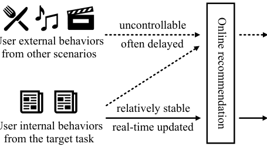
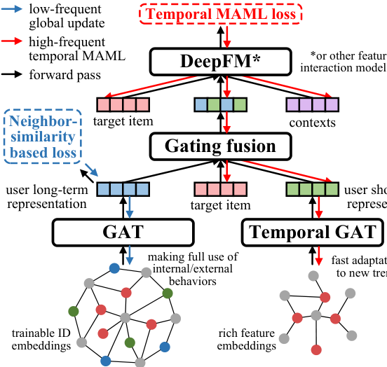
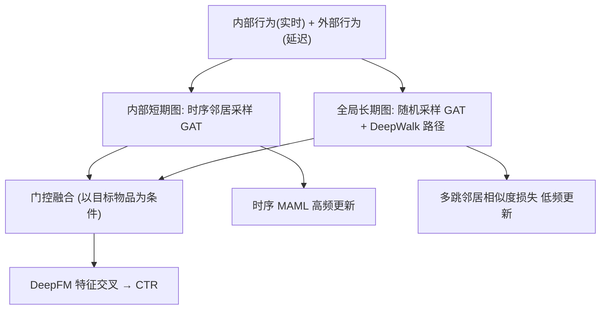

# Long Short-Term Temporal Meta-learning in Online Recommendation (在线推荐中的长短期时序元学习)

- **会议/期刊**: WSDM 2022
- **作者与机构**: Ruobing Xie, Yalong Wang, Rui Wang, Yuanfu Lu, Yuanhang Zou, Feng Xia, Leyu Lin（腾讯微信）
- **推荐链路定位**: 精排（Ranking，News Feed 排序模块）
- **研究方向**: 序列与会话推荐 / 跨域与多场景推荐
- **论文原文**: [https://arxiv.org/abs/2105.03686v2](https://arxiv.org/abs/2105.03686v2)
- **开源代码**: 暂未开源（数据为微信内部 NewsRec-21B，不可公开）

## TL;DR (1分钟核心速览)

在线新闻/视频推荐要同时吃下"用户内部行为 + 平台其他场景的外部行为"，且要秒级跟上热点漂移，但外部行为常延迟不可控、十亿级全图无法实时重训。本文提出 LSTTM：用**全局长期异构图**（内外部行为全量、ID 表征）与**内部短期动态图**（时序邻居采样 GAT）分别建模长期/短期兴趣，门控融合后接 DeepFM；并用**时序 MAML** 把"相邻小时"视为元任务做异步优化。在微信 58M 用户、1B 内部 + 20B 外部行为数据上，小时级 AUC 相对最优基线提升 1.3%–2.0%，线上 5 天 A/B 的 CTR +9.60%、ACN +9.93%。

## Background & Motivation (背景与核心矛盾)

- **主流范式**: 精排侧以 DeepFM/AutoInt 做特征交叉，序列侧以 DIN/DIEN 建模行为序列，图侧以 SR-GNN/GCE-GNN 在会话图上聚合；元学习侧则以 MeLU、SML 针对冷启动用户或"模型重训参数迁移"。
- **前人局限**: ① 序列/DIN 类模型只用目标域内部行为，无法利用同账号在其他 App 的跨域点击；② 会话图模型把图当静态快照，无法刻画"最近 K 次点击"的时序漂移；③ SML 等元学习把"用户"或"旧-新参数"当任务单元，捕捉不到**全局热点**（尤其用户当天无行为时）。
- **核心洞察 (Key Insight)**: 用户兴趣的变化在系统层面是**同步**的——同一小时内全体用户被同一批热点牵引；因此"时间区间"比"用户"更自然的元任务单元，且 MAML 的一步梯度恰好等价于在线 fine-tune 的开销。
- **本文切入点**: 长期用大图 + 低频邻居相似度损失，短期用小动态图 + 高频时序 MAML，两条优化轨道异步解耦（图 1）。

<figure class="paper-figure" markdown="span">
  <figcaption>图 1：具有异步多源内外部行为的实际在线推荐，旨在建模用户的短期和长期偏好。</figcaption>
</figure>

## Method (核心方法设计)

### 1. 整体框架 (Overall Architecture)

输入为用户属性/物品特征 6 个 field（各 16 维）与带时间戳的行为流。**全局长期图**含全部内外部行为节点，用随机/重要性采样的 2 层 GAT 得到 $\bar{\boldsymbol{u}}^l_i$；**内部短期图**仅含目标域用户-新闻点击边，用"最近 K 条"时序邻居采样的 2 层 GAT 得到$\boldsymbol{u}^s_i$。两表征经门控（以目标物品为条件）融合后与上下文一起送入 DeepFM 输出点击概率。训练上做异步解耦：短期图 + 融合层由时序 MAML 高频更新（长期图方向梯度被 block），长期图由多跳邻居相似度损失低频更新；线上对每个新行为只做一次梯度步（图 2）。

<figure class="paper-figure" markdown="span">
  <figcaption>图 2：LSTTM 的整体架构。</figcaption>
</figure>

### 2. 关键设计拆解 (Key Designs)

1. **时序邻居采样 GAT（把"最近性"写进邻域构造算子）**：常规 GAT 在邻居集上随机采样，抹平了行为先后。本文直接把邻居集定义为最近 K 次点击 $N_{u_i}=\mathrm{Temporal}(seq_i)=\{d_{i,m-K+1},\dots,d_{i,m}\}$，再套标准注意力聚合$\boldsymbol{u}^k_i=\sigma(\sum_{d_{i,j}\in N_{u_i}}\alpha^k_{ij}\boldsymbol{W}^k_d\boldsymbol{d}^{k-1}_{i,j})$。直觉：短期兴趣的物理载体是"最近序列"，而非"最相似邻居"。

2. **时序 MAML（把"时段"当作元任务，替代"用户/域"作为任务）**：将训练实例按小时切分，**相邻两小时构成一个任务**——前一小时为 support set、后一小时为 query set（同一实例可同时出现在两任务中）；batch 内采样 8 个跨天跨时的多样化任务，内/外层各只走一步：$\theta'_i=\theta-\alpha\nabla_\theta L_{T_i}(f_\theta)$，$\theta\leftarrow\theta-\beta\nabla_\theta\sum_{T_i}L_{T_i}(f_{\theta'_i})$。这样初始化对"下一小时的热点分布"敏感，线上只需一步梯度即可对齐新趋势，成本等同一次 fine-tune。任务还可按用户群细分为更细粒度任务，聚焦社区级热点。

3. **异步优化与训练目标**：短期侧用交叉熵 $L_T$（正样本点击、负样本未点击曝光），长期侧用 DeepWalk 10-hop 路径上的邻居相似度损失$L_N=-\sum_{p\in P}\sum_{q_i,q_j\in p}\log\sigma(\bar{\boldsymbol{q}}^{l\top}_i\bar{\boldsymbol{q}}^l_j)$，总损失$L=\lambda_T L_T+\lambda_N L_N$（$\lambda_T=\lambda_N=1$）。关键在于$L_T$的梯度对长期图 **block**：外部行为延迟/噪声不会污染实时短期建模；线上复杂度$O(k(T_i+T_f))$，$k$ 为上游召回的 top-200 候选。

## Experimental Setup & Evaluation Protocol (实验设置与评估协议)

- **数据集与预处理**: NewsRec-21B（微信新闻推荐，脱敏），无 5-core 过滤（工业全量曝光）：

| 数据集 | #Users | #Items | #Interactions | 稀疏度/密度 | 特征/场景说明 |
| :--- | :---: | :---: | :---: | :---: | :--- |
| NewsRec-21B (internal) | 58,284,406 | 626,736 | 1,022,589,888 | 极稀疏 | 目标新闻域的点击/曝光，小时级时间戳 |
| NewsRec-21B (external) | 58,284,406 | — | 20,087,883,624 | 极稀疏 | 同账号在其他推荐域的点击，构建全局长期图 |

- **数据划分与防穿越 (Splitting Strategy)**: **全局时间戳切分**——前 8 天为训练集，第 9 天内部行为为测试集；测试日再按自然小时切成 24 个时段，逐时段预测（第 $t$时段用当日$t-1$ 时段以前全部测试实例作 support set），严格避免未来行为泄漏。
- **排名评测协议 (Ranking Protocol)**: 非 Full-Ranking，而是**曝光级 point-wise CTR 预测 + AUC**（与工业线上目标一致）；负样本即未点击曝光。24 小时按 0:00–8:00 / 8:00–16:00 / 16:00–24:00 聚合成 3 个 period 报告均值，各模型统一只做一次梯度更新（SML 用其迁移函数），每模型跑 3 次，$t$-test$p<0.01$。
- **对比基线与超参设置**: 特征交叉类 FM / NFM / DeepFM / AutoInt；增强类 DeepFM(+external)、DIN+DeepFM(+external)；元学习类 SML、SML+DeepFM。图嵌入维 16、特征域嵌入维 16，长期图采样 30 邻居、短期图取 30 条最近行为；MAML batch 8 个任务、support/query 各 128、Adagrad 学习率 0.01。

## Key Experimental Results (实验关键数据)

### 1. 主实验对比 (Main Results)

| Model | period1 AUC | period2 AUC | period3 AUC |
| :--- | :---: | :---: | :---: |
| FM | 0.8086 | 0.8021 | 0.8072 |
| NFM | 0.8140 | 0.8035 | 0.8154 |
| DeepFM | 0.8253 | 0.8306 | 0.8296 |
| AutoInt | 0.8236 | 0.8282 | 0.8272 |
| DeepFM (+external) | 0.8282 | 0.8335 | 0.8327 |
| DIN+DeepFM (+external) | 0.8287 | 0.8346 | 0.8337 |
| SML+DeepFM | 0.8250 | 0.8307 | 0.8299 |
| LSTTM (w/o Meta) | 0.8373 | 0.8428 | 0.8421 |
| **LSTTM (final)** | **0.8395** | **0.8504** | **0.8502** |
| Improv. vs best baseline | +1.30% | +1.89% | +1.98% |

线上 A/B（微信看一看，5 天，基线为同频更新的 DeepFM）：CTR **+9.60%**、ACN **+9.93%**、HCR **+3.42%**、DT **+2.52%**（$p<0.01$）。

### 2. 消融实验 (Ablation Study)

| 版本 | period1 | period2 | period3 |
| :--- | :---: | :---: | :---: |
| LSTTM (final) | **0.8395** | **0.8504** | **0.8502** |
| – temporal MAML | 0.8373 | 0.8428 | 0.8421 |
| – user external behaviors | 0.8385 | 0.8459 | 0.8459 |
| – gating-based fusion (改 concat) | 0.8378 | 0.8488 | 0.8489 |
| – GAT aggregation & $L_N$ | 0.8304 | 0.8410 | 0.8411 |

### 3. 关键实验发现 (Key Findings)

1. **时序 MAML 的收益随时间单调放大**：去掉 MAML 后 period1→period3 分别掉 0.0022 / 0.0076 / 0.0081，即离上次全量训练越久（period3 已过 16 小时），一步元更新追热点的累积优势越明显，这也解释了图 3 中 LSTTM 的 AUC 曲线随小时数上升而持续领先。
2. **图结构比"外部特征"更重要**：仅删掉 GAT 聚合与 $L_N$（保留原始内外部特征输入）就损失 0.0063–0.0094，远大于删掉外部行为（0.0022–0.0045）或换掉门控（0.0013–0.0017），说明增益主因是"跨域多跳交互建模"而非特征拼接；同时 DeepFM→DeepFM(+external) 的 +0.003 也印证外部行为本身的边际价值。
3. **门控优于拼接且增益稳定**：替换为 concat 后在三个 period 均下降 0.0013–0.0017，说明以目标物品为条件动态分配长/短权重（而非固定权重）对"新闻 vs 视频"等异构候选场景有实际区分度。

## Highlights & Limitations (亮点、对比与审稿批判)

- **与代表作对比 (vs. Prior Work)**: 相比 **SML**（以时间序列上的参数迁移函数建模重训，基于 MF，须逐段顺序训练），LSTTM 把任务定义为"时段"并在图模型上做一步 MAML，AUC 高出 0.013–0.020；相比 **DIN+DeepFM(+external)**（序列注意力 + 跨域特征拼接），本文额外引入跨域多跳图与热点级元适应，AUC +0.011–0.017；相比 **SR-GNN/GCE-GNN**（会话图静态聚合），本文图是**随时间滚动更新**的动态邻居结构。
- **可迁移亮点**: ① "梯度 block + 双频更新"是工业界处理**延迟/不可控外部数据**的通用解耦范式，可直接搬到跨域推荐与实时特征延迟场景；② 把"时段"而非"用户"作为元任务单元，可迁移到任何有强全局时效性的任务（热搜、直播、秒杀推荐）。
- **审稿级局限批判**: ① 数据与代码均不公开，10 亿~200 亿规模的复现门槛使结论难以验证；离线仅报曝光级 point-wise AUC，缺少全库排序与稀疏/冷启动分桶实验，"外部行为对冷启动更有用"仅是论述而无数据；② 元任务粒度固定为"1 小时"、support/query 各 128、一步内外更新均属强工程先验，未给出对时间粒度与任务数的敏感性曲线；且最终 AUC 相对最优基线仅约 1 个百分点，却需日级 4 小时全量重训（30 PS + 20 workers）与在线双轨更新，投入产出比在中小系统未必成立。

## Rating (四维评分)

- **方法创新性 (Novelty)**: ⭐⭐⭐⭐ （"时段即任务"的时序 MAML 是有辨识度的新视角，双图异步优化设计自洽，但 GAT/门控/DeepFM 均为成熟组件拼装）
- **评估协议与实验扎实度 (Protocol & Experiments)**: ⭐⭐⭐⭐ （58M 用户真实流量、24 小时逐时段滚动评估 + 5 天线上 A/B + 显著性检验齐全，扣分于缺少全库排序、冷启动分桶与公开可复现性）
- **写作与数学规范度 (Clarity & Rigor)**: ⭐⭐⭐⭐ （公式精简、算法伪码与线上部署细节完整，但 $L_N$与$k$-hop/DeepWalk 的等价性仅有直觉论证，缺复杂度与收敛性分析）
- **工业落地与复现价值 (Industrial & Practical Value)**: ⭐⭐⭐⭐ （给出完整的异步训练/在线服务/资源配置方案，梯度 block 与一步更新极具工程借鉴意义；但不开源、依赖平台级跨域行为，独立复现困难）

