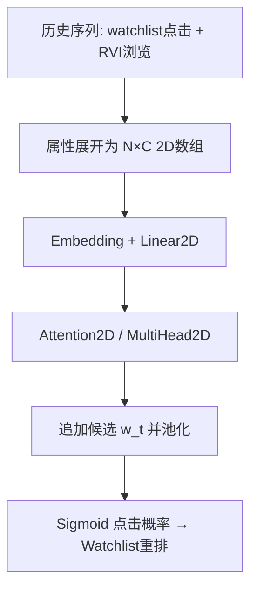
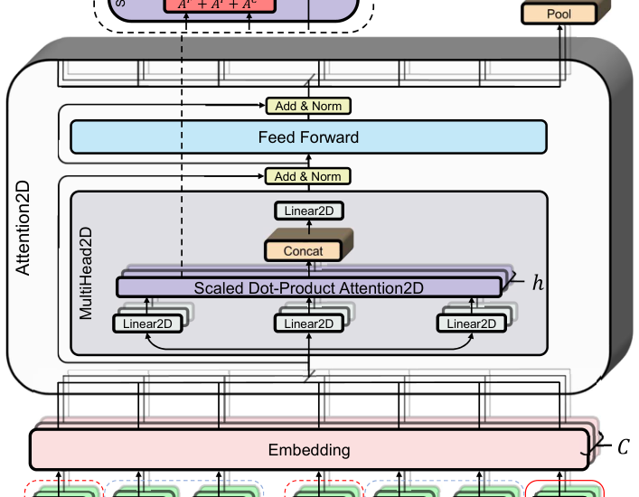

# Sequential Modeling with Multiple Attributes for Watchlist Recommendation in E-Commerce (电商关注列表推荐中的多属性序列建模)

- **会议/期刊**: WSDM 2022
- **作者与机构**: Uriel Singer 等，eBay Research / Ben-Gurion University
- **推荐链路定位**: 重排（watchlist 内候选排序）
- **研究方向**: 序列与会话推荐 / CTR与特征交互
- **论文原文**: [论文原文链接](https://arxiv.org/abs/2110.11072v2)
- **开源代码**: [开源代码仓库链接](https://github.com/urielsinger/Trans2D)

## TL;DR (1分钟核心速览)

针对电商 watchlist 候选多、物品属性动态变化、item-ID 稀疏且现有序列模型预测期难用属性等问题，本文把任务建模为 watchlist 内点击重排，提出 Trans2D：将序列展开为 item×attribute 二维数组，用 Attention2D 同时学习 item-item、attribute-attribute 与跨项属性交互。在 eBay 两周数据、当前 watchlist 快照全排序协议下，P@1 43.51、NDCG@5 26.12，较最佳基线分别提升 11.3% 和 4.2%。

## Background & Motivation (背景与核心矛盾)

- **主流范式**: 电商序列推荐多以 item-ID 序列 + GRU/Transformer（GRU4Rec、SASRec、BERT4Rec）预测下一物品；属性增强方法多先在嵌入层做平均/拼接/注意力池化，再送入序列模型。
- **前人局限**: ① watchlist 是动态小候选集，且价格、库存等属性随时间变，item-ID 稀疏易过拟合；② 多数属性模型只在训练期用属性、预测仍靠 item-ID，或 concat 导致参数膨胀，难以在预测期保留属性通道语义。RVI 浏览行为也未被 item-ID 序列充分利用。
- **核心洞察**: watchlist 快照平均仅 10.48 项，适合对候选逐项打分重排；用户点击前 RVI 与相对快照位置 RSP 含强短期意图，且 item-item、attribute-attribute、item-attribute 三类交互应同时建模。
- **本文切入点**: 将序列表示为 $N\times C$ 的 item-attribute 二维数组，用 Attention2D 原生处理二维输入，保留通道语义并对 watchlist 候选做点击重排。

## Method (核心方法设计)

### 1. 整体框架 (Overall Architecture)

输入为按时间排序的 watchlist 点击与 RVI 浏览序列，每一项展开成 $C$个属性，得到$N\times C$ 属性数组；Embedding 后经 Attention2D 块同时建模 item-item、channel-channel 与任意 item-attribute 交互；对当前 watchlist 候选逐项追加到序列末尾，池化其最后位置表示并用 sigmoid 输出点击概率，按分数降序展示 top-k。训练以 snapshot 内 BCE 全候选监督，推理只重排 watchlist 内候选，不触达全库 ANN。

<figure class="paper-figure" markdown="span">
  <figcaption>图1：使用带 Attention2D 层的 Transformer 的关注列表推荐模型（Trans2D）。该模型包含三个主要部分：嵌入层（底部）、Attention2D 层（中部）和预测层（右上）。ScaledDotProductAttention2D 组件在左上角进一步展示。</figcaption>
</figure>
图1：Trans2D 整体架构；Attention2D 在 item 与 attribute 两个轴上计算注意力。

### 2. 关键设计拆解 (Key Designs)

1. **Attention2D 三分支注意力**：痛点：先池化属性会丢失通道语义，concat 又使参数/维度膨胀。做法：对 $Q,K,V$的每个$(i,j)$计算全交互$A^F$、item 边缘$A^I$、channel 边缘$A^C$，再用可学习标量融合：$A_{i,j,i',j'}=\alpha_1A^{F}_{i,j,i',j'}+\alpha_2A^{I}_{i,i'}+\alpha_3A^{C}_{j,j'}$，经$\mathrm{softmax}(A/\sqrt{d})$加权$V$。直觉：$A^I$管“哪些历史物品重要”，$A^C$管“哪个属性通道重要”，$A^F$ 管跨物品跨属性的细粒度匹配。

2. **Linear2D 与候选追加式预测**：痛点：普通 Linear 对所有通道共享权重，无法保留属性差异。做法：每个通道 $j$独立线性变换$\mathrm{Linear2D}_W(X)=\mathbf{W}_j[x]_{i,j}$；预测时把候选$w_t$追加到序列尾，经 Attention2D 后对其最后表示做通道池化：$\hat{y}=\sigma(\mathbf{W}_p\cdot\mathrm{Pool}(e'_{N+1})+b_p)$。直觉：让候选与历史在同一 2D 注意力场中交互，且池化发生在注意力之后，避免信息早损。

3. **训练目标、负采样与推理效率**：在 snapshot 内对全部 $m_t$个候选做 BCE，非点击即负，**免额外负采样**：$\mathcal{L}=\sum_{l=1}^{m_t}-[y_l\log\hat{y}_l+(1-y_l)\log(1-\hat{y}_l)]$。推理需对每个候选追加一次序列前向（$m_t\le15$），无全库 ANN；参数量仅比标准 attention 多每通道 Linear2D 与 3 个$\alpha$。

## Experimental Setup & Evaluation Protocol (实验设置与评估协议)

- **数据集与预处理**: 非 5-core；保留活跃用户且至少 20 次 watchlist 交互；每个快照最多采样 15 项，按加入时间排序。

| 数据集 | #Users | #Items | #Interactions | 稀疏度/密度 | 特征/场景说明 |
| :--- | :---: | :---: | :---: | :---: | :--- |
| eBay Watchlist | 40,344 | 5,374,902 | 13,041,553（11.67M 浏览 + 1.37M 点击） | 极稀疏，约 $6\times10^{-5}$ | 2021-02-02 至 02-15；快照均值 10.48 项；属性含价格 100 分箱、品类、卖家哈希、condition、sale-type、RSP、时间等 |

- **数据划分与防穿越 (Splitting Strategy)**: 全局时间戳切分，训练 2 月 2–11 日，取训练末 1% 作验证，测试 2 月 12–15 日；Attention2D 对序列未来位置做 $-\infty$ mask。
- **排名评测协议 (Ranking Protocol)**: **Snapshot Full-Ranking**：对当前 $WL_t$ 的全部候选打分排序，非全局 catalog，也不采样负例；训练在 snapshot 内做全候选 BCE，非点击即负。
- **对比基线与超参设置**: 基线含启发式 RSP/Price、GRU 系（GRU$_A$、GRU$_C$、LatentCross、ContextAware）、Transformer 系（Trans$_A$、BST、Trans$_T$、FDSA$\pm$）、FM/MF 系（SeqFM、CDMF），并用 A1 属性平均、A2 watchlist 点击预测、A3 context 适配。默认$L=1$、$h=4$、$d=16$、$N=50$、dropout 0.3、Adam$lr=10^{-3}$、batch 32、5 epochs；显著性用双侧配对 t 检验，95% 置信 + Bonferroni 校正。

## Key Experimental Results (实验关键数据)

### 1. 主实验对比 (Main Results)

| Model | P@1 | P@2 | P@5 | H@2 | H@5 | N@2 | N@5 |
| :--- | :---: | :---: | :---: | :---: | :---: | :---: | :---: |
| **Trans2D** | **43.51** | **33.30** | **21.56** | **62.19** | **80.85** | **35.61** | **26.12** |
| GRU$_C$ | 39.08 | 31.52 | 21.24 | 58.76 | 79.43 | 33.23 | 25.07 |
| BST | 38.15 | 31.21 | 21.28 | 58.09 | 79.57 | 32.78 | 24.94 |
| FDSA$-$ | 37.84 | 31.03 | 21.14 | 57.80 | 78.91 | 32.57 | 24.76 |
| FDSA$+$ | 36.95 | 30.37 | 21.01 | 56.57 | 78.35 | 31.86 | 24.46 |
| Trans$_T$ | 36.77 | 30.83 | 21.18 | 57.37 | 79.12 | 32.17 | 24.62 |
| ContextAware | 36.06 | 30.50 | 21.09 | 56.78 | 78.70 | 31.76 | 24.41 |
| Trans$_A$ | 36.01 | 30.42 | 21.10 | 56.56 | 78.72 | 31.68 | 24.41 |
| CDMF | 32.71 | 28.15 | 20.41 | 52.10 | 75.30 | 29.18 | 23.15 |

相对最佳基线：P@1 43.51 vs. 39.08（**+11.3%**），NDCG@5 26.12 vs. 25.07（**+4.2%**），NDCG@2 35.61 vs. 33.23（**+7.2%**）。

### 2. 消融实验 (Ablation Study)

| Model | P@1 | H@5 | N@5 |
| :--- | :---: | :---: | :---: |
| **Trans2D** | **43.51** | **80.85** | **26.12** |
| $-A^F$ | 44.01 | 80.85 | 26.20 |
| $-A^C$ | 43.03 | 80.69 | 26.00 |
| $-A^I$ | 38.83 | 79.92 | 25.14 |
| $-\mathrm{Linear2D}$ | 41.93 | 80.56 | 25.79 |
| $-$RVI | 43.21 | 80.62 | 26.01 |
| $-$watchlist | 40.07 | 78.49 | 25.08 |
| $-$history | 33.04 | 75.53 | 23.27 |
| $-$position | 32.18 | 72.81 | 22.51 |
| $-$item 属性组 | 42.21 | 80.13 | 25.74 |
| $-$time 属性组 | 43.25 | 80.79 | 26.06 |

### 3. 关键实验发现 (Key Findings)

1. **主结果**：Trans2D 在 P@1 43.51、NDCG@5 26.12，较最佳基线 GRU$_C$ 的 39.08/25.07 提升 11.3%/4.2%；H@5 80.85 也高于 BST 的 79.57，说明二维注意力在 watchlist 小候选重排中稳定优于 concat 与属性池化。
2. **消融归因**：去掉 $A^I$ 使 P@1 降至 38.83、NDCG@5 降至 25.14；去掉 history 降至 33.04/23.27；去掉 position 属性组最伤，降至 32.18/22.51，表明“历史行为 + 快照位置/RSP”是核心信号，item-item 注意力比 channel 边缘更重要。
3. **参数与机制**：去掉 Linear2D 仍达 P@1 41.93，超过最强基线 39.08，说明增益不只来自通道独立参数；但 $A^F$单独移除反而略升至 44.01/26.20，暗示单层$A^F$与第二层注意力存在互补/冗余。敏感性显示$d=32$最优、$N=50$ 或 1 天已覆盖大部分短期信号。

## Highlights & Limitations (亮点、对比与审稿批判)

- **与代表作对比 (vs. Prior Work)**: SASRec/BERT4Rec 只吃 item-ID 并预测下一 item；FDSA/S3 虽用属性但预测仍依赖 item-ID 或仅预训练；BST 直接 concat 属性，参数大且通道语义弱。Trans2D 在预测期保留属性通道并用 2D attention 统一建模。
- **可迁移亮点**: “候选追加到序列尾 + 注意力后再池化”适合小候选重排；Attention2D 可迁移到多字段行为序列（价格/品类/位置）建模。
- **审稿级局限批判**: 仅 eBay 单一平台、4 天测试窗，缺公开基准与冷启动划分；推理对每个候选各前向一次，若候选集扩大成本线性上升，且 4D attention 复杂度 $O(N^2C^2)$。默认$d=16$而最优$d=32$，超参敏感；$A^F$ 移除略优也削弱三分支设计的可解释性。

## Rating (四维评分)

- **方法创新性 (Novelty)**: ⭐⭐⭐⭐ （将 Transformer attention 扩展到 item×attribute 二维输入，三分支融合有明确物理直觉，但仍是架构增量。）
- **评估协议与实验扎实度 (Protocol & Experiments)**: ⭐⭐⭐⭐ （eBay 大规模数据、时间切分、快照全排序与显著性检验较扎实；但单数据集、无公开复现基准略扣分。）
- **写作与数学规范度 (Clarity & Rigor)**: ⭐⭐⭐⭐ （Attention2D 公式、维度与掩码说明清晰，复杂度分析偏少。）
- **工业落地与复现价值 (Industrial & Practical Value)**: ⭐⭐⭐⭐ （代码开源、候选集小易上线；逐候选前向与 4D attention 在更大场景需优化。）

