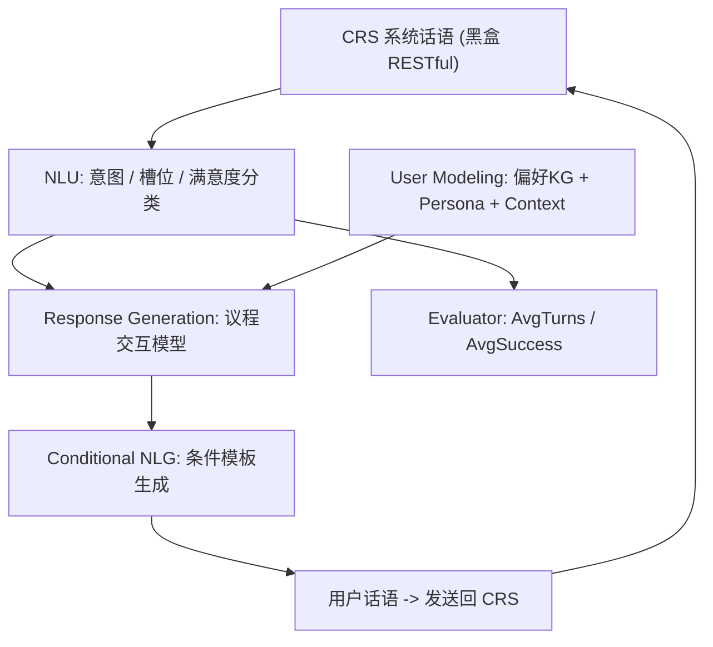

# UserSimCRS: A User Simulation Toolkit for Evaluating Conversational Recommender Systems （对话推荐系统的用户模拟评估工具箱）

- **会议/期刊**: WSDM 2023（4 页 Resource/Demo Track）
- **作者与机构**: Jafar Afzali, Aleksander Mark Drzewiecki, Krisztian Balog（University of Stavanger）, Shuo Zhang（Bloomberg）
- **推荐链路定位**: 端到端对话式推荐的**系统评测环节**（非排序模型）
- **研究方向**: 对话推荐与智能体仿真
- **论文原文**: [https://arxiv.org/abs/2301.05544v3](https://arxiv.org/abs/2301.05544v3)
- **开源代码**: [https://github.com/iai-group/UserSimCRS](https://github.com/iai-group/UserSimCRS)（底层通用库 DialogueKit 亦已开源）

## TL;DR (1分钟核心速览)

对话推荐系统（CRS）的最大瓶颈在**评测**：离线静态测试集无法度量会话级效果，真人实验昂贵且不可复现。本文提出 UserSimCRS——一个构建在议程驱动模拟器之上的开源、可扩展用户模拟工具箱，增量引入**用户满意度预测、Persona 建模、Context 建模（时序/关系/会话三种情境）与上下文条件式 NLG**，并以"黑盒 + REST 连接器"方式接入任意既有 CRS。方法论上仅需 5–50 条人工标注对话、一份物品集与一份用户评分三元组即可启动仿真；案例中对 IAI MovieBot 用 **8 条标注对话**即生成可完成多轮任务的拟人对话。原文为资源型论文，**未报告任何相对基线的定量指标与显著性检验**，评测为纯定性展示。

## Background & Motivation (背景与核心矛盾)

- **主流范式**: CRS 的偏好获取、多轮策略与 NLU/NLG 已有大量进展，但评测仍依赖离线静态数据集或小规模真人用户研究。
- **前人局限**: 其一，议程驱动模拟器（Zhang & Balog 等）工作在"意图空间"，无 Persona / Context / 满意度建模，生成对话机械、拟人度低；其二，ConvLab-2、Seq2seq 用户模拟器（Shi 等、Tseng 等）工作在"模型空间"，需白盒接入特定系统架构，且目标多为 RL 训练而非系统评测。
- **核心洞察 (Key Insight)**: 若把模拟器拆成 NLU / Response Generation / User Modeling / NLG 四个可替换模块，则**少量标注对话足以训练一个可控、可复现、与具体系统解耦的评测代理**；同时，仿真器与目标 CRS 的 action space 必须**协同设计**，否则无法放大待比较两系统的真实差异。
- **本文切入点**: 以"黑盒可接入 + 模块可插拔 + 语言空间生成"替代"白盒绑定 + 意图空间 + 端到端训练"。

## Method (核心方法设计)

### 1. 整体框架 (Overall Architecture)

模拟器沿用任务型对话系统的四件套结构但完全模块化：**NLU** 将 CRS 话语解析为意图、槽位与满意度标签；**User Modeling** 维护偏好知识图谱（用户-物品-属性节点）、Persona（耐心度、配合度）与 Context（时序、关系、会话因素）；**Response Generation** 采用议程（agenda）驱动的交互模型，持有一组待执行用户动作；**NLG** 为条件式模板生成。整个循环以 CRS 为黑盒，通过与 CRS 的 RESTful API 往返完成多轮对话，最终由 DialogueKit 的 Evaluator 统计 AvgTurns、AvgSuccess 等会话级指标。

### 2. 关键设计拆解 (Key Designs)

1. **满意度预测（Satisfaction Classifier）**：痛点在于模拟器无法感知"用户何时开始不耐烦"，导致对话策略变化缺失。在 NLU 侧增加三分类器 $\hat{s}_t=\arg\max_{c\in\{\text{sat},\text{neu},\text{dis}\}}P_{\theta}(c\mid u_t^{agent})$，仅在**训练阶段**用于为话语自动打标，标注成本从"逐句人工标注情感"降为"零"。
2. **Persona 与 Context 建模（含条件式 NLG）**：痛点在于既有模拟器的用户是"无差别人格"。将情境抽象为三个可配置维度（时序：工作日/周末、时段；关系：独处/群体；会话：当前满意度），并把 Persona 与 Context 向量 $\mathbf{p},\mathbf{c}$同时注入偏好模型（改变提问倾向）与 NLG 模板选择：$r_t=\arg\max_{r\in\mathcal{T}(u_{t+1},\mathbf{p},\mathbf{c})}\ \text{score}(r)$。直觉上，同一意图在不同情境下应产生不同长度与语气的表达（如满意度下降时语气更强硬），此即"人味"的来源。
3. **议程更新算子与训练/推理开销**：交互模型在期望响应命中时前移议程，否则重复或重采样：$u_{t+1}=\mathrm{Pop}(\mathcal{A})$若$a_t^{agent}\in\mathbb{E}(u_t)$，否则$u_{t+1}\sim\mathcal{A}$或$u_{t+1}=u_t$。总训练仅为 NLU（余弦意图分类器 + 轻量 DIET 槽位抽取）与模板库的监督拟合，**不涉及负采样、不涉及 RL**；推理即逐轮规则 + 分类前向，单轮开销以毫秒计，瓶颈完全在外部 CRS 的响应延迟。

## Experimental Setup & Evaluation Protocol (实验设置与评估协议)

- **案例配置与规模**（原文无标准数据集统计，仅有案例配置）：

| 配置项 | 取值 |
| :--- | :--- |
| 目标 CRS | IAI MovieBot（开源，经 RESTful API 接入） |
| 领域槽位 | title / genre / keyword |
| 标注对话量 | 8 条（论文建议通用区间 5–50） |
| 噪声/过滤 | 无（资源型论文不涉及 5-core 等过滤） |
| 用户群体 | 由 Persona × Context 组合实例化，偏好由评分三元组接地 |
| 会话级指标 | AvgTurns、AvgSuccess（DialogueKit Evaluator） |

- **数据划分与防穿越**: **不适用**——无 train/test 划分；8 条样本仅用于拟合 NLU 与 NLG，仿真对话全部为在线生成，不存在标签泄漏路径。
- **排名评测协议**: **不适用**——不涉及 Full-Ranking 或 Sampled Ranking；评测对象是会话轨迹而非候选列表排序。
- **对比基线与超参设置**: 无定量基线、无 $d$维嵌入、无$p<0.05$ 显著性检验；比较对象为功能性对比（见下表）。

| 能力维度 | 议程模拟器 [25] | ConvLab-2 / Shi 等 | **UserSimCRS（本文）** |
| :--- | :---: | :---: | :---: |
| 交互空间 | 意图空间 | 意图空间 | **语言空间** |
| 核心目标 | 数据生成 / RL | RL 训练 | **系统评测** |
| 系统接入 | 需定制适配 | 白盒、需接口 | **黑盒 REST** |
| 用户建模 | 偏好 KG | 基本缺失 | **偏好 + Persona + Context + 满意度** |
| NLG | 固定模板 | 神经生成 | **上下文条件模板** |

### 2. 消融实验 (Ablation Study)

**原文未提供消融实验**（资源型论文，无 `w/o ...` 变体对比）。可视为隐含消融的仅有：移除满意度分类器则该标签不可得、移除 context 条件则所有情境共用同一模板集，但作者均未给出量化验证。

### 3. 关键实验发现 (Key Findings)

1. **极低标注成本即可闭环**：仅 8 条标注对话即让模拟器与 IAI MovieBot 走完"提需求—获推荐—接受/拒绝"的完整流程（图 3 示例对话），印证了"模板 + 议程"路线对数据量的低依赖，但样本量过小也意味着无法估计方差。
2. **黑盒解耦是本文最实的工程贡献**：接入一个既有 CRS 只需 9 步配置（领域文件、物品集、评分三元组、对话样本、交互模型、用户群体、训练、仿真、评测），无需源码，显著降低了 CRS 之间横向比较的门槛。
3. **评测主张缺乏证据支撑**：全文未给出任何两个系统（如 CRSv1 vs 加 plot keyword 的改进版）在同一模拟器下的指标差异，因此"模拟器能放大目标行为差异"这一核心前提仍是**未验证的设计断言**，而非实验结论。

## Highlights & Limitations (亮点、对比与审稿批判)

- **与代表作对比 (vs. Prior Work)**: 相比议程模拟器 [25]，本文加了满意度、Persona/Context 与条件 NLG，并把定位从"数据生成"改为"系统评测"；相比 ConvLab-2 与 Seq2seq 模拟器，最大区别是**在语言空间操作 + 黑盒接入**，因而天然支持异构 CRS 的横向对比。
- **可迁移亮点**: ①用满意度分类器把"零成本弱标注"变成上下文条件生成的驱动信号，可直接迁移到 CRS 的奖励建模或早停策略；②"模拟器必须与目标系统的 action space 共同设计"这一方法论告诫，对所有做 Agent 仿真沙盒的工作都成立。
- **审稿级局限批判**: ①**实验近乎空白**——无定量指标、无基线、无显著性、无消融，仅一张示例对话图，作为 WSDM 论文其证据强度只能靠开源工具本身承担；②**模板 NLG 天花板明显**——语言多样性受限于人工模板库，且新领域需人工定义槽位、意图集与期望响应，扩展成本随领域复杂度线性上升；③未报告仿真延迟、用户群体规模敏感性，也未与真人对话做过拟人度对照评估。

## Rating (四维评分)

- **方法创新性 (Novelty)**: ⭐⭐⭐ （Persona/Context 与条件 NLG 是有价值的概念增量，但核心议程机制沿用 [25]，无理论或谱分析层面的新贡献）
- **评估协议与实验扎实度 (Protocol & Experiments)**: ⭐⭐ （仅 8 条对话的定性案例，无定量基准、无消融、无显著性检验，核心评测主张未被验证）
- **写作与数学规范度 (Clarity & Rigor)**: ⭐⭐⭐⭐ （架构分层图、包依赖图与 9 步接入流程表述清晰，缺憾是全篇几乎无形式化定义与复杂度分析）
- **工业落地与复现价值 (Industrial & Practical Value)**: ⭐⭐⭐⭐ （双库均已上 PyPI、提供可运行示例与详尽的配置文档，黑盒接入使其可直接用作 CRS 上线前的回归评测闸门）

