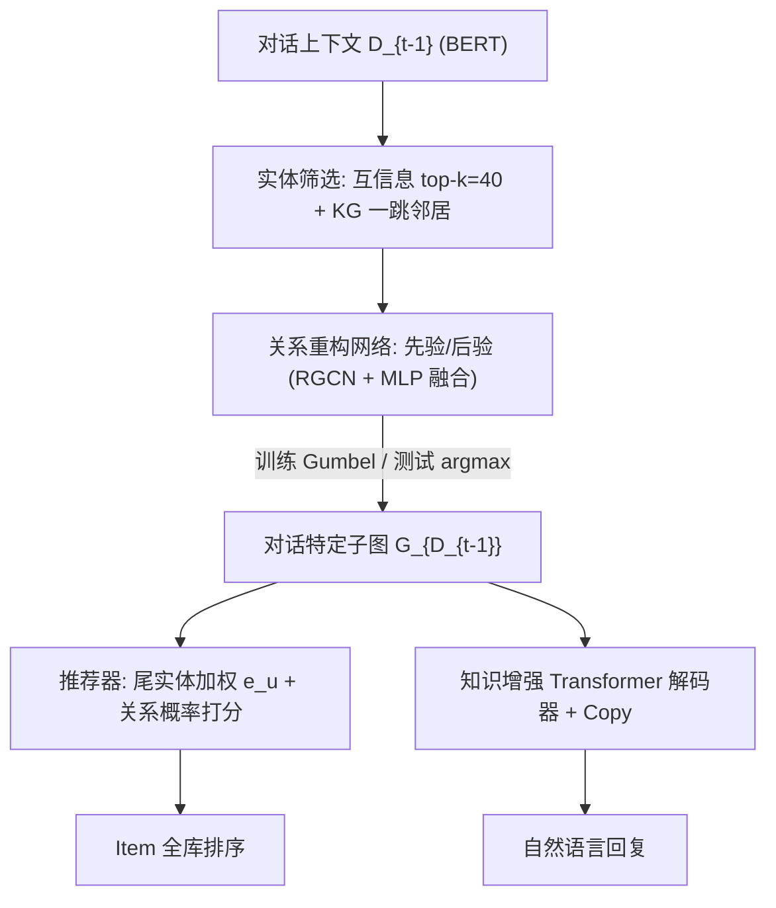
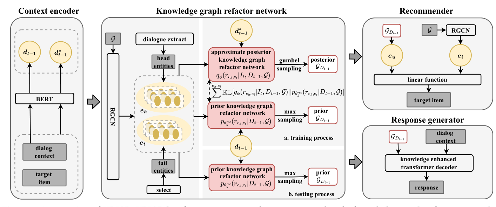

# Variational Reasoning over Incomplete Knowledge Graphs for Conversational Recommendation (面向不完整知识图谱变分推理的对话推荐)

- **会议/期刊**: WSDM 2023
- **作者与机构**: Xiaoyu Zhang, Xin Xin, Dongdong Li, Wenxuan Liu, Pengjie Ren, Zhumin Chen, Jun Ma, Zhaochun Ren（山东大学）
- **推荐链路定位**: 端到端（对话式推荐 + 回复生成联合建模）
- **研究方向**: 对话推荐与智能体仿真 / 图神经网络与知识图谱推荐
- **论文原文**: [https://arxiv.org/abs/2212.11868v2](https://arxiv.org/abs/2212.11868v2)
- **开源代码**: [https://github.com/zxd-octopus/VRICR](https://github.com/zxd-octopus/VRICR)

## TL;DR (1分钟核心速览)

对话推荐（CRS）普遍外挂知识图谱（KG）补充语义，但真实 KG 存在**不完整/稀疏**（形成孤立连通片，路径与嵌入式补全都失效）与**噪声冗余**（不同对话却共享同一整图知识）两大痛点。VRICR 把「对话特定子图」$G_{D_{t-1}}$ 显式建模为离散隐变量，用变分贝叶斯框架下的先验/后验关系重构网络同步完成**缺边补全**与**上下文条件下的知识筛选**，再把子图注入推荐器与回复解码器。REDIAL 全库排序评测下，Recall@1/@10 相对 UniCRS 提升 **11.8%/12.1%**，Distinct-4 从 0.359 升至 0.482。

## Background & Motivation (背景与核心矛盾)

- **主流范式**: KBRD/KGSF/C2-CRS/UniCRS 等把外部 KG 实体表征拼接或对齐进对话语义空间，做词级+实体级的知识增强推荐与生成。
- **前人局限 1**: 原始 KG 稀疏导致图被切成多个独立子图，路径式补全缺必要路径、嵌入式补全缺结构信号，二者都难以恢复如「The Dark Knight — DC Comics」这类关键缺失关系。
- **前人局限 2**: 几乎所有方法对**所有对话复用同一整图**；但两段都提到 "Wonder Woman" 的对话，其应激活的知识应分别是"女性主义电影"与"超级英雄/演员"两个不同子图，整图输入等价于注入噪声。
- **核心洞察 (Key Insight)**: CRS 天然自带大规模对话语料，其中共现的实体对（如某电影与某类型片）可作为**弱监督证据**，用于补全 KG 的缺失边；而"缺哪条边"本身依赖对话上下文，因此应作为隐变量推断而非静态预处理。
- **本文切入点**: 用变分后验 $Q_\phi(G_{D_{t-1}}\mid I_t, D_{t-1}, \mathcal{G})$逼近先验$p_\theta(G_{D_{t-1}}\mid D_{t-1},\mathcal{G})$，把"补全 + 筛选"统一为一个 KL 正则下的关系二分类问题。

## Method (核心方法设计)

### 1. 整体框架 (Overall Architecture)

输入为前 $t-1$轮对话上下文$D_{t-1}$与外部不完整 KG$\mathcal{G}=(\mathcal{E},\mathcal{R})$（所有物品均在图顶点中）。BERT 上下文编码器产出$\boldsymbol{d}_{t-1}$（先验条件）与拼接目标物品词序列的$\boldsymbol{d}^{*}_{t-1}$（后验条件，刻意不用 KG 实体表征以避免"图语义偏置")。KG 重构网络在 RGCN 实体表征之上，对候选实体对做「先验/后验」两路关系分类，训练时用 Gumbel 采样、测试时仅走先验并 argmax 采样，得到对话特定子图$G_{D_{t-1}}$；该子图分别以"尾实体加权用户表征 + 关系概率打分"注入推荐器、以"头/尾实体双注意力 + Copy"注入回复解码器。图 2 给出四个模块的训练/测试双路数据流。

### 2. 关键设计拆解 (Key Designs)

1. **子图即隐变量的 ELBO 目标**：把不可解的后验用 $Q_\phi$ 近似，得
$\log P(I_t\mid D_{t-1},\mathcal{G}) \ge \mathbb{E}_{q_\phi}\big[\log P_{\theta_{rec}^r}(I_t\mid G_{D_{t-1}})\big] - \sum_{e_h,e_t}\mathrm{KL}\big[q_\phi(r_{e_h,e_t}\mid I_t,D_{t-1},\mathcal{G})\,\|\,p_{\theta_{rec}^g}(r_{e_h,e_t}\mid D_{t-1},\mathcal{G})\big]$
关键在于**后验看到目标物品、先验看不到**，因此 KL 项强迫先验仅凭对话上下文就能"猜出"后验借答案学到的边——推理期无需标签即可补全与筛选。

2. **关系重构网络（候选筛选 + 特征融合）**：只允许对话中出现的实体作头实体以控复杂度；尾实体 = KG 一跳邻居 ∪ 按互信息 $P_c(e)=\sum_{e_h}P(e\mid e_h)P(e)\log\frac{P(e\mid e_h)}{P(e)}$取 top-$k=40$。关系简化为二分类（连通/不连通），MLP 输入为拼接项、两两哈达玛积与三阶积的融合向量$\boldsymbol{m}=[\boldsymbol{f}^1;\boldsymbol{f}^2;\boldsymbol{f}^3]\mathbf{W}_o$（式 9），使头实体、尾实体与上下文三者交互后才能定边。

3. **训练目标、负采样与推理效率**：推荐总损失
$\mathcal{L}_{rec}=-\beta\log P_{\theta_{rec}^r}(I_t\mid G_{D_{t-1}})+\gamma\sum \mathrm{KL}[q_\phi\|p_{\theta_{rec}^g}]+\lambda\mathcal{L}_{reg}$其中$\mathcal{L}_{reg}$（式 11）以原始图的存在性$p^{org}$为锚做双向 KL，起"重构原图 + 防过拟合"作用；另设基于自注意力用户表征$\boldsymbol{u}=\mathbf{N}\boldsymbol{a}$的预推荐任务$\mathcal{L}_{pre}$预热 RGCN。全流程无 BPR 式负采样，物品侧采用全 softmax 交叉熵；测试期只跑先验网络，候选实体为$|D_{t-1}|_{\text{ent}}\times 40$ 量级，远小于整图。
 <figure class="paper-figure" markdown="span">
  <figcaption>图 2：VRICR 概览。VRICR 包含四个组件：上下文编码器、知识图谱重构网络、推荐器和响应生成器。</figcaption>
</figure>

## Experimental Setup & Evaluation Protocol (实验设置与评估协议)

- **数据集与预处理**: 均为电影域两方对话，沿用 KBRD/C2-CRS 的会话级切分与实体链接结果（论文未额外声明 5-core 过滤）。

| 数据集 | #Users | #Items | #Interactions | 稀疏度/密度 | 特征/场景说明 |
| :--- | :---: | :---: | :---: | :---: | :--- |
| REDIAL | — | 51,699 | 10,006 sessions / 182,150 utterances | 极稀疏 | 英文，众包人工构建，含 DBpedia 实体链接 |
| TG-REDIAL | — | 33,834 | 10,000 sessions / 129,392 utterances | 极稀疏 | 中文，半自动主题引导，语义跳转更自然 |

- **数据划分与防穿越 (Splitting Strategy)**: 沿用 C2-CRS 的会话级划分（train/valid/test 会话互斥，按轮逐句喂入），历史对话只含 $t-1$轮，不泄漏第$t$ 轮目标物品与回复。
- **排名评测协议 (Ranking Protocol)**: `Full-Ranking`——Recall@$\{1,10,50\}$ 在数据全集物品上排序，训练侧为全库 softmax；论文未给出采样负例比例或显式负采样策略。
- **对比基线与超参设置**: 基线覆盖上下文模型（TextCNN/BERT）、知识接地对话模型（PostKS）、CRS（ReDial/MGCG/KBRD/KGSF/C2-CRS/UniCRS）、纯 Transformer 生成。实体维度 128、词向量 768、尾实体 $k=40$、$\alpha=0.1$、$\beta=1,\gamma=10,\lambda=0.0025$、RGCN 1 层，Adam，BERT/RGCN 学习率$1e{-5}/5e{-4}$；显著性用$t$-test（$p<0.05$）。

## Key Experimental Results (实验关键数据)

### 1. 主实验对比 (Main Results)

| Model | REDIAL R@1 | R@10 | R@50 | TG-REDIAL R@1 | R@10 | R@50 |
| :--- | :---: | :---: | :---: | :---: | :---: | :---: |
| Popularity | 0.011 | 0.055 | 0.181 | 0.000 | 0.003 | 0.015 |
| BERT | 0.014 | 0.117 | 0.191 | 0.003 | 0.016 | 0.029 |
| PostKS | 0.019 | 0.122 | 0.236 | 0.003 | 0.017 | 0.045 |
| ReDial | 0.023 | 0.141 | 0.320 | 0.000 | 0.003 | 0.015 |
| KBRD | 0.031 | 0.159 | 0.335 | 0.005 | 0.032 | 0.077 |
| KGSF | 0.036 | 0.177 | 0.363 | 0.005 | 0.030 | 0.073 |
| C2-CRS | 0.050 | 0.218 | 0.395 | 0.005 | 0.031 | 0.077 |
| UniCRS | 0.051 | 0.224 | **0.428** | — | — | — |
| **VRICR** | **0.057** | **0.251** | 0.416 | **0.005** | **0.032** | **0.081** |
| Improv.% | +11.8% | +12.1% | −2.8% | +3.2%(R@10) | | +5.2% |

生成侧（REDIAL）：VRICR 的 Distinct@3/@4 = **0.292/0.482**（UniCRS 0.231/0.359），ROUGE-1/L = **0.144/0.137**；人工评测 Fluency **1.302**、Informativeness **1.724**，较 C2-CRS 分别 +8.5%、+10.8%。TG-REDIAL 上 Distinct@4 **0.596**、ROUGE-1 **0.329**、Flu 1.515 / Inf 1.650，全面最优。

### 2. 消融实验 (Ablation Study)

| 变体 (REDIAL) | R@1 | R@10 | R@50 | 说明 |
| :--- | :---: | :---: | :---: | :--- |
| VRICR\P | 0.016 | 0.083 | 0.217 | 去掉式(11) 重构原图预训练 |
| VRICR\C | 0.055 | 0.250 | 0.406 | 重构网络去掉对话上下文条件 |
| VRICR\I | 0.041 | 0.164 | 0.228 | 冻结重构网络，退化为静态原图 |
| **VRICR** | **0.057** | **0.251** | **0.416** | 完整模型 |

### 3. 关键实验发现 (Key Findings)

1. **预训练是最大单点贡献**：去掉 $\mathcal{L}_{reg}$ 后 R@10 从 0.251 崩到 0.083（−67%），说明在完全随机初始化的 RGCN 上做 Gumbel 采样的关系推断等价于噪声，必须先以"重构原图"为锚把实体表征对齐到推荐子任务。
2. **"动态"优于"全图"**：VRICR\I（直接用原始整图）R@10 仅 0.164，比完整模型低 35%，直接量化了 KBRD/KGSF 类"整图喂入"范式的冗余噪声代价；而仅去掉上下文条件（\C）只掉 0.001，说明收益主要来自"有筛选"而非"筛选得多精细"。
3. **补全换来的是多样性而非仅准确率**：Distinct@4 比 UniCRS 高 0.123，案例（表 4）中由 "classic/thrilling" 推出 *North by Northwest*→*The Day of the Jackal/Marnie* 等原图不存在的同类型边，证明对话语料共现确实提供了可用的补边证据；反之 UniCRS 生成 "That was a great movie!" 这类模板回复。

## Highlights & Limitations (亮点、对比与审稿批判)

- **与代表作对比**: 相较 KBRD/KGSF 的"整图实体加权"，VRICR 首次把子图当**随机变量**而非确定性检索结果，补边与筛选在同一 KL 目标下耦合；相较 C2-CRS 的粗到细对比对齐（仍固定用整图），VRICR 从图侧做结构级去噪；相较 PostKS 的隐变量知识选择，其隐变量是"知识片段/文档"，本文则是"实体对之间的边"，因而能生成原图不存在的关系。
- **可迁移亮点**: (i) 后验注入答案、先验只看上下文 + KL 对齐，可作为"训练时用标签蒸馏结构化检索器"的通用模板；(ii) 用实体互信息 + 一跳邻居构造紧凑候选集，把 $O(|\mathcal{E}|^2)$的关系推断压到$O(|D|k)$，可直接移植到 KG 增强的序列推荐。
- **审稿级局限批判**: (i) **并非真正端到端**：作者自承生成器冻结上下文编码器与重构网络，推荐与生成不能互相促进；(ii) **评估与稳定性不足**：TG-REDIAL 上指标绝对值极低（R@1 仅 0.005）且仅个别指标显著，未报告多种子方差；训练需 Gumbel 采样逐实体对推断，叠加 BERT 双路编码，训练开销显著高于 KBRD；此外式(13) 的 $\alpha$与 top-$k$ 敏感度未做扫描分析。

## Rating (四维评分)

- **方法创新性 (Novelty)**: ⭐⭐⭐⭐ （把"对话特定子图"作为离散隐变量并给出可落地 ELBO，将 KG 补全与知识筛选统一，思路清晰且有别于对比学习式对齐）
- **评估协议与实验扎实度 (Protocol & Experiments)**: ⭐⭐⭐ （两数据集 + 自动/人工双评测 + 消融齐备，但未声明负采样细节、无方差报告，TG-REDIAL 增益边际）
- **写作与数学规范度 (Clarity & Rigor)**: ⭐⭐⭐⭐ （式 2–14 推导链条完整，先验/后验与训练/测试路径交代清楚；式 12–13 的"关系概率即权重"略显启发式，缺理论论证）
- **工业落地与复现价值 (Industrial & Practical Value)**: ⭐⭐⭐ （代码已开源、推理只跑先验网络可接受；但依赖 BERT+RGCN 双塔与逐对关系推断，线上低延迟场景需大幅裁剪候选集）

