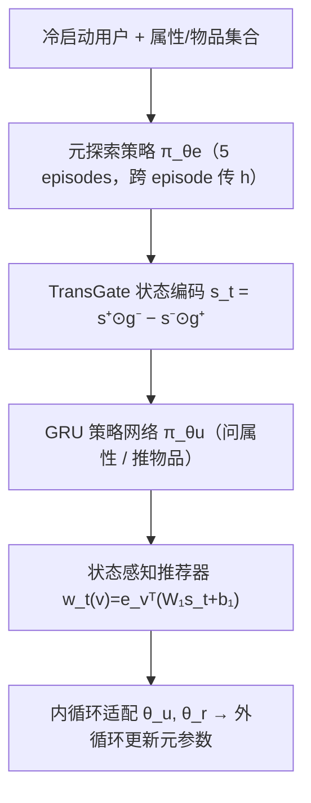
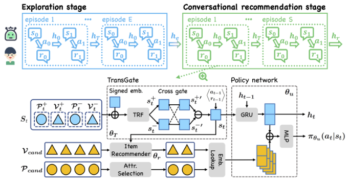

# Meta Policy Learning for Cold-Start Conversational Recommendation (面向冷启动对话推荐的元策略学习)

- **会议/期刊**: WSDM 2023
- **作者与机构**: Zhendong Chu, Hongning Wang (University of Virginia); Yun Xiao, Bo Long, Lingfei Wu (JD.COM)
- **推荐链路定位**: 多轮交互式召回/策略决策（对话-推荐联合端到端策略）
- **研究方向**: 冷启动与长尾推荐 / 对话推荐与智能体仿真（交叉：强化学习与动态探索）
- **论文原文**: [https://arxiv.org/abs/2205.11788v2](https://arxiv.org/abs/2205.11788v2)
- **开源代码**: [https://github.com/zdchu/MetaCRS.git](https://github.com/zdchu/MetaCRS.git)

## TL;DR (1分钟核心速览)

对话推荐（CRS）本是为解决冷启动而生，但现有 RL 方案只在全体用户上训练一个全局策略，新用户的交互轨迹一旦偏离训练分布，问什么、推什么都失效——这被作者定义为“CRS 的策略冷启动”。本文提出 MetaCRS：以元强化学习（MAML 式一阶近似）学一个泛化起点，并新增专用的元探索策略快速“认出这个用户是谁”，同时把物品推荐器从策略黑箱中解耦出来做逐用户局部适配，用 Transformer+Cross-Gate 编码正/负反馈。在 LastFM / BookRec / MovieLens 的严格新用户划分（8:1:1 用户级切分）下，SR@10 相对最强基线 UR-IA 提升 5.2% / 16.0% / 5.8%，平均轮数下降 9.8% / 4.2% / 8.9%。

## Background & Motivation (背景与核心矛盾)

- **主流范式**: 多轮 CRS 被建模为 MDP，用 REINFORCE 训练一个面向全体用户的全局策略 $\pi(a_t\mid s_t)$（EAR、SCPR、UNICORN 等），并在策略内嵌一个**预训练好且冻结**的 FM 推荐器。
- **前人局限 1（策略不个性化）**: 全局策略隐含“用户对属性的反馈由物品唯一决定”的强假设；实际不同用户描述同一物品差异极大（有人看外观、有人看品牌），新用户不受益于训练分布。
- **前人局限 2（鸡生蛋困境）**: 在 CRS 中，支持集（能观察到的对话）本身由待学习的策略生成，无法像图像元学习那样预置固定支持集；策略有偏 → 采到的反馈信息量低 → 适配更慢。
- **前人局限 3（组件耦合）**: 预训练推荐器是黑箱，策略即使问出了偏好也可能因推荐器排序不对而判负，反过来污染策略适配信号。
- **核心洞察 (Key Insight)**: 元学习的目标不是让元策略本身在新用户上表现好，而是让**适配后的局部策略**表现好；因此需把“探索识别用户”与“对话推荐执行”显式分离，并让推荐器与策略各自独立适配。
- **本文切入点**: 用元强化学习 + 三件协同组件，把“全局策略”替换为“元策略 + 少样本个性化”。

## Method (核心方法设计)

### 1. 整体框架 (Overall Architecture)

每个用户的一次“元任务”被切分为：先跑 $\lvert\mathcal{D}^e_u\rvert=5$个**探索 episode**，由元探索策略$\pi_{\theta_e}$执行，目标只是快速识别用户身份；随后跑 10 个**对话推荐 episode**，由个性化策略$\pi_{\theta_u}$与该用户专属推荐器$\theta_r$执行。GRU 策略网络的末隐状态$h_T$跨 episode 逐级传递（探索末态$h_e$→ 对话阶段 → 查询集$h_r$），从而使探索所得的用户画像直接“热启动”后续推荐。训练遵循 MAML：内循环在支持集$\mathcal{D}^s_u$上做一步（或每 episode 一次）梯度适配得$\theta_u,\theta_r$，外循环在查询集$\mathcal{D}^q_u$上更新元参数$\{\theta,\theta_R,\theta_T\}$，探索策略$\theta_e$与状态编码器$\theta_T$另由探索集$\mathcal{D}^e_u$更新；推理时冻结$\theta_e,\theta_T$，仅做内循环适配。

<figure class="paper-figure" markdown="span">
  <figcaption>图2：MetaCRS训练流程。每个用户的支持集分为探索阶段和对话推荐阶段。对每个用户，在整个MetaCRS过程中，上一回合的最后隐藏状态作为下一回合的初始状态传递。</figcaption>
</figure>

### 2. 关键设计拆解 (Key Designs)

1. **元探索策略与身份识别奖励（解决鸡生蛋）**：若直接用任务奖励驱动探索，策略会倾向于立刻推荐而非试探偏好，采到的支持集信息量低。本文为探索阶段单独设计奖励，用预训练用户向量 $e_u$（FM 在训练用户交互上得到）作为“身份标签”，奖励模型对用户身份后验置信度的**增量**：
$r_e(s_t)=\log P(e_u\mid s_t)-\log P(e_u\mid s_{t-1})$其中$P(e_u\mid s_t)\propto\exp(h_t^\top e_u)$，并附加交叉熵$\sum_t\log P(e_u\mid h_t)$ 作辅助正则（见式 (4)）。直觉：只奖励“让系统更确定你是谁”的动作，与最终推荐成败解耦，因而适配更快。
2. **解耦的状态感知推荐器（解决黑箱耦合）**：把冻结 FM 换成可学排序头 $w_t(v)=e_v^\top(\boldsymbol{W}_1 s_t+\boldsymbol{b}_1)$，成功对话结束后用“越早命中越好”的加权交叉熵做局部适配：
$\mathcal{L}_r(\theta_r)=-\frac{1}{T_s\,\mathbb{I}(T_s\le T)}\sum_{t=0}^{T_s}\log\frac{\exp(w_t(v_s))}{\sum_{v\in\mathcal{V}^+_t}\exp(w_t(v))}$分母用当前候选集$\mathcal{V}^+_t$（免负采样），使推荐器随策略共同适配，而非让策略迁就固定推荐器。
3. **TransGate 状态编码（正负反馈分流）**：冷启动早期负反馈密集，简单平均会混淆“满足全部已确认属性却被拒”的矛盾信号。先按符号加可学习符号嵌入 $\{e^+,e^-\}$（替代位置编码，因属性无序但符号关键），过 Transformer 层后分正/负池化得$s_t^+,s_t^-$，再用交叉门控互相过滤：$s_t=s_t^+\odot g^--s_t^-\odot g^+$，$g^\pm=\sigma(\boldsymbol{W}s_t^\pm+\boldsymbol{b})$。
4. **训练目标与开销**：策略侧用 REINFORCE，$\nabla_{\theta_u}\mathcal{L}_u=-\mathbb{E}[\sum_t R_u(a_t)\nabla_{\theta_u}\log\pi_{\theta_u}(a_t\mid s_t)]$，$R_u$为折扣累积奖励（成功推荐$+1$、推荐失败$-0.1$、属性确认$+0.1$、属性否认$-0.1$、退出$-0.3$）；采用一阶近似跳过二阶导，并对跨 episode 传递的初始隐状态$h_T$**停止梯度**。内循环每 episode 更新一次（实测优于整支持集更新），学习率$0.01$，元参数用 Adam（$0.005$）。推理开销 = 5+10 个 episode 的在线适配，动作空间用启发式裁剪为$K_A=K_I=10$。

## Experimental Setup & Evaluation Protocol (实验设置与评估协议)

| 数据集 | #Users | #Items | #Interactions | 稀疏度/密度 | 特征/场景说明 |
| :--- | :---: | :---: | :---: | :---: | :--- |
| LastFM | 1,801 | 7,432 | 72,040 | 33 属性（手工粗粒度） | 音乐推荐 |
| BookRec | 1,891 | 4,343 | 75,640 | 35 属性（TF-IDF 筛选） | 图书推荐 |
| MovieLens | 3,000 | 5,974 | 120,000 | 35 属性 | 电影推荐 |

- **数据划分与防穿越**: **用户级随机 8:1:1 切分**，测试集用户全部为训练期从未出现的新用户（严格冷启动）；每用户内部再切分为探索集 / 支持集 / 查询集（查询集固定 10 episodes），单 episode 最大轮数 $T=10$。
- **评测协议**: 通过**用户模拟器**交互评测（非离线全库排序），指标为 $\text{SR@}10$（10 轮内成功推荐比例）与$\text{AT}$（平均轮数，失败记满 10 轮）。模拟器为**用户中心**版本：为每个用户按$e_u^\top e_p$采样偏好属性集$\mathcal{P}_u$，仅当$\mathcal{P}_o=\mathcal{P}_u\cap\mathcal{P}_v$ 中的属性被问及才确认，其余全部否认——保证同一物品在不同用户处反馈不同。
- **对比基线（三组）**: 组一全局策略（MaxE、EAR、SCPR、UNICORN）；组二对话内动态更新用户向量（ConUCB、ConTS、FPAN），及将本文 TransGate+推荐器嫁接进 UNICORN 的 UR；组三适配策略（F-FT、F-IA、UR-FT、UR-IA）。超参：动作/隐层维度 64/100，奖励嵌入 10，1 层 Transformer 与 1 层 GRU，$\gamma=0.999$，$L_2=10^{-6}$。
- **注意点**: 为平衡交互数不均，作者按 $e_u^\top e_v$为每用户**合成 40 条交互**；该合成仅用于构造模拟器，$e_u$ 不直接暴露给策略，但仍属半合成评测。

## Key Experimental Results (实验关键数据)

### 1. 主实验对比 (Main Results)

| 数据集 | 指标 | MaxE | EAR | SCPR | UNICORN | FPAN | UR | UR-IA | **MetaCRS** | Improv.(vs UR-IA) |
| :--- | :--- | :---: | :---: | :---: | :---: | :---: | :---: | :---: | :---: | :---: |
| LastFM | SR@10 ↑ | 0.137 | 0.428 | 0.432 | 0.441 | 0.508 | 0.641 | 0.678 | **0.713** | +5.2% |
| LastFM | AT ↓ | 9.71 | 8.62 | 8.70 | 8.52 | 8.08 | 7.02 | 6.85 | **6.18** | −9.8% |
| BookRec | SR@10 ↑ | 0.206 | 0.320 | 0.329 | 0.358 | 0.397 | 0.384 | 0.420 | **0.487** | +16.0% |
| BookRec | AT ↓ | 9.64 | 9.01 | 9.11 | 9.00 | 8.31 | 8.55 | 8.41 | **8.06** | −4.2% |
| MovieLens | SR@10 ↑ | 0.262 | 0.552 | 0.545 | 0.596 | 0.589 | 0.681 | 0.704 | **0.745** | +5.8% |
| MovieLens | AT ↓ | 9.46 | 7.98 | 7.89 | 8.01 | 7.81 | 7.00 | 6.88 | **6.27** | −8.9% |

### 2. 消融实验 (Ablation Study)

| 变体 | LastFM SR@10 / AT | BookRec SR@10 / AT | MovieLens SR@10 / AT |
| :--- | :---: | :---: | :---: |
| ¬adaptation（仅元策略，不适配） | 0.632 / 6.68 | 0.378 / 8.56 | 0.630 / 7.31 |
| ¬exploration（去掉元探索策略） | 0.677 / 6.64 | 0.411 / 8.37 | 0.738 / 6.65 |
| ¬TransGate（换线性/均值池化） | 0.678 / 6.41 | 0.428 / 8.51 | 0.724 / 6.95 |
| **MetaCRS 全量** | **0.713 / 6.18** | **0.487 / 8.06** | **0.745 / 6.27** |

### 3. 关键实验发现 (Key Findings)

1. **适配本身就是最大增益来源**：去掉局部适配后 SR@10 从 0.713/0.487/0.745 掉到 0.632/0.378/0.630（LastFM −11.4%、BookRec −22.4%），且“未适配的元策略”已与全局训练的最佳基线相当甚至更好（BookRec 0.378 vs UNICORN 0.358），说明元训练把“可适配性”而非“即时精度”写进了初始化。
2. **探索阶段的收益在冷得越彻底的场景越大**：去掉元探索后 SR@10 在 BookRec（属性最泛化、正反馈最稀疏）掉 15.6%（0.487→0.411），在 MovieLens 仅掉 0.9%，印证探索奖励主要负责在高不确定性初期压缩“识别用户”所需的样本量。
3. **正负反馈分流对状态理解是刚需**：替换 TransGate 后 LastFM 的 SR 几乎不变（0.678）但 AT 从 6.18 恶化到 6.41（+3.7%），BookRec SR 掉 12.1%，说明门控主要在“早期负反馈密集、正负矛盾”的轨迹上避免策略走弯路；同时支持集从 5 增到 15+ 时 SR 持续上升、AT 持续下降（图 3），表明个性化 CRS 与用户留存可形成双赢。

## Highlights & Limitations (亮点、对比与审稿批判)

- **与代表作对比**: 相比 EAR/SCPR/UNICORN 这类“单全局策略 + 冻结 FM 推荐器”，本文把可适配性显式写进元目标，并把推荐器解耦为可局部学习模块；相比 FPAN（对话内动态修订用户向量）与 UR-IA（嫁接强状态编码后仍靠全局策略适配），MetaCRS 的增益来自“元初始化 + 探索识别 + 双组件解耦”三者的组合，而非单一表征增强。
- **可迁移亮点**: (1) 用“用户身份后验增量”作为内在奖励来做冷启动探索，可直接迁移到冷启动物品侧的主动问询；(2) 跨 episode 传递 GRU 隐状态但停止梯度，是在线持续学习里低成本复用长历史信号的实用技巧。
- **审稿级局限批判**: (1) **评测完全依赖自建模拟器**，且每用户 40 条合成交互由 $e_u$ 采样生成，与真实用户的噪声反馈、口径漂移差距未知，缺少线上 A/B；(2) 推理需先跑 5 个探索 + 10 个适配 episode，对新用户是真实的交互成本，论文只报告成功率未报告“每次成功推荐的对话代价-收益比”；(3) 元探索策略不个性化、支持集内 episode 数固定，对偏好极度小众的用户（图 1 的非中餐用户）是否仍能收敛缺少分桶分析。

## Rating (四维评分)

- **方法创新性 (Novelty)**: ⭐⭐⭐⭐ （首次把“CRS 策略冷启动”独立成问题，并用身份识别奖励破解元学习中的鸡生蛋，元探索 + 解耦适配的组合有清晰动机支撑）
- **评估协议与实验扎实度 (Protocol & Experiments)**: ⭐⭐⭐ （用户级 8:1:1 严格新用户划分与三组共 12 个基线较扎实，但全流程依赖合成模拟器、缺真实交互与显著性检验）
- **写作与数学规范度 (Clarity & Rigor)**: ⭐⭐⭐⭐ （MDP/MAML/门控公式定义完整、算法伪码与超参齐全，个别符号如 $\mathcal{L}_u$与$\theta_r$ 的层级关系需回看原文）
- **工业落地与复现价值 (Industrial & Practical Value)**: ⭐⭐⭐⭐ （代码与生成数据已开源，一阶近似 + 动作空间裁剪使训练可行，但新用户侧 15 个 episode 的在线适配成本需按业务容忍度裁剪）

