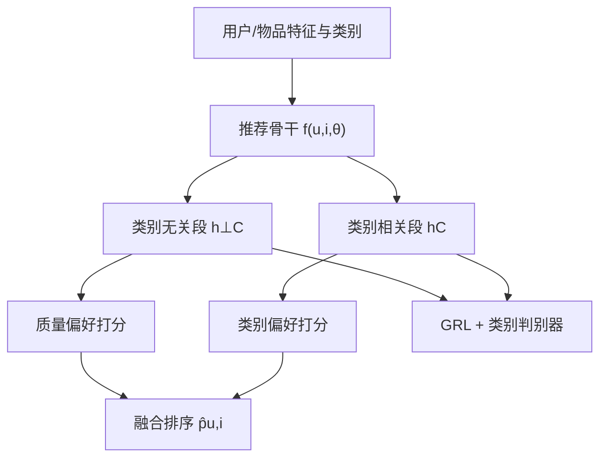
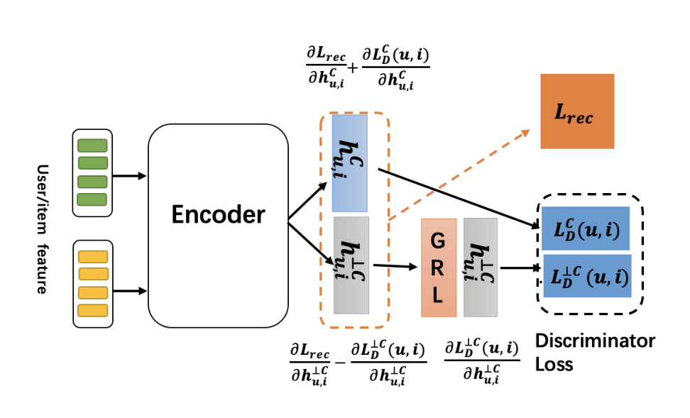

# Disentangled Representation for Diversified Recommendations（面向多样化推荐的解耦表征）

- **会议/期刊**: WSDM 2023
- **作者与机构**: Xiaoying Zhang, Hongning Wang, Hang Li；ByteDance AI Lab、University of Virginia
- **推荐链路定位**: 召回（候选生成；兼容排序打分）
- **研究方向**: 协同过滤与双塔召回 / 去偏公平与工业架构
- **论文原文**: [https://arxiv.org/abs/2301.05492v1](https://arxiv.org/abs/2301.05492v1)
- **开源代码**: [https://github.com/Xiaoyinggit/DCRS.git](https://github.com/Xiaoyinggit/DCRS.git)

## TL;DR (1分钟核心速览)

针对准确率-多样性困境，DCRS 指出多样化应在用户偏好的类别内进行：将用户-物品表征解耦为类别相关与类别无关两段，并用 GRL 判别器强制类别无关段不携带类别信息。离线在 ML-1M/ML-10M/Amazon-Books 上按时间 8:1:1 划分、全库排序；ML-1M 上 UAUC RelaImpr +0.40%、R@20 +5.73%、CE@20 +4.33%，Toutiao A/B 的 CTR +0.973%。

## Background & Motivation (背景与核心矛盾)

- **主流范式**: 以 NFM/矩阵分解等准确率模型为骨干，多样性多靠 MMR/DPP 后处理、IPS 重加权或 DGCN/PDGAN 等多样化模型实现。
- **前人局限**: 后处理/纯多样化常牺牲准确率；IPS 依赖倾向分估计，方差大且不稳定。核心矛盾是：盲目覆盖所有类别会推荐用户低偏好类别；而用户对类别的偏好又不可直接观测，缺少监督信号。
- **核心洞察 (Key Insight)**: 用户决策是层次化的：先判断是否喜欢物品类别，再判断该类别内物品质量；因此“同质量、不同但同等偏好类别”的物品应获得相近曝光，从而在偏好类别内多样化。
- **本文切入点**: 用概率因子分解把反馈拆成类别相关与类别无关两部分，并以对抗判别器实现无直接监督下的解耦。

## Method (核心方法设计)

### 1. 整体框架 (Overall Architecture)

DCRS 是模型无关框架，可嵌入 NFM 等推荐骨干。对用户 $u$与物品$i$，模型输出拼接表征$[(h^{\perp C}_{u,i})^\top,(h^{C}_{u,i})^\top]^\top=f(u,i,\theta)\in\mathbb{R}^{2d}$：$h^{\perp C}_{u,i}$建模类别无关质量偏好，$h^{C}_{u,i}$建模类别偏好。训练时联合推荐损失与类别判别对抗损失；推理时用融合两类偏好的$\hat{p}_{u,i}$ 排序。

<figure class="paper-figure" markdown="span">
  <figcaption>图3：DCRS的架构，该架构解耦用户u对物品的偏好</figcaption>
</figure>

### 2. 关键设计拆解 (Key Designs)

1. **层次化概率分解（名称：类别-质量因子分解）**：针对类别偏好不可观测，将反馈写成
   $P(Y_{u,i}=1|u,i)=P(Y^{\perp C}_{u,i}=1|u,i)P(Y^{C}_{u,i}=1|u,t_i)$。
   直觉是：用户很喜欢某类别时可容忍较低质量；类别偏好低时则需高质量才点击。该式避免 EM 后验推断，直接以两段表征分别估计两项。

2. **对抗解耦（名称：GRL 类别判别约束）**：仅拆分向量不能保证解耦。判别器 $D(\cdot)$预测物品类别向量$\tilde{t}_i$，并令
   $\mathcal{L}_{D}^{C}=\mathrm{CE}(D(h^{C}_{u,i}),\tilde{t}_i)$ 最小化，
   $\mathcal{L}_{D}^{\perp C}=\mathrm{CE}(D(h^{\perp C}_{u,i}),\tilde{t}_i)$ 经 GRL 最大化。
   这样 $h^{C}$保留类别信息，$h^{\perp C}$ 被“去除”类别信息，只保留质量等类别无关因素。

3. **训练目标、负采样与推理效率**：总损失为
   $\mathcal{L}=\frac{1}{|\mathcal{X}|}\sum[\mathcal{L}_{rec}(\hat{p}_{u,i},y_{u,i})+\mathcal{L}_{rec}(\hat{p}^{\perp C}_{u,i},y_{u,i})-\lambda\mathcal{L}_{D}^{\perp C}+\lambda\mathcal{L}_{D}^{C}]$。
   训练使用随机未交互负样本与交叉熵，无 hard negative；推理用 $\hat{p}_{u,i}$ 融合两段打分，判别器仅训练期使用，在线主要增加一个拼接与双头打分开销。

## Experimental Setup & Evaluation Protocol (实验设置与评估协议)

- **数据集与预处理**:

| 数据集 | #Users | #Items | #Interactions | 密度 | 特征/场景 |
| :--- | :---: | :---: | :---: | :---: | :--- |
| ML-1M | 6,040 | 3,883 | 1,000,209 | 4.26% | 电影，18 类 |
| ML-10M | 69,878 | 10,680 | 10,000,047 | 1.34% | 电影，19 类 |
| Amazon-Books | 22,929 | 33,130 | 1,178,117 | 0.155% | 图书，141 类，20-core |

  ML 系列评分 $>3$记正反馈；Amazon 评分$>4$ 记正反馈，并保留关联 20 本以上书籍的类别。
- **数据划分与防穿越**: 按用户交互时间戳排序后以 80%/10%/10% 划分 train/valid/test，非 Leave-One-Out。
- **排名评测协议**: 主协议为无偏 Full-Ranking，候选含全部训练期未交互物品；MMR/DPP 因重排限定 NFM top-200 池。指标含 AUC/UAUC/RelaImpr、Recall@K、NDCG@K、CE@K、CC@K。
- **对比基线与超参**: 骨干 NFM，$d=64$，AdaGrad；对比 IPS、MMR、DPP、PDGAN、DGCN、DecRS 等。$\lambda$在$\{0.01,0.05,0.1,0.5,1\}$网格搜索；线上指标$p<0.05$。

## Key Experimental Results (实验关键数据)

### 1. 主实验对比 (Main Results)

表1 ML-1M 主实验（Full-Ranking；DCRS 相对 NFM：UAUC RelaImpr +0.40%，R@20 +5.73%，NDCG@20 +6.02%，CE@20 +4.33%，CC@20 +2.96%）

| 方法 | AUC | UAUC | R@20 | NDCG@20 | CE@20 | CC@20 |
| :--- | ---: | ---: | ---: | ---: | ---: | ---: |
| NFM | 0.8461 | 0.8224 | 0.0908 | 0.0681 | 1.9764 | 0.6185 |
| IPS | 0.8446 | 0.8210 | 0.0890 | 0.0681 | 1.9759 | 0.6225 |
| MMR | — | 0.8194 | 0.0902 | 0.0670 | 2.2224 | 0.7244 |
| DPP | — | 0.6021 | 0.0770 | 0.0601 | **2.5974** | **0.9586** |
| DGCN | 0.7949 | 0.7759 | 0.0640 | 0.0482 | 2.0748 | 0.6466 |
| DecRS | 0.8462 | 0.8202 | 0.0919 | 0.0694 | 2.0378 | 0.6365 |
| DCRS CI | 0.8332 | 0.8096 | 0.0936 | 0.0699 | 1.9108 | 0.5766 |
| DCRS | **0.8483** | **0.8237** | **0.0960** | **0.0722** | 2.0620 | 0.6368 |

### 2. 消融实验 (Ablation Study)

表2 去掉类别相关分量（以 DCRS CI 仅用类别无关段排序）后的性能

| 数据集 | 方法 | AUC | UAUC | R@20 | NDCG@20 |
| :--- | :--- | ---: | ---: | ---: | ---: |
| ML-1M | DCRS CI | 0.8332 | 0.8096 | 0.0936 | 0.0699 |
| ML-1M | DCRS | **0.8483** | **0.8237** | **0.0960** | **0.0722** |
| ML-10M | DCRS CI | 0.8357 | 0.8197 | 0.0813 | 0.0554 |
| ML-10M | DCRS | **0.8447** | **0.8301** | **0.0838** | **0.0572** |
| Amazon-Books | DCRS CI | 0.6893 | 0.6546 | 0.0095 | 0.0049 |
| Amazon-Books | DCRS | **0.6974** | **0.6573** | **0.0123** | **0.0067** |

### 3. 关键实验发现 (Key Findings)

1. DCRS 在 ML-1M 同时提升准确率与多样性：AUC 0.8483 高于 NFM 0.8461，R@20 0.0960 较 0.0908 提升 5.73%，CE@20/CC@20 分别提升 4.33%/2.96%，说明“偏好类别内多样化”确实可缓解准确率-多样性困境。
2. 纯多样化方法代价显著：DPP 在 ML-1M 的 UAUC 仅 0.6021、RelaImpr -68.3%，DGCN AUC 0.7949；表明忽略类别偏好、全局拉高覆盖会导致准确率崩塌。
3. 去掉类别相关分量后 DCRS CI 全面下降：ML-1M R@20 0.0960→0.0936，Amazon R@20 0.0123→0.0095、NDCG@20 0.0067→0.0049；线上 A/B 的 CTR +0.973%、R_CN +2.372%，验证类别相关偏好建模是主要增益来源。

## Highlights & Limitations (亮点、对比与审稿批判)

- **与代表作对比**: DecRS 依赖因果/倾向重加权，DCRS 则在表征层解耦且骨干无关；MMR/DPP 是独立后处理，DCRS 从训练目标内化多样性；DGCN/PDGAN 偏重多样性而准确率下降，DCRS 试图双赢。
- **可迁移亮点**: 用 GRL 将“属性相关/无关”因子从用户表征中剥离，可迁移到流行度去偏、场景解耦、跨域偏好分解；层次化概率分解也可用于解释点击由“类目兴趣”还是“物品质量”驱动。
- **审稿级局限批判**: 类别偏好仍不可直接监督，判别器依赖类别标签质量与多类别软目标设定；静态偏好、单物品打分，未建模时间演化与列表级多样性，线上仅单一新闻平台验证。

## Rating (四维评分)

- **方法创新性 (Novelty)**: ⭐⭐⭐⭐ （用 GRL 解耦类别相关/无关偏好，切入准确率-多样性困境较新颖）
- **评估协议与实验扎实度 (Protocol & Experiments)**: ⭐⭐⭐⭐ （三数据集 Full-Ranking + 线上 A/B，但离线缺少充分重复实验与显著性检验）
- **写作与数学规范度 (Clarity & Rigor)**: ⭐⭐⭐⭐ （层次化概率分解清晰，但多类别判别目标与总损失权重解释略简）
- **工业落地与复现价值 (Industrial & Practical Value)**: ⭐⭐⭐⭐ （代码开源、骨干无关、推理开销可控；训练需调 GRL 与 $\lambda$，稳定性需工程处理）

