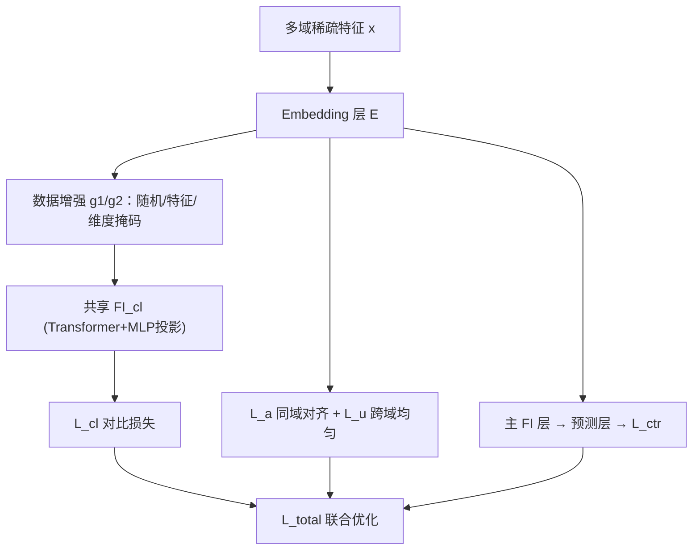
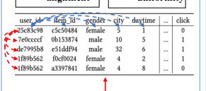
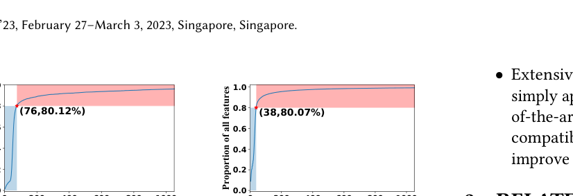

# CL4CTR: A Contrastive Learning Framework for CTR Prediction (面向点击率预估的对比学习框架)

- **会议/期刊**: WSDM 2023
- **作者与机构**: Fangye Wang, Yingxu Wang, Tun Lu, Peng Zhang, Ning Gu (复旦大学) ; Dongsheng Li (MSRA) ; Hansu Gu
- **推荐链路定位**: 精排（CTR 预估，嵌入层表征增强）
- **研究方向**: CTR/CVR 预估与特征交叉 / 自监督对比学习与交互去噪
- **论文原文**: [https://arxiv.org/abs/2212.00522v1](https://arxiv.org/abs/2212.00522v1)
- **开源代码**: [https://github.com/cl4ctr/cl4ctr](https://github.com/cl4ctr/cl4ctr)

## TL;DR (1分钟核心速览)

CTR 领域长期“堆结构、轻表征”：主流工作卷特征交叉层（CIN/CrossNet/Attention），却把嵌入层当成纯监督学习的普通查表，导致低频特征（占特征总数 80% 以上）训练不足、表征次优。本文提出模型无关的 CL4CTR 框架，在训练阶段用三种嵌入扰动（随机/特征/维度掩码）构造正对做对比损失，并新增“同域对齐 + 跨域均匀”两项约束。在 Frappe/ML-tag/ML-1M/SafeDriver 四个数据集的 7:2:1 或 8:1:1 比例划分、AUC/LogLoss 评估下，仅把 CL4CTR 套在最朴素的 FM 上即超越 DCN-V2，AUC 提升 0.13%–0.67%，LogLoss 相对下降 0.64%–16.10%，且推理零额外参数与延迟。

## Background & Motivation (背景与核心矛盾)

- **主流范式**: 沿用“嵌入层 → 特征交叉层 → 预测层”三段式，研究精力几乎全投在交叉层结构设计（xDeepFM、DCN-V2、AutoInt+、FED 等），嵌入层只靠 CTR 监督信号的梯度更新。
- **前人局限**: ① 特征频次呈极端长尾（图 1：ML-tag 中频次 ≤38 的特征占 80.07%），低频特征梯度更新次数极少，表征严重欠拟合；② FEN / Dual-FEN 等加权模块虽能重赋权，但额外增加参数与推理耗时，且仍只用单一监督信号驱动表征。
- **核心洞察 (Key Insight)**: 表征质量本身就是瓶颈——只要改善嵌入层，简单 FM 就能打穿复杂交叉网络。判别式学习下每个样本只提供一次梯度，低频特征天然吃亏；若能在**每次前向中都对所有特征施加与频次无关的正则信号**，长尾问题即可被结构性缓解。
- **本文切入点**: 把自监督对比学习搬到 FI-based CTR 的嵌入层上，并把信号全部放在训练期，推理时整体丢弃。

## Method (核心方法设计)

### 1. 整体框架 (Overall Architecture)

输入为多域表格样本，经嵌入层得到 $E\in\mathbb{R}^{M\times D}$；主分支走标准 FI 层与预测层计算$\hat{y}$与$\mathcal{L}_{ctr}$。旁路分支（仅训练期存在）对同一$E$施加两次独立扰动得到$\hat{E}_1,\hat{E}_2$，共享 Transformer FI 编码器$FI_{cl}(\cdot)$加单层 MLP 投影得到$\hat{h}_1,\hat{h}_2$，用对比损失拉近；同时对整张嵌入表施加同域对齐与跨域均匀约束。四项损失联合端到端优化，推理时旁路全部移除，主模型结构、参数量、时延与基线完全一致。

<figure class="paper-figure" markdown="span">
  <figcaption>图2：CL4CTR 框架架构。CL4CTR 包括三个组件：(a) 基础 CTR 模型；(b) 对比模块；(c) 对齐与均匀性约束。在对比模块中，我们设计了 (d) 三种嵌入扰动方法。</figcaption>
</figure>

### 2. 关键设计拆解 (Key Designs)

1. **任务定制的嵌入扰动（三种掩码）**：序列推荐的 crop/reorder 无法迁移到多域表格，本文改为在嵌入空间做扰动：随机掩码 $\hat{E}=E\cdot I,\ I\sim \mathrm{Bernoulli}(p)$（元素级，类比 Dropout）、特征掩码（把整条特征置零向量）、维度掩码（按共享的$D$维 Bernoulli 向量整体屏蔽某一维）。三种粒度的区别在于“丢弃多少语义单元”，实验中元素级随机掩码最稳健，掩码比例$p\approx0.4\text{–}0.5$ 最优——过高则编码器拿不到足够信息去构造有效交互表征。
2. **特征对齐 + 域均匀性约束**：本文的关键观察是——**CTR 表格数据自带“正负样本结构”：同域特征天然互为相似（如所有 city 取值），跨域特征天然应远离**，因此无需额外采样即可构造对齐/均匀性约束。其损失为 $\mathcal{L}_a=\sum_{f=1}^{F}\sum_{e_i,e_j\in E_f}\|e_i-e_j\|_2^2$，$\mathcal{L}_u=\sum_{f}\sum_{e_i\in E_f}\sum_{e_j\in E-E_f}\mathrm{sim}(e_i,e_j)$，其中$\mathrm{sim}$为余弦相似度。直觉：$\mathcal{L}_a/\mathcal{L}_u$ 每次前向都在**全量特征**上生效，与特征出现频次无关，因此低频特征与高频特征获得同等优化机会，这是缓解长尾表征退化最直接的一步。
3. **训练目标、负采样与推理效率**：$\mathcal{L}_{cl}=\frac{1}{B}\sum_{i=1}^{B}\|\hat{h}_{i,1}-\hat{h}_{i,2}\|_2^2$（仅正对拉近，不使用负样本队列）；总损失$\mathcal{L}_{total}=\mathcal{L}_{ctr}+\alpha\mathcal{L}_{cl}+\beta(\mathcal{L}_a+\mathcal{L}_u)$，最优$\alpha=1,\beta=10^{-2}$。**免负采样、免动量编码器、免记忆库**，训练增加的只有一条浅层旁路；在线推理不增参数、不增时延。

## Experimental Setup & Evaluation Protocol (实验设置与评估协议)

- **数据集与预处理**: 直接沿用 NFM/AFM 与 DCAP/ML-1M 的公开切分，无额外 5-core 过滤，保留原始长尾分布。

| 数据集 | 正样本率 | #Training | #Validation | #Test | #Features | #Fields |
| :--- | :---: | :---: | :---: | :---: | :---: | :---: |
| Frappe | 33% | 202K | 58K | 29K | 5K | 10 |
| ML-tag | 33% | 1,404K | 401K | 201K | 90K | 3 |
| ML-1M | 57.5% | 800K | 100K | 100K | 10K | 5 |
| SafeDriver | 3.64% | 476K | 59K | 59K | 600 | 57 |

- **数据划分与防穿越**: Frappe/ML-tag 为 `7:2:1 比例划分`（沿用 NFM/AFM 固定切分），ML-1M/SafeDriver 为 `8:1:1 随机划分`；非时序切分，属离线随机划分，不涉及未来信息穿越。
- **排名评测协议**: 本文是**二分类概率预估**任务，不做全库或采样排序；全量测试样本上计算 `AUC` 与 `LogLoss`，训练无负采样（曝光样本正负比即真实分布，SafeDriver 正样本仅 3.64%，天然极不平衡）。按 CTR 惯例，0.001 级 AUC 差异即视为显著，且论文报告 $p<0.01$ 显著性。
- **对比基线与超参设置**: 四大类基线——一阶 LR；二阶 FM/FwFM/IFM/FmFM；高阶 CrossNet/IPNN/OPNN/FINT/DCAP；集成类 WDL/DCN/DeepFM/xDeepFM/FiBiNET/AutoInt+/AFN+/TFNet/FED/DCN-V2。嵌入维度 $d=64$（Frappe、ML-tag）、$d=20$（ML-1M、SafeDriver），batch 1024，Adam，DNN 结构$\{400,400,400,1\}$，dropout 0.5，early stopping，结果取 5 次平均；$FI_{cl}$ 为 3 层 Transformer。

## Key Experimental Results (实验关键数据)

### 1. 主实验对比 (Main Results)

| 类别 | 模型 | Frappe AUC | Frappe LogLoss | ML-tag AUC | ML-tag LogLoss | ML-1M AUC | ML-1M LogLoss | SafeDriver AUC | SafeDriver LogLoss |
| :--- | :--- | :---: | :---: | :---: | :---: | :---: | :---: | :---: | :---: |
| 二阶 | FM | 0.9746 | 0.1856 | 0.9488 | 0.2595 | 0.8023 | 0.5332 | 0.6301 | 0.1538 |
| 二阶 | FwFM | 0.9756 | 0.1784 | 0.9582 | 0.2531 | 0.8046 | 0.5281 | 0.6335 | 0.1532 |
| 高阶 | IPNN | 0.9809 | 0.1604 | 0.9607 | 0.2295 | 0.8110 | 0.5190 | 0.6373 | 0.1521 |
| 高阶 | DCAP | 0.9801 | 0.1612 | 0.9560 | 0.2428 | 0.8130 | 0.5171 | 0.6390 | 0.1512 |
| 集成 | AutoInt+ | 0.9783 | 0.1762 | 0.9535 | 0.2562 | 0.8099 | 0.5219 | 0.6310 | 0.1516 |
| 集成 | FED | 0.9791 | 0.1606 | 0.9557 | 0.2465 | 0.8128 | 0.5184 | 0.6369 | 0.1534 |
| 集成 | DCN-V2 (最强基线) | 0.9803 | 0.1595 | 0.9610 | 0.2330 | 0.8132 | 0.5169 | 0.6406 | 0.1510 |
| 本文 | **CL4CTR_FM** | **0.9822** | **0.1324** | **0.9621** | **0.2102** | **0.8164** | **0.5136** | **0.6449** | **0.1483** |
| | Improv.% (vs DCN-V2) | +0.13% | +16.10% | +0.11% | +8.41% | +0.39% | +0.64% | +0.67% | +1.46% |

### 2. 消融实验 (Ablation Study)

| 消融对象 | 配置 | Frappe AUC | Frappe LogLoss | ML-1M AUC | ML-1M LogLoss |
| :--- | :--- | :---: | :---: | :---: | :---: |
| 损失信号 (FM) | $\mathcal{L}_{ctr}$ | 0.9746 | 0.1856 | 0.8023 | 0.5332 |
| 损失信号 (FM) | $+\mathcal{L}_{cl}$ | 0.9794 | 0.1485 | 0.8102 | 0.5230 |
| 损失信号 (FM) | $+(\mathcal{L}_a+\mathcal{L}_u)$ | 0.9812 | 0.1455 | 0.8139 | 0.5175 |
| 损失信号 (FM) | 全量 | **0.9822** | **0.1324** | **0.8164** | **0.5136** |
| 兼容性 (DCN-V2) | Base → +CL4CTR | 0.9803→**0.9812** | 0.1595→**0.1549** | 0.8132→**0.8144** | 0.5169→**0.5153** |
| 兼容性 (DCN) | Base → +CL4CTR | 0.9788→**0.9808** | 0.1621→**0.1566** | 0.8125→**0.8164** | 0.5170→**0.5125** |
| 增强方式 (FM) | 随机 / 特征 / 维度 | 0.9822 / 0.9814 / 0.9816 | 0.1324 / 0.1328 / 0.1334 | — | — |

### 3. 关键实验发现 (Key Findings)

1. **LogLoss 增益远大于 AUC**：Frappe 上 AUC 仅 +0.13%，LogLoss 却相对下降 16.10%（ML-tag 8.41%）。说明 CL4CTR 的真正贡献是**概率校准**——低频表征不再塌陷到全局均值附近，预测分布更贴合真实点击率，而非单纯把排序名次往前挤。
2. **三项信号互补且缺一不可**：单用 $\mathcal{L}_{cl}$或单用$(\mathcal{L}_a+\mathcal{L}_u)$ 都能把 FM 的 Frappe LogLoss 从 0.1856 降到 0.1485/0.1455，但只有三者在场才降到 0.1324；且在不同基线上二者贡献排序还会翻转（FM 上对齐均匀更强，DCN 上对比损失更强），佐证它们正则的角度不同（实例级视角不变性 vs. 域结构先验）。
3. **长尾缓解是可量化的**：按特征频次分桶（图 3），所有模型在低频桶（<5、[5,10)）LogLoss 最差并随频次单调改善、在 20 次以上趋稳；CL4CTR_FM 在**每个频次桶都最优**，且 ΔLogLoss 在低频区最大。副产品是参数效率——$d=16$的 CL4CTR_FM 已超过$d=64$ 的 FM，说明该框架可换取更小嵌入表。

<figure class="paper-figure" markdown="span">
  <figcaption>图1：特征频次的累积分布。(38, 80.07%) 表示特征频次小于或等于 38 次的特征占所有特征的 80.07%。</figcaption>
</figure>

## Highlights & Limitations (亮点、对比与审稿批判)

- **与代表作对比 (vs. Prior Work)**: FEN/Dual-FEN 走“加权重模块”路线，牺牲参数与推理时延换取重要度重分配；AQCL 面向冷启动、序列 CTR 做实例-簇级对比，需构造负样本；本文则把约束直接压在**全量特征嵌入矩阵**上，零负采样、零推理开销，且与任意 FI 编码器正交（可插 DeepFM/DCN-V2/Autoint+ 均涨点）。
- **可迁移亮点**: ① “同域=正对、跨域=负对”的结构先验可直接迁移到任何多域表格任务（如多任务精排的域嵌入正则、广告侧素材域对齐）；② 训练期旁路 + 推理丢弃的范式，是工业精排中加自监督信号几乎零风险的落地模板。
- **审稿级局限批判**: ① $\mathcal{L}_a$与$\mathcal{L}_u$在整张嵌入表上两两计算，复杂度约$O(M^2)$（ML-tag 有 90K 特征），论文未给出训练耗时或采样式近似的复杂度分析，实际训练成本可能远高于所声称的“只多一条旁路”；② 评估只有离线 AUC/LogLoss，4 个数据集均为中小规模公开集，缺少工业级稀疏场景与线上 A/B；③ 掩码方式、掩码比例$p$与$\alpha,\beta$均需逐数据集调参（$\beta>10^{-2}$ 即显著掉点），鲁棒性与自适应权重方案欠讨论。

## Rating (四维评分)

- **方法创新性 (Novelty)**: ⭐⭐⭐⭐ （把“对齐/均匀性”从 CV/NLP 的对样本对概念重解释为 CTR 的域内/域间结构先验，构思轻巧且模型无关，但单条技术线并非全新）
- **评估协议与实验扎实度 (Protocol & Experiments)**: ⭐⭐⭐⭐ （4 数据集 + 20 余个基线 + 5 次平均 + $p<0.01$，消融覆盖增强方式/编码器/损失信号/超参，但仅离线二分类指标，无排序与线上验证）
- **写作与数学规范度 (Clarity & Rigor)**: ⭐⭐⭐⭐ （三信号公式与数据流图清晰，但缺训练复杂度与显存开销分析，$\mathcal{L}_u$ 的全表求和实现细节交代不足）
- **工业落地与复现价值 (Industrial & Practical Value)**: ⭐⭐⭐⭐⭐ （代码已开源，推理零参数零延迟增量，可直接套在现有精排模型嵌入层上，属低风险高性价比的工业改造）

