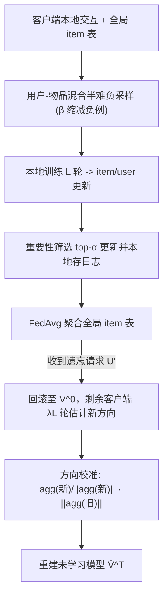
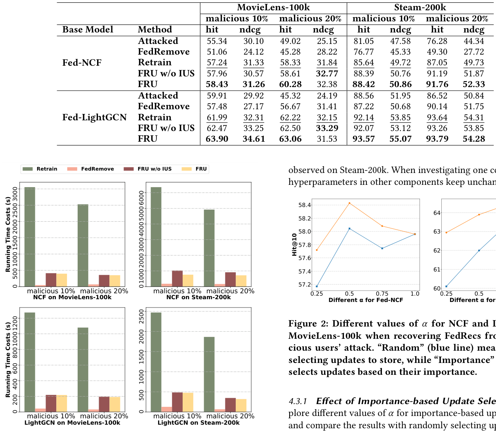

# Federated Unlearning for On-Device Recommendation (面向端侧推荐的联邦遗忘学习)

- **会议/期刊**: WSDM 2023
- **作者与机构**: Wei Yuan, Hongzhi Yin (UQ), Fangzhao Wu (MSRA), Shijie Zhang (Tencent), Tieke He (NJU), Hao Wang (Alibaba Cloud)
- **推荐链路定位**: 端到端训练（联邦参数服务器范式），服务于模型运维/合规阶段
- **研究方向**: 去偏公平、可信隐私与工业架构 / 协同过滤
- **论文原文**: [https://arxiv.org/abs/2210.10958v2](https://arxiv.org/abs/2210.10958v2)
- **开源代码**: 暂未开源

## TL;DR (1分钟核心速览)

FedRecs 只解决了"数据不出端"，却无法响应用户的"被遗忘权"，也无力在遭恶意客户端投毒后快速清除其影响；从头重训代价不可接受。本文提出 FRU：借鉴数据库事务的 log-based rollback，把每个客户端的历史 item embedding 更新存于本地，遗忘时回滚并**只校准更新方向、保留更新长度**重建全局模型；为适配端侧存储，进一步设计 top-$\alpha$ 重要性更新筛选与用户-物品混合半难负采样。在 MovieLens-100k / Steam-200k 上，NCF 与 LightGCN 遭 10%–20% 恶意用户攻击后，FRU 恢复的 HR@10 普遍超过全量重训（最高 +5.4%），且提速约 **7×**。

## Background & Motivation (背景与核心矛盾)

- **主流范式**: FedRecs（FedAvg + 本地 BPR）让用户 embedding 留在端侧、仅上传 item embedding 更新；近年工作集中于收敛加速、显示反馈与 GNN 化，均默认"用户贡献一旦进入全局参数即永久有效"。
- **前人局限**: ① 集中式机器遗忘（如 SISA、基于全量数据的梯度修正）必须访问完整训练集，在 FedRec 中根本不可行；② FL 侧遗忘方法（FedEraser、知识蒸馏、Newton 法）面向 CV 分类，客户端仅数十个且**不存在"私有用户 embedding"**，直接迁移会失效；③ 简单"删客户端继续训练"无法保证何时清除影响，"从头重训"时间与算力成本不可接受。
- **核心洞察 (Key Insight)**: item embedding 表主导了 FedRec 的参数量与更新体积，而单个用户对不同 item 的影响强度差异极大（热门/已收敛 item 几乎不受单用户影响），因此**全量存日志既非必要也不可行**——只需存"重要的少数更新"。
- **本文切入点**: 把每次全局轮次的更新视为事务日志，遗忘时回滚到目标用户加入前的状态，再用剩余客户端的**新方向 + 旧长度**校准重建，兼顾合规性与鲁棒性（投毒恢复）。

## Method (核心方法设计)

### 1. 整体框架 (Overall Architecture)

FRU 是模型无关的插件：训练阶段，每轮被选中的客户端下载全局 item embedding $\mathbf{V}^t$，用混合半难负采样选出负例集合$\mathcal{V}_k^{neg}$，本地训练$L$轮得到$\mathbf{M}^{(V),t+1}_k$与私有用户更新$\mathbf{M}^{(U),t+1}_k$；随后**仅保留 top-$\alpha$重要度的 item 更新**与最新用户 embedding 存于本地，并把更新上传聚合。当用户集合$\mathcal{U}'$请求遗忘（或检测到投毒）时，服务器从$\mathbf{V}^0$起重放：每轮让剩余客户端以$\lambda L$轮"短训练"估计新方向，与日志中的旧更新做**方向-长度解耦校准**，逐轮累加得到$\bar{\mathbf{V}}^T$，用户侧则直接用新算出的$\hat{\mathbf{M}}^{(U)}$ 更新。

### 2. 关键设计拆解 (Key Designs)

1. **重要性更新筛选 + 用户-物品混合半难负采样（把日志压缩到端侧可承受）**: 直存 item 表更新在 Steam 上需 $b\% B|\mathcal{V}|C$，端侧不可行。FRU 只保留$\|\mathbf{M}(v_i)^t_k\| = \|\mathbf{v}^t_i - \mathbf{v}^{t-1}_i\|$最大的 top-$\alpha$ 比例更新；同时用候选池采样替代随机负采样：
   $\mathcal{V}_{u_k}=\text{top}_{R\%|\mathcal{V}|}R(\mathbf{u}^{t-1}_k,\mathbf{v}^{t-1}_i),\ \mathcal{V}_{v_k}=\text{top}_{R\%|\mathcal{V}|}R(\mathbf{v}^{t-1}_{k,cet},\mathbf{v}^{t-1}_i),\ \mathcal{V}^{neg}_k=\text{Random}_{N\beta}(\mathcal{V}_{u_k}\cup\mathcal{V}_{v_k})$其中$\mathbf{v}_{k,cet}$为已交互 item embedding 的质心。**关键在"半难"**：联邦下用户 embedding 更新频率远低于 item，早期不可靠，故引入高频更新的 item 质心作为伪用户表征补齐；且刻意不取 top-1 硬负例，避免假阴性。$\beta=0.5$即可匹配原负例规模的效果，直接减半 item 更新条数。存储开销降为$b\%\,B\,\alpha(1+\beta n)|\mathcal{V}^{pos}_k|C$，Steam 上仅额外 17.5%(NCF)/8.75%(LightGCN)。
2. **方向校准的更新回滚（核心遗忘算子）**: 仅"删掉恶意更新再聚合"(FedRemove) 无法抹去其对全局参数的拉扯。FRU 让剩余客户端在当前未学习模型上跑 $\lambda L$轮得到$\hat{\mathbf{M}}^t_k$，再把它与历史日志$\mathbf{M}^t_k$ 融合：
   $\bar{\mathbf{M}}^t = \frac{\text{agg}(\hat{\mathbf{M}}^t_k)}{\|\text{agg}(\hat{\mathbf{M}}^t_k)\|}\cdot\|\text{agg}(\mathbf{M}^t_k)\|,\qquad \bar{\mathbf{V}}^t=\bar{\mathbf{V}}^{t-1}+\bar{\mathbf{M}}^t$直觉：**方向**决定拟合哪些数据（须换成干净数据的方向），**长度**编码了原训练轨迹的步长尺度（保留可避免收敛震荡）；用户 embedding 因更新稀疏则直接采用$\hat{\mathbf{M}}^{(U)}$。
3. **训练目标、负采样与遗忘评测协议**: 本地目标为标准 BPR（NCF 用 4 层 MLP、LightGCN 用 1 层传播），负采样如上进行；遗忘评测不靠参数比对（联邦随机性过多），而是设计**投毒攻击**作为压力测试：恶意客户端上传 $\tilde{\mathbf{M}}^t_k=-\gamma\mathbf{M}^t_k+\mu$（翻转+高斯噪声+随机幅度$\gamma$），再检验 FRU 能否恢复到甚至优于"从未被攻击"的重训模型。计算开销集中在$\lambda L$本地轮，$\lambda=0.1$ 时理论 10×、实测 7× 加速。

## Experimental Setup & Evaluation Protocol (实验设置与评估协议)

- **数据集与预处理**: 全部交互转为隐式 $r_{ij}=1$，未额外 5-core 过滤。

| 数据集 | #Users | #Items | #Interactions | 稀疏度/密度 | 特征/场景说明 |
| :--- | :---: | :---: | :---: | :---: | :--- |
| MovieLens-100k | 943 | 1,682 | 100,000 | 6.30% | 电影评分，稠密小规模联邦场景 |
| Steam-200k | 3,753 | 5,134 | 114,713 | 0.60% | 游戏购买，长尾稀疏、客户端数×4 |

- **数据划分与防穿越 (Splitting Strategy)**: 比例划分，80% 训练 / 20% 测试，无时间戳切分。
- **排名评测协议 (Ranking Protocol)**: 对测试集中未交互物品做全库打分排序，报告 HR@10 与 NDCG@10；训练阶段负采样比 NCF 为 1:4、LightGCN 为 1:1。
- **对比基线与超参设置**: Retrain（删恶意用户后从头重训，理想上界）、FedRemove（仅剔除恶意更新）以及 FRU w/o IUS（不用重要性筛选）；embedding 维 $d=64$，学习率 0.001，batch 64，本地 20 轮、全局最多 200 轮，$\alpha=0.5,\beta=0.5,\lambda=0.1$，恶意用户占比 10%/20%。

## Key Experimental Results (实验关键数据)

### 1. 主实验对比 (Main Results)

| 模型 | 方法 | ML-100k 10% HR | NDCG | ML-100k 20% HR | NDCG | Steam 10% HR | NDCG | Steam 20% HR | NDCG |
| :--- | :--- | :---: | :---: | :---: | :---: | :---: | :---: | :---: | :---: |
| Fed-NCF | Attacked | 55.34 | 30.10 | 49.02 | 25.15 | 81.05 | 47.58 | 76.28 | 44.34 |
| Fed-NCF | FedRemove | 51.06 | 24.12 | 45.28 | 28.22 | 76.77 | 45.33 | 49.30 | 27.72 |
| Fed-NCF | Retrain | 57.24 | **31.33** | 58.33 | 31.84 | 85.64 | **49.72** | 87.05 | 49.73 |
| Fed-NCF | FRU w/o IUS | 57.96 | 30.57 | 58.61 | **32.77** | 88.39 | 50.76 | 91.19 | 51.87 |
| Fed-NCF | **FRU** | **58.43** | 31.26 | **60.28** | 32.38 | **88.42** | **50.86** | **91.76** | **52.33** |
| | | | | | | | | | |
| Fed-LightGCN | Attacked | 59.91 | 29.92 | 45.32 | 24.19 | 88.56 | 51.95 | 86.52 | 50.84 |
| Fed-LightGCN | FedRemove | 57.48 | 27.17 | 56.67 | 31.41 | 87.22 | 50.68 | 90.14 | 51.75 |
| Fed-LightGCN | Retrain | 61.99 | 32.31 | 62.22 | 32.15 | 92.14 | 53.85 | 93.64 | **54.31** |
| Fed-LightGCN | FRU w/o IUS | 62.47 | 33.25 | 62.50 | **33.29** | 92.07 | 53.12 | 93.26 | 53.85 |
| Fed-LightGCN | **FRU** | **63.90** | **34.61** | **63.06** | 31.53 | **93.57** | **55.07** | **93.79** | 54.28 |

相对未受攻击状态，FRU 在 Fed-LightGCN/ML-100k 20% 上把 HR@10 从 45.32 拉回 63.06（+39.1%）；相对理想上界 Retrain，在 Fed-NCF/Steam-200k 20% 上达 **+5.4%**。

<figure class="paper-figure" markdown="span">
  <figcaption>图1：在 MovieLens-100k 和 Steam-200k 上恢复 FedRecs 的时间比较。</figcaption>
</figure>

### 2. 消融实验 (Ablation Study)

| 配置 (Fed-NCF / ML-100k, 10%) | HR@10 | NDCG@10 | 恢复耗时 (s) |
| :--- | :---: | :---: | :---: |
| FRU w/o IUS ($\alpha=1.0$) | 57.96 | 30.57 | > 396.9 |
| **FRU ($\alpha=0.5,\beta=0.5$)** | **58.43** | **31.26** | **396.9** |
| 随机选更新替代重要性 ($\alpha=0.5$) | 低于 FRU（图 2） | — | — |
| $\lambda=0.25$/$0.5$/$0.75$ | 57.04 / 56.06 / 53.44 | — | 894.6 / 1675.5 / 2270.6 |
| 随机负采样 vs. 混合半难 ($\beta=0.5$) |$\beta{=}0.5$混合半难 ≈$\beta{=}1.0$ 随机（图 3） | — | — |

### 3. 关键实验发现 (Key Findings)

1. **校准不可省，且"少校准"优于"全校准"**：FedRemove 在 Steam 20% 场景把 NCF 从 76.28 直接压到 49.30（比被攻击还差），说明单纯剔除恶意更新会造成方向漂移；而 $\alpha=1.0$（存全部更新）的 FRU w/o IUS 在 LightGCN/ML-100k 的 NDCG 反而低于$\alpha=0.5$ 的 FRU（31.53 vs 33.29 的对称现象），证明对不重要更新做过度校准会引入噪声。
2. **遗忘模型可"优于重训"**：FRU 在 8 个 HR@10 设置中 7 个超过 Retrain（最大 +5.4%），原因在于重训从随机初始化重新探索，而 FRU 保留了历史步长尺度与已收敛的 item 表征，等价于一次带先验的 warm reconstruction。
3. **效率—效果可调且存储几乎免费**：$\lambda=0.1$时恢复 NCF/ML-100k 仅需 396.9s，约为$\lambda=0.75$ 的 1/5.7，且 HR 反而更高（58.43 vs 53.44）；端侧额外存储仅 17.5%(NCF)/8.75%(LightGCN)，与客户端数量解耦。

## Highlights & Limitations (亮点、对比与审稿批判)

- **与代表作对比 (vs. Prior Work)**: 相比 FedEraser（CV 分类、集中存日志、无私有参数处理），FRU 把日志下沉到端侧并显式处理用户 embedding 的校准；相比集中式遗忘（SISA 等需全量数据），FRU 只依赖可上传的 item 更新；相比 FedRemove，多出的方向校准是效果差距的全部来源。
- **可迁移亮点**: ① "方向取自新数据、长度取自旧轨迹"的校准范式可迁移到任何增量重训/回滚式模型修复；② 用交互 item 质心作为伪用户表征，是解决联邦中用户 embedding 更新滞后的通用技巧；③ 以投毒-恢复作为遗忘效果的代理评测，可复用到隐私审计基准。
- **审稿级局限批判**: ① 客户端仍需保存 $B\times b\%$轮更新日志，长期运行（全局轮数上千）时存储线性增长，论文只测了 200 轮；② 遗忘需服务器重放全部历史轮次，遗忘对象越多、加入越早，回滚链越长，缺少"批量遗忘"的复杂度分析；③ 评测仅两个中小规模数据集、单一 80/20 划分，无时间切分与显著性检验，且$\lambda$ 对 NCF 敏感（0.1→0.75 掉 5 个点），鲁棒性证据偏弱。

## Rating (四维评分)

- **方法创新性 (Novelty)**: ⭐⭐⭐⭐ （首次定义 FedRec 用户级遗忘问题，DBMS 事务回滚 + 方向/长度解耦校准的组合简洁且有物理直觉）
- **评估协议与实验扎实度 (Protocol & Experiments)**: ⭐⭐⭐ （投毒-恢复协议设计巧妙、双模型双数据集覆盖，但划分单一、缺显著性检验、客户端规模偏小）
- **写作与数学规范度 (Clarity & Rigor)**: ⭐⭐⭐⭐ （存储/时间开销推导明确，$\alpha,\beta,\lambda$ 三参数作用边界清晰；校准公式与算法伪码一致，但与 FedEraser 的差异仅口头说明）
- **工业落地与复现价值 (Industrial & Practical Value)**: ⭐⭐⭐⭐ （模型无关、7× 加速、端侧存储增量 <20%，直接对应 GDPR/CCPA 合规需求；未开源且长期日志膨胀是落地前必须解决的问题）

