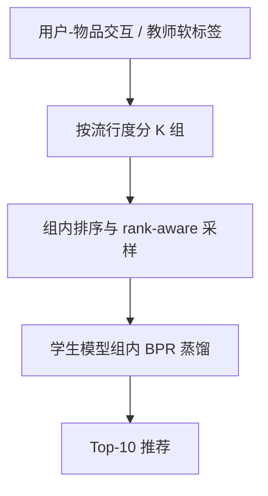
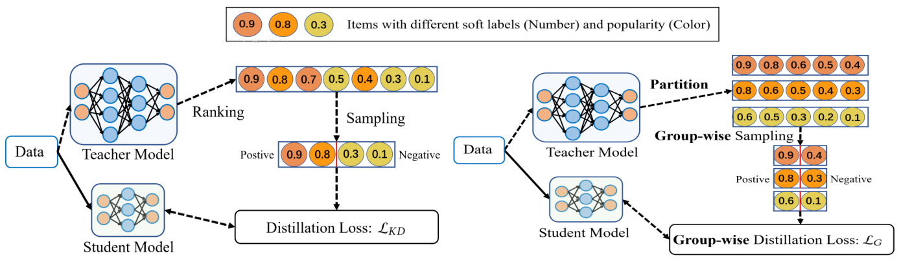

# Unbiased Knowledge Distillation for Recommendation (面向推荐系统的无偏知识蒸馏)

- **会议/期刊**: WSDM 2023
- **作者与机构**: Gang Chen, Jiawei Chen, Fuli Feng, Sheng Zhou, Xiangnan He；USTC & 浙江大学
- **推荐链路定位**: 精排/模型压缩（Top-N 排序蒸馏）
- **研究方向**: 去偏公平、可信隐私与工业架构 / 协同过滤
- **论文原文**: [论文原文链接](https://arxiv.org/abs/2211.14729v1)
- **开源代码**: [开源代码仓库链接](https://github.com/chengang95/UnKD)

## TL;DR (1分钟核心速览)

本文指出推荐系统知识蒸馏会把教师软标签中的流行度偏差放大：热门物品越推越多、非热门物品 Recall 显著下降。作者提出 UnKD，在蒸馏阶段按流行度分组，仅提取组内排序知识，理论上切断 $Z\rightarrow Y$ 的因果路径。三个数据集、BPRMF/LightGCN 双骨干下，UnKD 的 Recall@10 较最优基线提升 2.2%–8.0%，CiteULike 非热门组提升超 100%。

## Background & Motivation (背景与核心矛盾)

- **主流范式**: 先训练大教师模型，再用软标签或排序采样蒸馏轻量学生，以降低推理延迟。
- **前人局限**: RD/CD/DERRD/HTD 对全局软标签排序或嵌入拓扑蒸馏，热门物品天然占优；rank-aware 采样又让高分热门物品获得更多训练权重，偏差被进一步放大。
- **核心洞察 (Key Insight)**: 偏差源于因果路径 $I\rightarrow Z\rightarrow Y$，软标签混入了物品流行度$Z$的影响；若同组物品流行度近似相同，则组内按$Y$ 排序可近似还原去偏偏好排序。
- **本文切入点**: 不干预教师训练，只在学生蒸馏阶段做 popularity-stratified distillation，因而 teacher-agnostic 且实现简单。

## Method (核心方法设计)

### 1. 整体框架 (Overall Architecture)

UnKD 保持教师训练不变：教师先在全量数据上产出软标签；学生训练时，先按物品流行度将物品分为 $K$组（各组流行度总量近似相等），对每个用户在每组内按软标签排序并做 rank-aware 正负对采样，再用组内 BPR 蒸馏损失与原始监督损失联合优化学生；推理仅保留轻量学生，按学生打分做全库 Top-10。核心是把全局软标签排序替换为组内排序，使同组内$Z_i\approx Z_j$，从而近似抵消流行度混杂。

<figure class="paper-figure" markdown="span">
  <figcaption>图3：(a) 传统知识蒸馏和 (b) 我们提出的 UnKD 的示意图。UnKD 根据物品流行度将其划分为多个组，然后提取各组内的排序知识以学习学生模型。</figcaption>
</figure>

图3：传统全局蒸馏与 UnKD 的组内蒸馏对比。

### 2. 关键设计拆解 (Key Designs)

1. **因果去偏视角（切断 $Z\rightarrow Y$）**：总效应$\mathrm{TE}_i=Y_{i|u}-Y_{i^*|u}$可分解为偏好路径与流行度路径；后者为$\mathrm{PEZ}_i=Y_{i^*,Z_i|u}-Y_{i^*|u}$。目标去偏效应为$\mathrm{PEM}_i=\mathrm{TE}_i-\mathrm{PEZ}_i=Y_{i|u}-Y_{i^*,Z_i|u}$。由于反事实项难算，作者证明：同组内$Z_i\approx Z_j$时，$Y_{i|u}>Y_{j|u}\Leftrightarrow \mathrm{PEM}_i>\mathrm{PEM}_j$，故组内排序近似无偏。
2. **流行度分层与组内 rank-aware 蒸馏**：按流行度降序分组并令每组流行度总量相同；每组内按教师软标签排序，以 $p_i\propto e^{-rank(i)/\mu}$采样正负对$(i^+,i^-)$。这样避免全局 top 物品垄断蒸馏信号，热门与长尾物品只在各自层内竞争，保护非热门物品的排序知识。
3. **训练目标、负采样与推理效率**：组内蒸馏损失为 $\mathcal{L}_G=-\sum_u\frac{1}{|\mathcal{U}|}\sum_{g\in G}\sum_{(i^+,i^-)\in S_{ug}}\log\sigma(\mathbf{e}_u^\top\mathbf{e}_{i^+}-\mathbf{e}_u^\top\mathbf{e}_{i^-})$，总损失$\mathcal{L}=\mathcal{L}_R+\lambda\mathcal{L}_G$。负采样来自组内 rank-aware 分布；教师仅训练期使用，学生推理成本与普通小模型一致。

## Experimental Setup & Evaluation Protocol (实验设置与评估协议)

- **数据集与预处理**: 过滤交互数少于 20 的用户，评分转二值隐式反馈。

| 数据集 | #Users | #Items | #Interactions | 稀疏度 | 特征/场景说明 |
| :--- | :---: | :---: | :---: | :---: | :--- |
| CiteULike | 5219 | 25181 | 125580 | 99.91% | 学术文献收藏 |
| Apps | 3898 | 11797 | 128105 | 99.73% | Amazon 应用评论 |
| MovieLens | 6040 | 3706 | 1000209 | 95.54% | 电影评分 |

- **数据划分与防穿越**: 每用户随机 90% 训练、10% 测试，训练集再随机 10% 作验证；属于按用户随机划分，非全局时间戳切分，存在未来交互泄漏风险。
- **排名评测协议**: Top-10 全库排序；原文未显式报告采样负例比例，复现时需确认是否为无偏 Full-Ranking。
- **对比基线与超参设置**: 对比 Student、RD、CD、DERRD、HTD；教师 $d=100$、学生$d=10$；$K\in\{2,\dots,10\}$、$\lambda\in\{0.1,\dots,1.0\}$、$\mu\in\{10,20\}$，每用户软标签 30/40；未报告显著性检验。

## Key Experimental Results (实验关键数据)

### 1. 主实验对比 (Main Results)

| 数据集/骨干 | 指标 | Student | RD | CD | DERRD | HTD | UnKD | Improv. |
| :--- | :---: | :---: | :---: | :---: | :---: | :---: | :---: | :---: |
| MovieLens/BPRMF | R@10/N@10 | 0.1435/0.2511 | 0.1473/0.2559 | 0.1445/0.2534 | 0.1436/0.2532 | 0.1441/0.2539 | **0.1547/0.2615** | +5.02%/+2.18% |
| Apps/BPRMF | R@10/N@10 | 0.0719/0.0539 | 0.0768/0.0596 | 0.0790/0.0608 | 0.0729/0.0562 | 0.0732/0.0561 | **0.0853/0.0644** | +7.97%/+5.92% |
| CiteULike/BPRMF | R@10/N@10 | 0.0760/0.0477 | 0.0808/0.0514 | 0.0801/0.0518 | 0.0793/0.0511 | 0.0788/0.0485 | **0.0863/0.0550** | +6.80%/+6.17% |
| MovieLens/LightGCN | R@10/N@10 | 0.1456/0.2581 | 0.1471/0.2583 | 0.1477/0.2602 | 0.1487/0.2606 | 0.1472/0.2592 | **0.1569/0.2672** | +5.51%/+2.53% |
| Apps/LightGCN | R@10/N@10 | 0.0811/0.0643 | 0.0831/0.0647 | 0.0848/0.0658 | 0.0832/0.0648 | 0.0833/0.0652 | **0.0867/0.0678** | +2.24%/+3.04% |
| CiteULike/LightGCN | R@10/N@10 | 0.0783/0.0510 | 0.0833/0.0538 | 0.0936/0.0616 | 0.0809/0.0527 | 0.0958/0.0628 | **0.1006/0.0654** | +5.01%/+4.14% |

注：R=Recall@10，N=NDCG@10；Improv. 为 UnKD 相对该行最优基线的提升；加粗为最优。

### 2. 消融实验 (Ablation Study)

原文未给标准 `w/o` 模块消融，以下用机制对照替代：CD 可视为“无分层”全局蒸馏，PD-CD 为“教师端去偏+全局蒸馏”。

| 数据集（BPRMF） | Student 总体/非热门 | CD 总体/非热门 | PD-CD 总体/非热门 | UnKD 总体/非热门 |
| :--- | :---: | :---: | :---: | :---: |
| MovieLens | 0.1435/0.0250 | 0.1445/0.0179 | 0.1454/0.0210 | **0.1547/0.0311** |
| Apps | 0.0719/0.0109 | 0.0790/0.0090 | 0.0795/0.0113 | **0.0853/0.0147** |
| CiteULike | 0.0760/0.0095 | 0.0801/0.0088 | 0.0805/0.0092 | **0.0863/0.0208** |

K 敏感性：非热门组在 $K=4$附近最佳；$K$ 过大时组内物品过少，排序知识不足，性能回落。

### 3. 关键实验发现 (Key Findings)

1. 标准 KD 的收益几乎来自热门组：MovieLens 上 CD 热门组 +4.73%，非热门组却 -28.40%；三个数据集非热门组平均下降 22.4%，说明教师偏差在蒸馏中被传播和放大。
2. UnKD 把收益搬回非热门组：BPRMF/CiteULike 非热门组从 Student 的 0.0095 提至 0.0208（+119%），较最优 KD 的 0.0088 提升约 136%；整体 Recall@10 也较最优基线 +6.8%。
3. 教师端去偏并不够：MovieLens 上 PD-CD 非热门组仅 0.0210，UnKD 达 0.0311；且 $K$体现“无偏性—信息量”权衡，$K=4$ 左右最稳。

## Highlights & Limitations (亮点、对比与审稿批判)

- **与代表作对比 (vs. Prior Work)**: RD/CD 依赖全局软标签排序，HTD 蒸馏教师嵌入拓扑，二者都会继承流行度；UnKD 只在学生端做流行度分层，直接切断 $Z\rightarrow Y$，且不依赖教师结构。
- **可迁移亮点**: 任意排序蒸馏都可加入“分层软标签+组内 rank-aware 采样”；该策略也可用于长尾友好的模型压缩与负采样设计。
- **审稿级局限批判**: 其一，$K$、$\mu$、$\lambda$ 均需调参，且分组只按流行度，未处理特征级公平与冷启动；其二，评估采用用户随机划分、未报告候选采样比例与显著性检验，也缺少线上延迟/吞吐验证。

## Rating (四维评分)

- **方法创新性 (Novelty)**: ⭐⭐⭐⭐ （用因果路径识别 KD 偏差，分层排序蒸馏简单但切中要害；Lemma 以组内近似成立。）
- **评估协议与实验扎实度 (Protocol & Experiments)**: ⭐⭐⭐ （三数据集双骨干、4 个 KD 基线较完整；但缺显著性、候选协议说明与时间切分。）
- **写作与数学规范度 (Clarity & Rigor)**: ⭐⭐⭐⭐ （因果图与公式清晰，Lemma 证明简洁；组内近似误差界未展开。）
- **工业落地与复现价值 (Industrial & Practical Value)**: ⭐⭐⭐⭐ （teacher-agnostic、学生推理成本不变，代码开源；训练期需教师软标签与分组采样开销。）

