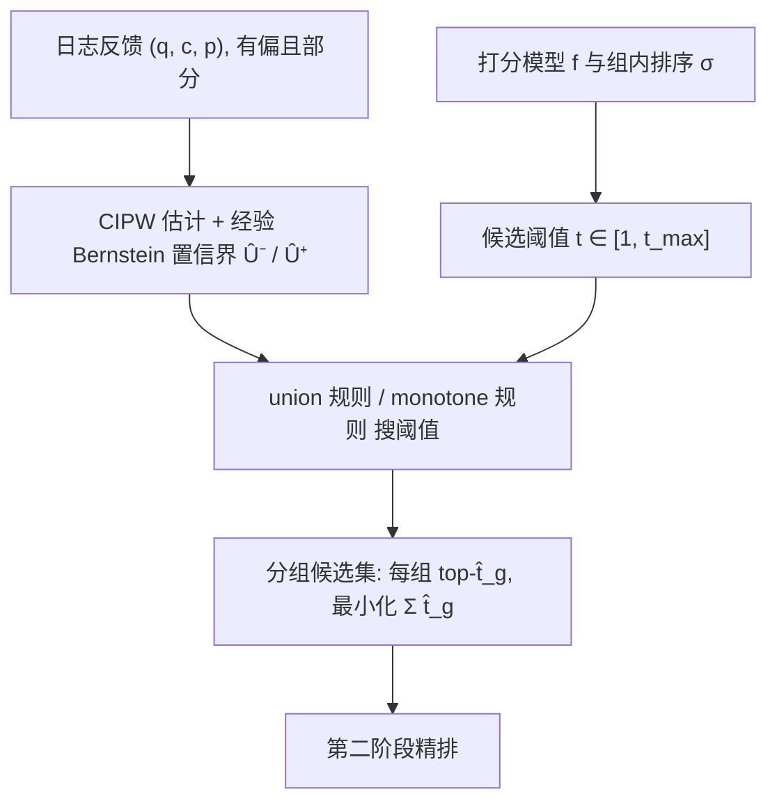
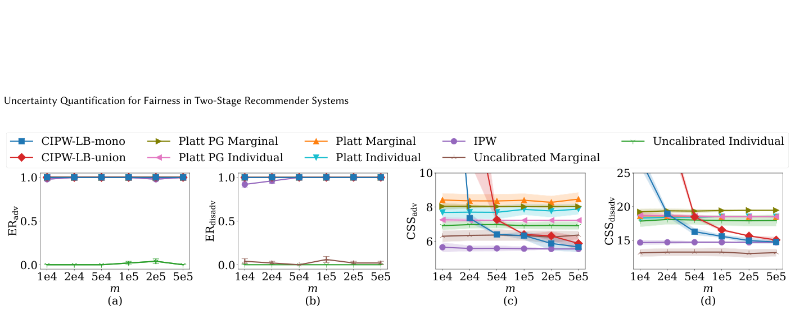

# Uncertainty Quantification for Fairness in Two-Stage Recommender Systems (两阶段推荐系统公平性的不确定性量化)

- **会议/期刊**: WSDM 2023
- **作者与机构**: Lequn Wang, Thorsten Joachims（Cornell University）
- **推荐链路定位**: 召回（第一阶段候选生成）
- **研究方向**: 去偏公平与工业架构 / 冷启动与长尾推荐
- **论文原文**: [https://arxiv.org/abs/2205.15436v3](https://arxiv.org/abs/2205.15436v3)
- **开源代码**: [https://github.com/LequnWang/Fair-Two-Stage-Recommender](https://github.com/LequnWang/Fair-Two-Stage-Recommender)

## TL;DR (1分钟核心速览)

两阶段推荐中，第一阶段若因打分模型对某群体有偏、或该群体反馈稀疏而漏召，第二阶段再公平也“回天乏术”。本文把召回层公平性建模为**分组阈值策略选择**：对每组只取 top-$t_g$，要求各组期望相关物品数$U_g(t_g)\ge U^\star_g$，同时最小化候选集规模。作者提出 union / monotone 两条阈值规则，基于**有偏部分反馈**导出的截断逆倾向加权（CIPW）经验 Bernstein 置信界，给出无分布、有限样本的高概率保证与近优性间隙。在 MSLR-WEB30K（30% 全信息测试集、50 次重复、全库排序口径）上，只有这两条规则在数据量$m\in[10^4,5\times10^5]$与弱势群体噪声比$\epsilon_{\text{disadv}}\in[0,1]$ 全区间稳定满足约束，且 monotone 的候选集比 union 小约 11%。

## Background & Motivation (背景与核心矛盾)

- **主流范式**: 工业推荐普遍采用“召回（近似 top-k，亚线性）× 精排（重模型）”两段式；公平性研究则集中在精排/bandit 阶段（如排序公平、曝光配额）。
- **前人局限**: ① 精排公平算法复杂度至少 $O(n)$（$n$为物品数），无法下沉到有毫秒级延迟约束的召回层；② 靠“校准打分”（Platt scaling、IPW 修正）来缓解偏差的方法只做点估计，**不给有限样本保证**，在弱势群体反馈少、方差大时仍会跌破约束（作者实验证实：$\epsilon_{\text{disadv}}>0.6$ 后 IPW 达标率迅速下降）。
- **核心洞察 (Key Insight)**: 第一阶段的不公平是**不可恢复的**——候选集中根本没有足够弱势群体相关物品，第二阶段任何公平约束都只能在该残缺集合内做比例分配。因此应把公平从“打分修正”改成“**集合级硬约束 + 不确定性量化**”。
- **本文切入点**: 用无分布不确定性量化（conformal / 风险控制思想，Bates et al.）构造阈值策略的置信下界，把“数据不足/模型有偏”的代价**显式转移到候选集规模（即第二阶段延迟）**上，从而给决策者以经济激励去补齐弱势群体数据。

## Method (核心方法设计)

### 1. 整体框架 (Overall Architecture)

给定打分模型 $f:Q\times D\to[0,1]$（可慢可偏，不做任何无偏假设），对每个群体$g$用$f$组内排序得$\sigma^f_{q,g}$，策略只在组内取前缀 top-$t_g$个物品。离线侧用部署策略$\pi_0$记录的日志$\{q_i,\boldsymbol{c}_i,\boldsymbol{p}_i\}_{i\in[m]}$估计每个候选阈值$t$的期望相关物品数$U_g(t)$的上下置信界，再按两条规则搜出最小可行$(\hat t_g)_{g\in\mathcal G}$；线上只做“组内排序 + 阈值截断”，无额外延迟开销。

### 2. 关键设计拆解 (Key Designs)

1. **分组阈值候选策略（把公平写成集合约束）**：痛点是不加约束的全局 top-$k$会让弱势群体被系统性挤出。改为$s_j=\mathbb{I}\{\exists g,\ j\in\{\sigma^f_{q,g}(j'):j'\in[t_g]\}\}$，优化目标
$\min_{\boldsymbol t}\sum_g t_g \ \ \text{s.t.}\ \ U_g(t_g)=\mathbb{E}_{q,\boldsymbol r}\big[\sum_{j\in[t_g]}r_{\sigma^f_{q,g}(j)}\big]\ge U^\star_g$。
直觉：约束挂在“期望相关物品条数”这一**可估、可加**的量上，既可离线估计，又天然保持召回的亚线性复杂度（只排 top-$t^{\max}_g$）。

2. **union 与 monotone 两条阈值选择规则（提供无分布保证）**：给定逐点下界 $\hat U^-_g(t,\alpha)$，
$\hat t^{\text{union}}_g=\min\{t\in[t^{\max}_g-1]:\hat U^-_g(t,\tfrac{\alpha}{t^{\max}_g-1})\ge U^\star_g\}$，
$\hat t^{\text{mono}}_g=\min\{t:\hat U^-_g(t',\alpha)\ge U^\star_g,\ \forall t\le t'<t^{\max}_g\}$。
union 对 $t^{\max}_g-1$个阈值做 union bound，失败概率被摊薄$t^{\max}$倍；monotone 利用$U_g(\cdot)$单调递增，只需每个阈值用$\alpha$，因此候选集更紧——这正是实验中 monotone 恒优于 union 的根源。

3. **从有偏部分反馈导出置信界 + 近优性间隙**：在位置偏差模型 $c_j=o_j r_j$、倾向$p^i_{\sigma(j)}$已知（正性假设$p>\gamma$）下用截断 IPW：
$\hat U^{\text{CIPW}}_{g,\lambda}(t)=\frac1m\sum_{i=1}^{m}\sum_{j\in[t]}\min(\lambda,\tfrac{1}{p^i_{\sigma^f_{Q_i,g}(j)}})C^i_{\sigma^f_{Q_i,g}(j)}$，
下界 = 该估计 $-\sqrt{2V_m(\boldsymbol Z_{g,t})\ln(2/\alpha)/m}-\frac{7t\lambda\ln(2/\alpha)}{3(m-1)}$。裁剪参数$\lambda$显式权衡偏差与方差。近优性：$U_g(\hat t_g)-U^\star_g<\hat U^+(\hat t_g)-\hat U^-(\hat t_g-1)$，渐近（$\lambda=\sqrt m$）可证$t^\star_g\le\hat t_g\le t^\star_g+1$。**无需训练目标函数**，全部成本是离线$O(|\mathcal G|\,t^{\max}m)$ 的界计算；线上零负采样、零额外推理。

## Experimental Setup & Evaluation Protocol (实验设置与评估协议)

- **数据集与预处理**: MSLR-WEB30K，30,000 条 query；按 `url click count` 特征分组——点击数为 0 记为弱势群体 $\text{disadv}$，其余为$\text{adv}$；相关性二值化（原标签 2/3/4 → 1，其余 → 0）。

| 数据集 | #Queries | #Groups | 每组平均相关物品数 | 说明 |
| :--- | :---: | :---: | :---: | :--- |
| MSLR-WEB30K | 30,000 | 2（adv / disadv） | $\text{AR}_{\text{adv}}=6.16$/$\text{AR}_{\text{disadv}}=13.99$ | 用 url click count 划分群体，模拟冷启动/长尾弱势组 |

- **数据划分与防穿越 (Splitting Strategy)**: **比例划分**——1% 训练 logistic regression 作为 $f$，69% 用于模拟用户反馈（构造置信界），30% 作为**全信息测试集**评估策略；三段互不重叠，避免界估计与评估泄漏。
- **排名评测协议 (Ranking Protocol)**: 30% 测试集上做 **Full-Ranking** 无偏评估（全库未交互物品均参与打分，无负采样），每组独立统计。反馈模拟采用位置点击模型，倾向 $p^i_j=1/\text{rank}(j\mid\pi_0)$。
- **对比基线与超参设置**: 基线 7 个——Uncalibrated {Individual, Marginal}、Platt {Individual, Marginal}、Platt PG {Individual, Marginal}、IPW；默认 $m=10^5$、$\lambda=100$、$t^{\max}_{\text{adv}}=t^{\max}_{\text{disadv}}=50$、$1-\alpha=0.9$；目标按 **Equal Opportunity** 设定：$U^\star_{\text{adv}}/\text{AR}_{\text{adv}}=U^\star_{\text{disadv}}/\text{AR}_{\text{disadv}}$且$U^\star_{\text{adv}}+U^\star_{\text{disadv}}=5$。每设置重复 **50 次**，报告达标率$\text{ER}_g$（含标准误）与平均候选集规模$\text{CSS}_g$（含标准差）。

## Key Experimental Results (实验关键数据)

### 1. 主实验对比 (Main Results)

原文以曲线（图 1–图 4）而非表格报告，下表为默认设置 $m=10^5$ 下由图 1 读取的近似值（50 次重复）：

| 方法 | $\text{ER}_{\text{adv}}\uparrow$|$\text{ER}_{\text{disadv}}\uparrow$|$\text{CSS}_{\text{adv}}\downarrow$|$\text{CSS}_{\text{disadv}}\downarrow$ |
| :--- | :---: | :---: | :---: | :---: |
| **CIPW-LB-mono (本文)** | **≈1.00** | **≈1.00** | **≈6.4** | **≈17.2** |
| CIPW-LB-union (本文) | ≈1.00 | ≈1.00 | ≈7.0 | ≈19.4 |
| IPW | ≈0.98 | ≈0.84 | ≈6.5 | ≈20.1 |
| Platt PG Marginal | ≈0.95 | ≈0.62 | ≈5.8 | ≈16.0 |
| Platt Marginal | ≈0.93 | ≈0.55 | ≈6.0 | ≈16.4 |
| Platt PG Individual | ≈0.88 | ≈0.48 | ≈5.6 | ≈15.8 |
| Uncalibrated Marginal | ≈0.80 | ≈0.40 | ≈5.2 | ≈14.9 |
| Uncalibrated Individual | ≈0.72 | ≈0.35 | ≈5.0 | ≈14.5 |

<figure class="paper-figure" markdown="span">
  <figcaption>图1：当我们改变用户反馈数据量 𝑚 时，不同第一阶段候选生成策略的比较。左侧两图展示了在50次运行中，每种策略为优势群体 ERadv 和劣势群体 ERdisadv 选择足够相关项的经验概率及标准误条。右侧两图展示了在50次运行中，优势群体 CSSadv 和劣势群体 CSSdisadv 的期望候选集大小的经验平均值，以及作为阴影区域的一个标准差。</figcaption>
</figure>

### 2. 消融实验 (Ablation Study)

| 配置 | $\text{ER}_{\text{disadv}}$|$\text{CSS}_{\text{adv}}$|$\text{CSS}_{\text{disadv}}$ | 现象 |
| :--- | :---: | :---: | :---: | :--- |
| mono, $\lambda=10$ | 1.00 | ≈6.8 | ≈18.9 | 方差主导，需更多候选 |
| mono, $\lambda=40$ | 1.00 | ≈6.5 | ≈17.5 | 接近最优 |
| mono, $\lambda=100$（默认） | 1.00 | ≈6.4 | ≈17.2 | 偏差-方差折中最优 |
| union, $\lambda=100$ | 1.00 | ≈7.0 | ≈19.4 | 系统性地偏保守 |
| mono, $t^{\max}=30$| 1.00 | ≈6.5 | ≈17.3 | 对$t^{\max}$ 不敏感 |
| mono, $t^{\max}=300$ | 1.00 | ≈6.6 | ≈17.4 | 同上，界不因阈值变宽而变松 |
| union, $t^{\max}=300$| 1.00 | ≈7.5 | ≈22.5 | 失败概率被$t^{\max}$ 稀释，候选膨胀 |

### 3. 关键实验发现 (Key Findings)

1. **只有本文两条规则在“模型对弱势群体越来越不准”时不破约**：把弱势群体打分区按 $\eta\sim\text{Bernoulli}(\epsilon_{\text{disadv}})$替换为$\text{Beta}(1,10)$噪声后，$\epsilon_{\text{disadv}}$从 0 升到 1.0 全程保持$\text{ER}_{\text{disadv}}\approx1$；而 IPW 在$\epsilon_{\text{disadv}}>0.6$ 后达标率明显下滑（其方差未被建模），Platt 类基线几乎线性崩塌——直接验证“点估计 + 校准”无法替代置信下界。
2. **公平是靠“延迟换来的”而非免费**：$m$从$5\times10^5$降到$10^4$时，mono 的$\text{CSS}_{\text{disadv}}$从约 16.5 升到约 24（约 +45%），而$\text{ER}$ 始终为 1。这正是本文强调的经济激励——数据越缺、模型越偏，候选集越大，第二阶段成本越高，倒逼决策者补齐弱势群体反馈。
3. **monotone 支配 union**：默认设置下 $\text{CSS}_{\text{disadv}}$17.2 vs 19.4（约 −11%），且 union 的候选规模随$t^{\max}$增大而单调上升（30→300 时约 +26%），mono 几乎不变；原因在于 union bound 惩罚随阈值数线性放大，而 mono 的界仅含$\log t$ 项，故阈值搜索空间可以放心开大。

## Highlights & Limitations (亮点、对比与审稿批判)

- **与代表作对比 (vs. Prior Work)**: 相对 Platt scaling / IPW 等**校准类**方法，本文不追求无偏打分，而是用置信下界换取“即使有偏也不破约”的硬保证；相对 Bates et al. 的风险控制，本文把全信息假设推广到**有偏 + 部分可观测**的排序日志，并额外给出有限样本与渐近近优性分析；相对精排/bandit 公平（如曝光配额、公平排序），本文是唯一在亚线性召回复杂度下可行的方案。
- **可迁移亮点**: ① “阈值化前缀 + 逐点置信下界”这套模板可直接移植到多样性/覆盖度/地域配额的硬约束候选生成，只需换掉被约束的统计量；② CIPW + 经验 Bernstein 的排序场景上下界，本身就是一个可复用的离线策略评估工具（可用于验证召回改动是否真的涨点）。
- **审稿级局限批判**: ① 实验仅单一数据集 MSLR-WEB30K，反馈由位置点击模型**模拟**，倾向 $p=1/\text{rank}$完全已知，真实系统中倾向需估计，估计误差会直接破坏有限样本保证；② 方法只输出 top-$t_g$前缀，无法表达组内更细粒度的配额或公平排序；$U^\star_g$、$t^{\max}_g$与$\lambda$仍需人工设定（虽实验显示对$\lambda$、$t^{\max}$ 稳健）；③ 公平是以**候选集膨胀**换取的，第二阶段延迟与算力成本上升，论文未量化这部分端到端代价。

## Rating (四维评分)

- **方法创新性 (Novelty)**: ⭐⭐⭐⭐ （首次把无分布不确定性量化引入召回层分组公平，把“公平约束”转成“可估统计量的置信下界”，理论视角新且非增量式堆模块）
- **评估协议与实验扎实度 (Protocol & Experiments)**: ⭐⭐⭐ （50 次重复 + 30% 全信息测试集 + 标准差报告扎实，但仅 1 个数据集、反馈为模拟点击、无真实线上 A/B 与显著性检验）
- **写作与数学规范度 (Clarity & Rigor)**: ⭐⭐⭐⭐⭐ （两条规则动机清晰、定理/命题与证明链条完整，有限样本 + 渐近双层分析齐备，符号自洽）
- **工业落地与复现价值 (Industrial & Practical Value)**: ⭐⭐⭐ （线上仅需组内排序截断、几乎零额外延迟，代码已开源；但依赖已知倾向与人工设定目标，候选膨胀带来的二阶段成本需工程权衡）

