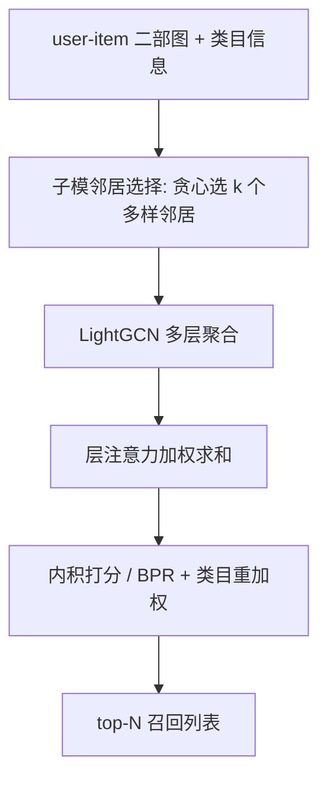
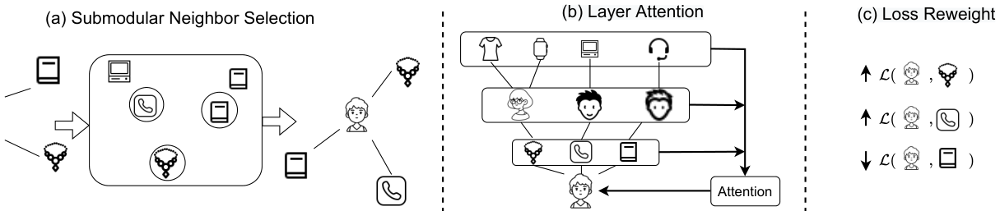
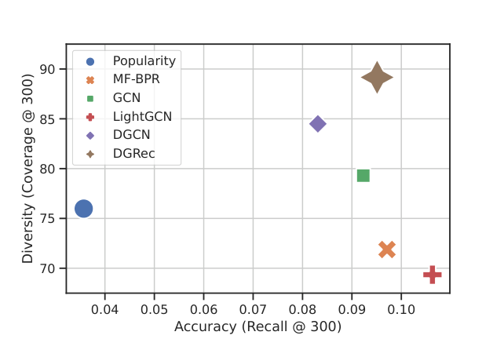

# DGRec: Graph Neural Network for Recommendation with Diversified Embedding Generation (基于多样化嵌入生成的图神经网络推荐)

- **会议/期刊**: WSDM 2023
- **作者与机构**: Liangwei Yang, Xiaolong Liu, Philip S. Yu (UIC) / Shengjie Wang, Yunzhe Tao, Jiankai Sun, Taiqing Wang (ByteDance AML)
- **推荐链路定位**: 召回（Top-N 检索阶段的嵌入生成）
- **研究方向**: 图神经网络与知识图谱推荐 / 去偏、长尾与工业架构
- **论文原文**: [https://arxiv.org/abs/2211.10486v2](https://arxiv.org/abs/2211.10486v2)
- **开源代码**: [https://github.com/YangLiangwei/DGRec](https://github.com/YangLiangwei/DGRec)

## TL;DR (1分钟核心速览)

GNN 推荐按图结构"无差别聚合全部邻居"，热门物品淹没长尾、推荐列表高度同质；而层数一深就过平滑。DGRec 不改召回框架，只在**嵌入生成**处动三刀：子模函数贪心选多样化邻居子集、层注意力软化过平滑、按类目有效样本数重加权 BPR 损失。在 TaoBao/Beauty 的 60/20/20 划分、top-100/300 全库排序下，TaoBao Coverage@300 达 89.17（较 DGCN +5.5%，较 LightGCN +28.6%），Recall@300 仅比 LightGCN 低 10.6%。

## Background & Motivation (背景与核心矛盾)

- **主流范式**: LightGCN/NGCF 等把 user-item 二部图上的邻居嵌入做归一化加权和，多层堆叠获取高阶协同信号，优化目标几乎只有 BPR 准确率。
- **前人局限**: ① 等权聚合使热门类目物品在表示中"沉底"，列表多样性差；② 直接堆叠层数触发过平滑，准确率骤降，高阶邻居带来的"远端兴趣"无法用；③ 现有去多样化方法（DPP、DUM、DGCN）多在后处理重排或仅按类目逆频率改边权，未触及表示本身，且 DGCN 忽略高阶连通与类目长尾。
- **核心洞察 (Key Insight)**: 图 1 显示物品出现频次与类目规模均服从幂律；多样性瓶颈不在排序器，而在 **聚合哪几个邻居**——若保证被聚合邻居子集在嵌入空间里彼此不相似，聚合结果天然携带多样化信号。
- **本文切入点**: 把"集合多样性"的子模最大化搬进 GNN 的邻域构造，再辅以层注意力与长尾重加权，一次性在表示层解决多样性—准确性两难。

## Method (核心方法设计)

### 1. 整体框架 (Overall Architecture)

输入为 user-item 二部图与物品类目映射。每个目标节点先经**子模邻居选择**从全邻居中贪心挑出至多 $k$个嵌入空间上互相不相似的邻居作为有效邻域；随后在此稀疏邻域上做 LightGCN 式对称归一化聚合，堆叠$L$层得到$[e^{(0)},\dots,e^{(L)}]$；**层注意力**按可学习权重加权求和得最终表示；打分用内积，训练时对每个正样本采 4 个负例计算 BPR，并按物品所属类目的有效样本数对损失**重加权**。推理即标准向量内积 top-N 检索，无额外重排模块。

<figure class="paper-figure" markdown="span">
  <figcaption>图 2：DGRec 的框架。(a) 子模邻居选择模块（第 3.2 节）在嵌入空间上寻找多样化的邻居子集用于聚合。(b) 层注意力模块（第 3.3 节）缓解由高阶连接引起的过平滑问题。(c) 损失重加权模块（第 3.4 节）调整每个样本的权重，以关注长尾类别的训练。</figcaption>
</figure>

### 2. 关键设计拆解 (Key Designs)

1. **子模邻居选择（Facility Location）**: 痛点是无差别聚合让热门邻居主导表示。作者定义集合函数 $f(\mathcal{S}_u)=\sum_{i\in\mathcal{N}_u\setminus\mathcal{S}_u}\max_{i'\in\mathcal{S}_u}\mathrm{sim}(i,i')$，相似度用高斯核$\mathrm{sim}(i,i')=\exp(-\lVert e_i-e_{i'}\rVert^2/\sigma^2)$。函数值高意味着"每个未选邻居都能在已选集合里找到代表"，即所选子集既覆盖又分散。受基数约束$|\mathcal{S}_u|\le k$最大化该子模函数是 NP-hard，用贪心按最大边际增益逐步加入，得$1-1/e$ 近似保证。直觉：聚合来自不同语义簇的邻居，表示自然带上长尾口味。
2. **层注意力（Layer Attention）**: 痛点是想用高阶邻居提多样性却遭遇过平滑。作者把不同层的嵌入看作不同感受野的候选，令 $e=\sum_{l=0}^{L}a^{(l)}e^{(l)}$，$a^{(l)}=\mathrm{softmax}_l(\langle \mathbf{W}_{\text{Att}}, e^{(l)}\rangle)$。可学习权重使模型在深层自动压低冗余层的贡献，实验中层数增至 5 时 Recall@300 仍不衰减。
3. **长尾损失重加权与训练推理**: 借用 class-balanced loss，$w_{C(i)}=(1-\beta)/(1-\beta^{|C(i)|})$，总损失$\mathcal{L}=\sum_{(u,i)\in\mathcal{E}}w_{C(i)}\mathcal{L}_{\text{BPR}}(u,i,j)+\lambda\lVert\Theta\rVert_2^2$，$\beta$越大越偏向小类目。负采样为均匀随机 4 负例，$d=32$；推理仅需一次前向，额外开销集中在邻居子集的贪心选择（可离线预处理，$O(k|\mathcal{N}_u|)$ 每节点）。

## Experimental Setup & Evaluation Protocol (实验设置与评估协议)

- **数据集与预处理**:

| 数据集 | #Users | #Items | #Interactions | 稀疏度/密度 | 特征/场景说明 |
| :--- | :---: | :---: | :---: | :---: | :--- |
| TaoBao (10-core) | 82,633 | 136,710 | 4,230,631 | 密度 $3.7\times10^{-4}$ | 阿里妈妈点击/购买/加购/收藏，3,108 类目 |
| Beauty (5-core) | 8,159 | 5,862 | 98,566 | 密度 $2.1\times10^{-3}$ | Amazon 评论，41 类目 |

- **数据划分与防穿越**: `比例划分`，随机 60% 训练 / 20% 验证 / 20% 测试，验证集用于调参与早停（10 epoch 不升即停），非时间切分。
- **排名评测协议**: top-100 与 top-300 全库检索排序，准确率用 Recall、HR，多样性用 Coverage（推荐列表覆盖的类目数）。原文未声明候选集采样，训练侧为 1 正 : 4 随机负。
- **对比基线与超参设置**: Popularity、MF-BPR、GCN、LightGCN、DGCN 五类基线；$d=32$、Adam、网格搜索调参，与 DGCN 同设置以保证公平。

## Key Experimental Results (实验关键数据)

### 1. 主实验对比 (Main Results)

| 模型 | TaoBao R@300 | HR@300 | C@100 | C@300 | Beauty R@300 | HR@300 | C@100 | C@300 |
| :--- | :---: | :---: | :---: | :---: | :---: | :---: | :---: | :---: |
| Popularity | 0.0357 | 0.2562 | 38.2449 | 75.9837 | 0.2096 | 0.3124 | 16.0213 | **27.9336** |
| MF-BPR | 0.0971 | 0.4889 | 34.0812 | 71.8802 | 0.3863 | 0.4966 | 15.8728 | 25.6659 |
| GCN | 0.0923 | 0.4634 | 37.2577 | 79.2985 | 0.3897 | 0.3897 | 16.5311 | 25.5634 |
| LightGCN | **0.1063** | **0.5097** | 32.7069 | 69.3502 | **0.4205** | **0.5318** | 15.0203 | 23.9421 |
| DGCN | 0.0831 | 0.4369 | 38.1183 | 84.4989 | 0.3790 | 0.4792 | 18.2876 | 26.9694 |
| **DGRec** | 0.0951 | 0.4817 | **39.0597** | **89.1684** | 0.3915 | 0.5021 | **19.0557** | 27.5704 |
| Improv. vs 最强基线 | −10.5% (vs LightGCN) | −5.5% (vs LightGCN) | +2.5% (vs DGCN) | +5.5% (vs DGCN) | −6.9% (vs LightGCN) | −5.6% (vs LightGCN) | +4.2% (vs DGCN) | −1.3% (vs Popularity) |

### 2. 消融实验 (Ablation Study)

| 变体 (TaoBao) | R@300 | HR@300 | C@300 | ΔC@300 |
| :--- | :---: | :---: | :---: | :---: |
| DGRec 完整 | 0.0951 | 0.4817 | **89.1684** | — |
| w/o Submodular selection | 0.0982 | 0.4869 | 84.9129 | −4.26 |
| w/o Layer attention | **0.1009** | **0.4976** | 82.9553 | −6.21 |
| w/o Loss reweighting | 0.0886 | 0.4612 | 79.3286 | −9.84 |

### 3. 关键实验发现 (Key Findings)

1. **多样性收益几乎"免费"**: 去掉子模选择后 C@300 掉 4.26（−4.8%）而 R@300 反升 0.0031，说明该模块正是"用极小准确率换覆盖度"的主引擎；完整 DGRec 相对 DGCN 在 TaoBao 上同时拿下 +14.4% R@300 与 +5.5% C@300，全面压制同赛道 SOTA。
2. **层注意力是深层的必需品，不是装饰**: 图 4 中均值聚合在 5 层时 Recall@300 快速坍塌，而层注意力让 Recall 随层数稳升、Coverage@300 升至近 105（$\beta=0.95$ 时 C@300>105、R@300>0.086）；可见过平滑被软化成"可调用的高阶多样性红利"。
3. **重加权既是去偏器也是注意力引导器**: 去掉它准确率与多样性**同时**下降（R −6.8%、C −11.0%），幅度大于另两个模块，说明长尾类目的梯度信号同时塑造了层权重的学习方向；$\beta$ 从 0.90 到 0.95 提供了一条平滑的准确率—多样性调节旋钮。

<figure class="paper-figure" markdown="span">
  <figcaption>图 3：TaoBao 数据集上的准确率-多样性权衡比较。右上角模型已放大。</figcaption>
</figure>

## Highlights & Limitations (亮点、对比与审稿批判)

- **与代表作对比 (vs. Prior Work)**: 与 DPP/DUM 等后处理重排正交且可叠加，本文把多样化前移到嵌入生成；与 DGCN 相比，DGCN 按类目逆频率改边权并靠对抗/负采样扰动嵌入，忽略高阶结构与子集内部冗余，DGRec 则显式优化邻居子集的**集合级多样性**并配层注意力处理深层退化。
- **可迁移亮点**: ① Facility-location 贪心选邻居可作为即插即用层接到任意 GNN 召回（只需嵌入与相似度，不需类目信息）；② class-balanced 的 $w_{C(i)}$ 可作为通用长尾重加权模块迁移到双塔召回。
- **审稿级局限批判**: ① 多样性指标仅用类目覆盖数，忽略同一类目内物品差异，且未报告用户级多样性或在线 A/B；② 每节点每层贪心选邻居带来 $O(k|\mathcal{N}_u|)$ 开销，论文未给出训练时长与预处理成本的定量分析；③ Beauty 上 41 个类目使覆盖度天花板过低，Popularity 反而最高，方法优势被数据规模压制，泛化证据偏弱。

## Rating (四维评分)

- **方法创新性 (Novelty)**: ⭐⭐⭐⭐ （把子模集合多样性引入 GNN 邻域构造的思路清晰且少见，但三模块均为已有技术组合）
- **评估协议与实验扎实度 (Protocol & Experiments)**: ⭐⭐⭐ （双数据集 + 消融 + 参数敏感性较完整，但随机划分无时间切分、未报告显著性检验与 full-ranking 细节）
- **写作与数学规范度 (Clarity & Rigor)**: ⭐⭐⭐⭐ （公式与模块动机一一对应，$1-1/e$ 近似保证交代清楚，复杂度分析略缺）
- **工业落地与复现价值 (Industrial & Practical Value)**: ⭐⭐⭐⭐ （代码开源、$d=32$ 轻量、可作为插入层叠加于现有 GNN 召回，但贪心选邻居的工程开销需离线化处理）

