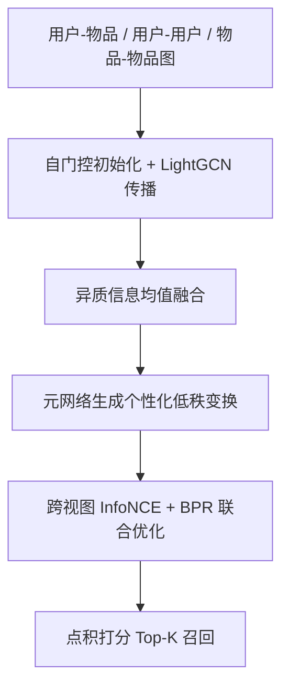
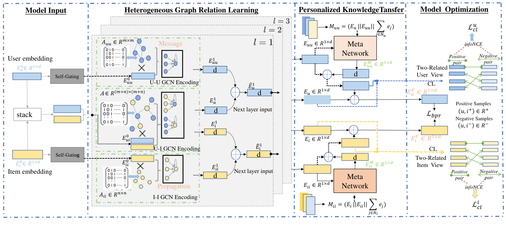

# Heterogeneous Graph Contrastive Learning for Recommendation (异构图对比学习推荐)

- **会议/期刊**: WSDM 2023
- **作者与机构**: Mengru Chen, Chao Huang, Lianghao Xia, Wei Wei, Yong Xu, Ronghua Luo；华南理工大学、香港大学
- **推荐链路定位**: 召回（用户/物品表征学习）
- **研究方向**: 图神经网络与知识图谱推荐 / 自监督对比学习与交互去噪
- **论文原文**: [https://arxiv.org/abs/2303.00995v1](https://arxiv.org/abs/2303.00995v1)
- **开源代码**: [https://github.com/HKUDS/HGCL](https://github.com/HKUDS/HGCL)

## TL;DR (1分钟核心速览)

针对异构图推荐中社交/物品侧信息稀疏且影响因人而异的问题，HGCL 用自门控异构图编码、元网络个性化低秩变换与跨视图 InfoNCE，将侧信息自适应蒸馏到用户-物品交互表征；在 Ciao/Epinions/Yelp 的 1 正 99 负采样排序下，HR@10 相对最强基线提升 2.02%–3.77%，NDCG@10 提升 4.14%–5.29%。

## Background & Motivation (背景与核心矛盾)

- **主流范式**: GNN-based CF 在用户-物品交互图上传播协同信号；异质 GNN 进一步引入社交图、物品知识图，GCL 用自监督信号缓解标签稀疏。
- **前人局限**: 现有异质 GNN 依赖稀疏交互标签，且社交影响/物品语义依赖被“统一注入”，未区分不同用户与物品的个性化差异；SGL/HCCF/HeCo 等对比增广多为随机 dropout、超图或 meta-path 级，缺少跨视图个性化知识迁移。
- **核心洞察 (Key Insight)**: 社交关系对用户偏好的影响并非同质：部分用户强受好友影响，部分用户更依赖自身交互；因此辅助视图应向交互视图做“用户/物品特定”的自适应对比增强。
- **本文切入点**: 以元网络生成个性化低秩变换矩阵，将异质辅助视图变换后再与交互视图做 InfoNCE 对齐。

## Method (核心方法设计)

### 1. 整体框架 (Overall Architecture)

HGCL 同时构建用户-物品图 $\mathcal{G}_{ui}$、用户-用户图$\mathcal{G}_{uu}$、物品-物品图$\mathcal{G}_{ii}$。先用自门控从共享 ID 表征生成辅助视图初始表征，再以无变换、无激活的 LightGCN 式传播分别编码三图；每层对用户侧/物品侧异质表征做均值融合。随后元网络根据用户/物品的交互上下文生成个性化低秩映射，将社交/物品辅助表征变换后与交互表征加权融合，并用跨视图 InfoNCE + BPR 联合优化，推理时以点积排序。

<figure class="paper-figure" markdown="span">
  <figcaption>图 1：所提出 HGCL 框架的模型流程。HGCL 包括三个关键部分：（1）通过异构图神经网络在用户-用户图、用户-物品图和物品-物品图上进行异构图表示提取与融合。（2）用于在辅助视图与交互视图之间进行个性化跨视图依赖建模的元网络。（3）在异构关系视图之间采用自适应对比学习进行联合参数优化。</figcaption>
</figure>

### 2. 关键设计拆解 (Key Designs)

1. **异质关系编码与融合（Relation-Aware Encoding）**：解决三图语义空间不一致问题。辅助图初始表征由共享 ID 表征经自门控得到：$\mathbf{E}^{0}_{uu}=\mathbf{E}^{0}_{u}\odot\sigma(\mathbf{E}^{0}_{u}\mathbf{W}_{g}+\mathbf{b}_{g})$，$\mathbf{E}^{0}_{ii}$ 同理；传播后对交互视图与辅助视图做逐元素均值融合。这样既保留交互协同信号，又让社交/物品关系以残差方式进入下一层。

2. **元网络个性化跨视图迁移（Personalized Knowledge Transfer）**：解决“社交影响因人而异”。元知识拼接交互表征、辅助表征与邻域和：$\mathbf{M}_{uu}=[\mathbf{E}_{u}\Vert\mathbf{E}_{uu}\Vert\sum_{i\in\mathcal{N}_{u}}\mathbf{e}_{i}]$；MLP 生成低秩矩阵$\mathbf{W}^{M1}_{uu}\in\mathbb{R}^{m\times d\times k}$、$\mathbf{W}^{M2}_{uu}\in\mathbb{R}^{m\times k\times d}$，变换为$\mathbf{E}^{M}_{uu}=\sigma(\mathbf{W}^{M1}_{uu}\mathbf{W}^{M2}_{uu}\mathbf{E}_{uu})$，最终$\mathbf{E}^{F}_{u}=\alpha_u\mathbf{E}_{u}+(1-\alpha_u)(\mathbf{E}_{uu}+\mathbf{E}^{M}_{uu})$。$k<d$ 降低参数量并稳定训练；变换矩阵越大，表示该用户越受社交影响。

3. **训练目标、负采样与推理效率**：BPR 使用正交互与未观测负例；跨视图对比以其他用户/物品为负例，用户侧损失为 $\mathcal{L}^{u}_{cl}=-\log\frac{\exp(s(\mathbf{e}^{M}_{uu}+\mathbf{e}_{uu},\mathbf{e}_{u})/\tau)}{\sum_{u'}\exp(s(\mathbf{e}^{M}_{uu}+\mathbf{e}_{uu},\mathbf{e}_{u'})/\tau)}$。总损失$\mathcal{L}=\mathcal{L}_{bpr}+\beta(\alpha_1\mathcal{L}^{u}_{cl}+\alpha_2\mathcal{L}^{i}_{cl})$，打分$\hat{y}_{u,i}=\mathbf{e}^{F\top}_{u}\mathbf{e}^{F}_{i}$。GNN 部分与 SGL 同阶，元网络开销$O((m+n)d^2k)$，$k$ 通常很小。

## Experimental Setup & Evaluation Protocol (实验设置与评估协议)

- **数据集与预处理**:

| 数据集 | #Users | #Items | #Interactions | 稀疏度 | 特征/场景说明 |
| :--- | :---: | :---: | :---: | :---: | :--- |
| Ciao | 6,776 | 101,415 | 265,308 | 99.9614% | 评论站；用户信任关系 + 物品类别 |
| Epinions | 15,210 | 233,929 | 630,391 | 99.9823% | 评论站；社交信任 + 物品属性 |
| Yelp | 161,305 | 114,852 | 957,923 | 99.9948% | 本地商家；社交关系 + 商家属性 |

- **数据划分与防穿越 (Splitting Strategy)**: 正文未明确给出训练/验证/测试切分细节（需查代码或附录），因此跨论文绝对数值可比性受限；评测明确为每用户 1 个正例 + 99 个负例的 `Sampled Ranking`，非 `Full-Ranking`。
- **排名评测协议 (Ranking Protocol)**: `Sampled Ranking`，正负比 1:99；指标 HR@10、NDCG@10。
- **对比基线与超参设置**: 覆盖社交 GNN（GraphRec/DANSER/MHCN）、异质 GNN（HAN/HGT/HeCo）、KG（KGAT/MKR）、自监督（SMIN）等；$d=32$、GNN 层数 2、低秩$k=3$、学习率 0.04–0.06、batch 1024–8192；原文未报告显著性检验$p$ 值。

## Key Experimental Results (实验关键数据)

### 1. 主实验对比 (Main Results)

| Method | Ciao HR@10 | Ciao NDCG@10 | Epinions HR@10 | Epinions NDCG@10 | Yelp HR@10 | Yelp NDCG@10 |
| :--- | :---: | :---: | :---: | :---: | :---: | :---: |
| NGCF | 0.6945 | 0.4894 | 0.7984 | 0.5945 | 0.8265 | 0.5854 |
| GraphRec | 0.6825 | 0.4730 | 0.7723 | 0.5751 | 0.8098 | 0.5679 |
| HAN | 0.6589 | 0.4469 | 0.7505 | 0.5275 | 0.7731 | 0.5604 |
| HeCo | 0.6867 | 0.4867 | 0.7998 | 0.5910 | 0.8359 | 0.5847 |
| HGT | 0.6939 | 0.4869 | 0.8150 | 0.6126 | 0.8364 | 0.5883 |
| MHCN | 0.7053 | 0.4928 | 0.8201 | 0.6158 | 0.8344 | 0.5799 |
| SMIN | 0.7108 | 0.5012 | 0.8179 | 0.6137 | 0.8478 | 0.5993 |
| **HGCL** | **0.7376** | **0.5261** | **0.8367** | **0.6413** | **0.8712** | **0.6310** |
| Improv. | +3.77% | +4.97% | +2.02% | +4.14% | +2.76% | +5.29% |

注：`Improv.` 相对各列最强基线计算（Ciao/Yelp 为 SMIN，Epinions 为 MHCN）。

### 2. 消融实验 (Ablation Study)

| Variant | Ciao HR | Ciao NDCG | Epinions HR | Epinions NDCG | Yelp HR | Yelp NDCG |
| :--- | :---: | :---: | :---: | :---: | :---: | :---: |
| w/o-cl | 0.7124 | 0.5015 | 0.8176 | 0.6166 | 0.8471 | 0.6030 |
| w/o-meta | 0.7215 | 0.5135 | 0.8247 | 0.6282 | 0.8585 | 0.6218 |
| w/o-ii | 0.7116 | 0.5055 | 0.8245 | 0.6317 | 0.8573 | 0.6188 |
| w/o-uu | 0.7149 | 0.5047 | 0.8285 | 0.6266 | 0.8533 | 0.6208 |
| **HGCL** | **0.7376** | **0.5261** | **0.8367** | **0.6413** | **0.8712** | **0.6310** |

### 3. 关键实验发现 (Key Findings)

1. 移除对比学习 `w/o-cl` 在 Ciao HR@10 上从 0.7376 降至 0.7124、Yelp NDCG@10 从 0.6310 降至 0.6030，说明跨视图 InfoNCE 是主要增益来源，而非单纯异质图堆叠。
2. 移除元网络 `w/o-meta` 使 Ciao HR@10 降至 0.7215、Epinions NDCG@10 降至 0.6282，验证“用户/物品特定”的低秩变换比统一融合更能过滤辅助视图噪声。
3. 移除物品图 `w/o-ii` 在 Ciao HR@10 仅 0.7116，低于 `w/o-uu` 的 0.7149，表明物品知识依赖在该数据上贡献更明显；同时图 2 显示 HGCL 在五档稀疏用户组中均领先，稀疏场景鲁棒性较好。

## Highlights & Limitations (亮点、对比与审稿批判)

- **与代表作对比 (vs. Prior Work)**: 相比 SGL 的随机边/节点 dropout，HGCL 的增广由元网络按用户/物品个性化生成；相比 HeCo 的 meta-path 级对比，HGCL 直接对齐“辅助视图→交互视图”的跨视图变换；相比 MHCN 的多通道超图，HGCL 更强调低秩个性化迁移与自适应对比权重。
- **可迁移亮点**: 低秩元变换可用于任何“辅助图 + 主交互图”的跨视图蒸馏；用变换矩阵可视化社交影响强弱，具备可解释性。
- **审稿级局限批判**: 评测仅为 1:99 采样排序，未报告 Full-Ranking 与切分细节，绝对 HR/NDCG 可能偏高；元网络增加 $O((m+n)d^2k)$开销，且$d$、层数、$k$均较敏感（最优$d=32$、层数 2、$k=3$），大规模工业部署需进一步压缩。

## Rating (四维评分)

- **方法创新性 (Novelty)**: ⭐⭐⭐⭐ （元网络驱动的个性化异构图对比迁移较新颖，低秩变换与 InfoNCE 结合有明确动机）
- **评估协议与实验扎实度 (Protocol & Experiments)**: ⭐⭐⭐ （三数据集与消融较完整，但仅 1:99 采样排序、切分与显著性检验缺失）
- **写作与数学规范度 (Clarity & Rigor)**: ⭐⭐⭐⭐ （三图编码、元网络、对比损失链条清晰，复杂度分析到位）
- **工业落地与复现价值 (Industrial & Practical Value)**: ⭐⭐⭐⭐ （代码开源，GNN 部分与 LightGCN 同阶；元网络与辅助图构建是主要工程成本）

