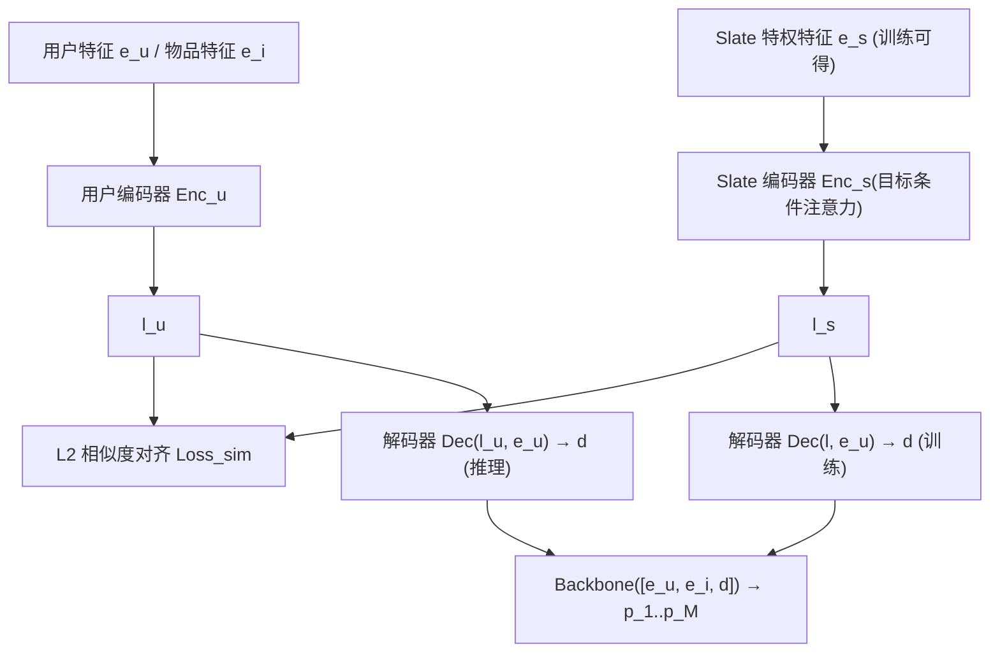

# Slate-Aware Ranking for Recommendation (列表感知排序：以特权 Slate 表征对齐隐式建模物品互影响)

- **会议/期刊**: WSDM 2023 (Long Paper)
- **作者与机构**: Yi Ren, Xiao Han, Xu Zhao, Shenzheng Zhang, Yan Zhang（腾讯）
- **推荐链路定位**: 精排（排序阶段，向下游重排供给 top-K 候选）
- **研究方向**: 多任务学习与列表级重排 / CTR 预估与特征交互
- **论文原文**: [https://arxiv.org/abs/2302.12427v1](https://arxiv.org/abs/2302.12427v1)
- **开源代码**: [https://github.com/BestActionNow/Slate_Aware_Ranking](https://github.com/BestActionNow/Slate_Aware_Ranking)

## TL;DR (1分钟核心速览)

精排阶段对每个 $(u,i)$独立打分，完全无视同一 slate 内物品的互影响；而能建模互影响的重排阶段受延迟约束只能处理几十个候选，候选集质量的上限被精排锁死。本文提出 SAR：训练时用 slate 编码器（含目标条件注意力）编码整条曝光列表得$l_s$，用用户编码器得$l_u$，以 L2 相似度损失对齐二者；推理时丢弃 slate 分支、以$l_u$ 顶替，实现在**零额外推理开销**下注入列表语境。工业新闻数据 AUC 相对 +0.43%、MAE −0.20%（优于 PFD 特权蒸馏的 +0.10%/−0.09% 且训练资源约省一半），线上 A/B 人均 PV +0.9%、停留时长 +0.745%。

## Background & Motivation (背景与核心矛盾)

- **主流范式**: 精排对 user-item 对输出单变量分数并按分数贪心构造 slate（等价假设 $R(S,u)=\sum_k o_k r(i_k,u)$）；slate 内互影响交由重排阶段（DLCM/PRM/GSF/SetRank 一步生成器、LSTM 序列生成器、生成器-评估器）处理。
- **前人局限**: ① 重排为建模复杂交互必须用重模型，线上只能吃几十个候选，其性能天花板由精排候选集决定，而精排对列表整体"视而不见"；② 精排想在训练期用 slate 特征，但推理时最终列表尚未产生，形成训练/推理特征不一致。
- **核心洞察 (Key Insight)**: 推荐系统按用户历史行为产出的 slate 本身具有同质模式，因此 slate 级信息可被用户特征"预演"出来——只要在潜空间强制 $l_u \approx l_s$，推理期就能用$l_u$无损替换$l_s$。
- **本文切入点**: 放弃 PFD 式"教师-学生软标签蒸馏"的双模型双份训练开销，改为单模型内训练/推理结构非对称切换 + 显式相似度对齐，且显式对齐比软标签更能保住特权信息。

## Method (核心方法设计)

### 1. 整体框架 (Overall Architecture)

训练图（Fig.2b）：用户特征嵌入 $e_u$、物品特征$e_i$、slate 特征（列表内 item id/类别序列）嵌入$e_s$三路并联；slate 编码器以$(e_s,e_u)$为输入产出$l_s$，用户编码器以$e_u$产出$l_u$，二者经 L2 相似度损失对齐；解码器$\text{Decoder}(l_s,e_u)\to d$与$[e_u,e_i]$拼接后进入多任务 backbone（PLE/MMoE 或 FM/W&D/NCF）产出各目标$\{p_m\}$，再由人工权重$\Phi$合成 reward 并贪心排序。推理图（Fig.2c）删除$e_s$与 slate 编码器，仅把$l_u$ 喂给同一解码器，其余链路与训练完全一致——所有 slate 侧计算都在离线完成。

### 2. 关键设计拆解 (Key Designs)

1. **目标条件注意力 Slate 编码器（把"谁在列表里"变成可训练信号）**：痛点是精排拿到的是孤立物品而非列表。SAR 将 slate 内物品序列嵌入后聚合，并以**目标物品自身**为 query 对列表内其余物品做注意力加权：$l_s=\text{Enc}_s(e_s,e_u)$。作者给出三种聚合变体对照：$SAR_{SumPool}$（无顺序无权重）、$SAR_{LSTM}$（有顺序无目标权重）、$SAR_{Attn}$（有权重无顺序）。直觉是目标物品的分数应与"同列表里出现哪些竞品/互补品"相关，注意力权重正是对这一相对重要性的显式估计——实验显示权重比顺序更值钱（$SAR_{Attn}$比$SAR_{LSTM}$再高 0.02% AUC，而$SAR_{LSTM}$仅比$SAR_{SumPool}$ 高 0.01%）。
2. **用户编码器 + 相似度对齐（让推理期"凭空"获得列表表征）**：痛点是 $l_s$依赖推理期未知的$S$。SAR 增设$\text{Enc}_u(e_u)\to l_u$，并令$\text{Loss}_{sim}=\|l_u-l_s\|_2^2$把用户侧表征拉向"该用户未来会被曝光的列表"的期望表征。解码器做结构自适应：$d=\text{Decoder}(l,e_u)$，训练时$l=l_s$、推理时$l=l_u$。t-SNE 可视化显示两类编码输出落入同簇且逐维密度吻合（Fig.4），从经验上解释了切换无损；由于$l_u$ 只需用户特征，在线完全不感知候选池，代价是与具体候选集解耦（见局限）。
3. **训练目标、负采样与推理效率**：总损失 $\mathcal{L}=\sum_{m=1}^{M}\omega_m L_m+\lambda\,\text{Loss}_{sim}$，工业场景两任务为 CTR（交叉熵）与观看时长（Huber 回归）。$\lambda$ 与 CTR 任务权重同量级时最优且曲线平坦（Fig.3），调参成本可控；无负采样设计，全量曝光样本直接监督。推理期只新增一层 MLP 解码器，无列表内 item-item 交叉计算，延迟与 baseline 同阶——这是它相较重排阶段生成式方法的根本成本优势。

## Experimental Setup & Evaluation Protocol (实验设置与评估协议)

| 数据集 | #Users | #Items | #Interactions | 稀疏度/密度 | 特征/场景说明 |
| :--- | :---: | :---: | :---: | :---: | :--- |
| MovieLens-1M | 6,040 | 4,000 | 1,000,000 | 4.14% (rating) | 无真实 slate，按会话人工切成长度 20 的列表；评分 4–5 为正、1–3 为负 |
| 工业新闻推荐 | ~30M | ~2M | ~1B | — | 每请求曝光 slate=10，item id 序列作 slate 特征；CTR + 观看时长双任务 |

- **数据划分与防穿越 (Splitting Strategy)**: MovieLens-1M 采用**随机比例划分** 8:1:1（训/验/测）；工业数据采用**全局时间戳切分**——前 7 天训练、第 8 天验证与调参、第 9 天测试，严格防未来信息泄漏。
- **排名评测协议 (Ranking Protocol)**: **不使用** NDCG/MRR 等排序指标，而是 CTR 任务用 **AUC**、观看时长任务用 **MAE**，理由为下游 $\Phi$ 依赖概率校准值与绝对值估计；论文声明在该场景 AUC/MAE 相对提升 0.1% 即为显著。未报告 Full-Ranking 或 Sampled Ranking 协议。
- **对比基线与超参设置**: Backbone 覆盖 FM / Wide&Deep / NCF（MovieLens）与 PLE（工业）；对照 PFD 特权特征蒸馏（教师=去掉 $\text{Loss}_{sim}$的 Fig.2b 结构，学生=baseline）。编码器/解码器均为$[dim,dim]$MLP，$dim=16$（MovieLens）/$128$（工业），Adam 优化、逐模型调学习率；未报告显著性检验（线上 A/B 报告单尾 t 检验$p<0.05$）。

## Key Experimental Results (实验关键数据)

### 1. 主实验对比 (Main Results)

| 数据集 / Backbone | 模型 | AUC | RelGain | MAE$_{wt}$ | RelGain |
| :--- | :--- | :---: | :---: | :---: | :---: |
| 工业（PLE） | Baseline | 0.7841 | 0 % | 11.3858 | 0 % |
| 工业（PLE） | PFD$_{student}$ | 0.7849 | +0.10% | 11.3760 | +0.09% |
| 工业（PLE） | **SAR$_{Attn}$** | **0.7875** | **+0.43%** | **11.3631** | **+0.20%** |
| MovieLens (FM) | Baseline / PFD / **SAR$_{Attn}$** | 0.8065 / 0.8062 / **0.8079** | — / −0.03% / **+0.17%** | — | — |
| MovieLens (W&D) | Baseline / PFD / **SAR$_{Attn}$** | 0.8055 / 0.8063 / **0.8087** | — / +0.10% / **+0.40%** | — | — |
| MovieLens (NCF) | Baseline / PFD / **SAR$_{Attn}$** | 0.8062 / 0.8086 / **0.8110** | — / +0.30% / **+0.60%** | — | — |

线上 A/B（7 天，用户随机分桶，baseline 精排 vs SAR$_{Attn}$精排，下游均挂同一生成器-评估器重排）：人均 PV **+0.9%**、人均停留时长 **+0.745%**（单尾 t 检验$p<0.05$）；最终曝光 Gini 指数 ItemID 0.8829→0.8818（+0.12%）、**ItemCat 0.7253→0.7126（+1.75%）**，即多样性与相关性同向提升。

### 2. 消融实验 (Ablation Study)

| 变体（工业数据，PLE backbone） | AUC | RelGain | MAE$_{wt}$ | 训练资源 | 说明 |
| :--- | :---: | :---: | :---: | :---: | :--- |
| Baseline（无列表信息） | 0.7841 | 0 % | 11.3858 | 1× | 纯 user-item 打分 |
| PFD$_{student}$（软标签蒸馏） | 0.7849 | +0.10% | 11.3760 | ~2× | 教师-学生双模型 |
| SAR$_{SumPool}$（去顺序、去权重） | 0.7871 | +0.40% | 11.3672 | 1× | 仅均值池化列表嵌入 |
| SAR$_{LSTM}$（去目标条件权重） | 0.7872 | +0.41% | 11.3720 | 1× | 保留序列、无相对重要性 |
| **SAR$_{Attn}$（完整）** | **0.7875** | **+0.43%** | **11.3631** | 1× | 目标 item 作 query 加权 |

### 3. 关键实验发现 (Key Findings)

1. **显式对齐 > 软标签蒸馏，且更省资源**：SAR$_{Attn}$ 比 PFD 学生高 0.33% AUC、MAE 再降 0.11%，训练资源却约为一半；PFD 在 FM backbone 上甚至出现 −0.03% 的负迁移，说明未经专门设计的特权特征蒸馏会稀释列表信息。
2. **列表信息是"全局有效"，但聚合方式决定增益上限**：三种变体全部显著优于 baseline（+0.40%~+0.43%），而 $SumPool\to LSTM$仅带来 0.01%、$LSTM\to Attn$ 再带来 0.02%—0.03%，即**目标条件相对权重**贡献大于**序列顺序**，为后续精简 slate 编码器提供依据。
3. **精排注入列表语境可同时改善相关性与多样性，并与重排叠加**：线上在已部署 SOTA 生成器-评估器重排的前提下仍获 PV +0.9%、ST +0.745%，且类别 Gini 下降 1.75%，说明收益来自候选集质量而非替代重排；$\lambda$ 取 CTR 权重时最优且曲线平坦，具备工程可调性。

## Highlights & Limitations (亮点、对比与审稿批判)

- **与代表作对比 (vs. Prior Work)**: 与 DLCM/PRM/GSF/SetRank 等**重排**一步生成器相比，SAR 工作在候选池大 10–100 倍的精排阶段且部署成本几乎为零；与 PRM/GSF 依赖上一阶段初始排序列表不同，SAR 不依赖任何前置顺序信息；与 PFD 特权蒸馏相比，SAR 用单模型的结构非对称切换替代双模型软标签，性能更优而训练开销减半，且不受 Reconstruction-Concentration 类生成模型随机性影响（对比 SetCover/生成式仅编码列表的方法）。
- **可迁移亮点**: ① "训练期专属分支 + 潜空间 L2 对齐 + 推理期替换输入"是任何 *train-only feature*（真实曝光位置、完整会话、后验统计）都可直接套用的轻量范式，无需蒸馏框架；② 用目标 item 作 query 对上下文做注意力，是低成本注入列表语境的标准做法，可移植到粗排/召回侧的上下文感知打分。
- **审稿级局限批判**: ① **评估协议偏弱**——主指标为 AUC/MAE 而非 NDCG/Recall 等排序指标，MovieLens 的 slate 由评分会话人工切成长度 20，并非真实曝光列表，且缺少与 PRM/SetRank 在同一候选集上的排序级直接对比；② **推理期与候选池解耦的代价未被分析**——$l_u$逼近的是$l_s$ 的期望而非当前候选集，当候选分布漂移（冷启动用户、突发新闻、候选池结构变化）时对齐误差会被放大，论文未做鲁棒性/分布漂移实验；③ 绝对增益偏小（AUC +0.43%），且 slate 特征取曝光 item id，潜在位置偏差未建模，作者亦在结论中承认留待后续。

## Rating (四维评分)

- **方法创新性 (Novelty)**: ⭐⭐⭐⭐ （以"训练/推理结构非对称 + 潜空间对齐"替代特权蒸馏，思路简洁可复用，但本质仍是 privileged information + alignment 的组合创新，缺乏理论刻画）
- **评估协议与实验扎实度 (Protocol & Experiments)**: ⭐⭐⭐⭐ （离线双数据集 + 三 backbone + 7 天线上 A/B + 多样性 Gini + t-SNE 机理验证相当完整，但以 AUC/MAE 替代排序指标、MovieLens slate 为人工合成，削弱了结论的排序侧说服力）
- **写作与数学规范度 (Clarity & Rigor)**: ⭐⭐⭐⭐ （公式与符号表清晰、三类 slate 编码变体对照设计严谨，但缺复杂度/延迟的定量分析，$\lambda$ 敏感性仅给曲线未给数值）
- **工业落地与复现价值 (Industrial & Practical Value)**: ⭐⭐⭐⭐⭐ （代码开源，推理期仅多一层 MLP、与既有 PLE/重排链路正交叠加，训练资源仅 1×，是少见的"论文即上线"型工作）

