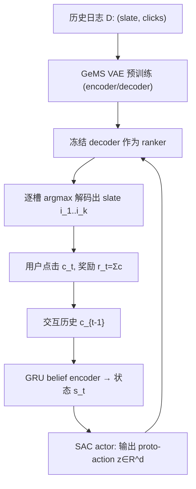
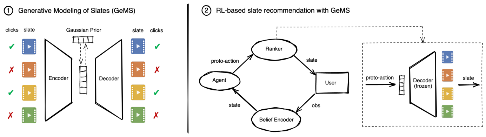
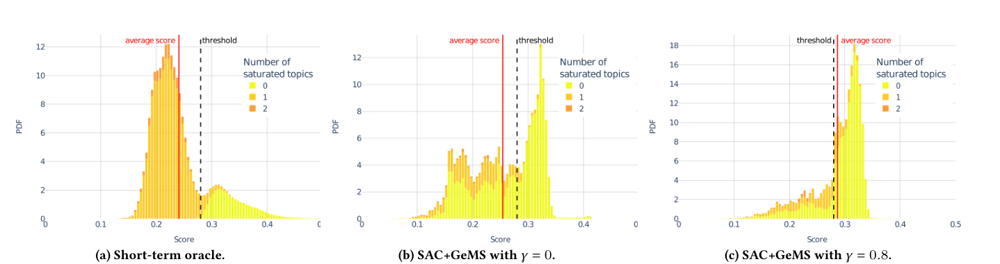

# Generative Slate Recommendation with Reinforcement Learning (基于强化学习的生成式列表推荐)

- **会议/期刊**: WSDM 2023
- **作者与机构**: Romain Deffayet, Thibaut Thonet, Jean-Michel Renders (Naver Labs Europe); Maarten de Rijke (University of Amsterdam)
- **推荐链路定位**: 重排（第二阶段排序，slate 级策略）
- **研究方向**: 强化学习与动态探索推荐 / 生成式推荐
- **论文原文**: [arXiv:2301.08632v2](https://arxiv.org/abs/2301.08632v2)
- **开源代码**: [naver/gems](https://github.com/naver/gems)

## TL;DR (1分钟核心速览)

列表推荐（slate recommendation）的动作空间是组合爆炸的（1,000 物品选 10 个 ≈ $9.6\times10^{29}$），已有 RL 方案必须靠“物品互相独立”“至多一次点击”“已知点击模型”等强假设把动作分解成单物品，实用场景下假设一放开就失效。本文提出 GeMS：在历史日志上预训练一个 VAE，把整条 slate+点击编码成低维连续潜向量（proto-action），冻结解码器作为 ranker，让 SAC 在潜空间做连续控制并解码出整条列表。在 6 个模拟环境中，GeMS 在无特权信息方法里全部最优，TopDown/Mixed(Diffuse)/TopDown(Diffuse) 三处显著优于所有基线（最高 +20.1%）。

## Background & Motivation (背景与核心矛盾)

- **主流范式**: 用 RL 优化长期留存/累计点击数，以对抗短视推荐导致的用户厌倦与信息茧房；代表做法是把 slate 的 Q 值分解为单物品 Q 值（SoftMax+REINFORCE、SlateQ）或在物品嵌入积空间取动作（Wolpertinger/WkNN）。
- **前人局限**: ① SoftMax 路线同时要求“每屏至多一次点击(1CL)”与“同屏物品收益互相独立(MI)”，两者联合起来在数学上等价于点击概率与物品本身无关；② SlateQ 需已知真实点击模型与相关性（CM），属不公平优势；③ WkNN 要求 top-down 位置模型与“执行即最优(EIB)”，本质上否定了长期优化的意义；④ TopK 极度依赖物品嵌入质量。
- **核心洞察 (Key Insight)**: 组合动作空间之所以不可解，是因为缺少一个**结构化且平滑**的动作表示；而 slate 的生成过程本身是可学的——只要有日志（slate, clicks），VAE 就能学出一个低维流形，使“相近的潜向量 ⇒ 相似的列表与相似的用户即时反馈”。
- **本文切入点**: 放弃对 slate 做人工分解，改由生成模型承担“动作→列表”的映射，把 RL 的动作维度从 $|\mathcal{A}|$降为$d\in\{16,32\}$。

## Method (核心方法设计)

### 1. 整体框架 (Overall Architecture)

环境建模为 POMDP：观测量 $o_t=c_{t-1}\in\{0,1\}^k$为上一轮点击向量，奖励$r_t=\sum_{j=1}^{k}c_{j,t}$，动作为 slate$a_t=(i_{1,t},...,i_{k,t})$，$|\mathcal{A}|=|\mathcal{I}|!/(|\mathcal{I}|-k)!$。两阶段闭环：先在日志$\mathcal{D}$上以 slate 重建 + 点击重建 + KL 三项预训练 GeMS(VAE)；随后**冻结** VAE 参数，GRU belief encoder 把$(a_t,c_t)$序列压缩成状态向量，SAC actor 在该状态输出$d$维 proto-action$z$，冻结解码器逐槽位 argmax 解码为列表并下发。整个链路只要求存在已记录的历史日志，不需要任何用户模型假设。

<figure class="paper-figure" markdown="span">
  <figcaption>图1：我们提出的基于强化学习的列表推荐框架。首先，我们在由展示列表及关联点击组成的历史日志数据上预训练GeMS模型（左），然后使用GeMS冻结的解码器将RL智能体的低维原型动作向量解码为展示列表（右）。</figcaption>
</figure>

### 2. 关键设计拆解 (Key Designs)

1. **GeMS：把 slate 压成可控潜动作（核心创新）**：痛点是把全部槽位嵌入直接当动作维度（WkNN 为 $k\times d=200$维）会遭遇维数灾难，且各槽位独立采样无法建模同屏交互；本文改为 encoder$q_\phi(z|a,c)$输入“可学习物品嵌入 + 点击”拼接、输出对角高斯$(\mu_\phi,\log\sigma_\phi)$，decoder 输出每槽的重建嵌入$e^j_\theta(z)$与点击概率$p^{j,c}_\theta(c_j|z)$，物品 logits 由$e^j_\theta(z)$ 与全库嵌入内积得到（物品嵌入用 stop-gradient 防退化解）。直觉：整条列表被压进一个点后，潜空间中的“移动方向”就对应有意义的列表编辑操作，SAC 才可能学到平滑策略。
2. **双重重建与 $\beta$/$\lambda$ 权衡（让潜空间既准又可控）**：若一味追求重建精度，KL 项被压制，潜空间欠正则、不平滑，连续控制退化；加入点击重建则让“短期结果相似的 slate”在潜空间聚拢，从而把用户反馈信号注入动作表示。总目标（最小化负 ELBO）：
$$\min_{\theta,\phi}\ \mathcal{L}=-\sum_{j=1}^{k}\log p_{\theta}^{j,a}(a_j|z_\phi)-\lambda\sum_{j=1}^{k}\log p_{\theta}^{j,c}(c_j|z_\phi)+\beta\sum_{i=1}^{d}\left(\sigma_{\phi,i}^2+\mu_{\phi,i}^2-\log\sigma_{\phi,i}-1\right)$$
其中 $z_\phi=\mu_\phi+\mathrm{diag}(\sigma_\phi^2)\cdot\epsilon,\ \epsilon\sim\mathcal{N}(0,I)$。$\beta$控制“重建 vs 可控性”，$\lambda$ 控制“点击信号 vs 列表信号”。
3. **训练目标、解码与推理开销**：RL 侧用 SAC（熵正则鼓励探索，在高度随机的推荐环境中被作者观察到是必要的）；解码为确定性贪心 $i_j=\arg\max_{i\in\mathcal{I}}p^{j,a}_\phi(i|z)$，一次前向即得整条 slate，训练/推理无需对候选逐一评估（对比 Chen et al. 的自回归分解需$k\times|\mathcal{I}|=10{,}000$次前向）。日志数据由$\epsilon=0.5$的$\epsilon$-greedy oracle 生成 100K 条轨迹，VAE 训练 10 epoch、batch 256、lr 1e-3。

## Experimental Setup & Evaluation Protocol (实验设置与评估协议)

- **数据集与预处理**: 本文不使用公开基准，自建可配置模拟器（用户冷启动、每轨迹现场生成），并开源模拟器代码。

| 模拟器配置 | 规模/取值 | 说明 |
| :--- | :---: | :--- |
| #Items | 1,000 | 符合场景 (S)：千级候选、每屏 10 个 |
| 物品/用户嵌入 | 20 维（10 主题 × 2 子维） | diffuse vs focused 两种峰度 |
| Slate 大小 $k$| 10 | 动作空间$\approx 9.6\times10^{29}$ |
| 训练轨迹 | 100K × 100 turns | $\epsilon$-greedy oracle 日志 |
| 验证/测试轨迹 | 200 / 500 | 每 1,000 步验证一次 |
| 环境变体 | 6 个 | TopDown / Mixed / DivPen × diffuse / focused |

- **数据划分与防穿越 (Splitting Strategy)**: 轨迹级切分——训练用 100K 轨迹、验证 200 条、测试 500 条互不重叠；用户按轨迹即时冷启动生成，不存在用户泄漏；超参在 TopDown+focused 验证集上网格搜索后**固定迁移**到其余 5 个环境。
- **排名评测协议 (Ranking Protocol)**: 非静态 Top-N 排序评测，而是**闭环序贯评测**——报告 100 轮交互的测试集平均累计点击数（cumulative clicks），10 个随机种子取均值，95% 置信区间基于 Student's $t$，显著性用 Welch's$t$-test。
- **对比基线与超参设置**: 基线分两组：**Disclosed env.**（Short-term oracle / SAC+TopK(ideal) / SlateQ，含特权信息，不作公平比较）与 **Undisclosed env.**（Random / REINFORCE+SoftMax / SAC+WkNN / SAC+TopK(MF)）。通用超参 $\gamma=0.8$、$\tau=0.002$、Q 网 lr$10^{-3}$、策略网 lr$3\times10^{-3}$；GeMS 专属$d\in\{16,32\}$、$\beta\in\{0.1,...,2.0\}$、$\lambda\in\{0,0.2,0.5,1.0\}$。

## Key Experimental Results (实验关键数据)

### 1. 主实验对比 (Main Results)

| 类别 | 方法 | Focused TopDown | Focused Mixed | Focused DivPen | Diffuse TopDown | Diffuse Mixed | Diffuse DivPen |
| :--- | :--- | :---: | :---: | :---: | :---: | :---: | :---: |
| Disclosed | Short-term oracle | 107.7 | 101.6 | 85.4 | 96.7 | 94.6 | 78.8 |
| Disclosed | SAC+TopK (ideal) | **429.0** | **384.1** | **386.3** | **373.9** | **371.9** | **341.3** |
| Disclosed | SlateQ | 206.5 | 202.7 | 119.0 | 209.5 | 192.7 | 117.8 |
| Undisclosed | Random | 33.8 | 33.9 | 33.6 | 33.3 | 33.2 | 32.9 |
| Undisclosed | REINFORCE+SoftMax | 248.1 | 233.5 | 249.1 | 249.5 | 214.7 | 213.8 |
| Undisclosed | SAC+WkNN | 98.5 | 97.7 | 95.5 | 107.2 | 89.8 | 92.5 |
| Undisclosed | SAC+TopK (MF) | 254.4 | 232.7 | 242.2 | 249.7 | 184.1 | 231.4 |
| Undisclosed | **SAC+GeMS (Ours)** | **305.3** | **242.6** | **254.1** | **300.0** | **260.6** | **249.6** |
| Undisclosed | Improv. vs 最优可用基线 | +20.0% | +3.9% | +2.0% | +20.1% | +21.4% | +7.9% |

（SAC+GeMS 在 6/6 环境均为 Undisclosed 组第一，其中 3 处 $^{\dagger}$ 显著优于所有其他方法，含 Disclosed 组。）

### 2. 消融实验 (Ablation Study)

| 消融/变体 | 平均累计点击 | 结论 |
| :--- | :---: | :--- |
| SAC+GeMS, $\gamma=0.8$（完整） | **305.3** | 长期折扣奖励不可或缺 |
| SAC+GeMS, $\gamma=0$（去长期项） | 194.3 | 短期均奖励也胜 oracle，但显著劣于完整版 |
| Short-term oracle（纯贪心上界） | 107.7 | 短视被长期策略反超 ≈2.8× |
| $\beta=0.1/0.2/0.5/2.0$与$\beta=1.0$对比（图3a） |$\beta=1.0$最高 | KL 权重存在明显“甜点”，$d=16/32$ 均成立 |
| $\lambda=0$（去点击重建）与$\lambda>0$对比（图3b） |$\lambda>0$更优 | 点击重建有益但影响幅度小于$\beta$ |

<figure class="paper-figure" markdown="span">
  <figcaption>图2：(a) 短期oracle、(b) 𝛾=0的SAC+GeMS和(c) 𝛾=0.8的SAC+GeMS所推荐物品的相关性得分分布。厌倦度会惩罚物品得分，并以橙色区域可视化。短视方法（左、中）比长期方法（右）产生更多厌倦，因此平均物品得分更低（红色实线）。</figcaption>
</figure>

### 3. 关键实验发现 (Key Findings)

1. **整条列表建模比分解式动作更抗“假设失效”**：一旦放开 1CL/MI/CM 等假设，SoftMax 与 SlateQ 立刻塌陷——DivPen 环境下 SlateQ 仅 117.8（focused），而 GeMS 达 254.1，说明其分解假设在需要屏内多样性时直接失效；WkNN 因 200 维积空间维数灾难仅 89.8–107.2，甚至不及贪心 oracle 的 78.8~107.7 量级附近。
2. **长期折扣是收益的主要来源**：$\gamma=0.8$(305.3) 相比$\gamma=0$(194.3) 提升 57.1%，相比 STO (107.7) 提升 183%；图2 的得分分布给出机制解释——STO 推荐的物品在无厌倦时分数可高达 0.45，但大量落入橙色“厌倦惩罚区”，而$\gamma=0.8$ 主动牺牲部分即时分数（分布左移）换来极小的橙色面积，平均分反而更高。
3. **潜空间质量决定 RL 上限，且对嵌入质量不敏感**：SAC+TopK(MF) 与 SAC+TopK(ideal) 之间落差达 174.6/151.4（focused TopDown），暴露 TopK 对物品嵌入的强依赖；GeMS 在 diffuse 与 focused 嵌入下 TopDown 分别为 300.0 / 305.3，几乎无损但置信区间更宽（$\pm42.8$vs$\pm21.9$），因其学到的是列表级结构而非单物品几何。

## Highlights & Limitations (亮点、对比与审稿批判)

- **与代表作对比 (vs. Prior Work)**: 相比 SoftMax/REINFORCE [Chen et al., Bai et al.]，本文不要求 1CL+MI，且策略在低维连续空间而非 $|\mathcal{I}|$维离散 softmax 上搜索，训练稳定性明显更好（原文指出 REINFORCE 最佳 checkpoint 尚可但训练不收敛）；相比 SlateQ 不需要真值点击模型；相比 WkNN 不在$k\times d$积空间做最近邻，规避维数灾难；相比 Chen et al. 的自回归 Q 分解，推理成本从$O(k|\mathcal{I}|)$ 次前向降为 1 次解码。
- **可迁移亮点**: ① “生成模型固定解码器 + 潜空间做 RL/搜索”这一范式可直接迁移到组合式捆绑推荐、多物品广告位分配；② 在重建损失外并联一个**下游反馈重建项**（本文的点击项 $\lambda$）作为潜空间的正则化手段，可用于任何 VAE-based 检索/推荐的动作或 query 表示学习。
- **审稿级局限批判**: ① 全部结论建立在自建模拟器上（用户嵌入、厌倦规则、位置点击模型均由作者定义），GeMS 的收益是否在真实日志上成立缺少离线/线上证据，且奖励信号只用点击数、未涉及留存等真正长期指标；② 论文明确承认未处理 offline RL 的分布偏移问题，而在线训练 RL 在工业界不可行，方法当前的落地路径不闭环；③ 对 $\beta$敏感（图3a 显示非最优点明显掉分），且 VAE 冻结后解码为确定性 argmax，探索完全依赖 SAC 熵项，在$d=16$ 的低容量下表达力上限未做分析。

## Rating (四维评分)

- **方法创新性 (Novelty)**: ⭐⭐⭐⭐ （首次把 slate 整体作为 VAE 潜动作交给 RL 连续控制，用一条“生成式 ranker”替代所有人工动作分解假设，思路干净且具一般性）
- **评估协议与实验扎实度 (Protocol & Experiments)**: ⭐⭐⭐⭐ （6 个环境 × 10 种子 + Welch $t$ 检验 + 95% CI + disclosed/undisclosed 分组，协议严谨，但完全依赖模拟器、缺少真实数据与 offline 设定）
- **写作与数学规范度 (Clarity & Rigor)**: ⭐⭐⭐⭐ （POMDP 形式化与假设对照表 1 极具说服力；但负 ELBO 的符号书写与 $\mathcal{L}_{GeMS}$ 的“最小化”表述略有不一致，部分超参搜索细节从简）
- **工业落地与复现价值 (Industrial & Practical Value)**: ⭐⭐⭐⭐ （代码与模拟器全开源；推理仅需一次解码前向，开销远低于自回归分解方案，但离线训练闭环与生产级日志偏差仍是落地门槛）

