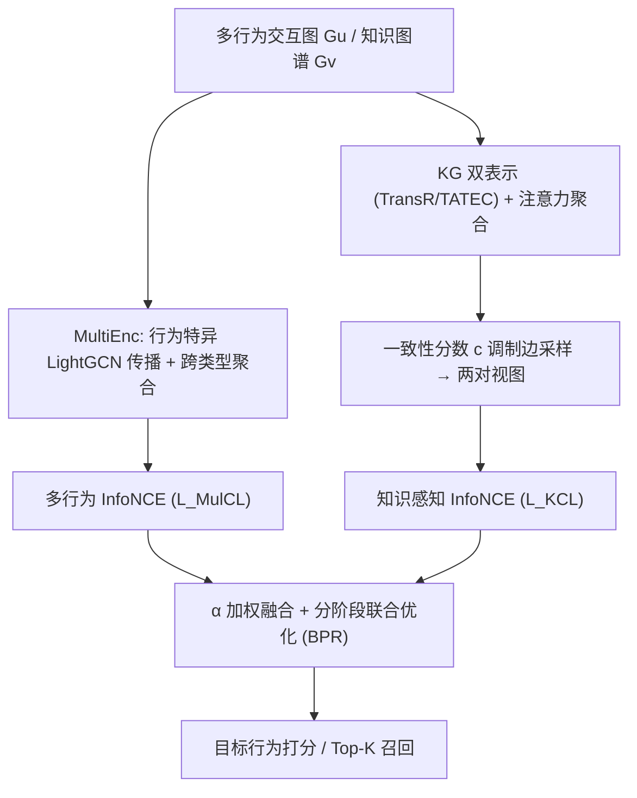
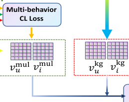
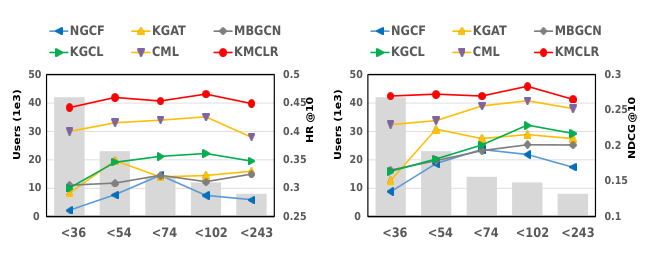

# Knowledge Enhancement for Contrastive Multi-Behavior Recommendation (知识增强的对比多行为推荐)

- **会议/期刊**: WSDM 2023 (pp. 195–203)
- **作者与机构**: Hongrui Xuan, Yi Liu, Bohan Li (南京航空航天大学), Hongzhi Yin (昆士兰大学)
- **推荐链路定位**: 召回 (用户/物品表征学习)
- **研究方向**: 自监督对比学习与交互去噪 / 图神经网络与知识图谱推荐
- **论文原文**: [https://arxiv.org/abs/2301.05403v2](https://arxiv.org/abs/2301.05403v2)
- **开源代码**: 暂未开源

## TL;DR (1分钟核心速览)

针对多行为推荐中**目标行为（如购买）监督信号极稀疏**与**用户个性化行为模式差异大**两大痛点，KMCLR 把"同一用户不同行为视图"与"知识图谱的平移/语义双视图"分别作为两组自监督对比任务，并用跨子图一致性分数调制用户-物品边采样以压制 KG 噪声，最后以分阶段联合训练融合两路表征。在三真实数据集上以 HR@10/NDCG@10 评估，相对最强基线 CML 分别提升 1.40%/1.14% (Yelp)、9.37%/15.86% (Tmall)、7.07%/9.27% (Retail)。

## Background & Motivation (背景与核心矛盾)

- **主流范式**: 以 LightGCN/NGCF 在用户-物品图上传播高阶协同信号；多行为方向用注意力 (MATN)、行为感知图卷积 (MBGCN)、时序 Transformer+KG (KHGT) 或元对比编码 (CML) 融合点击/收藏/加购等辅助行为。
- **前人局限**: (1) 目标行为（购买）占比远低于点击/收藏，直接融合异质行为会引入偏差、牺牲主任务精度；(2) 行为依赖因人而异（有人狂收藏极少买、有人从不用购物车），既有方法只能建模粗粒度共性，缺乏用户级细粒度区分。
- **核心洞察 (Key Insight)**: 同一用户的不同行为是同一偏好的"多视图观测"，天然满足对比学习的正样本定义；而 KG 虽能补全物品侧语义，其噪声可用"跨子图结构一致性"量化——稳定节点抗噪，但一味取稳定节点会丢失偏爱长尾/低稳定节点的用户偏好。
- **本文切入点**: 用两组 InfoNCE 对比任务（行为间、KG 双表示间）把辅助信号变成自监督正则，再用一致性分数调制交互图边保留概率，实现"增强 + 去噪"一体化。

## Method (核心方法设计)

### 1. 整体框架 (Overall Architecture)

输入为用户多行为交互图 $\mathcal{G}_u=(\mathcal{U},\Theta,\mathcal{V})$与物品关系知识图谱$\mathcal{G}_v=(H,R,T)$。首先**多行为学习模块**按行为类型$k$分别构建单行为子图，用 LightGCN 式传播得到行为特异表征，再跨类型聚合与对比（$\mathcal{L}_{MulCL}$），产出用户级增强表征；**知识增强模块**并行用 TransR 与 TATEC 生成两套 KG 表示，配合注意力邻居聚合与一致性调制采样的两张交互子图，构成$(\mathcal{G}_{u1},\mathcal{G}_{k1}),(\mathcal{G}_{u2},\mathcal{G}_{k2})$两对视图（$\mathcal{L}_{KCL}$），产出物品级增强表征；**联合学习模块**以权重$\alpha$ 线性融合两路嵌入后，经"分阶段训练"（先各自优化，再融合后共同优化 BPR+CL）输出目标行为打分。

<figure class="paper-figure" markdown="span">
  <figcaption>图1：KMCLR框架的模型架构。</figcaption>
</figure>

### 2. 关键设计拆解 (Key Designs)

1. **行为特异编码 + 跨类型聚合（保留行为语义再求共识）**：直接在全行为混合图上传播会把弱意图行为（tip、neutral）的噪声灌进购买表征。本文先在每种行为 $k$的子图上独立传播$v_u^{k,(l+1)}=\sum_{i\in\mathcal{N}_u^k}v_i^{k,l}$，再按行为维求均值并做门控聚合$v_u^{l}=\sigma\!\left(W_u\cdot \mathrm{mean}(\oplus_{k=1}^{K} v_u^{k,l})\right)$，最终拼接各层输出经 PReLU 得$v_u$。直觉：先"分行为建模"避免语义互斥行为的梯度冲撞，再"跨行为平均"获得对目标行为的互补共识。

2. **多行为对比任务 + 知识双视图对比与一致性去噪采样**：行为侧以同用户跨行为对 $(v_x^k,v_x^{k'})$为正、跨用户对$(v_x^k,v_y^{k'})$为负，构造$\mathcal{L}_{MulCL}=-\sum_{k'}\sum_{x\in\mathcal{U}}\log\frac{\exp(s(v_x^k,v_x^{k'})/\tau)}{\sum_{y\in\mathcal{U}}\exp(s(v_x^k,v_y^{k'})/\tau)}$，等价于用点击/收藏信号对购买表征做跨视图正则。知识侧先由$-||M_r v_h+v_r-M_r v_t||_2^2$(TransR) 与$v_h^\top M_r v_t+v_h^\top v_r+v_t^\top v_r+v_h^\top D v_t$(TATEC) 生成两套侧重"三元组合理性"与"潜在语义"的表示；再采样不同种子子图计算一致性$c=s(g_1(v_i),g_1'(v_i))$，并以$P_{u,i}=\sigma(v_u^\top v_i)\odot c$、$\hat{P}_{u,i}=(1-\mathrm{MinMax}(P_{u,i}))a+\mathrm{MinMax}(P_{u,i})b$决定边保留，得到两对视图后做$\mathcal{L}_{KCL}$。关键直觉：$c$高的节点跨子图表示稳定$\Rightarrow$ 抗噪；但乘上用户偏好 logits 后，模型仍能为"偏爱低稳定节点"的用户保边，避免过度去噪导致表征同质化。

3. **训练目标、负采样与推理开销**：总损失 $\mathcal{L}=\mathcal{L}_{BPR}+\lambda_1\mathcal{L}_{cl}+\lambda_2\|\Omega\|_2^2$，其中$\mathcal{L}_{BPR}=-\sum_{u}\sum_{i\in\mathcal{N}_u}\sum_{j\notin\mathcal{N}_u}\ln\sigma(v_u^\top v_i-v_u^\top v_j)$。融合方式为$v_u=(1-\alpha)v_u^{mul}+\alpha v_u^{kg}$。负采样：BPR 用均匀负采样，InfoNCE 用 in-batch 其他用户/物品作负例（免额外采样器）。训练采用$\text{main\_opt}\{\text{mul\_opt}(\mathcal{L}_{mul},V_{mul}),\text{kg\_opt}(\mathcal{L}_{kg},V_{kg}),V_{main}\}$的分阶段范式。复杂度：传播$O(LK|\Theta^+|d)$、跨类型聚合$O(LK(I+J)d)$、子图生成$O(|\Theta^+|d^2+|\Theta^+|dL)$；推理阶段仅保留前向传播与内积，与 LightGCN 同阶，额外开销集中在训练期的双 KG 嵌入与子图采样。

## Experimental Setup & Evaluation Protocol (实验设置与评估协议)

- **数据集与预处理**: 沿用 KHGT 的 KG 构建，行为类型见下表：

| 数据集 | #Users | #Items | #Interactions | 行为类型 | 场景说明 |
| :--- | :---: | :---: | :---: | :--- | :--- |
| Yelp | 19,800 | 22,734 | 1,400,002 | Dislike / Neutral / Tip / Like | 本地商户点评，目标行为=Like |
| Tmall | 31,882 | 31,232 | 1,451,219 | Page View / Favorite / Cart / Purchase | 电商，目标行为=Purchase |
| Retail | 147,894 | 99,037 | 1,584,238 | Favorite / Cart / Purchase | 在线零售，目标行为=Purchase |

- **数据划分与防穿越 (Splitting Strategy)**: 原文未显式声明划分细节，按 KHGT 协议处理（沿用其多行为切分），**未报告是否严格全局时间戳切分**，存在潜在穿越风险。
- **排名评测协议 (Ranking Protocol)**: 仅报 HR@10 与 NDCG@10；**未明确说明是 Full-Ranking 还是 Sampled Ranking**（无正负比说明），负采样策略未在评估侧固定，可复现性存疑。
- **对比基线与超参设置**: 覆盖 CF 类 (BPR/LightGCN/AutoRec/NGCF)、KG 类 (KGAT/KGCL)、多行为类 (NMTR/MATN/MBGCN/KHGT/CML)。嵌入维度 $d=32$，层数$L\in\{1,2,3,4\}$（最优 3），$\alpha\in\{0.1,0.2,0.3,0.4\}$（最优 0.2–0.3），学习率$1e^{-3}/3e^{-4}$，L2 权重$\{0.05,\dots,0.0001\}$；未做显著性检验。

## Key Experimental Results (实验关键数据)

### 1. 主实验对比 (Main Results)

| Model | Yelp HR@10 | Yelp NDCG@10 | Tmall HR@10 | Tmall NDCG@10 | Retail HR@10 | Retail NDCG@10 |
| :--- | :---: | :---: | :---: | :---: | :---: | :---: |
| BPR | 0.7435 | 0.4497 | 0.2443 | 0.1501 | 0.2608 | 0.1653 |
| LightGCN | 0.7884 | 0.4993 | 0.3418 | 0.2048 | 0.3065 | 0.1847 |
| NGCF | 0.7903 | 0.5063 | 0.3288 | 0.1964 | 0.3027 | 0.1844 |
| KGAT | 0.8211 | 0.5362 | 0.3853 | 0.2219 | 0.3485 | 0.2191 |
| KGCL | 0.8331 | 0.5516 | 0.4027 | 0.2293 | 0.3502 | 0.2197 |
| MBGCN | 0.7962 | 0.5033 | 0.3910 | 0.2261 | 0.3137 | 0.1904 |
| KHGT | 0.8767 | 0.5970 | 0.4032 | 0.2351 | 0.4199 | 0.2471 |
| CML (prev. best) | 0.8774 | 0.5965 | 0.5185 | 0.3055 | 0.4256 | 0.2503 |
| **KMCLR** | **0.8897** | **0.6038** | **0.5671** | **0.3540** | **0.4557** | **0.2735** |
| Improv.% vs best | +1.40% | +1.14% | +9.37% | +15.86% | +7.07% | +9.27% |

### 2. 消融实验 (Ablation Study)

| 变体 | Yelp HR | Yelp NDCG | Tmall HR | Tmall NDCG | Retail HR | Retail NDCG |
| :--- | :---: | :---: | :---: | :---: | :---: | :---: |
| w/o-Mcl (去多行为模块) | 0.8352 | 0.5749 | 0.4583 | 0.2645 | 0.3612 | 0.2157 |
| w/o-Kcl (去知识增强模块) | 0.8687 | 0.5916 | 0.5231 | 0.3064 | 0.4247 | 0.2513 |
| w/o NorT (普通联合训练) | 0.8701 | 0.5943 | 0.5339 | 0.3106 | 0.4268 | 0.2502 |
| **KMCLR (full)** | **0.8897** | **0.6038** | **0.5671** | **0.3540** | **0.4557** | **0.2735** |

### 3. 关键实验发现 (Key Findings)

1. **多行为对比的收益与"行为语义梯度"正相关**：Retail 上移除多行为模块 HR 从 0.4557 掉到 0.3612（-20.7%）、Tmall NDCG 从 0.3540 掉到 0.2645（-25.3%），但在 Yelp 上仅从 0.8897 降到 0.8352（-6.1%）。说明"收藏→购物车→购买"这类强意图递进关系才是对比学习的主战场，而 Yelp 的 dislike/neutral/tip 情感极性标签与 Like 目标同质性高、互补信息少。
2. **KG 分支的增益依赖物品侧语义丰度，且分阶段训练在稀疏场景尤为关键**：移除 KG 后 Tmall HR 降 7.8%、Retail 降 6.8%，Yelp 仅降 2.4%（商户属性 KG 较弱）；而在保留 KG 但改为直接线性加权联合训练 (w/o NorT) 时，Tmall NDCG 从 0.3540 掉至 0.3106（-12.3%），说明"先各自收敛再融合"避免了辅助 CL 梯度在早期压过 BPR 主任务。
3. **稀疏度分桶上优势随交互数减少而放大**：Retail 用户按交互数分层（<36 至 <243）时，KMCLR 与 NGCF/MBGCN/CML 的差距在最稀疏桶最大，验证多行为+KG 的多视图自监督确实在小样本用户上补足了监督信号（见图 2）。

<figure class="paper-figure" markdown="span">
  <figcaption>图2：KMCLR与基线方法在Retail数据上不同数据稀疏度下的性能。</figcaption>
</figure>

## Highlights & Limitations (亮点、对比与审稿批判)

- **与代表作对比 (vs. Prior Work)**: ① 相比 **CML**（同样用 CL 建模多行为，但只用元对比编码、无外部知识），本文额外引入 KG 双表示视图与一致性去噪采样，Tmall HR@10 高出 9.37%；② 相比 **KGCL**（KG 对比学习但仅单行为交互图），本文把对比扩展到行为维度，Retail HR@10 高 30.2%；③ 相比 **KHGT**（同时用多行为与 KG，但无自监督，仅靠 Transformer 时序融合），本文以对比正则替代强监督融合，Retail/Tmall 提升 8.5%/40.6%。
- **可迁移亮点**: ① "**一致性分数 $\times$ 用户偏好 logits → min-max 归一化采样概率**"是一个通用且廉价的结构去噪算子，可直接移植到社交图、序列物品转移图的边丢弃策略；② **TransR+TATEC 双语义 KG 视图**的构造方式，可复用为任何 KG 增强推荐的对比增广手段，无需额外标注。
- **审稿级局限批判**: ① **评估协议不透明**——未声明全库排序或采样排序、未给负采样比例与随机种子，也未做显著性检验，0.5% 量级的 Yelp 提升（+1.40%/+1.14%）在无方差报告下说服力偏弱；② **训练开销与工程复杂度偏高**——双 KG 嵌入、逐物品子图采样生成 $O(|\Theta^+|d^2)$的额外代价，加上三阶段优化器调度，论文未给训练时长/显存/推理 QPS，工业落地时噪声容忍区间$[a,b]$ 与丢弃率需要逐业务重新调参（图 4 显示其对 HR 影响达 0.5 个百分点量级），迁移成本被明显低估。

## Rating (四维评分)

- **方法创新性 (Novelty)**: ⭐⭐⭐⭐ （首次把"多行为对比"与"知识图谱对比"联合纳入统一框架，一致性调制采样去噪的设计有清晰物理直觉，但各组件本身均为已有技术的组合式创新）
- **评估协议与实验扎实度 (Protocol & Experiments)**: ⭐⭐⭐ （三数据集 + 11 个基线 + 消融 + 稀疏度分桶 + 超参分析较完整，但划分与打分协议缺失、无显著性检验、无线上验证）
- **写作与数学规范度 (Clarity & Rigor)**: ⭐⭐⭐ （公式链条完整、符号基本自洽，但 Eq.4/6 的维度与广播机制表述含糊，复杂度分析仅给渐进阶而缺实测）
- **工业落地与复现价值 (Industrial & Practical Value)**: ⭐⭐⭐ （去噪采样算子可独立复用，但代码未开源、双 KG 训练开销与多阶段调参使其更适合离线召回实验而非快速上线）

