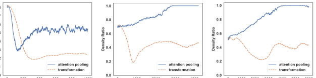
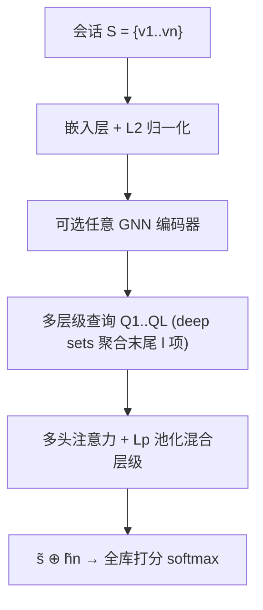

# Efficiently Leveraging Multi-level User Intent for Session-based Recommendation via Atten-Mixer Network (基于 Atten-Mixer 网络高效利用多级用户意图的会话推荐)

- **会议/期刊**: WSDM 2023
- **作者与机构**: Peiyan Zhang, Jiayan Guo, Chaozhuo Li 等 (HKUST / 北京大学 / 微软亚洲研究院 / UIUC)
- **推荐链路定位**: 召回 (会话级 next-item 全库排序)
- **研究方向**: 序列与会话推荐
- **论文原文**: [https://arxiv.org/abs/2206.12781v4](https://arxiv.org/abs/2206.12781v4)
- **开源代码**: [https://github.com/Peiyance/Atten-Mixer-torch](https://github.com/Peiyance/Atten-Mixer-torch)

## TL;DR (1分钟核心速览)

针对 SBR（会话推荐）领域"堆叠更复杂 GNN"却收益边际递减的现象，本文先用 SparseVD 稀疏化实验证明：GNN 传播权重密度在训练中趋近于 0，而 attention readout 权重密度保持较高——即传播是冗余的、读出才是主力。据此提出 Atten-Mixer：以 deep sets 对末尾 $l$个物品做置换不变聚合生成$L$个多层级意图查询，多头注意力后接$L^p$ 池化混合注意力图，得到会话表征。在三基准上 HR@20 全面超越 9 个 SOTA，且训练时间仅为 DHCN 的约 1/7。

## Background & Motivation (背景与核心矛盾)

- **主流范式**: SBR 以短会话 $S=\{v_1,\dots,v_n\}$预测$v_{n+1}$；近年在 SR-GNN 之后，主线是用更精巧的 GNN（highway 连接、超图 DHCN、位置/目标感知）刻画物品成对转移。
- **前人局限**: ① 会话图极稀疏（Diginetica 近 70% 会话内物品互不相同），构图近似退化为一条序列，复杂传播反而成为"重负担"；② 复杂度指数增长却只换来边际精度提升。
- **核心洞察 (Key Insight)**: 对 GNN 模型做 SparseVD 分解后发现，图传播权重的密度比随训练步数趋近 0，而 attention pooling 权重密度比显著更高——读出模块才是承载推理的主体；但现有读出仅停留在 instance-view（末次点击或单物品查询），缺乏跨物品的高层语义关联（如"婚纱"与"头纱"同属婚庆），推理碎片化易陷局部最优。
- **本文切入点**: 直接砍掉 GNN 传播，把推理职责全部交给一个具备多层级（concept-view + instance-view）推理能力的读出模块。

<figure class="paper-figure" markdown="span">
  <figcaption>图 3：在 GNN 模块上应用 SparseVD 后的稀疏化结果。</figcaption>
</figure>

## Method (核心方法设计)

### 1. 整体框架 (Overall Architecture)

物品经嵌入层与 L2 归一化得 $\tilde{h}_j$（可选接入任意 GNN 编码器，本文主实验不加）。Atten-Mixer 承担读出：先在会话末尾若干项上生成$L$层意图查询，多头注意力得到$L\times H$组注意力图，再用$L^p$池化沿"层级"维度池化混合为每个 head 的会话向量，拼接归一化得$\tilde{s}$；最后与末次点击$\tilde{h}_n$拼接经$W_m$ 变换后与全库物品内积、softmax 打分。训练用交叉熵 + Adam。

### 2. 关键设计拆解 (Key Designs)

1. **多层级用户意图查询生成（用归纳偏置剪搜索空间）**: 朴素地枚举所有高层概念不可行（复杂度 $O(Hn\lfloor n/2\rfloor d)$）。作者引入 SBR 两条归纳偏置——*inherent priority*（末尾项更重要）与 *local invariance*（末尾项局部顺序无关）——只对末尾$l$项做置换不变的 deep sets 聚合，生成第$l$级查询：$Q_l = W_{q_l}\big(\Sigma(\{\tilde{h}_j\}_{j=n-l+1}^{n})\big)$，$l=1,\dots,L$。$Q_1$即 instance-view，其余为高层 concept-view。复杂度降至$O(HL^2nd)$，$L \ll n$ 带来数量级削减。

2. **注意力图混合（multi-head + $L^p$池化）**: 各层查询独立注意力$\alpha^h=\mathrm{softmax}\!\left(\frac{QW_Q^h (KW_K^h)^\top}{\sqrt{d}}\right)$；随后在层级维度做$L^p$池化而非简单 max/mean：$\hat{\alpha}_{j,h}=\big[\sum_{m=0}^{l-1}(\alpha_{j,mH+h})^p\big]^{1/p}$，$s_h=\sum_j \hat{\alpha}_{j,h}\tilde{h}_j$。$L^p$池化在"突出最显著层级"与"保留多层级综合意图"之间取得可调平衡（$p=4$），避免 max 池化只留单层导致的信息塌缩。

3. **训练目标、负采样与推理效率**: 损失为末项交叉熵 $\mathcal{L}=-\log \hat{y}_{v_{n+1}}$，无显式负采样，softmax 覆盖全物品集（即全库 softmax 训练）。推理仅需一次前向 + 全库内积，单 epoch 耗时 288s (Diginetica) / 267s (Gowalla) / 1140s (Last.fm)，相对 DHCN 21070s 降低约 7–18 倍。

## Experimental Setup & Evaluation Protocol (实验设置与评估协议)

- **数据集与预处理**: 沿用 SR-GNN/LESSR 的过滤与数据增广（过滤短会话与低频物品，末项作为标签并做序列增广）。

| 数据集 | #Users | #Items | #Interactions | 稀疏度/平均长度 | 特征/场景说明 |
| :--- | :---: | :---: | :---: | :---: | :--- |
| Diginetica | — | 42,596 | 981,620 (777,029 会话) | 平均长 4.80 | 电商交易会话 |
| Gowalla | — | 29,510 | 1,122,788 (830,893 会话) | 平均长 3.85 | POI 打卡 |
| Last.fm | — | 38,615 | 3,835,706 (3,510,163 会话) | 平均长 11.78 | 音乐艺人收听 |

- **数据划分与防穿越 (Splitting Strategy)**: Diginetica 取最后一周会话为测试集；Gowalla 以 1 天为切分间隔、Last.fm 以 8 小时为间隔，各取最后 20% 会话作测试；训练集再取末 20% 作验证集。
- **排名评测协议 (Ranking Protocol)**: 单正例 next-item 预测，对全部候选物品打分后排序（全库排序，不做负采样），报告 HR@{5,10,20} 与 MRR@{5,10,20}。
- **对比基线与超参设置**: 基线含 NARM、NextItNet、SR-GNN、GC-SAN、SGNN-HN、LESSR、NISER+、DHCN、DSAN；$d=256$、batch=100，$L\in\{1..10\}$、$H\in\{1,2,4,8,16,32\}$，$\sigma=12$、$p=4$；5 个随机种子取均值，成对 t 检验$p<.01$。

## Key Experimental Results (实验关键数据)

### 1. 主实验对比 (Main Results)

| 模型 | Diginetica HR@20 | MRR@20 | Gowalla HR@20 | MRR@20 | Last.fm HR@20 | MRR@20 | Time(s) 均值 |
| :--- | :---: | :---: | :---: | :---: | :---: | :---: | :---: |
| NARM | 48.27 | 16.43 | 49.67 | 22.14 | 21.73 | 6.87 | 205 |
| SR-GNN | 51.16 | 17.67 | 50.16 | 24.58 | 22.49 | 8.30 | 769 |
| GC-SAN | 50.63 | 17.37 | 50.35 | 24.65 | 22.63 | 8.40 | 883 |
| SGNN-HN | 51.57 | 17.54 | 50.72 | 24.97 | 23.66 | 8.34 | 762 |
| LESSR | 51.71 | 18.15 | 51.34 | 25.49 | 23.37 | 8.84 | 960 |
| NISER+ | 54.18 | 18.36 | 53.89 | 25.73 | 23.82 | 8.36 | 284 |
| DHCN | 53.85 | 18.50 | 53.77 | 24.13 | 22.86 | 7.78 | 11894 |
| DSAN | 54.02 | 18.62 | 54.09 | 26.64 | 24.17 | 8.42 | 585 |
| **Atten-Mixer** | **55.66** | **18.96** | **55.12** | **27.01** | **24.50** | **9.05** | **565** |
| Improv. | +2.73% | +1.83% | +1.90% | +1.39% | +1.37% | +7.48% | 7× 快于 DHCN |

**可插拔增强 (Table 3)**: 将 Atten-Mixer 作为读出替换 SR-GNN / SGNN-HN 的读出——Diginetica HR@5 从 26.90→29.67 (+10.3%)、24.88→27.68 (+11.25%)；Gowalla HR@5 +9.78%/+9.88%；且 $K$ 越小增益越大，说明改进主要发生在列表头部。

### 2. 消融实验 (Ablation Study)

| 变体 | Diginetica HR@20 | MRR@20 | Gowalla HR@20 | MRR@20 | Last.fm HR@20 | MRR@20 |
| :--- | :---: | :---: | :---: | :---: | :---: | :---: |
| Atten-Mixer-M（退化为末次点击单查询） | 52.27 | 17.52 | 50.20 | 25.06 | 22.14 | 8.30 |
| Atten-Mixer-IP（去掉 inherent priority） | 53.76 | 17.99 | 52.62 | 25.03 | 22.56 | 8.83 |
| Atten-Mixer-LI（去掉 deep sets，改拼接） | 53.81 | 17.78 | 52.27 | 24.91 | 22.28 | 8.81 |
| Atten-Mixer-LP（$L^p$ 池化换 max 池化） | 53.48 | 17.89 | 53.29 | 25.54 | 23.44 | 8.90 |
| **Atten-Mixer 全模型** | **55.66** | **18.96** | **55.12** | **27.01** | **24.50** | **9.05** |

### 3. 关键实验发现 (Key Findings)

1. **多层级推理是主要增益源，而非图结构**: 退化为 instance-view 单查询（Atten-Mixer-M）在三个数据集上分别掉 3.39 / 4.92 / 2.36 个 HR@20 点，是最大跌幅项；而全模型在完全不含 GNN 传播的情况下仍超过所有 GNN 基线，反向印证 SparseVD 的诊断结论。
2. **两条归纳偏置互补且各自必要**: 单独去掉 IP 或 LI 均下降 1.3–2.9 点，但幅度小于去掉多层级；说明"末尾优先"与"局部置换不变"主要起搜索空间剪枝与抗噪作用，$L$的敏感性实验也显示$l=1$最差、$l$ 过大则因稀释末尾优先级而回落。
3. **效率-精度同时占优，且线上可迁移**: 训练时间与 DSAN/NISER+ 同量级但精度更高，比 DHCN 快一个数量级；线上在已调优的 SR-GNN 生产模型上叠加 Atten-Mixer，7 天 A/B 中头部业务指标稳定 **+1.5%**。

## Highlights & Limitations (亮点、对比与审稿批判)

- **与代表作对比 (vs. Prior Work)**: 与 SR-GNN/DHCN 的"加厚传播"路线相反，本文用稀疏化证据反证传播冗余，把算力挪到读出；与 NISER+ 同样"弃图"，但 NISER+ 仅取末尾 10 项且读出仍是 instance-view，长会话下信息损失明显；与 DSAN 同为轻量读出，但 DSAN 只有单层稀疏注意力，缺少 concept-view 的高层语义约束。
- **可迁移亮点**: ① "SparseVD 密度比"是一种低成本、可复用的模块重要性诊断工具，可迁移到多任务/多模态推荐中判断哪个子网在做实事；② 把先验（recent-priority、局部无序）编码成查询的**感受野层级**而非额外正则项，是一种优雅的偏置注入范式。
- **审稿级局限批判**: ① 高层"概念"仍由末尾 $l$项的池化隐式定义，缺乏显式语义/类目监督，$L$与$H$ 在 Last.fm 上需回落到 1–2，超参对数据方差敏感；② 全库 softmax 训练在千万级物品工业场景需依赖采样或 ANN，论文未讨论该退化路径，线上收益（+1.5%）也缺少与更强基线（如 NISER+）的对照。

## Rating (四维评分)

- **方法创新性 (Novelty)**: ⭐⭐⭐⭐ （以稀疏化实证反直觉地"删模块"，多层级查询 + $L^p$ 混合机制简洁且有理据，但注意力混合本身并非全新范式）
- **评估协议与实验扎实度 (Protocol & Experiments)**: ⭐⭐⭐⭐ （三数据集全库排序 + 5 种子 + $p<.01$ 检验、消融与可插拔增强实验完整，并附线上 A/B；缺少采样排序与冷启动分桶分析）
- **写作与数学规范度 (Clarity & Rigor)**: ⭐⭐⭐⭐ （SparseVD 诊断→设计准则→算子的逻辑链清晰，复杂度对比明确；IP/LI 的形式化定义略偏文字化）
- **工业落地与复现价值 (Industrial & Practical Value)**: ⭐⭐⭐⭐⭐ （代码开源、无图传播使训练/推理开销大幅下降，已在百万级 PV 场景上线并作为默认方案）

