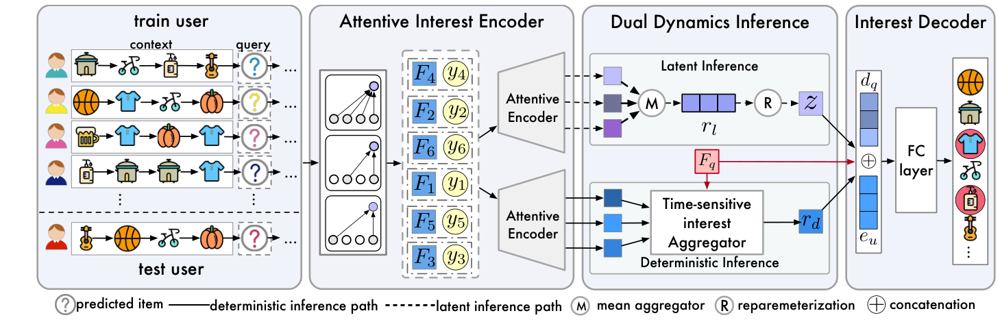
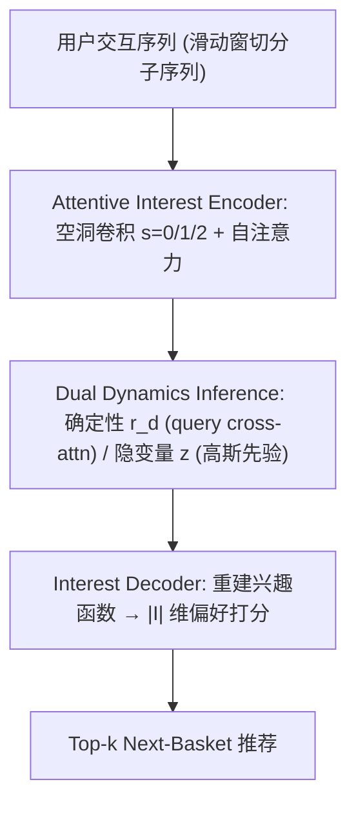

# IDNP: Interest Dynamics Modeling using Generative Neural Processes for Sequential Recommendation (基于生成式神经过程的兴趣动态建模序列推荐)

- **会议/期刊**: WSDM 2023
- **作者与机构**: Jing Du, Zesheng Ye, Lina Yao (UNSW / CSIRO Data61)；Bin Guo, Zhiwen Yu (西北工业大学)
- **推荐链路定位**: 召回（Next-Item / Next-Basket 序列打分）
- **研究方向**: 序列与会话推荐 / 冷启动与长尾推荐
- **论文原文**: [论文原文链接](https://arxiv.org/abs/2208.04600v1)
- **开源代码**: 暂未开源

## TL;DR (1分钟核心速览)

现有序列推荐依赖"严格有序"的连续短期交互来聚合长期兴趣，既无法处理用户跨兴趣的**跳跃行为 (skip behavior)**，也无法从稀疏、离散分布的短期序列中推断**兴趣动态**。IDNP 用空洞时序卷积 + 自注意力得到多尺度短期兴趣，再把长期兴趣建模为用户兴趣函数族的一次**函数实例化**，借神经过程 (Neural Processes) 的确定性/隐变量双路径推断在任意查询时刻重建兴趣函数。在 MovieLens/Gowalla/Yelp/Amazon-book 的 few-shot（每用户仅 16–24 条交互）全物品打分协议下，Hit@10 相对最强基线提升约 8.6%–105%，Yelp NDCG@10 达 0.7968。

## Background & Motivation (背景与核心矛盾)

- **主流范式**: GRU4REC/SASRec/Caser/NextItNet 等以 RNN、自注意力或空洞 CNN 在"严格时间序"的交互序列上抽取兴趣，再用均值池化/RNN 把短期兴趣聚成长期表征。
- **前人局限 1（短期）**: 连续 \(L\) 次交互常由**多个交织兴趣**共同驱动（看衣服穿插点击化妆品），严格相邻依赖假设把跳跃行为误当成单一兴趣演化。<figure class="paper-figure" markdown="span">
  <figcaption>图1：长短期兴趣示例。</figcaption>
</figure>
- **前人局限 2（长期）**: 长期兴趣序列在时间轴上**离散且稀疏**（非连续），短窗口只给出离散兴趣点，自回归聚合无法刻画"跨序列的兴趣漂移"；元学习推荐 (MeLU/MetaTL) 虽缓解少样本问题，却仍只学到离散兴趣点，不建模兴趣动态。
- **核心洞察 (Key Insight)**: 若把长期兴趣看作一条**连续函数** \(f:\mathcal{X}\to\mathcal{Y}\)，则零散短期交互就是该函数的**稀疏观测点**；函数族的先验可由全体用户"经验观测"隐式学得，因此少量、非连续的观测也足以恢复函数形状。
- **本文切入点**: 首次将 Neural Processes 引入兴趣建模，以函数连续性承载兴趣动态，实现任意查询时刻的兴趣函数重建与 next-basket 预测。

## Method (核心方法设计)

### 1. 整体框架 (Overall Architecture)

对每个用户序列用宽度 \(L\)、步长 1 的滑窗切出子序列集合；随机划出上下文集 \(\mathcal{C}\)（\(N_c\) 个窗）与目标集 \(\mathcal{T}\)。Attentive Interest Encoder 对每个窗做三组空洞率 (0/1/2) 的多尺度时序卷积并拼接，再用自注意力得到位置感知的短期兴趣表示 \(\boldsymbol{r}_i\)。Dual Dynamics Inference 分两路聚合上下文：确定性路以查询窗为 key 做 cross-attention 得到 \(\boldsymbol{r}_d\)，隐变量路以均值聚合参数化高斯先验 \(p(\boldsymbol{z}|\mathcal{C})\)。Interest Decoder 拼接 \(\boldsymbol{r}_d\Vert\boldsymbol{z}\Vert\boldsymbol{F}_q\) 重建查询窗处的兴趣函数，并与用户嵌入一起映射到 \(|I|\) 维偏好向量。训练端以 NLL + Wasserstein 距离联合优化，推理端对全物品排序取 Top-k。<figure class="paper-figure" markdown="span">
  <figcaption>图2：IDNP 概览，包括 Attentive Interest Encoder、Dual Dynamics Inference 和 Interest Decoder。每个用户的序列被随机划分为上下文集和目标集。Attentive Interest Encoder 从多个尺度捕获短期用户兴趣表示并赋予不同重要性。Dual Dynamics Inference 由确定性推断（实线）和隐变量推断（虚线）组成，分别导出注意力兴趣表示 𝒓𝒅和潜在全局兴趣 𝒛。这两种表示与查询兴趣表示 𝒓𝒒一起被输入</figcaption>
</figure>

### 2. 关键设计拆解 (Key Designs)

1. **多尺度空洞兴趣编码（对付跳跃行为）**：标准时序卷积假设窗内交互同源。IDNP 对同一子序列图像 \(\boldsymbol{P}\in\mathbb{R}^{L\times d}\) 并行使用膨胀率 \(s\in\{0,1,2\}\)、每组 \(n_s=\lceil (L+s)/(s+1)\rceil\) 个核，组内取均值后拼接：\(\boldsymbol{F}_j=\Vert_{s=0}^{2}\frac{1}{n_s}\sum_{i=1}^{n_s}\boldsymbol{c}_s^{(i)}\)。膨胀核在不加参数的前提下扩大感受野，"跳过"中间交互，恰好对应跨兴趣的跳跃模式；再用 SDPA 得到 \(\boldsymbol{r}_j=\mathrm{softmax}(\boldsymbol{Q}_r\boldsymbol{K}_r^{\top}/\sqrt{d_r})\boldsymbol{V}_r\) 注入子序列相对位置信息（原始 NP 完全忽略位置）。
2. **双路径兴趣动态推断（对付离散稀疏）**：确定性路以查询窗 \(\boldsymbol{F}_q\) 与各上下文窗的相似度加权聚合，得到 query-specific 表征 \(\boldsymbol{r}_d=\sum_{i=1}^{N_c}\frac{\exp(\langle\boldsymbol{F}_i,\boldsymbol{F}_q\rangle)}{\sum_j\exp(\langle\boldsymbol{F}_j,\boldsymbol{F}_q\rangle)}\boldsymbol{r}_i\)——把 NP 的均值聚合换成"按查询定位取用上下文"，且不破坏置换不变性；隐变量路令 \(\boldsymbol{z}=\mu(\boldsymbol{r}_l)+\boldsymbol{I}\sigma(\boldsymbol{r}_l)\odot\epsilon,\ \epsilon\sim\mathcal{N}(\boldsymbol{0},\boldsymbol{I})\)，其中 \(\boldsymbol{r}_l\) 为上下文均值，使各短期兴趣在边缘分布上**相互关联**并由全局隐兴趣生成。
3. **损失与推理效率**：解码为 \(\boldsymbol{d}_q=\mathrm{ReLU}(\boldsymbol{W}_d[\boldsymbol{r}_d\Vert\boldsymbol{z}\Vert\boldsymbol{F}_q]+\boldsymbol{b}_d)\)，\(\hat{\boldsymbol{y}}_q=\sigma(\boldsymbol{W}_p[\boldsymbol{d}_q;\boldsymbol{e}_u]+\boldsymbol{b}_p)\)。总目标 \(\mathcal{L}=\mathcal{L}_{\text{NLL}}+\mathcal{W}(P_\mathcal{T},P_\mathcal{C})\)：隐式反馈用 BCE、显式反馈用 MAE，并用 Sinkhorn-Knopp 近似的 Wasserstein 距离 \(\mathcal{W}=\frac{1}{K}(\mathbb{E}_{x\sim P_\mathcal{T}}[f_\omega(x)]-\mathbb{E}_{x\sim P_\mathcal{C}}[f_\omega(x)])\) **替换 KL**——高维下 KL 不对称且在支撑集不交时不可用。训练为随机上下文采样（无需构造负样本，全物品 BCE 隐式负采样），推理一次前向即得 \(|I|\) 维分数，开销与 SASRec 同级。

## Experimental Setup & Evaluation Protocol (实验设置与评估协议)

- **数据集与预处理**: 未使用 5-core 过滤，直接沿用公开版本；**few-shot 截断**：每用户交互序列长度上限 20 (MovieLens) / 16 (Gowalla) / 24 (Yelp) / 24 (Amazon-book)，不足则零填充。

| 数据集 | #Users | #Items | #Interactions | 稀疏度 | 特征/场景说明 |
| :--- | :---: | :---: | :---: | :---: | :--- |
| MovieLens | 6,040 | 3,400 | 999,620 | 95.16% | 显式评分 |
| Gowalla | 29,858 | 40,981 | 1,027,370 | 99.92% | 隐式签到 |
| Yelp | 31,668 | 38,048 | 1,561,406 | 99.87% | 隐式商户点评 |
| Amazon-book | 52,643 | 91,599 | 2,984,108 | 99.94% | 显式图书评论 |

- **数据划分与防穿越**: **用户级随机划分** 80% 训练 / 15% 验证 / 5% 测试（用户不重叠），测试用户仅用 \(L\) 条交互做 few-shot 预测，未采用 Leave-One-Out 或全局时间戳切分，存在轻微的未来交互泄漏风险。
- **排名评测协议**: 解码器对全部 \(|I|\) 个物品输出偏好并排序，属 **Full-Ranking（全库未交互排序）**；指标 Hit@K / Recall@K / NDCG@K，K∈{1,5,10}，\(k\) 表示预测未来 \(k\) 个商品。
- **对比基线与超参**: 基线含 CNN 类 (Caser, NextItNet)、RNN/注意力类 (GRU4REC, SASRec, GRec) 与元学习类 (MeLU, MetaTL)；超参 \(L=5\)、\(N_c=10\)（训练时 1–10 随机采样）、\(N_t=15\)、\(d=64\)、Adam lr=\(3e^{-4}\)、batch 32/64、seed=1234，未报告显著性检验。

## Key Experimental Results (实验关键数据)

### 1. 主实验对比 (Main Results)

| 数据集 | 指标 | Caser | GRU4REC | SASRec | NextItNet | GRec | MeLU | MetaTL | **IDNP** | Improv. |
| :--- | :--- | :---: | :---: | :---: | :---: | :---: | :---: | :---: | :---: | :---: |
| MovieLens | Hit@1 | 0.0083 | 0.0081 | 0.0040 | 0.1088 | 0.0114 | 0.0731 | 0.0584 | **0.1375** | +26.4% |
| MovieLens | Hit@10 | 0.1019 | 0.0379 | 0.0064 | 0.3429 | 0.1621 | 0.2216 | – | **0.3722** | +8.6% |
| Gowalla | Hit@1 | 0.0033 | 0.0032 | 0.0033 | 0.0020 | 0.0015 | 0.0045 | 0.0033 | **0.0260** | +478% |
| Gowalla | Hit@10 | 0.0114 | 0.0087 | 0.0307 | 0.0123 | 0.0379 | 0.0453 | – | **0.0930** | +105% |
| Yelp | NDCG@1 | 0.5412 | 0.5053 | 0.4493 | 0.5626 | 0.4816 | 0.5882 | 0.4515 | **0.6677** | +13.5% |
| Yelp | NDCG@10 | 0.7053 | 0.6911 | 0.5913 | 0.6483 | 0.6061 | 0.6377 | – | **0.7968** | +24.9% |
| Amazon-book | Hit@10 | 0.0011 | 0.0020 | 0.0048 | 0.0111 | 0.0031 | 0.0064 | – | **0.0120** | +8.1% |
| Amazon-book | NDCG@10 | 0.7706 | 0.8531 | 0.7566 | 0.7010 | 0.7213 | 0.8384 | – | **0.9113** | +6.8% |

（Improv. 为相对该行最强基线的相对提升；MetaTL 仅能预测 \(k=1\)。）

### 2. 消融实验 (Ablation Study)

MovieLens 验证集，D=空洞卷积，A=自注意力，N=NP 推断，W=Wasserstein 替代 KL：

| 变体 | D | A | N | W | Hit@1 | NDCG@1 | Hit@10 | NDCG@10 |
| :--- | :---: | :---: | :---: | :---: | :---: | :---: | :---: | :---: |
| CNN | ✗ | ✗ | ✗ | ✗ | 0.0091 | 0.3961 | 0.1050 | 0.5460 |
| DCNN | ✓ | ✗ | ✗ | ✗ | 0.0113 | 0.4695 | 0.0110 | 0.5607 |
| AIE | ✓ | ✓ | ✗ | ✗ | 0.0457 | 0.4199 | 0.0260 | 0.6018 |
| DCNN+ANP | ✓ | ✗ | ✓ | ✗ | 0.0920 | 0.5897 | 0.0718 | 0.6556 |
| AIE+ANP | ✓ | ✓ | ✓ | ✗ | 0.1597 | 0.6013 | 0.3322 | 0.6895 |
| **IDNP** | ✓ | ✓ | ✓ | ✓ | **0.1964** | **0.6488** | **0.3723** | **0.7097** |

### 3. 关键实验发现 (Key Findings)

1. **少样本下"函数先验"胜过"梯度适配"**：Gowalla 上网络类模型几乎失效（Hit@1≈0.002–0.003），元学习 MeLU 仅 0.0045，而 IDNP 一举达 0.0260；说明在 16 条交互的极端稀疏下，跨用户共享的兴趣函数族先验比 MAML 式参数微调更具样本效率。
2. **NP 推断是最大的增益来源，而非编码器**：加入 NP 推断（CNN→DCNN+ANP）使 Hit@1 从 0.0113 跃至 0.0920（8 倍），远大于自注意力带来的 0.0457；二者叠加达 0.1597，再换 Wasserstein 得 0.1964（Hit@1 再 +22.9%），证明高维隐空间下 KL 的确低估了分布对齐的作用。
3. **空洞卷积与"非自回归"是其跨越时序依赖的关键**：CNN 变体 NDCG@10 仅 0.5460，改进感受野后 0.5607；论文指出 NextItNet/GRec 在基线中表现相对最好亦归功于空洞卷积，与 IDNP 的"顺序不变上下文 + 函数重建"思路方向一致。

## Highlights & Limitations (亮点、对比与审稿批判)

- **与代表作对比**: vs. **NextItNet**：同样用空洞卷积扩感受野，但仅输出单一短期兴趣向量、无长期兴趣动态；vs. **MeLU/MetaTL**：同样面向少样本，但把推荐当作参数快速适配或跨用户转移模式，未建立短期观测与长期函数的连续性映射；vs. **vanilla NP**：把均值聚合换成查询条件 cross-attention，并把 KL 换成 Wasserstein，才使其适配高维推荐场景。
- **可迁移亮点**: (1) 用"函数实例化 + 任意 query 时刻解码"替代"最后隐状态解码"，可直接移植到 POI/序列召回中缓解稀疏段；(2) 高维隐变量对齐用 Sinkhorn 近似 Wasserstein 替代 KL，是通用正则化技巧。
- **审稿级局限批判**: (1) **评估协议薄弱**：用户级随机划分而非时间切分，测试用户交互中可能包含"未来"物品造成泄漏；且 NDCG@1（0.4853）远高于 Hit@1（0.1375）、Yelp NDCG@10=0.7968 与 Hit@10=0.0339 严重不匹配，指标实现/归一化口径令人存疑，论文自述的提升百分比（如 Yelp +7.95%）与表中数字亦不一致（实为 +13.5%），削弱结论可信度；(2) **开销与依赖**：需对每个用户构造 \(N_c\) 个上下文窗并做 Sinkhorn 迭代（\(K\) 步矩阵缩放），训练成本高于 SASRec；同时 \(N_c\) 与 \(L\) 的最优值在数据集间漂移（MovieLens 需 \(N_c=8,L=10\)，Yelp 仅 \(N_c=5,L=8\)），工业部署需逐场景调参；缺少与线上 A/B、长尾/冷启动分桶的细粒度分析。

## Rating (四维评分)

- **方法创新性 (Novelty)**: ⭐⭐⭐⭐ （首次将 Neural Processes 的"函数先验"引入兴趣建模，用函数连续性刻画兴趣动态，配合查询条件聚合与 Wasserstein 替代 KL，思路新颖且有清晰物理直觉）
- **评估协议与实验扎实度 (Protocol & Experiments)**: ⭐⭐⭐ （四数据集 + 7 个基线 + 完整消融与超参敏感性，但用户级随机划分非时间切分、无显著性检验，且 NDCG/Hit 数值严重不自洽，削弱可信度）
- **写作与数学规范度 (Clarity & Rigor)**: ⭐⭐⭐⭐ （NP 的 ELBO 推导与三模块衔接交代清楚，公式符号规范；但对为何 Wasserstein 在 \(|I|\) 维偏好空间中优于 KL 仅有引用式论断，缺实证解释）
- **工业落地与复现价值 (Industrial & Practical Value)**: ⭐⭐⭐ （推理仅一次前向、与 SASRec 同量级，适合稀疏用户场景；但需多次上下文采样与 Sinkhorn 迭代训练、超参敏感且未开源，工程化门槛偏高）

