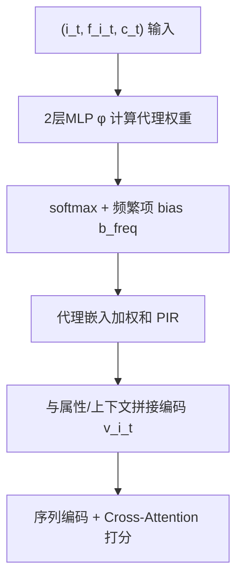
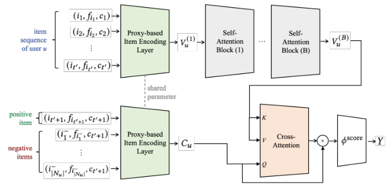

# Proxy-based Item Representation for Attribute and Context-aware Recommendation (基于代理的物品表征用于属性与上下文感知推荐)

- **会议/期刊**: WSDM 2024
- **作者与机构**: Jinseok Seol, Minseok Gang, Sang-goo Lee, Jaehui Park；Seoul National University / University of Seoul / IntelliSys
- **推荐链路定位**: 精排（Next-Item 候选打分；可插拔物品编码层）
- **研究方向**: 冷启动与长尾推荐 / 序列推荐
- **论文原文**: [https://arxiv.org/abs/2312.06145v1](https://arxiv.org/abs/2312.06145v1)
- **开源代码**: [https://github.com/theeluwin/ProxyRCA](https://github.com/theeluwin/ProxyRCA)

## TL;DR (1分钟核心速览)

论文针对全量物品嵌入表中低频物品训练不足、参数随物品数膨胀的痛点，提出 PIR：每个物品由属性/上下文生成 softmax 权重，对共享的可学习代理嵌入做加权和，并为 Top-K 频繁物品加偏置以注入协同信号。在 5 个 Amazon/MovieLens 数据集、Leave-One-Out + 100 负采样协议下，ProxyRCA 最高约 17% 相对提升，参数仅约基线 10%。

## Background & Motivation (背景与核心矛盾)

- **主流范式**: 属性/上下文感知序列推荐（ACSR）通常用完整物品查表学习 ID 嵌入，再与属性、上下文拼接，经 Transformer/Cross-Attention 打分。
- **前人局限**: 物品频率呈长尾分布，低频物品的参数更新次数正比于出现频次，嵌入难以收敛；同时物品数无限增长时，查表参数线性膨胀。
- **核心洞察 (Key Insight)**: 作者将低频物品替换为 unknown token 后，Fashion 上 SASRec++ 的 NDCG@10 从 37.9% 升至 41.6%，但 Diversity 从 15.0% 降至 11.6%，说明“坏的低频嵌入”确实伤害精度，但直接丢弃会牺牲覆盖。
- **本文切入点**: 用“共享代理嵌入 + 内容条件权重”组合式生成物品向量，让低频物品借用高频物品的训练信号，同时保持参数高效与端到端可训练。

## Method (核心方法设计)

### 1. 整体框架 (Overall Architecture)

PIR 替换原物品编码层中的 ID 查表：输入物品属性 $f_{i_t}$与上下文$c_t$，经两层 MLP$\varphi$得到代理权重，softmax 归一化后对代理矩阵$\mathbf{P}$加权求和，得到$\mathrm{PIR}_{i_t}$；再与属性/上下文编码拼接为最终物品向量$v_{i_t}$，送入序列编码与 Cross-Attention 打分。高频物品额外学习代理权重偏置，低频物品仅靠内容组合。训练采用 LIP + Contrastive CA，推理按候选物品打分排序。

<figure class="paper-figure" markdown="span">
  <figcaption>图2：整体模型架构。</figcaption>
</figure>

### 2. 关键设计拆解 (Key Designs)

1. **代理组合表征与单纯形约束**：痛点在于低频 ID 嵌入更新不足；PIR 令 $\hat{w}_{i_t}=\mathrm{softmax}(\varphi(f_{i_t},c_t)+\mathbb{I}[i_t\in\mathcal{T}_K]b^{\mathrm{freq}}_{i_t})$，$\mathrm{PIR}_{i_t}=\hat{w}_{i_t}\mathbf{P}$。权重非负且和为 1，使物品向量落在训练良好的代理凸包内；梯度以代理为单位回传，低频物品可共享高频物品信号。
2. **Top-K 频繁物品偏置**：纯内容组合近似内容过滤，缺少 ID-to-ID 协同信号；仅对 Top-K 频繁物品加 $b^{\mathrm{freq}}_{i_t}$，在 softmax 前注入可记忆偏置。$K=0$退化为内容版，$K=|I|$ 近似带 softmax 的低秩分解，统一了频繁/非频繁物品结构。
3. **训练目标、负采样与推理效率**：采用 LIP 避免 Cross-Attention 双向信息与 NIP 因果假设不一致，并对序列随机截断；损失为 $\mathcal{L}=-\sum_{u\in U}\log\frac{\exp(Y_1/\tau)}{\sum_{j=1}^{|I^-_u|+1}\exp(Y_j/\tau)}$，每正样本配 100 个随机负样本。参数从$O(|I|d+M(d))$降为$O((K+d)n_{\mathrm{proxy}}+M'(d))$，$n_{\mathrm{proxy}}=128$、$d=256$ 时仅用约 10%–50% 参数。

## Experimental Setup & Evaluation Protocol (实验设置与评估协议)

- **数据集与预处理**: 过滤交互数 $\le 3$ 的用户；Fashion/Men 用 ResNet50 图像向量，Beauty/Game 用标签/价格，ML-20M 仅用电影 genre，属性信息极弱。

| 数据集 | #Users | #Items | #Interactions | 密度 | 特征/场景说明 |
| :--- | :---: | :---: | :---: | :---: | :--- |
| Fashion | 45,184 | 166,270 | 358,003 | 0.0048% | 图像属性，属性区分度高 |
| Men | 34,244 | 110,636 | 254,870 | 0.0067% | 图像属性，长尾明显 |
| Beauty | 52,204 | 57,289 | 394,908 | 0.0132% | 标签属性，属性重复度高 |
| Game | 31,013 | 23,715 | 287,107 | 0.0390% | 标签+价格，属性极弱 |
| ML-20M | 138,287 | 20,720 | 9,995,410 | 0.3488% | 仅 genre，内容极有限 |

- **数据划分与防穿越 (Splitting Strategy)**: `Leave-One-Out`：每用户最后一项为测试、倒数第二项为验证。
- **排名评测协议 (Ranking Protocol)**: `Sampled Ranking`：1 个正样本 + 100 个随机未交互负样本，报告 HR@10 / NDCG@10，5 个随机种子平均。
- **对比基线与超参设置**: Popular、BPR++、MixDim++、SASRec++、CARCA；统一 LIP 目标与相近结构，$d=256$、$n_{\mathrm{proxy}}=128$，$t$-test 显著性$p<0.05$。

## Key Experimental Results (实验关键数据)

### 1. 主实验对比 (Main Results)

| Model | Fashion R/N@10 | Men R/N@10 | Beauty R/N@10 | Game R/N@10 | ML-20M R/N@10 |
| :--- | :---: | :---: | :---: | :---: | :---: |
| Popular | .407/.262 | .415/.269 | .451/.261 | .519/.314 | .815/.530 |
| BPR++ | .523/.332 | .429/.266 | .505/.352 | .768/.564 | .956/.702 |
| BPR++ +PIR | .620*/.406* | .554*/.358* | .511/.353 | .770/.582* | .957/.761* |
| MixDim++ | .623/.407 | .570/.365 | .587/.398 | .766/.556 | .961/.781 |
| SASRec++ | .630/.416 | .587/.379 | .601/.415 | .753/.539 | .949/.761 |
| SASRec++ +PIR | .635/.426* | .580/.381 | .599/.422 | .779*/.572* | .944/.773* |
| CARCA | .648/.427 | .614/.398 | .608/.423 | .762/.560 | .961/.788 |
| **ProxyRCA** | **.661***/** .446*** | **.617**/** .408** | **.626***/** .449*** | **.809***/** .611*** | **.962**/** .792*** |

相对 CARCA：Fashion N@10 +4.4%、Beauty N@10 +6.1%、Game N@10 +9.1%、ML-20M N@10 +0.5%；Game R@10 +6.2%，论文汇总最高约 17%。

### 2. 消融实验 (Ablation Study)

| Backbone | w/o PIR R@10/N@10 | +PIR R@10/N@10 | ΔN@10 |
| :--- | :---: | :---: | :---: |
| BPR++ (Fashion) | .523/.332 | .620/.406 | +22.3% |
| SASRec++ (Fashion) | .630/.416 | .635/.426 | +2.4% |
| CARCA (Fashion) | .648/.427 | .661/.446 | +4.4% |
| CARCA (Beauty) | .608/.423 | .626/.449 | +6.1% |
| CARCA (Game) | .762/.560 | .809/.611 | +9.1% |

### 3. 关键实验发现 (Key Findings)

- **低频物品不是靠牺牲覆盖换精度**：移除 90% 低频物品时 SASRec++ NDCG@10 从 37.9% 升至 41.6%，Diversity 从 15.0% 降至 11.6%；PIR 在 0%→90% 移除比例下 NDCG 稳定约 42.6%→42.4%，Diversity 维持约 16.2%→16.0%，说明代理表征实质性改善了低频物品质量。
- **参数效率与性能同步**：$n_{\mathrm{proxy}}=128$仅为$d=256$ 的一半，ProxyRCA 参数量约为非 PIR 对照的 10%–50%；Fashion 按物品数分段增长时，基线查表持续膨胀，PIR 以固定代理矩阵维持更优性能。
- **跨 backbone 与弱属性场景仍有效**：BPR++ 加 PIR 后 Fashion N@10 提升 22.3%，SASRec++ 提升 2.4%，CARCA 在 Beauty/Game 上分别提升 6.1%/9.1%；即使 ML-20M 属性极弱，N@10 仍从 .788 升至 .792。

## Highlights & Limitations (亮点、对比与审稿批判)

- **与代表作对比 (vs. Prior Work)**: 相较 MixDim++ 的频繁/非频繁分维，PIR 用共享代理 + 内容权重统一建模；相较内容模仿式冷启动方法，PIR 单结构端到端训练，无需 warm-up；相较 ProxySR 单代理用户建模，PIR 是多代理物品组合。
- **可迁移亮点**: 用 softmax 代理码本为长尾/新物品生成嵌入，可直接替换任意神经推荐模型的物品编码层；Top-K 频繁偏置可作为“协同信号注入”模块迁移到多模态冷启动。
- **审稿级局限批判**: 依赖属性/上下文预处理质量，$n_{\mathrm{proxy}}$与$K$ 需调参；评估仅 100 负采样排序，缺少 Full-Ranking 与线上延迟/冷启动严格划分验证。

## Rating (四维评分)

- **方法创新性 (Novelty)**: ⭐⭐⭐⭐ （代理凸包组合 + 频繁偏置统一框架，机制清晰且有内容局部性/偏置优先性理论支撑）
- **评估协议与实验扎实度 (Protocol & Experiments)**: ⭐⭐⭐⭐ （5 数据集、5 种子、$t$-test 与多 backbone 插件验证较完整；但仅采样排序，缺全库与在线实验）
- **写作与数学规范度 (Clarity & Rigor)**: ⭐⭐⭐⭐ （公式、复杂度与消融链条清楚；部分超参细节与证明置于附录）
- **工业落地与复现价值 (Industrial & Practical Value)**: ⭐⭐⭐⭐ （即插即用、参数降一个量级且代码开源；落地需属性管道与代理数/频繁项阈值调优）

