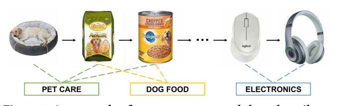
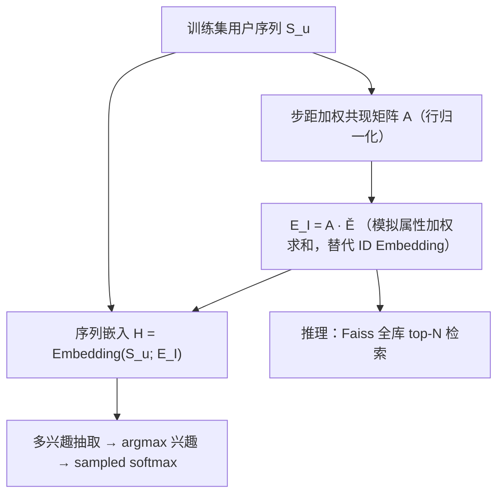
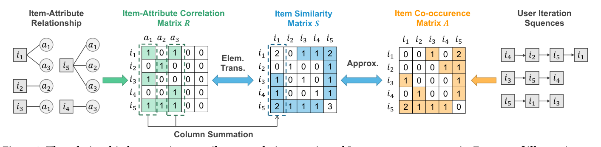

# Attribute Simulation for Item Embedding Enhancement in Multi-interest Recommendation (多兴趣推荐中的属性模拟与物品嵌入增强)

- **会议/期刊**: WSDM 2024
- **作者与机构**: Yaokun Liu, Xiaowang Zhang, Minghui Zou, Zhiyong Feng（天津大学）
- **推荐链路定位**: 召回（匹配阶段）/ 端到端序列多兴趣
- **研究方向**: 协同过滤与双塔召回 / 序列与会话推荐
- **论文原文**: [arXiv:2311.17374v1](https://arxiv.org/abs/2311.17374v1)
- **开源代码**: [THUDM/ComiRec](https://github.com/THUDM/ComiRec)（SimEmb 构建于 ComiRec-SA 之上，故称 SimRec）

## TL;DR (1分钟核心速览)

本文指出多兴趣召回模型存在「物品嵌入欠聚类」问题：t-SNE 可视化显示 ComiRec/REMI 的物品向量在单位圆上近似均匀铺开、密度曲线平坦，物品间区分度低，直接拖累 ANN 检索。作者证明物品-属性关联矩阵 $\mathbf{R}$可由物品共现矩阵$\mathbf{A}$经初等列变换近似，进而推出「$\mathbf{E}_I=\mathbf{A}\tilde{\mathbf{E}}$」这一极简形式，用共现矩阵与可学习属性矩阵的乘积**完全取代 ID Embedding 层**（SimEmb）。在 4 个基准、8:1:1 序列划分的全库排序协议下，Recall@20 相对最优基线平均提升 25.59%（Beauty +46.21%）。

## Background & Motivation (背景与核心矛盾)

- **主流范式**: 召回阶段用 MIND/ComiRec/PIMIRec/Re4/REMI 等多兴趣模型从用户序列抽取 $K$ 个兴趣向量，训练用 sampled softmax，在线用 Faiss 取 top-N；几乎所有工作只优化「兴趣抽取模块」与「负采样/路由正则」。
- **前人局限（矛盾一）**: 物品侧始终只有 ID Embedding，物品语义稀疏，导致嵌入空间欠聚类、物品间余弦相似度过高，召回难以区分（图 1/图 4 的密度曲线佐证）。
- **前人局限（矛盾二）**: 属性是天然的增强侧信息，但公开数据集（Beauty/Books/RetailRocket/Yelp）属性标注缺失或严重粗粒度——Books 中 47.47% 物品仅被打上 "Books" 一个类目，等同于无信息；且已有的属性补全方法依赖已标注属性，无法应对完全缺失场景。
- **核心洞察 (Key Insight)**: 用户序列中物品的共现强度本身就编码了共享属性——共现越频繁、步距越近，属性重叠概率越大（图 2）。
- **本文切入点**: 不做属性补全，而是**从交互数据"模拟"属性**，并利用矩阵恒等变形把模拟与加权求和合并为一次矩阵乘法，从而在召回阶段同时满足高精度与低复杂度。

<figure class="paper-figure" markdown="span">
  <figcaption>图2：一个用户序列及商品间共享属性的示例。</figcaption>
</figure>

## Method (核心方法设计)

### 1. 整体框架 (Overall Architecture)

SimEmb 将传统「ID Embedding 查表」替换为「共现矩阵 × 可学习属性矩阵」的预计算映射：先用训练集用户序列构建步距加权的行归一化共现矩阵 $\mathbf{A}$（对角置 1），训练前一次性算出增强后的物品嵌入矩阵$\mathbf{E}_I=\mathbf{A}\tilde{\mathbf{E}}$；训练时对$\mathbf{E}_I$查表得到序列嵌入，再送入原有多兴趣抽取模块（多头注意力/胶囊路由）、argmax 兴趣选择与 sampled softmax 优化；推理时只需保留$\mathbf{E}_I$供 Faiss 检索，$\mathbf{A}$ 不再参与计算。

### 2. 关键设计拆解 (Key Designs)

1. **理论可行性：共现矩阵近似属性关联矩阵**：定义二值关联矩阵 $\mathbf{R}\in\mathbb{R}^{|I|\times|A|}$，按每个物品的属性集合做列求和可得物品相似矩阵$\mathbf{S}$，其等价于$\mathbf{S}=[\mathbf{R}:\mathbf{O}]\mathbf{P}$（初等列变换 + 矩阵扩展）。由于共现矩阵$\mathbf{A}$是$\mathbf{S}$的统计近似，故$\mathbf{R}\approx\mathbf{A}\mathbf{P}^{-1}$——即**无需人工标注即可反推属性关联**。直觉：$\mathbf{P}$ 只是把"属性维度"重排到"物品维度"的置换算子。

<figure class="paper-figure" markdown="span">
  <figcaption>图3：商品-属性相关矩阵与商品共现矩阵之间的关系。为便于说明，我们考虑仅包含五个商品和三个属性的特定场景。</figcaption>
</figure>

2. **公式坍缩：SimEmb 模块**：理想增强式为 $\mathbf{e}_i=\sum_j r_{ij}\mathbf{e}_{a_j}$，矩阵形式$\mathbf{E}_I=\mathbf{R}\mathbf{E}_A$；代入近似得$\mathbf{E}_I=\mathbf{A}(\mathbf{P}^{-1}\mathbf{E}'_A)$。关键一步：$\mathbf{P}^{-1}\mathbf{E}'_A$本身就是对属性嵌入做行初等变换，故直接用一个统一参数矩阵$\tilde{\mathbf{E}}\in\mathbb{R}^{|I|\times d}$ 吸收，得
$$\mathbf{E}_I=\mathbf{A}\tilde{\mathbf{E}}.$$
作者据此**丢弃 ID Embedding**：当模拟属性足够细粒度时，没有两个物品完全同属性，ID 向量是冗余的。物理直觉：与共享属性物品相连的列被同一权重聚合，共享属性的物品嵌入被迫彼此靠近，聚类性由结构自动涌现。

3. **训练目标、负采样与推理效率**：共现权重 $a_{ij}\leftarrow a_{ij}+(T-d_{ij})$（仅当$T-d_{ij}>0$），$d_{ij}$为步距、$T$为步距阈值。总损失沿用多兴趣 sampled softmax$-\log P(i^+|u)$，负样本为 batch 内共享随机负采样（所有模型统一取$10\times$batch size，免 hard negative 挖掘）。为规避稠密$|I|\times|I|$乘法的$O(\rho|I|^2 d)$开销，训练改为两步：先$\mathbf{C}=\text{Embedding}(S_u;\mathbf{A})\in\mathbb{R}^{L\times|I|}$，再$\mathbf{H}=\mathbf{C}\tilde{\mathbf{E}}\in\mathbb{R}^{L\times d}$，复杂度降为$O(\rho L|I|d)$；**推理阶段零额外开销**（$\mathbf{E}_I$ 离线保留）。

## Experimental Setup & Evaluation Protocol (实验设置与评估协议)

- **数据集与预处理**: 按 ComiRec 设定过滤，交互次数 <5 的用户/物品全部剔除（`5-core`），隐式反馈，最大序列长 20。

| 数据集 | #Users | #Items | #Interactions | 稀疏度/密度 | 特征/场景说明 |
| :--- | :---: | :---: | :---: | :---: | :--- |
| Beauty | 22,363 | 12,101 | 198,502 | 0.0734% | Amazon 评论，类目属性粗粒度 |
| Books | 603,668 | 367,982 | 8,898,041 | 0.0040% | Amazon 评论，极端稀疏 |
| RetailRocket | 37,175 | 25,310 | 440,084 | 0.0468% | 真实电商行为流 |
| Yelp | 19,242 | 14,142 | 201,237 | 0.0740% | 2019 全年商户点评 |

- **数据划分与防穿越 (Splitting Strategy)**: 按**用户数**做 8:1:1 的 `比例划分`（非时间戳切分）；训练集整条序列参与训练，验证/测试集用序列前 80% 建模、后 20% 作为 target（类 `Leave-Last-N-Out` 的序列内切分，避免未来交互穿越）。
- **排名评测协议 (Ranking Protocol)**: 采用 `Full-Corpus Ranking`（全库未交互物品排序，遵循 ComiRec 官方修正版代码计算 NDCG），报告 Recall@20/50、NDCG@20/50、HR@20/50。
- **对比基线与超参设置**: 基线含 PopRec、YouTube-DNN、GRU4Rec、MIND、ComiRec-SA、PIMIRec、Re4、REMI；排除 CF/图模型因其无法建模测试中未见过用户。嵌入维度 $d=64$、兴趣数$K=4$、Adam lr=1e-3、batch=256（Books 为 128）、$T=3$（Yelp 为 5）。原文未报告显著性检验（$p$ 值）。

## Key Experimental Results (实验关键数据)

### 1. 主实验对比 (Main Results)

| Model | Beauty R@20 | Beauty R@50 | Books R@20 | RetailRocket R@20 | Yelp R@20 |
| :--- | :---: | :---: | :---: | :---: | :---: |
| YouTube-DNN | 0.0643 | 0.1025 | 0.0380 | 0.3096 | 0.0549 |
| GRU4Rec | 0.0480 | 0.0768 | 0.0295 | 0.2762 | 0.0244 |
| MIND | 0.0822 | 0.1259 | 0.0636 | 0.3797 | 0.0624 |
| ComiRec-SA | 0.0650 | 0.1102 | 0.0525 | 0.4133 | 0.0625 |
| PIMIRec | 0.0731 | 0.1101 | 0.0723 | 0.4179 | 0.0842 |
| Re4 | 0.0741 | 0.1142 | 0.0602 | **0.4631** | 0.0598 |
| REMI | 0.0779 | 0.1259 | 0.0768 | 0.4537 | 0.0725 |
| **SimRec (Ours)** | **0.1139** | **0.1810** | **0.0937** | **0.4859** | **0.0921** |
| Improv. vs REMI | +46.21% | +43.76% | +22.01% | +7.10% | +27.03% |

### 2. 消融实验 (Ablation Study)

论文为「单模块即插即用」设计，故以**兼容性实验（替换各模型嵌入层，Recall@20）** 替代常规 w/o 消融，并补充与人工标注属性的对照：

| 配置 | Beauty | Books | Yelp | 说明 |
| :--- | :---: | :---: | :---: | :--- |
| PIMIRec → +SimEmb | 0.0731 → **0.1082** | 0.0723 → **0.1031** | 0.0842 → **0.1092** | +48.0% / +42.6% / +29.7% |
| Re4 → +SimEmb | 0.0741 → **0.1010** | 0.0602 → 0.0728 | 0.0598 → **0.1055** | Re4 结构最脆弱，增益最大 |
| REMI → +SimEmb | 0.0779 → **0.1190** | 0.0768 → 0.1013 | 0.0725 → 0.1114 | 平均 R@20 +35.85% |
| ComiRec（ID Emb.） | 0.0650 | 0.0525 | 0.0625 | 原始基线 |
| ComiRec + MaaEmb（人工属性） | 0.0741 (+14.00%) | 0.0584 (+11.24%) | 0.0678 (+8.48%) | 仅在已标注类目上求和 |
| ComiRec + SimEmb | **0.1139 (+75.23%)** | **0.0937 (+78.48%)** | **0.0921 (+47.36%)** | 模拟属性反超真实标注 |

### 3. 关键实验发现 (Key Findings)

1. **问题归因成立**：把任意 3 个多兴趣 SOTA 的嵌入层换成 SimEmb，Recall@20 平均涨 35.85%、Recall@50 涨 38.42%，说明性能瓶颈确实在**物品侧表征欠聚类**，而非兴趣抽取模块；REMI 靠改负采样虽也带来聚类改善，但收益远小于直接重构嵌入。
2. **"模拟"优于"标注"**：SimEmb 相对 ComiRec 提升 75.23%（Beauty R@20），而使用真实类目属性的 MaaEmb 仅 +14.00%；Books 上 47.47% 物品只有 "Books" 单一标签，粗粒度标注几近无效，而共现模拟产出的是细粒度、全覆盖的"隐属性"。
3. **成本可控**：Beauty 上单 batch 训练耗时 ComiRec 0.0071s → SimRec 0.0108s（REMI 0.0106s、PIMIRec 0.0567s），测试耗时 1.1195s → 1.1878s（REMI 1.4773s），即训练开销与 REMI 同级、测试几乎无损，却换来 +46% 的 R@20。代价是 RetailRocket 的 NDCG@20/50 微降 0.17%/0.11%，说明位置敏感性（NDCG）上的收益不如召回广度稳定。

## Highlights & Limitations (亮点、对比与审稿批判)

- **与代表作对比 (vs. Prior Work)**: 相较 ComiRec/REMI 只在「兴趣抽取与负采样」上做增量，本文首次把多兴趣召回的性能瓶颈定位到物品嵌入空间并直接重构嵌入层；相较 MIIR/AGCN 等属性补全工作，本文**不依赖任何已标注属性**，且针对召回阶段做了复杂度坍缩（$O(\rho|I|^2d)\to O(\rho L|I|d)$）；相较 LightGCN 式图传播，本文省去了多层图卷积，仅保留一跳共现行求和。
- **可迁移亮点**: (1) 用「共现矩阵 × 可学习码本」替换 ID Embedding，可作为任何双塔召回模型的即插即用增强（甚至可与语义 ID/生成式召回结合做初始化）；(2) 把「先算全量嵌入矩阵 → 序列侧只做查表」的解耦思路，可推广到任何巨型物品词表的低复杂度嵌入方案。
- **审稿级局限批判**: (1) 理论部分仅证到 $\mathbf{R}\approx\mathbf{A}\mathbf{P}^{-1}$，而实现中$\mathbf{P}^{-1}\mathbf{E}'_A$被整体吸收为自由参数，实际等价于「共现线性变换」，理论保证与实现之间存在解释 gap，且缺乏对近似误差的界；(2) 共现矩阵直接由交互统计构造，无去噪（作者在结论中自承）；且$T$ 虽在 1–5 内波动较小，但对高频噪声/长序列场景敏感度未经检验；(3) 实验未做显著性检验，RetailRocket 上 NDCG 反降，说明收益并非全指标稳健。

## Rating (四维评分)

- **方法创新性 (Novelty)**: ⭐⭐⭐⭐ （从「欠聚类」现象出发，用初等变换给出属性可模拟的理论依据，但最终形式 $\mathbf{E}_I=\mathbf{A}\tilde{\mathbf{E}}$ 与既有共现/线性传播思想较为接近）
- **评估协议与实验扎实度 (Protocol & Experiments)**: ⭐⭐⭐⭐ （4 个数据集 + 全库排序 + 8 个基线 + 兼容性/人工属性双对照与训练开销分析，惟缺显著性检验与随机种子方差）
- **写作与数学规范度 (Clarity & Rigor)**: ⭐⭐⭐⭐ （公式推导链清晰、图 3 的小规模矩阵示例直观，但对 $\mathbf{P}^{-1}$ 参数化的误差分析略欠严谨）
- **工业落地与复现价值 (Industrial & Practical Value)**: ⭐⭐⭐⭐⭐ （仅替换嵌入层、推理零额外开销、代码基于 ComiRec 开源，落地成本极低）

