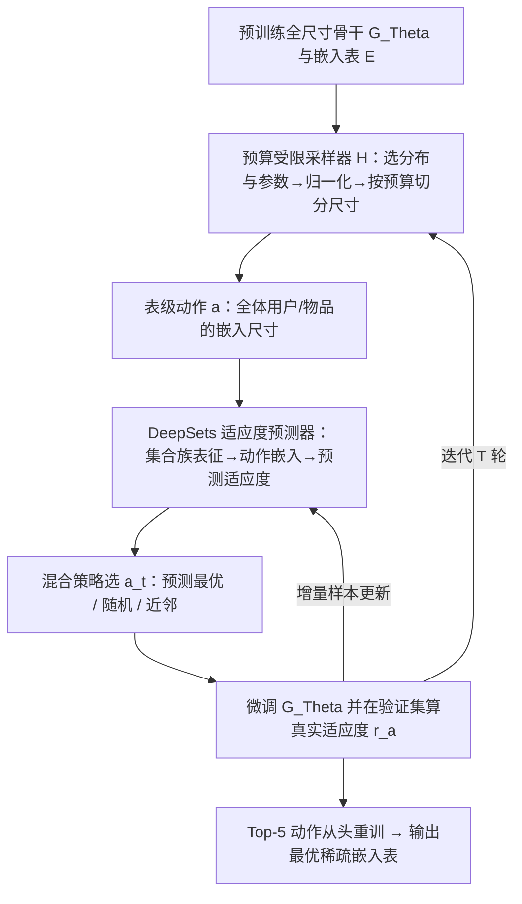

# Budgeted Embedding Table For Recommender Systems (预算受限的推荐系统嵌入表)

- **会议/期刊**: WSDM 2024
- **作者与机构**: Yunke Qu, Tong Chen, Quoc Viet Hung Nguyen, Hongzhi Yin（昆士兰大学 / 格里菲斯大学）
- **推荐链路定位**: 召回（Embedding 层压缩，模型无关插件）
- **研究方向**: 协同过滤与双塔召回
- **论文原文**: [https://arxiv.org/abs/2310.14884v8](https://arxiv.org/abs/2310.14884v8)
- **开源代码**: [https://github.com/qykcq/Budgeted-Embedding-Table-For-Recommender-Systems](https://github.com/qykcq/Budgeted-Embedding-Table-For-Recommender-Systems)

## TL;DR (1分钟核心速览)

轻量化推荐的两条主流路线（阈值剪枝、RL 尺寸搜索）都把内存约束写成**隐式正则/奖励惩罚**：需为每个预算手调权衡系数、实测常常突破预算，且以**逐用户/逐物品**方式生成尺寸导致搜索极慢。BET 把决策提升到**表级**：从参数化分布采样后归一化、直接按预算切分尺寸，天然满足 $c$；再用 DeepSets 把「尺寸→实体集合」编码为动作向量做**归纳式适应度预测**，把真实评估次数从$m\times T$降至$T$。Gowalla/Yelp2018 上配 LightGCN 于 95% 稀疏率时 Recall@20 相对 CIESS 提升 **13.2%/10.7%**。

## Background & Motivation (背景与核心矛盾)

- **主流范式**: 潜在因子模型为全部用户/物品分配统一固定维度 $d$ 的嵌入表；轻量化分支包括嵌入稀疏化剪枝（OptEmbed）、嵌入维度搜索（ESAPN / CIESS）、量化与哈希。
- **前人局限 1**: 预算被写成目标函数中的隐式复杂度项或 RL 奖励惩罚，权衡系数对每个内存预算都要重新调参；且该约束**不保证生效**——ESAPN/OptEmbed 在目标 80% 稀疏率下实测只到 67%–83%，反而占用更多参数。
- **前人局限 2**: 尺寸按实例（per user/item）决策，策略网络理论上需逐实例更新（不可行），若每 batch 只更新一次则奖励聚合化、收敛慢且泛化差。
- **核心洞察 (Key Insight)**: 「尺寸分配」本质是一个**总量固定的表级资源配置问题**——预算已知、只需按实体重要性（频率）单调分配，无需逐实例 RL；而动作质量评估可借集合表示学习做到**对未见动作的归纳泛化**。
- **本文切入点**: 用「预算受限采样 + 集合化代理评估」取代「隐式惩罚 + 逐实例搜索」。

## Method (核心方法设计)

### 1. 整体框架 (Overall Architecture)

BET 由三部分组成：预训练的全尺寸骨干 $G_\Theta$（嵌入表经二值掩码$\mathbf{M}$实现可变维度）、非参数动作采样器$H$、以及 DeepSets 适应度预测器$F_\Phi$。每轮迭代中，$H$先随机选定分布族与参数，采样全体用户/物品的概率并归一化，再乘以预算上限得到尺寸，形成**一个表级动作**；$F_\Phi$对$m$个候选动作打分，按三种策略轮换选出$a_t$，用$a_t$微调$G_\Theta$并在验证集得到真实适应度$r_{a_t}$，将该样本增量写入样本池以在线训练$F_\Phi$。$T$ 轮后对池中 Top-5 动作从头重训，取验证最优者输出稀疏嵌入表。

### 2. 关键设计拆解 (Key Designs)

1. **预算硬约束的表级采样与频率对齐分配**：前人把预算当软惩罚导致超标。BET 先按 Eq.(5) 归一化采样概率 $\tilde{p}_i=p_i/\sum_{i'}p_{i'}$，再直接按预算切分：
   $d_i=\lfloor \tilde{p}_i\cdot w\cdot d_{max}\cdot(|\mathcal{U}|+|\mathcal{V}|)\cdot c\rfloor,\quad d_j=\lfloor \tilde{p}_j\cdot(1-w)\cdot d_{max}\cdot(|\mathcal{U}|+|\mathcal{V}|)\cdot c\rfloor$由于下取整，$\sum_n d_n\le c\,d_{max}(|\mathcal{U}|+|\mathcal{V}|)$**恒成立**，无需任何手调系数。分布族从幂律/截断指数/截断正态/对数正态中随机挑选，$\beta_{\mathcal{U}},\beta_{\mathcal{V}}\sim U(0,\beta_{max})$、$w\sim U(0,1)$以扩大探测空间；采样完成后按**交互频率降序**把第$n$大尺寸配给第$n$ 高频实体，注入「高频实体更需容量」的归纳偏置，同时把随机尺寸集合转为有序可学信号。
2. **DeepSets 集合化适应度预测器**：痛点是每候选动作都要从零训练骨干，成本 $m\times T$。BET 将动作重定义为集合族$a=\{S_d\}_{d=1}^{d_{max}}$，$S_d$为被分配尺寸$d$ 的实体集合；每个集合先做频率归一化编码再均值聚合、拼上尺寸标量：
   $\boldsymbol{s}_d=\mu\!\left(\left[\tfrac{1}{|S_d|}\sum_{n\in S_d}\boldsymbol{q}_n;\ \tfrac{d}{d_{max}}\right]\right),\qquad \boldsymbol{h}_a=\tfrac{1}{d_{max}}\sum_{d=1}^{d_{max}}\boldsymbol{s}_d$由$\hat{r}_a=\pi(\boldsymbol{h}_a)$ 输出预测适应度。关键收益是**归纳性**：搜索中每个动作都是新动作，但嵌入可由当前集合与上下文实时合成，不必为每个动作单独维护参数，这正是逐实例 RL 所缺的能力。
3. **训练目标、负采样与推理效率**：骨干沿用 BPR 损失 $\mathcal{L}_{BPR}=\sum_{(u,v,v')\in\mathcal{D}_{train}}-\ln\sigma(\hat{y}_{uv}-\hat{y}_{uv'})+\eta\|\Theta\|_2^2$（单负样本采样），约束为$1-\|\mathbf{M}\|_{1,1}/\big((|\mathcal{U}|+|\mathcal{V}|)d_{max}\big)\le c$；预测器用 MSE 回归适应度。目标值定义为**相对适应度**$r_a=\mathrm{eval}(\mathbf{E}\odot\mathbf{M}_a|\mathcal{D}_{val})/\mathrm{eval}(\mathbf{E}|\mathcal{D}_{val})$，即稀疏表与全尺寸表的质量比，天然归一化到同一量纲。动作选择按$t \boldsymbol{o}d 5$轮换三策略（预测贪心 / 随机探索 / 与历史最优动作的嵌入近邻），避免代理过拟合。线上仅存储$\mathbf{E}_{sparse}$，零值维度用稀疏格式可忽略；真实评估次数$m\times T\to T$。

## Experimental Setup & Evaluation Protocol (实验设置与评估协议)

- **数据集与预处理**: 两套公开基准，密度均低于 0.15%，未额外做 `5-core` 过滤说明。

| 数据集 | #Users | #Items | #Interactions | 稀疏度/密度 | 特征/场景说明 |
| :--- | :---: | :---: | :---: | :---: | :--- |
| Gowalla | 29,858 | 40,981 | 1,027,370 | ≈0.084% | LBSN 签到，纯 ID 特征 |
| Yelp2018 | 31,668 | 38,048 | 1,561,147 | ≈0.130% | 本地生活商户点评，纯 ID 特征 |

- **数据划分与防穿越 (Splitting Strategy)**: 采用 **比例划分** 50%/25%/25%（train/val/test），未使用全局时间戳切分——存在未来交互泄漏风险。
- **排名评测协议 (Ranking Protocol)**: 原文仅声明在验证/测试集上计算 Recall@k 与 NDCG@k（$k\in\{5,20\}$），**未明确交代是 Full-Ranking 全库排序还是采样排序及负采样比例**，此为本评估协议的明显空白。
- **对比基线与超参设置**: 骨干取 NCF / NGCF / LightGCN，最大维度 $d_{max}=128$、最小 1；对比 PEP、ESAPN、OptEmbed、CIESS 及 ES（统一尺寸）、MR（均匀随机混合尺寸）六类基线，预算设 80%/90%/95% 三档；$T=50$、$m=100$、每轮微调 10–15 epoch、预测器每轮更新$N=2$次；显著性用 paired$t$-test。

## Key Experimental Results (实验关键数据)

### 1. 主实验对比 (Main Results)

以最优骨干 LightGCN 为例（其余骨干见原文表 1），每格为 `Recall@20 / NDCG@20`：

| Method | Gowalla 80% | Gowalla 90% | Gowalla 95% | Yelp 80% | Yelp 90% | Yelp 95% |
| :--- | :---: | :---: | :---: | :---: | :---: | :---: |
| ESAPN | 0.1579/0.1329 (75%) | — | — | 0.0812/0.0773 (73%) | — | — |
| OptEmbed | 0.1314/0.1115 (74%) | — | — | 0.0534/0.0489 (80%) | — | — |
| PEP | 0.1588/0.1347 | 0.1274/0.1102 | 0.0803/0.0712 | 0.0723/0.0682 | 0.0657/0.0610 | 0.0600/0.0561 |
| ES | 0.1674/0.1400 | 0.1477/0.1217 | 0.1085/0.0872 | 0.0822/0.0758 | 0.0722/0.0648 | 0.0624/0.0571 |
| MR | 0.1583/0.1323 | 0.1403/0.1171 | 0.1178/0.0975 | 0.0783/0.0698 | 0.0642/0.0573 | 0.0583/0.0540 |
| CIESS | 0.1750/0.1461 | 0.1589/0.1353 | 0.1214/0.0997 | 0.0839/0.0783 | 0.0730/0.0705 | 0.0657/0.0640 |
| **BET** | **0.1753/0.1483** | **0.1620/0.1376** | **0.1374/0.1171** | **0.0873/0.0816** | **0.0816/0.0762** | **0.0727/0.0676** |
| Improv.% (vs best) | +0.2% / +1.5% | +2.0% / +1.7% | **+13.2% / +17.4%** | +4.0% / +4.2% | +11.8% / +8.1% | +10.7% / +5.6% |

### 2. 消融实验 (Ablation Study)

针对动作选择与预测器结构（LightGCN 骨干，`R@20 / N@20`）：

| 选择策略 | Yelp 80% | Yelp 90% | Yelp 95% | Gowalla 80% | Gowalla 90% | Gowalla 95% |
| :--- | :---: | :---: | :---: | :---: | :---: | :---: |
| Random Selection | 0.0846/0.0788 | 0.0767/0.0717 | 0.0637/0.0583 | 0.1749/0.1473 | 0.1594/0.1357 | 0.1335/0.1143 |
| Simple fitness prediction | 0.0835/0.0779 | 0.0768/0.0717 | 0.0673/0.0629 | 0.1739/0.1469 | 0.1590/0.1355 | 0.1349/0.1152 |
| **DeepSets (BET)** | **0.0873/0.0816** | **0.0816/0.0762** | **0.0727/0.0676** | **0.1753/0.1483** | **0.1620/0.1376** | **0.1374/0.1171** |

### 3. 关键实验发现 (Key Findings)

1. **硬预算带来的效率红利随稀疏率放大**：Gowalla 上 80% 档 BET 与 CIESS 几乎持平（0.1753 vs 0.1750），但 95% 档差距拉到 13.2% Recall@20——说明预算越紧，「按频率单调分配 + 表级优化」越关键；Yelp 的 90%/95% 档亦分别 +11.8%/+10.7%。
2. **少参数反而更高精度**：Gowalla 上 ESAPN 占用 75% 稀疏（仅压缩 25% 参数）只达 R@20 0.1579，而 BET 在 90% 稀疏（压缩 90%）下已达 0.1620，即多用 15% 参数量仍不敌——直接印证「隐式惩罚约束 + 逐实例搜索」的参数预算利用率低下。
3. **集合化代理评估是增益主源，且搜索收敛快**：95% 档把 DeepSets 换成随机选择，Yelp R@20 从 0.0727 掉到 0.0637（−12.4%）；换成「只吃尺寸标量的简单 MLP」也掉到 0.0673（−7.4%），说明频率上下文与集合聚合结构不可省。适应度损失在 15 轮内收敛、性能约 40 轮达峰，故 $T=50$ 足够。

## Highlights & Limitations (亮点、对比与审稿批判)

- **与代表作对比 (vs. Prior Work)**: 与 OptEmbed（阈值剪枝 + 进化搜索，按 field 粒度、无法精确控预算）相比，BET 在**表级**直接硬约束；与 CIESS（连续动作空间的 RL，逐实例决策、每动作均需训练评估）相比，BET 把决策对象换成整表、把评估换成归纳式代理，评估次数由 $mT$降为$T$；与 ES/MR 相比则证明「非均匀尺寸必须是有结构的分配，而非随机混合」。
- **可迁移亮点**: (i) 「采样概率→归一化→乘预算下取整」是一套通用、零调参的硬预算资源分配模板，可直接用于层宽/码本大小等搜索；(ii) 频率降序对齐尺寸的单调映射，可迁移到任何「重要性已知但容量受限」的表示压缩任务。
- **审稿级局限批判**: (i) 动作空间仍由 4 个手工候选分布与 $\beta_{max}$界定，分布族选择本身无学习机制，可能限制最优解覆盖；(ii) 评估协议薄弱——50/25/25 随机划分而非时间切分，且未声明 Full-Ranking 或采样规模，跨方法可比性存疑；(iii) 全文只报精度与稀疏率，未给 wall-clock 或 FLOPs 的绝对成本对比，且$T=50$轮 × 10–15 epoch 的微调开销在工业级 ID 空间下可能不可忽略；(iv)$w\sim U(0,1)$ 随机划分用户/物品参数份额，对两侧规模严重失衡的场景可能次优。

## Rating (四维评分)

- **方法创新性 (Novelty)**: ⭐⭐⭐⭐ （把尺寸搜索从逐实例 RL 重构为预算受限的表级分布采样，并用集合表示学习做归纳式代理评估，思路干净且首次将「严格预算」作为硬约束而非软惩罚）
- **评估协议与实验扎实度 (Protocol & Experiments)**: ⭐⭐⭐ （三骨干 × 三稀疏率 × 两数据集覆盖充分，并报告 paired $t$-test；但划分方式为随机比例而非时间切分，Full-Ranking/采样协议未交代，ESAPN/OptEmbed 因预算不可控只能报其自然稀疏率，对比不完全对等）
- **写作与数学规范度 (Clarity & Rigor)**: ⭐⭐⭐⭐ （采样-归一化-切分-对齐四步链条清晰，约束满足性可证；但适应度相对指标的定义与集合编码的维度细节略显压缩，缺乏复杂度分析）
- **工业落地与复现价值 (Industrial & Practical Value)**: ⭐⭐⭐⭐ （模型无关插件、代码开源、部署仅需存稀疏表且推理与原模型一致；但每轮仍需微调骨干，实际搜索成本依骨干规模而定）

