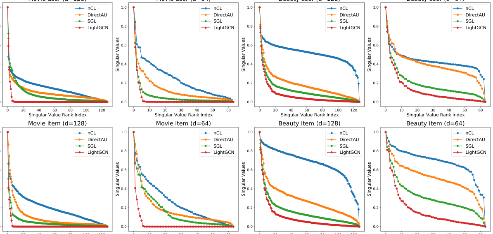
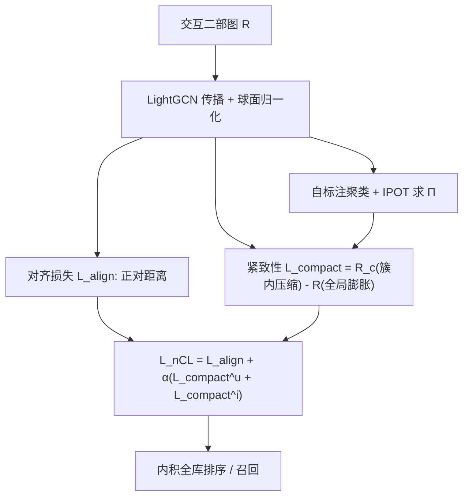
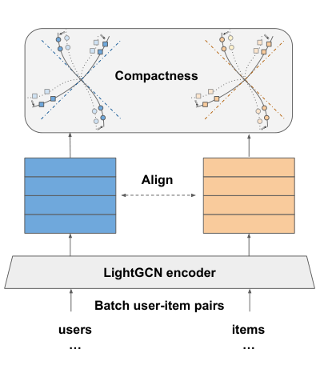

# Towards Mitigating Dimensional Collapse of Representations in Collaborative Filtering (面向协同过滤表征维度坍缩的缓解)

- **会议/期刊**: WSDM 2024
- **作者与机构**: Huiyuan Chen, Vivian Lai, Mahashweta Das (Visa Research); Hongye Jin, Zhimeng Jiang (Texas A&M); Xia Hu (Rice University)
- **推荐链路定位**: 召回（图协同过滤表征学习）
- **研究方向**: 协同过滤与双塔召回 / 自监督与表征去噪
- **论文原文**: [https://arxiv.org/abs/2312.17468v1](https://arxiv.org/abs/2312.17468v1)
- **开源代码**: 暂未开源

## TL;DR (1分钟核心速览)

本文指出：SGL/SimGCL 等图对比推荐虽能避开"完全坍缩"，却普遍陷入**维度坍缩**——用户/物品嵌入的协方差谱中超过 90% 的奇异值收敛到 0，128 维空间实际只用了前 10 维。为此提出非对比目标 **nCL**：用对齐损失拉近正样本对，用**率失真函数（编码长度）之差** $R_c-R$ 作为紧致性正则在"整体膨胀 + 簇内压缩"之间取平衡，且**免数据增广、免负采样**。在 5-core 四数据集、**Full-Ranking** 全库排序协议下，MovieLens10M Recall@10 达 0.2314，较最优基线 DirectAU 相对提升 **+14.21%**。

## Background & Motivation (背景与核心矛盾)

- **主流范式**: LightGCN 图卷积 + BPR  pairwise 损失是召回主干；SGL/SimGCL 叠加 InfoNCE，靠边丢弃或均匀噪声构造增广视图。
- **前人局限**: ① 对比式正则只惩罚"完全坍缩"，对"部分维度失效"无约束，梯度把嵌入挤压到低维子空间；② 增广策略（随机丢边/加噪）纯启发式，增广强度与数据结构耦合，稀疏图上极其敏感。
- **核心洞察 (Key Insight)**: 作者对训练后嵌入做 SVD 谱分析，发现 LightGCN 的 128 维仅前 10 个奇异值非零，且把 $d$ 从 128 降到 64 **并不能**缓解坍缩；DirectAU 虽优化 alignment+uniformity，但 uniformity 强行让所有实例在超球面上均匀散开，反而简化了流形、坍缩依旧。
- **本文切入点**: 放弃"实例级均匀性"，改用信息论的**码率（coding rate）**度量嵌入体积，从"防止奇异值归零"的几何角度直接对抗维度坍缩。

<figure class="paper-figure" markdown="span">
  <figcaption>图2：所有嵌入的奇异值谱。该谱包含协方差矩阵按排序顺序排列的奇异值。若干奇异值收敛到零（例如 LightGCN），表明存在维度坍缩。</figcaption>
</figure>

## Method (核心方法设计)

### 1. 整体框架 (Overall Architecture)

以 LightGCN（$L=2$）为编码器得到用户嵌入$\mathbf{E}_u\in\mathbb{R}^{d\times|U|}$与物品嵌入$\mathbf{E}_i$，全部归一化到单位超球面；每个 batch 内同时计算对齐损失（连接用户与物品两个空间）与紧致性损失（用户/物品各算一次，由全局码率$R$与簇内码率$R_c$之差组成），簇分配矩阵$\boldsymbol{\Pi}$由自标注深度聚类 + IPOT 最优传输每轮更新一次。训练时**不构造任何增广视图、不采样负例**，直接用 SGD 更新；推理沿用内积$\hat{y}_{ui}=\mathbf{e}_u^\top\mathbf{e}_i$ 全库排序。

### 2. 关键设计拆解 (Key Designs)

1. **紧致性：用码率差取代 uniform 损失（核心创新）**：痛点是对比/均匀性正则无法约束奇异值谱。作者引入率失真函数 $R(\mathbf{E}_u,\epsilon)=\frac{1}{2}\log\det\left(\mathbf{I}+\frac{d}{|U|\epsilon^2}\mathbf{E}_u\mathbf{E}_u^\top\right)$，取 SVD 后化为$\sum_{j=1}^{d}\log(1+t s_j^2)$——**该式对每个奇异值单调递增，最大化它即强制$s_j$不归零**，从谱上根除维度坍缩。再以簇成员矩阵$\boldsymbol{\Pi}_k$定义簇内码率$R_c(\mathbf{E}_u,\epsilon|\boldsymbol{\Pi})=\sum_{k=1}^{K}\frac{\mathrm{Tr}(\boldsymbol{\Pi}_k)}{2|U|}\log\det\left(\mathbf{I}+\frac{d}{\mathrm{Tr}(\boldsymbol{\Pi}_k)\epsilon^2}\mathbf{E}_u\boldsymbol{\Pi}_k\mathbf{E}_u^\top\right)$，取其差：
   $\mathcal{L}_{compact}=R_c(\mathbf{E}_u,\epsilon|\boldsymbol{\Pi})-R(\mathbf{E}_u,\epsilon)$，
   第一项压簇内体积、第二项扩全局体积，二者相减即"簇间尽量远、簇内尽量紧"的判别性结构。

2. **对齐：正对距离直接回归**：$\mathcal{L}_{align}=\mathbb{E}_{(u,i)\sim p_{pos}}\|\mathbf{e}_u-\mathbf{e}_i\|_F^2$，只连接用户-物品两个空间，保证内积打分可比。相比 InfoNCE 需$O(B^2)$ 负例两两打分，这里只有正样本，batch 可开很小。

3. **簇信息两条实现路径**：nCLG 用共现图 $\mathbf{A}=\mathbf{R}\mathbf{R}^\top$的阈值列$\boldsymbol{\Pi}_k=\mathrm{diag}(\mathbb{I}(\mathbf{a}_k\geq\eta))$（仅一阶近邻，需对$|U|$个簇抽样 50 个）；nCL 用 MLP$\Phi:\mathbb{R}^d\to\mathbb{R}^K$输出软分配$p(y|\mathbf{e}_u)$，在**均衡划分约束**下求解自标注目标$\min_{\mathbf{Q}}\langle\mathbf{Q},-\log\mathbf{P}\rangle$s.t.$\mathbf{Q}\mathbf{1}_{|U|}=\frac{1}{K}\mathbf{1}_K,\ \mathbf{Q}^\top\mathbf{1}_K=\frac{1}{|U|}\mathbf{1}_{|U|}$，用 IPOT（免反传 Sinkhorn 迭代）求解，避免退化为单簇。

4. **训练目标与开销**：$\mathcal{L}_{nCL}=\mathcal{L}_{align}+\alpha\left(\mathcal{L}_{compact}(\mathbf{E}_u)+\mathcal{L}_{compact}(\mathbf{E}_i)\right)$，无负采样、无增广；复杂度$\mathcal{O}(d^3+|U|d^2)$对用户数线性，$\alpha=0.5$、$K\approx300$ 最优。

<figure class="paper-figure" markdown="span">
  <figcaption>图3：所提 nCL 的概览。nCL 实现两个目标：1）对齐，最小化正用户-物品对之间的距离；2）紧凑性，鼓励用户/物品嵌入扩展到尽可能大的体积，同时推动每个簇（如方块和圆圈）占据尽可能小的空间。</figcaption>
</figure>

## Experimental Setup & Evaluation Protocol (实验设置与评估协议)

- **数据集与预处理**: 四个公开基准，统一 `5-core` 过滤：

| 数据集 | #Users | #Items | #Interactions | 密度 | 说明 |
| :--- | :---: | :---: | :---: | :---: | :--- |
| MovieLens10M | 72.0k | 10.0k | 10.0M | 1.39% | 稠密电影评分 |
| Beauty | 22.4k | 12.1k | 198.5k | 0.07% | Amazon 美妆 |
| Book | 52.6k | 91.6k | 2984.1k | 0.06% | Amazon 图书，最稀疏 |
| Yelp | 31.7k | 38.0k | 1561.4k | 0.13% | 本地商户点评 |

- **数据划分与防穿越**: 每用户交互按 **8:1:1 比例随机划分** train/val/test（非全局时间戳切分，属随机留出，存在轻微未来信息泄漏风险）。
- **排名评测协议**: 无偏 **Full-Ranking（全库未交互物品排序）**，指标 Recall@{10,20,50} 与 NDCG@{10,20,50}，重复 10 次取均值。
- **对比基线与超参**: 8 个基线覆盖 MF（BPRMF）、GNN（LightGCN/DGCF）、免负采样（BUIR）、对比式（CLRec/SGL/SimGCL）与 SOTA 非对比（DirectAU）；$d\in\{64,128,256\}$，学习率$1e{-3}$，batch$\in\{512,...,4096\}$，早停按验证 NDCG@10 十轮不升；$\epsilon^2\in\{0.01,0.05,0.1,0.5\}$、$K\in\{100..500\}$、$\alpha\in\{0.01..1\}$ 网格搜索。

## Key Experimental Results (实验关键数据)

### 1. 主实验对比 (Main Results)

| 数据集 | 指标 | BPRMF | LightGCN | DGCF | SGL | SimGCL | DirectAU | nCLG | **nCL** | Improv. |
| :--- | :--- | :---: | :---: | :---: | :---: | :---: | :---: | :---: | :---: | :---: |
| ML10M | R@10 | 0.1264 | 0.1306 | 0.1569 | 0.1732 | 0.1871 | 0.2026 | 0.2295 | **0.2314** | +14.21% |
| ML10M | R@20 | 0.1877 | 0.2053 | 0.2435 | 0.2437 | 0.2642 | 0.3028 | 0.3222 | **0.3301** | +9.02% |
| ML10M | N@10 | 0.1543 | 0.1766 | 0.1874 | 0.1877 | 0.1950 | 0.2265 | 0.2582 | **0.2596** | +14.61% |
| Beauty | R@10 | 0.0806 | 0.0863 | 0.0897 | 0.0903 | 0.0939 | 0.1041 | 0.1116 | **0.1164** | +11.82% |
| Beauty | N@10 | 0.0444 | 0.0484 | 0.0501 | 0.0521 | 0.0595 | 0.0635 | 0.0650 | **0.0671** | +5.67% |
| Book | R@10 | 0.0574 | 0.0601 | 0.0624 | 0.0627 | 0.0631 | 0.0620 | 0.0728 | **0.0732** | +16.01% |
| Book | N@10 | 0.0450 | 0.0496 | 0.0513 | 0.0520 | 0.0543 | 0.0516 | 0.0610 | **0.0623** | +14.73% |
| Yelp | R@10 | 0.0416 | 0.0508 | 0.0519 | 0.0545 | 0.0582 | 0.0676 | 0.0695 | **0.0695** | +2.81% |
| Yelp | N@10 | 0.0335 | 0.0406 | 0.0409 | 0.0441 | 0.0483 | 0.0547 | 0.0524 | **0.0564** | +3.11% |

### 2. 消融实验 (Ablation Study)

| 变体 (nCL 移除项) | ML10M R@10 | ML10M N@10 | Yelp R@10 | Yelp N@10 |
| :--- | :---: | :---: | :---: | :---: |
| (0) 完整 nCL | **0.2314** | **0.2596** | **0.0695** | **0.0564** |
| (1) w/o $R(\mathbf{E}_u,\epsilon)$ | 0.1896 | 0.2113 | 0.0574 | 0.0501 |
| (2) w/o $R_c(\mathbf{E}_u,\epsilon\|\boldsymbol{\Pi}_u)$ | 0.1932 | 0.2174 | 0.0587 | 0.0490 |
| (3) w/o $R(\mathbf{E}_i,\epsilon)$ | 0.1954 | 0.2242 | 0.0580 | 0.0481 |
| (4) w/o $R_c(\mathbf{E}_i,\epsilon\|\boldsymbol{\Pi}_i)$ | 0.2033 | 0.2301 | 0.0593 | 0.0472 |

### 3. 关键实验发现 (Key Findings)

1. **全局膨胀项是命门**：去掉用户侧全局码率 $R(\mathbf{E}_u,\epsilon)$ 后 ML10M Recall@10 从 0.2314 掉到 0.1896（**-18.1%**），甚至低于 DirectAU 的 0.2026，证明性能增益主要来自"阻止奇异值归零"而非聚类本身；簇内压缩项单独移除掉 16.5%，二者互补。
2. **收敛加速显著**：Yelp 上 nCL 约 30 epoch 收敛，BPR 需 220 epoch；单 epoch 耗时 74s vs 40s，综合加速 **×3.96**——码率项的高质量梯度抵消了 logdet 的额外计算。
3. **长尾/稀疏分组全面领先**：按物品度数分四组（[0,100)/[100,200)/[200,300)/[300,400)）后，nCL 在最低度数组仍优于 LightGCN 与 SimGCL，说明"谱不坍缩"对低度节点表征的增益比启发式增广更稳健；且 nCL 在 Yelp 的 Recall@10 仅比 nCLG 高 5.4e-2→6.95e-2 的绝对值约 +8%，说明一阶共现近似已相当强。

## Highlights & Limitations (亮点、对比与审稿批判)

- **与代表作对比 (vs. Prior Work)**: SGL/SimGCL 靠增广视图 + InfoNCE 做"实例判别"，本质只惩罚完全坍缩；DirectAU 改用 alignment+uniformity 但均匀性过度简化流形；nCL 是**首个从谱/码率角度显式约束维度坍缩**的 CF 目标，且训练成本更低（无增广、无负例）。
- **可迁移亮点**: ① 把 $R_c-R$ 这种"全局膨胀−簇内压缩"差值作为正则项，可即插即用地替换 LightGCN/序列模型上的 InfoNCE 辅助损失；② IPOT 免反传的均衡聚类分配，可用于任意需要"伪簇标签"又不想退化的场景（如多兴趣召回）。
- **审稿级局限批判**: ① 8:1:1 随机划分而非全局时间切分或 Leave-One-Out，且未做显著性检验，和部分对比工作的协议不完全可比；② 每轮需一次 IPOT 聚类 + $K$个 logdet（$\mathcal{O}(K d^3)$量级），单 epoch 慢 85%，$K$与$\alpha$ 双超参需网格搜索，且未开源，工业侧复现成本偏高。

## Rating (四维评分)

- **方法创新性 (Novelty)**: ⭐⭐⭐⭐ （首次把率失真/码率差引入 CF 表征，谱分析动机与 $\sum_j\log(1+ts_j^2)$ 的理论闭环干净利落）
- **评估协议与实验扎实度 (Protocol & Experiments)**: ⭐⭐⭐⭐ （四数据集 + Full-Ranking + 10 次重复 + 分组稀疏与收敛分析齐全，缺显著性检验与时间切分是其减分点）
- **写作与数学规范度 (Clarity & Rigor)**: ⭐⭐⭐⭐ （SVD 推到 logdet、簇码率与 IPOT 约束推导清晰，复杂度分析到位，仅 $\eta$ 阈值等细节略含糊）
- **工业落地与复现价值 (Industrial & Practical Value)**: ⭐⭐⭐ （免负采样与小 batch 极利于大规模训练，但无开源代码、每 epoch 额外聚类开销需工程优化）

