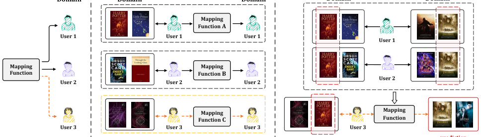
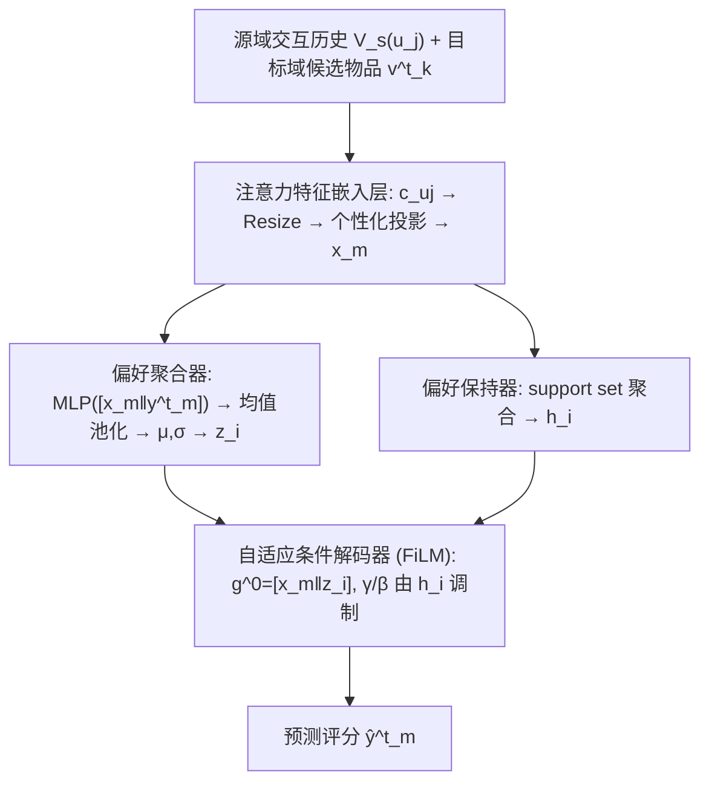
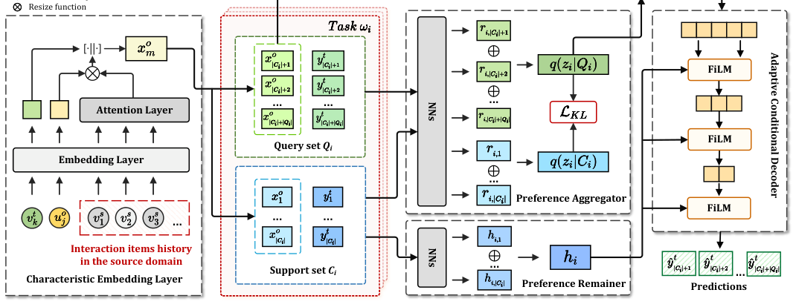

# CDRNP: Cross-Domain Recommendation to Cold-Start Users via Neural Process (基于神经过程的跨域冷启动推荐)

- **会议/期刊**: WSDM 2024 (Oral)
- **作者与机构**: Xiaodong Li, Jiawei Sheng, Jiangxia Cao, Wenyuan Zhang, Quangang Li, Tingwen Liu（中科院信工所 / UCAS / 快手）
- **推荐链路定位**: 召回阶段的跨域用户表征迁移与冷启动打分
- **研究方向**: 跨域与多场景推荐 / 冷启动与长尾推荐
- **论文原文**: [https://arxiv.org/abs/2401.12732v3](https://arxiv.org/abs/2401.12732v3)
- **开源代码**: 暂未开源

## TL;DR (1分钟核心速览)

跨域冷启动推荐（CDR）现有两条路线都有硬伤：EMCDR 学一个**用户共享**映射函数，抹平了个体偏好；PTUPCDR 等元学习方法把每个用户当作**彼此独立**的任务，既丢掉了用户间偏好相关性，又在映射时只搬表征、丢掉两域显式交互。本文提出 CDRNP，用神经过程（NP）把所有用户的 CDR 任务放进**同一个随机过程**——以 support set 推断隐变量 $z_i$，再以$z_i$条件化解码 query set，天然携带共性偏好；配合注意力特征嵌入层与 FiLM 式自适应条件解码器。在 Amazon 三个跨域场景的评分预测协议（MAE/RMSE，测试用户占重叠用户 20%/50%/80%）下，相对 PTUPCDR 的 MAE 分别降低 30.68%/11.27%/39.34%（$\alpha{=}20\%$），最高单点降幅达 50.67%。

## Background & Motivation (背景与核心矛盾)

- **主流范式**: EMCDR 系列先各自学域内表征，再学一个把源域用户向量映到目标域的**共享**映射 $W$；元学习系列（PTUPCDR/TMCDR）用 support set 为每个用户生成**个性化**映射。
- **前人局限**: ① 共享映射对所有用户一视同仁，无法刻画个体偏好差异；② 元学习把每个用户 CDR 视为独立任务，"相似用户应共享偏好"这一免费监督信号被浪费；③ 两类方法在映射阶段只处理**用户表征**，训练时也只用到了用户 embedding，两域显式的 $(u,v,r)$ 交互对从未进入映射函数。
- **核心洞察 (Key Insight)**: 若把每个用户的 CDR 视为某随机函数 $f_i$的一次实现，则所有任务共享同一先验$p(z)$，隐变量$z_i$即可承载"用户间共性偏好"，而 support set 的后验$q(z_i\mid C_i)$ 提供用户特异的调制信息——一次前向即可完成新用户适配，无需梯度步。
- **本文切入点**: 用 NP 的"先验-后验-解码"三段式重写元学习 CDR，输入直接是 $(x_m,y^t_m)$ 交互对而非用户向量。

<figure class="paper-figure" markdown="span">
  <figcaption>图 1：用户 1 和用户 2 是重叠用户，而用户 3 是冷启动用户。(a) 基于 EMCDR 的方法通过学习用户共享映射函数的框架。(b) 基于元学习的 CDR 方法通过学习用户特定映射函数的框架。(c) 我们的 CDRNP 通过捕获用户间偏好相关性的框架。</figcaption>
</figure>

## Method (核心方法设计)

### 1. 整体框架 (Overall Architecture)

对每个用户 $u_j$与候选目标域物品$v^t_k$，构造"评分可观测信息"$x_{jk}=(u_j,V_s(u_j),v^t_k)$：先用注意力把源域历史物品聚合成用户偏好向量，再经 Resize 生成**用户专属投影矩阵**作用于用户 embedding，与目标域物品 embedding 拼接得$x_m$。随后把任务$\omega_i=C_i\cup Q_i$（一批用户）分别编码为变分后验$q(z_i\mid Q_i)$与先验$q(z_i\mid C_i)$；训练时用 KL 拉近二者并回归$Q_i$评分，测试时对冷启动用户只保留重叠用户构成的$C_i$，采样$z_i\sim q(z_i\mid C_i)$与其$x^{s\backslash o}_m$ 一起送入 FiLM 解码器输出评分。

### 2. 关键设计拆解 (Key Designs)

1. **注意力特征嵌入层（把"用户向量"升级为"用户专属映射矩阵"）**：痛点是把源域偏好压成单一向量再线性映射，表达力受限。本文先对源域交互物品做注意力加权 $c_{u_j}=\sum_{v^s_k\in V_s(u_j)}\mathrm{softmax}_k(\mathbf{q}^{\top}\mathrm{ReLU}(\mathbf{W}_a\boldsymbol{v}^s_k))\,\boldsymbol{v}^s_k$，再把$c_{u_j}\in\mathbb{R}^{d/2}$经 Resize 张成$\mathbb{R}^{d\times d}$当作用户特异线性变换：$\hat{\boldsymbol{u}}_j=\mathrm{Resize}(c_{u_j})\boldsymbol{u}_j,\; \boldsymbol{x}_m=[\hat{\boldsymbol{u}}_j\,\|\,\boldsymbol{v}^t_k]$。直觉：偏好向量直接参数化"如何投影自己"，比外挂一个映射网络更轻且更个性化。

2. **偏好聚合器 + 偏好保持器（NP 双通道）**：痛点在于任务独立化导致偏好相关性丢失。聚合器对每个交互对编码 $\boldsymbol{r}_{i,m}=\mathrm{MLP}([\boldsymbol{x}_m\|\boldsymbol{y}^t_m];\theta)$，用**均值池化**（满足可交换性，保证随机过程 exchangeability）得$\bar{\boldsymbol{r}}_i$，再出高斯参数$\boldsymbol{\mu}_i,\log\boldsymbol{\sigma}_i$并重参数化$\boldsymbol{z}_i=\boldsymbol{\mu}_i+\boldsymbol{\epsilon}\odot\boldsymbol{\sigma}_i$；复杂度仅$O(n+m)$。保持器则对 support set 另编码一层$\boldsymbol{h}_i=\frac{1}{|C_i|}\sum_m \mathrm{MLP}([\boldsymbol{x}^o_m\|\boldsymbol{y}^t_m];\phi)$，保留原始共性偏好，供解码器逐层调制。

3. **训练目标、负采样与推理效率**：$z_i$的条件化使损失分为"任务似然 + 过程一致性"两项：$\mathcal{L}=\underbrace{\frac{1}{|Q_i|}\sum_m(y^t_m-\hat{y}^t_m)^2}_{\mathcal{L}_{rec}}+\lambda\,\mathrm{KL}\big(q(z_i\mid Q_i)\,\|\,q(z_i\mid C_i)\big)$。这里无负采样概念（评分回归任务）；测试时只用先验$q(z_i\mid C_i)$ 采样一次即完成冷启动适配，无需 MAML 的内循环梯度更新，是相对 PTUPCDR 的显著推理优势。

<figure class="paper-figure" markdown="span">
  <figcaption>图 3：CDRNP 在训练阶段的框架。特征嵌入层用于生成 𝒙𝑜𝑚。C𝑖 和 Q𝑖 均被编码以生成变分先验和后验。从偏好保持器学习得到的 𝒉𝑖 用于调制解码器参数。从 𝑞(𝒛𝑖|Q𝑖) 采样的 𝒛𝑖 在 Q𝑖 中与 𝒙𝑜𝑚 拼接，以经解码器预测 Q𝑖 的 ˆ𝑦𝑡𝑚。</figcaption>
</figure>

## Experimental Setup & Evaluation Protocol (实验设置与评估协议)

- **数据集与预处理**: Amazon 5-scores（每用户/物品至少 5 条评分），三个 categories 构成三组跨域场景，且使用**全量数据**而非子采样：

| 场景 | #Items (源/目标) | #Users (源/目标) | #Overlap | #Ratings (源/目标) |
| :--- | :---: | :---: | :---: | :---: |
| Movie→Music | 50,052 / 64,443 | 123,960 / 75,258 | 18,031 | 1,697,533 / 1,097,592 |
| Book→Movie | 367,982 / 50,052 | 603,668 / 123,960 | 37,388 | 8,898,041 / 1,697,533 |
| Book→Music | 367,982 / 64,443 | 603,668 / 75,258 | 16,738 | 8,898,041 / 1,097,592 |

- **数据划分与防穿越**: 按**时序戳**切分以避免信息泄漏；meta-training 任务只用重叠用户，meta-testing 的 $C_i$仍由重叠用户构成、$Q_i$替换为冷启动用户（源域有交互、目标域无交互）。测试用户比例$\alpha\in\{20\%,50\%,80\%\}$指占重叠用户的比例，$\alpha$ 越大可训练重叠用户越少、任务越难。
- **排名评测协议**: **非 top-N 排序**，而是**评分预测（rating prediction）**，仅对 query set 内候选物品打分并计算 MAE / RMSE，5 次随机运行取均值。因此全文未采用 Full-Ranking 或负采样排序协议。
- **对比基线与超参**: TGT（仅目标域 MF）、CMF、DCDCSR、SSCDR、EMCDR、PTUPCDR；embedding 维度 $\{32,64,128,256\}$统一调优，$|V_s(u_j)|{=}20,\ |C_i|{=}40$，隐藏层$\{8\!-\!128\}$，学习率$\{0.001\!-\!0.1\}$，$\lambda\in\{0.1\!-\!0.9\}$。

## Key Experimental Results (实验关键数据)

### 1. 主实验对比 (Main Results)

$\alpha=20\%$（训练重叠用户最充足设定）的 MAE / RMSE：

| 方法 | Movie→Music | Book→Movie | Book→Music | Improv.(MAE) |
| :--- | :---: | :---: | :---: | :---: |
| TGT | 4.4803 / 5.1580 | 4.1831 / 4.7536 | 4.4873 / 5.1672 | — |
| CMF | 1.5209 / 2.0158 | 1.3632 / 1.7918 | 1.8284 / 2.3829 | — |
| DCDCSR | 1.4918 / 1.9210 | 1.3971 / 1.7346 | 1.8411 / 2.2955 | — |
| SSCDR | 1.3017 / 1.6579 | 1.2390 / 1.6526 | 1.5414 / 1.9283 | — |
| EMCDR | 1.2350 / 1.5515 | 1.1162 / 1.4120 | 1.3524 / 1.6737 | — |
| PTUPCDR | 1.1504 / 1.5195 | 0.9970 / 1.3317 | 1.2286 / 1.6085 | — |
| **CDRNP** | **0.7974 / 1.0638** | **0.8846 / 1.1327** | **0.7453 / 0.9914** | **30.68% / 11.27% / 39.34%** |

$\alpha=80\%$ 时相对 PTUPCDR 的 MAE 降幅进一步扩大到 41.06% / 25.24% / **50.67%**。

### 2. 消融实验 (Ablation Study)

$\alpha=20\%$，`w/o PRM` = 去掉偏好保持器（FiLM 层数置 0），`w/o PRM+ACP` 再去掉注意力特征嵌入层：

| 变体 | Movie→Music | Book→Movie | Book→Music |
| :--- | :---: | :---: | :---: |
| w/o PRM+ACP | 0.8597 / 1.0908 | 0.9446 / 1.1645 | 0.7940 / 1.0214 |
| w/o PRM | 0.8259 / 1.0735 | 0.9002 / 1.1409 | 0.7628 / 1.0019 |
| **CDRNP (full)** | **0.7974 / 1.0638** | **0.8846 / 1.1327** | **0.7453 / 0.9914** |

### 3. 关键实验发现 (Key Findings)

1. **增益随可训练重叠用户减少而放大**：$\alpha$ 从 20%→80%（训练重叠用户从 80% 降到 20%），Movie→Music 的 MAE 降幅由 30.68% 升至 41.06%，Book→Music 由 39.34% 升至 50.67%，说明 NP 的 KL 先验正则主要在小样本任务上兑现，而非仅靠容量取胜。
2. **两层调制缺一不可，且 FiLM 层数比注意力层更关键**：去掉 PRM（FiLM 层数 3→0）即损失 3.6% MAE，再去 ACP 再损 4.1%；反过来说明"逐层用 $h_i$ 调制解码器"贡献大于"重塑输入 embedding"。
3. **单模型双向迁移**：仅在 Music→Movie 训练一次的 CDRNP 在 Movie→Music / Music→Movie 上分别取得 0.9140 / 0.8817 MAE，而 EMCDR 反向方向崩到 4.1198、PTUPCDR 4.4992（近随机水平），佐证显式交互建模比纯表征映射更不依赖映射方向；同时 $|V_s(u_j)|$从 10 增到 90、$|C_i|$ 从 20 增到 60 时曲线近乎平坦，而 PTUPCDR 对历史长度明显敏感。

## Highlights & Limitations (亮点、对比与审稿批判)

- **与代表作对比**: 相比 EMCDR，本文把"一个共享映射"换成"随机过程 + 用户特异投影矩阵"，兼顾共性与个性；相比 PTUPCDR，本质差异是把独立任务改为**同一过程的不同实现**（KL 强制 $q(z\mid Q)$与$q(z\mid C)$一致），并让$(x_m,y^t_m)$ 交互对进入映射，而非仅迁移用户向量；相比同源的 TANP，本文把 NP 从单域冷启动推广到跨域双域输入。
- **可迁移亮点**: ① $\mathrm{Resize}(c_{u_j})$把偏好向量直接当$\mathbb{R}^{d\times d}$投影矩阵，可作为任意个性化映射头的低成本替代；② 均值池化保证 exchangeability，使 support set 聚合$O(n+m)$ 且对集合顺序不敏感，可直接搬到 few-shot 用户建模。
- **审稿级局限批判**: ① 评估停留在**评分回归（MAE/RMSE）**，未做 top-N Full-Ranking，且只对 query set 内已观测物品打分，与工业召回/排序链路的真实候选分布差距较大，30%+ 的降幅难以直接外推；② 严重依赖重叠用户 support set（$|C_i|{=}40$）与源域历史，冷启动用户源域交互极稀疏时增益未知，且 NP 采样$z_i$、KL 项与$\lambda$需按场景（大规模 Book 域取大$\lambda$）调参，文中未报告推理延迟与线上 A/B。

## Rating (四维评分)

- **方法创新性 (Novelty)**: ⭐⭐⭐⭐ （把 NP 随机过程引入跨域冷启动，理论上用 exchangeability/consistency 两条件为"用户偏好相关性"提供依据，思路清晰而非模块堆叠）
- **评估协议与实验扎实度 (Protocol & Experiments)**: ⭐⭐⭐ （三场景 + $\alpha$ 三档 + 双向迁移 + 超参分析较完整，但仅 MAE/RMSE 评分回归、无 top-N 排名与显著性检验）
- **写作与数学规范度 (Clarity & Rigor)**: ⭐⭐⭐⭐ （从 ELBO 到 Eq.(6) 的似然+KL 分解推导连贯，各模块公式与复杂度交代到位，仅符号 $x_m/y^t_m$ 复用略密）
- **工业落地与复现价值 (Industrial & Practical Value)**: ⭐⭐⭐ （无需内循环梯度即可适配新用户、聚合复杂度线性，具工程吸引力，但未开源、依赖重叠用户冷启动画像，线上时延未知）

