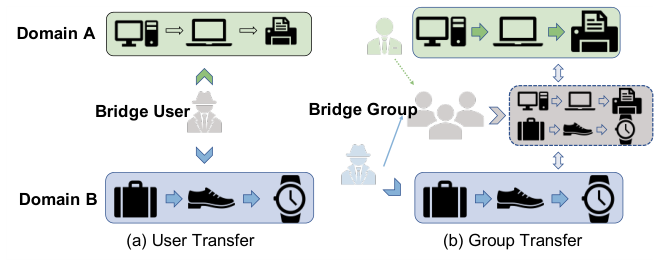
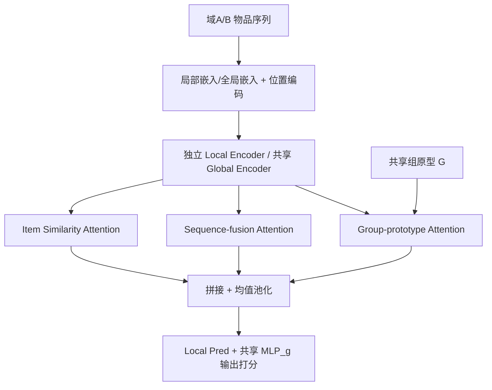

# Mixed Attention Network for Cross-domain Sequential Recommendation (混合注意力网络用于跨域序列推荐)

- **会议/期刊**: WSDM 2024
- **作者与机构**: Guanyu Lin (CMU)、Chen Gao / Yu Zheng / Zhiheng Li / Depeng Jin / Yong Li (清华大学)、Jianxin Chang / Yanan Niu / Yang Song (快手)、Meng Wang (合肥工业大学)
- **推荐链路定位**: 召回（Next-Item 打分/候选检索）
- **研究方向**: 跨域与多场景推荐 / 序列与会话推荐
- **论文原文**: [https://arxiv.org/abs/2311.08272v1](https://arxiv.org/abs/2311.08272v1)
- **开源代码**: [https://github.com/Guanyu-Lin/MAN](https://github.com/Guanyu-Lin/MAN)

## TL;DR (1分钟核心速览)

现有跨域序列推荐（PiNet、DASL）默认两域存在大量重叠用户，必须成对输入同一桥接用户的双域序列，而真实工业数据重叠用户不足 8.37%（Amazon 仅 0.04%），模型直接失效。MAN 抛弃“用户级迁移”，改用**共享组原型（group prototypes）**做隐式群体级知识迁移，并配合物品相似度、序列融合、组原型三重注意力融合局部（域特有）与全局（跨域共享）表征。在两个双域数据集上，稀疏的 Amazon Video Games 域 AUC 相对提升 8.25%（0.6059→0.6559），Micro Video A 提升 4.10%。

## Background & Motivation (背景与核心矛盾)

- **主流范式**: 序列推荐（GRU4REC/SASRec/SURGE）建模用户行为序列做 Next-Item 预测；跨域推荐通过参数共享或多任务学习缓解目标域稀疏，近年 PiNet/DASL 进一步做“双目标”跨域序列建模。
- **前人局限 1（用户重叠假设）**: PiNet/DASL 依赖 bridge user，需两域同一用户的序列成对输入；实验数据中重叠用户占比仅 7.18%/8.37%（Micro Video）与 0.27%/0.04%（Amazon），假设直接崩塌。
- **前人局限 2（优化冲突）**: 简单的全局共享骨干（本文 “Shared” 对照）在两域联合训练时相互拖累，出现负迁移，单域独立训练反而更优。
- **核心洞察 (Key Insight)**: 用户 ID 无法跨域共享，但**兴趣群体是可跨域共享的抽象**——用户不属于单一群体，而是多个原型的软加权组合（如“青少年 + 篮球爱好者”）。因此迁移的载体应从“用户”下沉为“组原型”。
- **本文切入点**: 用 $N_g$ 个可学习组原型在无监督方式下聚合跨域共同行为模式，两域输出互不依赖对方输入，从而彻底去掉重叠用户先验。

<figure class="paper-figure" markdown="span">
  <figcaption>图1：(a) 用户迁移学习依赖重叠用户，(b) 无用户重叠先验假设的组迁移学习示意图。</figcaption>
</figure>

## Method (核心方法设计)

### 1. 整体框架 (Overall Architecture)

每个域的物品序列先经**局部嵌入**（域独享矩阵 $M^A/M^B$）与**全局嵌入**（跨域共享矩阵$M$）双通道加位置编码，分别送入参数独立 / 参数共享的序列编码器得到局部序列$S^A$与全局序列$S^{Ag}$。混合注意力层三路并行：物品相似度注意力从历史中检索与目标物品相近的物品；序列融合注意力以局部序列为 Query 交叉注意全局序列；组原型注意力用共享原型$G$反向聚合每个域的用户序列并软加权。三路输出与池化后的局部/全局序列拼接，分别进入局部预测 MLP 与跨域共享的$MLP_g$，两域损失独立回传，可异步增量更新。

### 2. 关键设计拆解 (Key Designs)

1. **物品相似度注意力 (ISA)：在局部+全局联合空间做目标感知的历史检索**。痛点是不共享物品的两域无法对齐物品语义；做法是把目标物品嵌入与“局部+全局”历史嵌入拼接后打分，再用 softmax 权重加权历史物品：$F^A=\mathrm{MLP}([M_{i^A_{t+1}}\,\|\,\mathbf{E}^A+\mathbf{E}^{Ag}])$，$E^A_i=\mathrm{softmax}(F^A)(\mathbf{E}^A+\mathbf{E}^{Ag})$。加全局分量使共享物品/相似物品在跨域空间被复用，减轻域特有语义偏置。

2. **序列融合注意力 (SFA)：以局部为 Query 注入跨域序列模式**。直接拼接两域序列会引发前述优化冲突；改为交叉注意：$S^A_s=\mathrm{MLP}(\mathrm{CA}(S^A,S^{Ag})+S^A)$，残差保证域特有模式不被覆盖，Query/Key 分离使跨域信息仅以“键值上下文”形式注入，抑制负迁移。

3. **组原型注意力 (GPA) + 原型解耦正则：无需用户 ID 的群体级迁移**。先用可学习池化矩阵求用户对各组的软归属 $C^A=\mathrm{MLP}(W^A_P S^A)$，让共享原型通过交叉注意适配到该域$G^A=\mathrm{MLP}(\mathrm{CA}(G,S^A))$，再按软归属加权$G^A_u=\mathrm{softmax}(C^A)G^A$。为防止原型塌缩为同一点，加入排斥型正则$\mathcal{L}_g=-\lambda_g\sum_{i<j}\lVert G_i-G_j\rVert^2$（负号即最大化原型间距离），迫使$N_g$ 个原型覆盖不同兴趣簇。

4. **训练目标、负采样与推理效率**：总损失 $\mathcal{L}=\mathcal{L}_A+\mathcal{L}_B+\lambda_A\lVert\Theta_A\rVert^2+\lambda_B\lVert\Theta_B\rVert^2+\mathcal{L}_g$，其中$\mathcal{L}_A,\mathcal{L}_B$ 为逐域下一物品的负对数似然（正负样本二分类交叉熵）。关键工程性质：域 A 的输出不依赖域 B 的输入，缺失某域数据时可直接删去其损失项，支持两域数据非同步到达时的迭代式训练。

## Experimental Setup & Evaluation Protocol (实验设置与评估协议)

- **数据集与预处理**: 一个工业短视频双域数据集（Micro Video A/B）+ 公开电商双域数据集（Amazon Video Games / Toys），均为长序列过滤后的真实日志：

| 数据集 | 域 | #Users | #Items | #Interactions | 密度 | 重叠用户/物品 |
| :--- | :--- | :---: | :---: | :---: | :---: | :---: |
| Micro Video | A / B | 43,919 / 37,692 | 147,813 / 131,732 | 18.01M / 14.91M | 0.2775% / 0.3003% | 7.18% / 8.37%（用户）; 71.22% / 79.91%（物品） |
| Amazon | Video Games / Toys | 826,767 / 1,342,911 | 50,210 / 327,698 | 1.32M / 2.25M | 0.0032% / 0.0005% | 0.27% / 0.04%（用户）; 7.66% / 4.72%（物品） |

- **数据划分与防穿越 (Splitting Strategy)**: 按每个用户序列的时间顺序做下一物品预测划分（最后一行为测试目标），序列截断/补零至固定长度（Micro Video 250，Amazon 20）。
- **排名评测协议 (Ranking Protocol)**: 采用 **Sampled Ranking**（逐正样本配负样本的候选打分）而非 Full-Ranking，报告 AUC、W AUC（即 GAUC，按用户加权）、MRR、NDCG@10；论文未披露具体负采样比例，亦未报告显著性检验。
- **对比基线与超参**: 单域基线 DIN、Caser、GRU4REC、DIEN、SASRec、SLi-Rec、SURGE；跨域基线 NATR、PiNet、DASL（后者在无重叠用户场景下以空序列适配运行）。嵌入维度 40（Micro Video）/ 20（Amazon），Adam lr=1e-3，正则系数搜 {1e-7,1e-5,1e-3}，组原型数搜 {1,5,10,20}。

## Key Experimental Results (实验关键数据)

### 1. 主实验对比 (Main Results)

AUC 主指标（W AUC 与 MRR/NDCG 趋势一致，略）：

| 域 | DIN | DIEN | GRU4REC | SASRec | SURGE | NATR | PiNet | DASL | **MAN** | Improv.% |
| :--- | :---: | :---: | :---: | :---: | :---: | :---: | :---: | :---: | :---: | :---: |
| Micro Video A | 0.5673 | 0.6666 | 0.7838 | 0.7730 | 0.7959 | 0.7972 | 0.7834 | 0.7879 | **0.8285** | +4.10% |
| Micro Video B | 0.5613 | 0.6581 | 0.7625 | 0.7794 | 0.7605 | 0.7727 | 0.7595 | 0.7665 | **0.8094** | +3.85% |
| Amazon VG | 0.5577 | 0.6059 | 0.5303 | 0.5234 | 0.5975 | 0.5617 | 0.5740 | 0.5527 | **0.6559** | +8.25% |
| Amazon Toys | 0.6372 | 0.6321 | 0.6576 | 0.5707 | 0.6455 | 0.6127 | 0.5402 | 0.6237 | **0.6712** | +2.07% |

### 2. 消融实验 (Ablation Study)

| 变体 | MV-A AUC | MV-B AUC | VG AUC | Toys AUC |
| :--- | :---: | :---: | :---: | :---: |
| w/o ISA（物品相似度注意力） | 0.8136 | 0.8059 | 0.6195 | 0.6499 |
| w/o SFA（序列融合注意力） | 0.8133 | 0.7939 | 0.6420 | 0.6502 |
| w/o GPA（组原型注意力） | 0.7983 | 0.7996 | 0.6195 | 0.6546 |
| **Full MAN** | **0.8285** | **0.8094** | **0.6559** | **0.6712** |

### 3. 关键实验发现 (Key Findings)

- **GPA 是主贡献且在稀疏域最吃重**：去掉 GPA 后 Micro Video A 掉 3.0%（0.8285→0.7983）、Video Games 掉 5.6%（0.6559→0.6195），证明“组级迁移”确实在无重叠用户时替代了用户级桥接；而 Toys（密度仅 0.0005%）上 GPA 掉幅仅 2.5%，说明极稀疏场景下原型估计样本不足，此时把局部与全局物品空间融合的 ISA 更关键。
- **重叠用户假设是 PiNet/DASL 失效的直接原因**：在重叠用户 <0.3% 的 Amazon 上，PiNet 在 Toys 仅 0.5402，显著低于连非序列的 DIN（0.6372）与 GRU4REC（0.6576）；NATR 虽不依赖用户重叠，但依赖重叠物品（Toys 仅 4.72%），同样退化为 0.6127。
- **简单共享骨干会产生负迁移**：骨干实验显示 GRU4REC/SASRec/SURGE 三者 “Shared”（跨域共享参数）普遍不如 “Single”（单域独立训练），而 “Cross”（接入 MAN）在三类骨干（RNN/Attention/图式）上均取得最高 AUC，验证方法是 **model-agnostic** 且注意力混合结构是消解优化冲突的关键。

## Highlights & Limitations (亮点、对比与审稿批判)

- **与代表作对比**: PiNet/DASL 以“同一用户的成对双域序列”为输入做双向注意力融合，本质是用户级迁移；NATR 转向物品级但为非序列、单目标模型；MAN 是首个“双目标 + 无重叠用户/物品假设”的序列方案，迁移粒度下沉到组原型。
- **可迁移亮点**: (1) 用可学习软聚类原型 + 排斥正则作为**域无关适配器**，可直接插入现有多场景模型（STAR/PEPNet）替代场景 ID；(2) 以 Query/Key 分离的交叉注意做跨域注入并用残差保护主域表征，是抑制负迁移的通用范式。
- **审稿级局限批判**: (1) 评估全部为采样排序（AUC/GAUC/MRR@10），未做 Full-Ranking，也未报告负采样比例与显著性检验，跨域增益的实际量级存疑；(2) 组原型数 $N_g$ 从 1 搜到 20，属高敏感超参，且“原型能否跨域共享”仅以 t-SNE 可视化佐证，缺乏定量可解释性验证；(3) 两域数据完全异构（不共享任何用户/物品）时的退化行为未做压力测试。

## Rating (四维评分)

- **方法创新性 (Novelty)**: ⭐⭐⭐⭐ （“以组原型替代重叠用户”是问题建模层面的真正松绑，三重注意力分别对应物品/序列/群体粒度，动机与算子自洽）
- **评估协议与实验扎实度 (Protocol & Experiments)**: ⭐⭐⭐ （工业+公开双域数据集覆盖度好，含骨干泛化与可视化分析，但仅采样排序、无显著性检验、无线上 A/B）
- **写作与数学规范度 (Clarity & Rigor)**: ⭐⭐⭐⭐ （三路注意力公式定义清晰、损失与独立更新讨论有工程价值；个别符号如 $G$与$G^A$ 层级关系需对照图 2 才能确认）
- **工业落地与复现价值 (Industrial & Practical Value)**: ⭐⭐⭐⭐ （代码与数据处理已开源，各域可独立异步训练，落地门槛低；代价是新增原型注意力带来的额外推理开销未量化）

