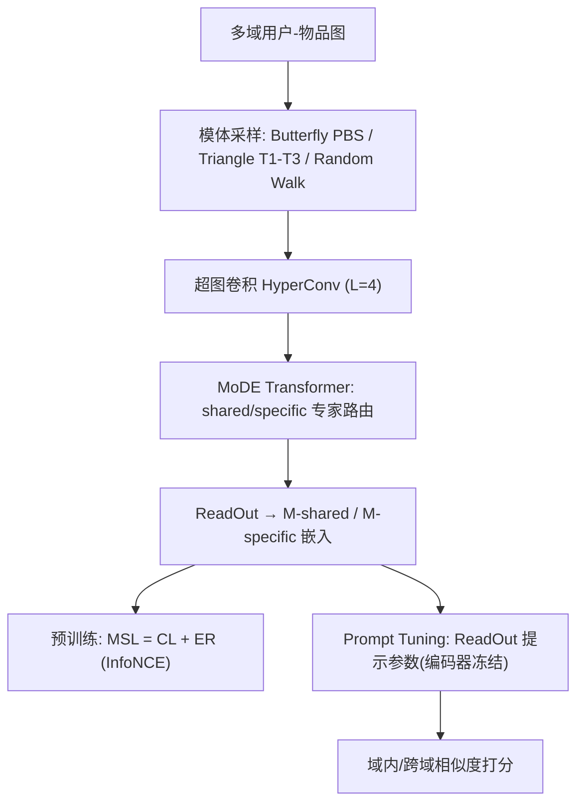
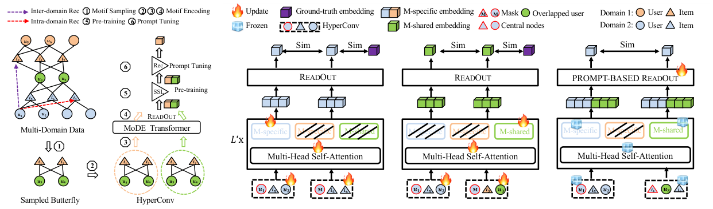

# Motif-Based Prompt Learning for Universal Cross-Domain Recommendation (基于模体的通用跨域推荐提示学习)

- **会议/期刊**: WSDM 2024
- **作者与机构**: Bowen Hao (首都师范大学)、Chaoqun Yang (Griffith University)、Lei Guo (山东师范大学)、Junliang Yu / Hongzhi Yin (昆士兰大学)
- **推荐链路定位**: 召回（用户–物品双塔式相似度打分，端到端训练）
- **研究方向**: 跨域与多场景推荐 / 自监督对比学习
- **论文原文**: [https://arxiv.org/abs/2310.13303v1](https://arxiv.org/abs/2310.13303v1)
- **开源代码**: 暂未开源

## TL;DR (1分钟核心速览)

通用跨域推荐（Universal CDR）已有工作用 domain-shared embedding + 「多任务」或「预训练-微调」迁移，但忽略了跨域共有的**结构拓扑**，且预训练目标与推荐目标不一致，易负迁移。本文提出 MOP：用 butterfly / triangle / random walk 三类模体经超图卷积 + Mixture-of-Domain-Experts Transformer 编码出 M-shared / M-specific 嵌入，并把 CL、ER 与推荐任务统一为「模体相似度学习 (MSL)」+ ReadOut 提示参数。在 4 类 CDR 场景、HR@10/NDCG@10 上，inter-domain 冷启动提升最高 +8.7% / +19.8%。

## Background & Motivation (背景与核心矛盾)

- **主流范式**: 现有 CDR 分 intra-domain（稀疏域借源域知识）与 inter-domain（冷启动用户跨域映射）两支，各需专门模块；UniCDR / CAT-ART 用 shared embedding 统一二者，再靠 MTL 或 Pre-train+Fine-tune 迁移。
- **前人局限**: (1) 两种训练范式的**预训练目标与推荐目标不对齐**，shared embedding 易吸收伪相关，产生负迁移；(2) 只对齐节点级语义，**忽略了跨域同构的局部结构拓扑**（如 $\mathcal{B}_1=\{u_3,i_5,u_4,i_6\}$与$\mathcal{B}_2=\{i_2,u_4,i_3,u_2\}$ 表达同一种偏好模式）这一可迁移知识。
- **核心洞察 (Key Insight)**: 模体天然刻画节点的结构相关性，若把「用户/物品中心模体」作为迁移载体，并把 SSL 与推荐都写成「模体中心嵌入的余弦相似度计算」，则目标天然对齐。
- **本文切入点**: 用模体共享嵌入 + 「Pre-training & Prompt Tuning」替换 MTL / PF，只冻结编码器、只调提示参数完成下游适配。

## Method (核心方法设计)

### 1. 整体框架 (Overall Architecture)

多域用户–物品图先经模体采样得到 butterfly / triangle / random-walk 三类模体集合；Motif-based Encoder（超图卷积 → MoDE Transformer → ReadOut）把每个中心节点编码为 M-shared（跨域共有拓扑）与 M-specific（域内拓扑）两套嵌入。预训练阶段把对比学习与嵌入重建统一改写为 MSL 任务（正/负对均由模体中心嵌入的相似度定义）联合优化；Prompt Tuning 阶段冻结编码器，仅在 ReadOut 上挂可学习提示参数，生成 $\tilde{z}_u,\tilde{z}_i$ 做域内（拼接 shared+specific）或跨域（仅用 shared）相似度打分。

<figure class="paper-figure" markdown="span">
  <figcaption>图2：MOP的整体框架。图2(b)展示了一个域内CDR示例，即在域内将𝑖4推荐给𝑢1。对于跨域CDR，即将𝑖3推荐给𝑢1，我们仅对𝑢1使用M-shared嵌入，但对𝑖3同时使用M-shared和M-specific嵌入来执行推荐任务。</figcaption>
</figure>

### 2. 关键设计拆解 (Key Designs)

1. **模体采样 + 超图编码（把拓扑变成可迁移知识）**：普通 GNN 只聚合直接邻居，无法区分「强连接完全子图」与「弱连接间接链路」。本文用 Priority-based Butterfly Sampling (PBS，按度优先、公共邻居组合枚举，复杂度 $O(\sum_{(n,n') \in E_i}(\min\{\deg(n),\deg(n')\})^2)$)、三类三角形 T1/T2/T3（以 EASE$^R$的 item-item 相似度$a_3$阈值判定）与变长随机游走，分别捕获强连接短期、弱连接短期与长期依赖；再以超图卷积$X^{(l+1)}=D^{-1}HWB^{-1}H^{\top}X^{(l)}$聚合并取$X^L=\frac{1}{L+1}\sum_l X^{(l)}$。超边把模体内多点关系一次性建模，避免二部图逐跳传播的信息稀释。

2. **MoDE Transformer + ReadOut（分离共享/专有拓扑）**：直接用单一 FFN 会把域内专有模式与跨域共有模式混在一处。本文将标准 Transformer 的 FFN 替换为 M-shared / M-specific 两组专家（Mixture-of-Domain-Experts），即 $T^{l}_S=\mathrm{MFFN}(\mathrm{LN}(T^{l\prime}_S))+T^{l\prime}_S$，按输入来源路由；ReadOut 再以均值聚合模体嵌入并拼接中心节点信号$z^S_n=\mathrm{Concat}(z^S,z'_n)$。这样同一套编码器同时输出两种粒度的拓扑表征。

3. **目标统一（MSL）与 Prompt Tuning、训练目标**：痛点在于 CL/ER 的优化目标与推荐排序目标不一致。作者把三者都写成「模体中心嵌入相似度」模板：CL 拉近同节点双视图、推远不同节点；ER 拉近重建嵌入与 ground-truth（由 UniCDR 提供）。预训练损失 $\mathcal{L}_{pre}=\lambda_1\mathcal{L}_c+(1-\lambda_1)\mathcal{L}_e$，均用 InfoNCE（$\tau$为温度）；提示侧对 ReadOut 加可学习参数$p_n$（默认逐元素乘$z^S=\mathrm{ReadOut}(\{p_n\odot t^{L'}_S\})$），推荐损失$\mathcal{L}_{Rec}=-\sum_{(u,i)\in E_i}\log\frac{\exp(\mathrm{sim}(\tilde{z}_u,\tilde{z}_i)/\tau)}{\sum_{(u,i')\notin E_i}\exp(\mathrm{sim}(\tilde{z}_u,\tilde{z}_{i'})/\tau)}$。推理沿用双塔内积检索，无额外在线开销；提示参数远少于全参数微调，适合多域多任务快速上线。

## Experimental Setup & Evaluation Protocol (实验设置与评估协议)

- **数据集与预处理**: Amazon 系四类 CDR 任务（沿用 UniCDR 划分），Embedding 维度 $d=128$，batch 1024：

| 场景 (任务类型) | 数据集 | #Users | #Items | #Interactions | 说明 |
| :--- | :--- | :---: | :---: | :---: | :--- |
| Scenario 1 (Dual-User-Intra) | Sport / Cloth | 9,928 | 30,796 / 39,008 | 92,612 / 87,829 | 重叠用户、域内稀疏 |
| Scenario 1 | Elec / Phone | 3,325 | 17,709 / 38,706 | 50,407 / 115,554 | 同上 |
| Scenario 2 (Dual-User-Inter) | Sport / Cloth / Game / Video | 19k–42k | 8.7k–17.9k | 15.5w–18.8w | 冷启动跨域推荐 |
| Scenario 3 (Multi-Item-Intra) | M1–M5 | 2.7k–7.1k | 1.2k–9.8k | 19k–77k | 物品为桥梁 |
| Scenario 4 (Multi-User-Intra) | D1–D3 | 231k / 508k / 773k | 595–2,096 | 49w–379w | 大规模、中位交互数 1–3 |

- **数据划分与防穿越**: Scenario 1–3 采用 `Leave-One-Out`（valid/test 各留一条正样本）；Scenario 4 采用比例划分（valid/test 各约 1.3w–9.3w 条）。
- **排名评测协议**: Scenario 1–3 为 `Sampled Ranking`（每条正样本随机采 999 负样本，正负比 1:999）；Scenario 4 为无偏 `Full-Ranking`。指标 HR@10、NDCG@10。训练阶段负采样数为 4。
- **对比基线与超参设置**: 与 UniCDR、CAT-ART、GraphPrompt、GPPT 及 UniCDR 论文内其他基线比较（表中取各列最强基线记作 SOTA）；lr=0.001，$\tau=0.5$，$\lambda_1=0.5$，MoDE 层数$L'=2$，超图层数$L=4$，随机游走长度$\{3,6,9\}$，默认模体为 butterfly、ReadOut 为逐元素乘。

## Key Experimental Results (实验关键数据)

### 1. 主实验对比 (Main Results)

| 场景 | 数据集 | HR@10 (基线→MOP) | Improv. | NDCG@10 (基线→MOP) | Improv. |
| :--- | :--- | :---: | :---: | :---: | :---: |
| Dual-User-Intra | Sport | 18.37 → **19.23** | +4.7% | 10.98 → **11.37** | +3.6% |
| Dual-User-Intra | Cloth | 17.85 → **18.18** | +1.8% | 11.20 → 10.19 | −9.0% |
| Dual-User-Intra | Elec | 24.57 → **25.19** | +2.5% | 14.51 → **15.11** | +4.1% |
| Dual-User-Intra | Phone | 28.76 → **28.82** | +0.2% | 16.13 → **18.02** | +11.7% |
| Dual-User-Inter | Sport | 12.04 → **13.09** | +8.7% | 7.04 → **8.09** | +14.9% |
| Dual-User-Inter | Cloth | 12.48 → **13.03** | +4.4% | 7.52 → **9.01** | +19.8% |
| Dual-User-Inter | Game | 8.78 → 7.98 | −9.1% | 4.63 → 4.09 | −11.7% |
| Dual-User-Inter | Video | 13.17 → **14.13** | +7.3% | 6.49 → **6.88** | +6.0% |
| Multi-Item-Intra | M1 | 73.13 → **74.01** | +1.2% | 59.57 → **60.10** | +0.9% |
| Multi-User-Intra | D3 (Full) | 73.89 → **74.29** | +0.5% | 59.15 → **60.02** | +1.5% |

基线来源：Scenario 1 中 Sport/Cloth 为 UniCDR，Elec 为 DisenCDR，Phone 为 CDRIB；Scenario 2 中 Sport/Cloth/Game 为 UniCDR、Video 为 CDRIB；Scenario 3/4 以 S3-Rec / UniCDR 为最强基线。

### 2. 消融实验 (Ablation Study)

| 变体 (HR@10) | Sport | Elec | NDCG@10 (Sport) |
| :--- | :---: | :---: | :---: |
| 仅 CL，单域 (CL-) | 10.37 | 21.88 | 6.37 |
| 仅 ER，单域 (ER-) | 8.84 | 17.37 | 5.73 |
| CL+ER，单域 (A-) | 11.03 | 22.37 | 9.37 |
| 原 CL+ER，未统一 (A*) | 18.89 | 24.82 | 11.19 |
| **MOP (MSL + PPT)** | **19.23** | **25.19** | **11.37** |
| 模体换 Triangle T1 | 10.23 | 20.35 | 5.11 |
| 模体换 RandomWalk(len3) | 11.03 | 20.12 | 6.37 |
| 编码器换 LightGCN (G) | 18.77 | 24.99 | 11.12 |
| 编码器换 Vanilla Transformer (VT) | 18.81 | 24.98 | 11.08 |
| 多模体融合 (A, {B,R6,T1-T3}) | 19.66 | 25.02 | 11.13 |

### 3. 关键实验发现 (Key Findings)

1. **模体选择是第一性变量**：把默认 butterfly 换成三角形 T1，Sport HR@10 从 19.23 崩到 10.23（−47%），远超编码器替换的全部差异（LightGCN 18.77 / Vanilla Trans. 18.81 vs 19.23），说明收益主要来自「强连接短期拓扑」这一知识形式，而非编码器容量；随机游走长度过长（R9: 16.66 < R6: 16.91）反而引入噪声。
2. **跨域共享 + 目标对齐缺一不可**：单域内预训练 (A-) 仅 11.03，跨域 MSL 达 18.45（+67%）；把 CL/ER 原始目标换成统一的 MSL 又额外带来 18.45→19.23 与 24.82→25.19，验证「负迁移源于目标不对齐」的诊断；$\lambda_1$在 0.5–0.7 附近最优，只用 CL（$\lambda_1=1$）或只用 ER（$\lambda_1=0$）均下降。
3. **增益集中在冷启动跨域，域内几乎饱和**：inter-domain 上 NDCG@10 提升 6.0%–19.8%，而 intra-domain HR@10 增益普遍 ≤4.7%，且 Cloth NDCG（−9.0%）、Game（−9.1%）出现负向；提示调优相对全量微调 (PF) 与 MTL 有小幅但一致的领先，说明本文方法的真实价值域是「新场景冷启动」，而非稠密域精排。

## Highlights & Limitations (亮点、对比与审稿批判)

- **与代表作对比 (vs. Prior Work)**: UniCDR 以 MTL 同时做 CL 与推荐、CAT-ART 走 Pre-train+Fine-tune，二者都把「共享嵌入」当语义向量、目标与推荐错位；MOP 把迁移单元从「节点语义」升级为「模体拓扑」，并用 prompt tuning 在**参数层面**而非符号层面消解 SSL/Rec 目标差，这是与两者的本质区别。
- **可迁移亮点**: (1) 「把 SSL 与下游任务都改写成同一相似度模板」的思路可直接迁移到序列推荐/图推荐的预训练-提示微调；(2) PBS 按度优先枚举 butterfly 的采样策略可在不显著增加构图开销下提供高质量结构监督信号。
- **审稿级局限批判**: (1) **评估协议偏弱**：Scenario 1–3 采用 1:999 采样排序且每条正样本仅 1 条，NDCG 在 Cloth/Game/M3/M5 上实际低于基线，主实验只报「各列最强 SOTA」而未报告全部基线方差与显著性检验，$p$ 值缺失；(2) **收益幅度与可复现性**：域内 HR 提升仅 0.2%–4.7%，部分表格数值存在内部矛盾（如 Multi-User D2 NDCG 由 50.48 跳至 66.23、M5 NDCG 48.01>60 的排序反常），加上未开源代码，复现成本高；(3) 需为每域采样三类模体并做超图卷积，预训练构图/内存开销随域数和模体数线性增长，多域扩展到 5 个以上场景的工程可扩展性未验证。

## Rating (四维评分)

- **方法创新性 (Novelty)**: ⭐⭐⭐⭐ （首次把「模体拓扑」作为跨域可迁移知识单元，并以 MSL 统一 SSL 与推荐目标，思路清晰且具备可推广性）
- **评估协议与实验扎实度 (Protocol & Experiments)**: ⭐⭐⭐ （覆盖 4 类 CDR 场景与 Full-Ranking 场景，消融充分，但 1:999 采样排序、仅报最强 SOTA、无显著性检验且个别数值自相矛盾）
- **写作与数学规范度 (Clarity & Rigor)**: ⭐⭐⭐ （MoDE/ReadOut/提示三种形式定义明确，但符号在 $T$、$z$、$p$ 上多处复用，部分公式（Eq.4、Eq.7）排版与记号不一致）
- **工业落地与复现价值 (Industrial & Practical Value)**: ⭐⭐⭐ （提示调优只需少量参数即可适配多域，推理仍为双塔内积、无额外在线成本；但代码未开源且模体采样预处理较重）

