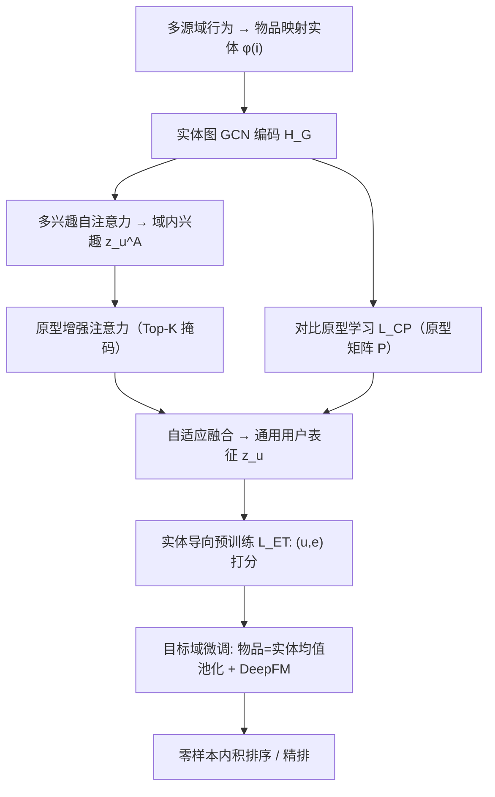
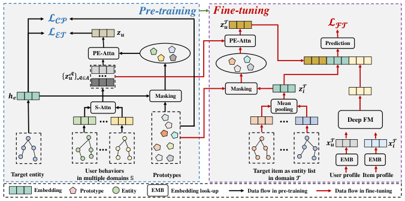

# PEACE: Prototype lEarning Augmented transferable framework for Cross-domain rEcommendation (原型学习增强的跨域可迁移推荐框架)

- **会议/期刊**: WSDM 2024
- **作者与机构**: Chunjing Gan, Bo Huang, Binbin Hu, Jian Ma, Ziqi Liu, Zhiqiang Zhang, Jun Zhou, Guannan Zhang, Wenliang Zhong（蚂蚁集团 Ant Group）
- **推荐链路定位**: 精排（多源域预训练 + 目标域零样本/微调排序）
- **研究方向**: 跨域与多场景推荐 / 冷启动与长尾推荐
- **论文原文**: [https://arxiv.org/abs/2312.01916v2](https://arxiv.org/abs/2312.01916v2)
- **开源代码**: 暂未开源

## TL;DR (1分钟核心速览)

面向支付宝小程序新场景冷启动：目标域物品与源域完全不重叠、训练期目标域数据为零，且平台实体图规模巨大、噪声严重，直接聚合实体上下文会引发负迁移。PEACE 以「实体导向 + 多兴趣」预训练替代传统的 item-level 预训练，并引入可学习原型：对比原型学习把语义相近实体（Luckin 与 Starbucks）拉近、无关实体推远；原型增强注意力用目标实体激活 Top-$K$ 原型，产出场景感知用户表征。在 6 个真实业务域上 NDCG@10 相对最强基线最高提升 7.54%，零样本场景大幅超越 Tiger，线上 CTR 最高 +35.63%。

## Background & Motivation (背景与核心矛盾)

- **主流范式**: 跨域推荐（CDR）两条主线——学习源/目标域共享映射矩阵（PTUPCDR、TMCDR 等），或以实体图/知识图谱为桥梁做可迁移预训练（PeterRec、PCRec、Tiger），再在目标域微调。
- **前人局限**: ① 映射类方法假设存在重叠用户/物品且训练时可见目标域数据，与「新场景上线即无标签、物品完全非重叠」的工业现实冲突；② 图桥接类方法仅做「实体级上下文聚合」，在 1762 万实体、1.03 亿三元组的图上极易被模糊/相关但异构的实体噪声淹没，实测中甚至弱于 BERT4Rec 等序列预训练模型，出现负迁移。
- **核心洞察 (Key Insight)**: 实体比物品更"通用"（品牌、品类、技术等跨域共享语义），因此对齐粒度应从 item-level 下沉到 entity-level；而实体图的噪声问题本质是**缺少簇级语义约束**，可用「原型」作为语义中心来正则化表征空间。
- **本文切入点**: 用实体导向预训练（而非物品匹配）打通域间隙，用原型对比学习 + 原型增强注意力同时解决"噪声"与"场景语义自适应"两个矛盾。

## Method (核心方法设计)

### 1. 整体框架 (Overall Architecture)

输入侧，源域每条行为记录经物品-实体对齐函数 $\phi:\mathcal{I}\to\mathcal{E}$拆解为实体序列（每物品最多 3 个实体），实体经图上卷积得到$\mathbf{H}_G\in\mathbb{R}^{|\mathcal{E}|\times d}$。用户侧先做多兴趣自注意力抽取跨域兴趣，再由目标实体激活的原型增强注意力注入场景语义，自适应融合为通用表征$\boldsymbol{z}_u$；实体侧用对比原型学习约束表征空间。预训练以$(u,e)$为监督对做实体级 CTR 预测。目标域微调时，物品表征取其所关联实体表征的均值池化，拼接 DeepFM 侧特征后精排；在完全无标签的新场景则退化为$\boldsymbol{z}_u^\top \boldsymbol{z}_i$ 内积零样本排序。

<figure class="paper-figure" markdown="span">
  <figcaption>图 2：PEACE 的整体架构，其中 S-Attn 和 PE-Attn 分别表示自注意力与原型增强注意力。</figcaption>
</figure>

### 2. 关键设计拆解 (Key Designs)

1. **实体导向预训练 + 多兴趣分层编码（跨域知识的可迁移载体）**：痛点是把预训练目标设在 item 上时，源/目标物品零重叠导致参数无法迁移。本文把样本 $\langle u,i,y_{ui}\rangle$直接改写为$\langle u,\phi(i),y_{ue}\rangle$，使匹配发生在实体空间；同时用户侧用$M$ 个兴趣核抽取兴趣，再按域重要性融合：
$\boldsymbol{z}_u^{(i)}=\text{SoftMax}(\boldsymbol{w}_i^\top\tanh(\mathbf{W}_A\mathbf{H}_u^\top))\mathbf{H}_u^\top,\quad \boldsymbol{z}_u=\sum_{A\in\mathcal{A}}\text{SoftMax}(\boldsymbol{v}^\top\tanh(\mathbf{W}\boldsymbol{z}_u^{A}))\boldsymbol{z}_u^{A}$。
直觉：$2$-hop 限制下，实体导向比物品导向多看一层结构邻居（entity→entity→entity vs. item→entity→entity），信息增益免费获得。

2. **对比原型学习（把噪声实体图"聚类化"）**：痛点是无监督实体图缺少簇级约束。设可学习原型 $\mathbf{P}\in\mathbb{R}^{n\times d}$，先算实体到原型的相似分布并由原型重构该实体：$\boldsymbol{s}_e=\text{SoftMax}(\mathbf{P}\boldsymbol{h}_e),\ \hat{\boldsymbol{h}}_e=\mathbf{P}^\top\boldsymbol{s}_e$，再用对称 InfoNCE 双向拉近$(\boldsymbol{h}_e,\hat{\boldsymbol{h}}_e)$、推远批内负样本。物理直觉：原型充当"软簇心"，重构损失迫使同簇实体（如咖啡品牌）共享原型，等价于在表征空间做去噪式的语义压缩，从而抑制负迁移。

3. **原型增强注意力（场景自适应）**：痛点式 (1)(2) 的通用编码与"当前推荐处于什么场景"无关。给定目标实体 $e$的原型分布$\boldsymbol{s}$，构造$K$稀疏掩码$\boldsymbol{m}_i=0$（若$\boldsymbol{s}_i\ge\epsilon(\boldsymbol{s},K)$）否则$-\infty$，把掩码加在注意力 query 上：$\hat{\boldsymbol{z}}_u^{A}=\text{MLP}(\mathbf{P}^\top\text{SoftMax}(\frac{\mathbf{P}\boldsymbol{z}_u^{A}+\boldsymbol{m}}{\sqrt{d}})+\boldsymbol{z}_u^{A})$。这样只允许与该场景最相关的$K$ 个原型参与改写兴趣表征，避免无关原型引入噪声。

**训练目标与推理效率**：预训练 $\mathcal{L}_{PT}=\mathcal{L}_{ET}+\gamma\mathcal{L}_{CP}$，$\mathcal{L}_{ET}$为实体级交叉熵，负样本取批内均匀采样；微调$\mathcal{L}_{FT}$为目标域交叉熵，打分$\hat{y}_{ui}=\sigma(\text{MLP}(\boldsymbol{z}_u^{T}\|\boldsymbol{z}_i^{T}\|\text{DeepFM}(\boldsymbol{x}_u^{T}\|\boldsymbol{x}_i^{T})))$，并可外接 ESSM 式 CVR 分支。工程上采用"图推理离线化 + 线上只跑 MLP"的解耦部署：用户/实体 embedding 每日预训练写入存储，在线无需图传播，支撑零样本 ranker 平滑过渡到常规精排。

## Experimental Setup & Evaluation Protocol (实验设置与评估协议)

- **数据集与预处理**: 支付宝真实工业日志。源域为 Payment / Homepage Feed / Search；目标域 6 个（Travel、Digital Art、Rental、Food Delivery、Daily Necessity、Dining）。实体图含 107 种关系，实体原始特征为预训练 BERT 的 32 维向量。

| 数据集 | #Users | #Items/#Entities | #Interactions | 稀疏度/密度 | 特征/场景说明 |
| :--- | :---: | :---: | :---: | :---: | :--- |
| Payment (源) | 452,626,664 | 5,866,019 | 5,300,961,103 | 未报告 | 一个月支付行为 |
| Homepage Feed (源) | 164,426,735 | 21,001 | 862,691,910 | 未报告 | 首页信息流点击 |
| Search (源) | 18,842,402 | 143,354 | 35,535,320 | 未报告 | 搜索行为 |
| Travel (目标) | 252,981 | 261 | 1,547,821 | 极端稀疏 | 两个月数据 |
| Digital Art (目标) | 54,499 | 213 | 251,967 | 极端稀疏 | 数字藏品 |
| Rental (目标) | 230,403 | 253 | 1,489,039 | 极端稀疏 | 租房 |
| Food Delivery (目标) | 506,852 | 24,252 | 5,563,663 | 稀疏 | 外卖 |
| Daily Necessity (目标) | 450,391 | 22,396 | 4,921,769 | 稀疏 | 日用百货 |
| Dining (目标) | 596,102 | 25,608 | 6,505,069 | 稀疏 | 到店餐饮 |
| Entity Graph | — | 17,621,487 实体 | 103,227,202 三元组 | — | 107 类关系 |

- **数据划分与防穿越 (Splitting Strategy)**: 原文未显式声明目标域划分方式（仅说明源域取 1 个月、目标域取 2 个月数据），无 Leave-One-Out / 全局时间戳切分的明确描述，属协议披露不足。
- **排名评测协议 (Ranking Protocol)**: 报告截断至 5/10 的 Hit 与 NDCG；未说明是 Full-Ranking 全库排序还是采样候选集排序，亦未给出负采样比例——这是复现时最需向作者确认的一点。
- **对比基线与超参设置**: 基线涵盖基础 DeepFM、序列预训练（SASRec、BERT4Rec、PeterRec、PAUP、ComiRec）、对比图学习（SimGCL）、跨域图学习（PCRec-L / PCRec-D），零样本对比 Tiger；预训练嵌入维度 $d$与原型数$n$未在正文表格给出，$n$在 100–1000 间调优、Top-$K$ 在 20–200 间调优；线上 A/B 采用 95% 置信水平的显著性检验。

## Key Experimental Results (实验关键数据)

### 1. 主实验对比 (Main Results)

六个目标域 NDCG@10（最佳基线 vs. PEACE），加粗为最优：

| 方法 | Travel | Digital Art | Rental | Food Delivery | Daily Necessity | Dining |
| :--- | :---: | :---: | :---: | :---: | :---: | :---: |
| DeepFM | 0.7079 | 0.3648 | 0.7930 | 0.1265 | 0.1636 | 0.1667 |
| SASRec | 0.7093 | 0.3731 | 0.7997 | 0.1310 | 0.1711 | 0.1698 |
| BERT4Rec | 0.7222 | 0.4024 | 0.8000 | 0.1426 | 0.1660 | 0.1747 |
| PeterRec | 0.7137 | 0.3729 | 0.7964 | 0.1348 | 0.1740 | 0.1676 |
| PAUP | 0.7125 | 0.3913 | 0.7988 | 0.1303 | 0.1727 | 0.1739 |
| ComiRec | 0.7121 | 0.3893 | 0.7868 | 0.1432 | 0.1711 | 0.1720 |
| SimGCL | 0.7080 | 0.3386 | 0.7859 | 0.1291 | 0.1713 | 0.1729 |
| PCRec-L | 0.7047 | 0.3682 | 0.7918 | 0.1311 | 0.1679 | 0.1597 |
| **PEACE** | **0.7278** | **0.4265** | **0.8025** | **0.1540** | **0.1789** | **0.1837** |
| Improv.% | +0.78% | +5.99% | +0.31% | +7.54% | +2.82% | +5.15% |

Hit@5 上 PEACE 亦全面领先：Travel 0.5378（vs. BERT4Rec 0.5126，+4.92%）、Digital Art 0.3854（vs. PAUP 0.3737，+3.13%）、Rental 0.6082（vs. SASRec 0.5949，+2.24%）、Food Delivery 0.0503（+3.50%）、Daily Necessity 0.1397（+0.50%）、Dining 0.1618（vs. PAUP 0.1523，+6.24%）。

零样本（无任何目标域标签，仅内积排序，NDCG@10）：Travel 0.7104 vs. Tiger 0.0123、Rental 0.0271 vs. 0.0124（+118%）、Food Delivery 0.1036 vs. 0.0660（+57%）、Daily Necessity 0.1002 vs. 0.0718（+40%）、Dining 0.1735 vs. 0.0597（+191%）；**唯一失手是 Digital Art（0.2100 vs. Tiger 0.2561）**。

线上 A/B（对比已部署 DeepFM，CTR 相对提升）：Travel +35.63%、Digital Art +11.00%、Rental +4.13%、Food Delivery +11.95%、Daily Necessity +15.87%、Dining +19.05%。

### 2. 消融实验 (Ablation Study)

原文以图 4 柱状图（相对归一化值）呈现，未给出具体数值，此处按图示趋势记录：

| 变体 | 移除组件 | NDCG@5 / @10 趋势（六域整体） |
| :--- | :--- | :--- |
| PEACE w/o CPL | 对比原型学习 | 下降最大，多数域显著劣化（最关键的组件） |
| PEACE w/o PEA | 原型增强注意力 | 次大降幅，场景语义缺失导致稳定下滑 |
| PEACE w/o GL | 实体图卷积编码 | 降幅最小但仍一致低于完整模型 |
| PEACE | — | 全域最优（归一化为 1.00） |

### 3. 关键实验发现 (Key Findings)

1. **原型对比学习是去噪主力**：移除 CPL 的降幅超过移除图学习模块，说明瓶颈不在"有没有图结构"，而在"图结构是否被簇级语义约束"；t-SNE（图 5）显示 PEACE 的实体簇与原型归属高度一致，而无 CPL 版本簇结构涣散。
2. **预训练范式本身有价值，但需防负迁移**：多数预训练+微调基线优于 DeepFM，但 SimGCL、PCRec-L 在 Digital Art、Dining 等域反而低于 DeepFM（如 PCRec-L 在 Dining NDCG@10 仅 0.1597 vs. DeepFM 0.1667），印证了朴素图聚合的负迁移，而 PEACE 在这些域均取得最佳。
3. **原型数与 Top-$K$需偏大**：$n$从 100 增至 900–1000 时六个域一致最优，$K$ 在 100–160 区间最优，过小欠知识、过大引噪声——与"大规模实体图需更细粒度簇心"的假设吻合。

## Highlights & Limitations (亮点、对比与审稿批判)

- **与代表作对比 (vs. Prior Work)**: 与 PTUPCDR/TMCDR 类映射方法相比，PEACE 不要求目标域物品重叠或训练期可见目标域数据；与 PCRec/Tiger 等图桥接方法相比，PEACE 把"实体级上下文聚合"升级为"原型约束的实体表征 + 原型门控的用户表征"，本质区别在于引入了簇级归纳偏置而非单纯加深图传播；与 PeterRec 类序列预训练相比，监督信号从 item 匹配换成 entity 匹配，迁移粒度更粗但覆盖更广。
- **可迁移亮点**: ① "物品→实体集合→均值池化"这一 item 表征构造方式，可直接移植到任意具备 KG 的多场景推荐做零样本冷启；② 把原型相似度做成 Top-$K$ 硬掩码注入 attention query，是一个低成本、可插拔的场景条件化技巧。
- **审稿级局限批判**: ① 评测协议披露不足——未说明全库排序还是采样排序、未说明目标域时间切分，且零样本 Travel 的 NDCG@10（0.7104）几乎追平微调结果（0.7278），与 Digital Art 零样本大幅落后形成矛盾，存在候选集构造或特征泄漏的合理怀疑；② 消融仅以归一化柱状图呈现、无绝对数值与显著性检验，原型数 $n$、Top-$K$、$\gamma$、$\tau$ 均缺少敏感性表；③ 线上收益在 Rental（+4.13%）等域偏小，且部署依赖每日离线图推理与 embedding 存储，实体图更新延迟对时效性场景的影响未讨论。

## Rating (四维评分)

- **方法创新性 (Novelty)**: ⭐⭐⭐⭐ （将原型学习首次引入跨域推荐，实体导向预训练 + 原型门控注意力组合有清晰动机，但单点技术均为已有模块的巧妙拼装）
- **评估协议与实验扎实度 (Protocol & Experiments)**: ⭐⭐⭐ （六域离线 + 零样本 + 线上 A/B 覆盖面好，但划分与排序协议未交代、消融无绝对数值、零样本结果存在可疑异常）
- **写作与数学规范度 (Clarity & Rigor)**: ⭐⭐⭐⭐ （公式简洁、符号统一、部署流程描述完整，但关键超参与数据集统计的密度信息缺失）
- **工业落地与复现价值 (Industrial & Practical Value)**: ⭐⭐⭐⭐⭐ （离线图推理 + 在线纯 MLP 的解耦部署与零样本→微调平滑过渡极具工程参考价值，可惜代码未开源）

