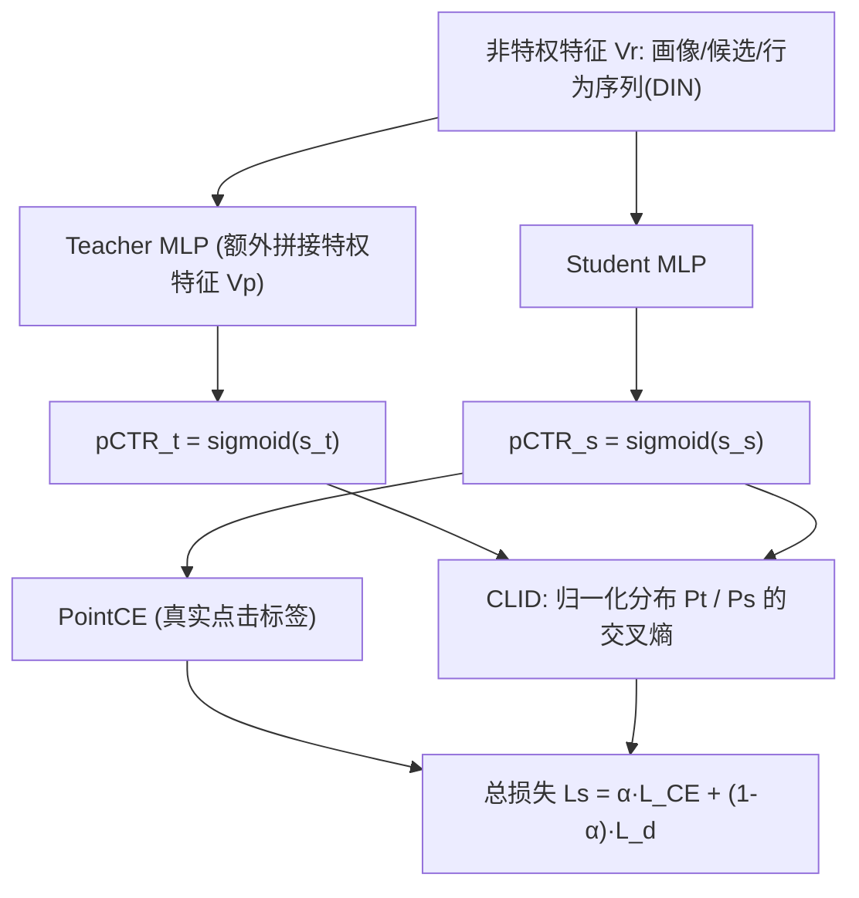

# Calibration-compatible Listwise Distillation of Privileged Features for CTR Prediction (面向 CTR 预估的校准兼容特权特征列表级蒸馏)

- **会议/期刊**: WSDM 2024
- **作者与机构**: Xiaoqiang Gui, Yunfeng Zhao, Guoxian Yu (山东大学软件学院); Yueyao Cheng, Xiang-Rong Sheng, Shuguang Han, Yuning Jiang, Jian Xu, Bo Zheng (阿里巴巴集团)
- **推荐链路定位**: 精排 (Ranking stage CTR 模型训练/服务一致性)
- **研究方向**: CTR/CVR 预估与特征交叉 / 去偏公平、可信隐私与工业架构
- **论文原文**: [arXiv:2312.08727](https://arxiv.org/abs/2312.08727v1)
- **开源代码**: 暂未开源（论文正文仅给出作者自建代码页链接，未托管公开仓库）

## TL;DR (1分钟核心速览)

精排阶段存在"离线可见、线上不可见"的特权特征（如**同页上下文条目、曝光位置、停留时长**），主流做法特权特征蒸馏 (PFD) 用 teacher 预测作软标签，但 pointwise 蒸馏损失忽略同页条目的非 i.i.d. 依赖与相对序，蒸馏不出排序能力；而直接换成 ListNet/ListMLE 又会破坏 pCTR 的概率语义、摧毁校准。本文定义"校准兼容性"性质，证明常用 listwise 损失均不满足，并设计 CLID：把 teacher/student 的 pCTR 各自归一化到概率单纯形后用交叉熵对齐。在 Web30K、Istella-S 与阿里展示广告生产数据的 **Full-List 排序协议**下，CLID 的 NDCG@10 分别达 0.4495 / 0.7084（Istella-S 相对 Base 提升 **+3.23%**，相对 Base+Pointwise **+2.50%**），线上 GAUC 相对 Base **+0.38%** 且 LogLoss 仅 +0.02%。

## Background & Motivation (背景与核心矛盾)

- **主流范式**: 为消除特权特征带来的训练-服务不一致 (covariate shift)，采用 PFD 框架——teacher 吃全量特征、student 只用非特权特征并在线上服务，以 teacher 的 pCTR 作软标签做**逐点交叉熵 (PointCE) 蒸馏**。
- **前人局限 (1)**: pointwise 蒸馏损失基于 i.i.d. 假设，逐条独立优化，完全丢弃了同一页面 (list) 内 teacher 打分形成的**相对序**，因此蒸馏不出排序能力（listwise 语境下 NDCG 收益受限）。
- **前人局限 (2)**: 换成 ListNet / ListMLE 等常用 listwise 损失虽能提升排序，但它们只保留 softmax 相对比例，**不保证与 PointCE 的全局最优点重合**，使 student 输出失去 pCTR 的概率含义，直接损伤校准（在 eCPM = 1000·pCTR·Bid 的竞价计费场景中不可接受）。
- **核心洞察 (Key Insight)**: 另一个流派（PAL / PriDropOut，把特权特征塞进 detached shallow tower、线上丢弃）因输入分布不一致，排序提升无理论保证、校准则大幅崩塌——说明"消除不一致"与"保持校准"必须同时满足，不能牺牲其一。
- **本文切入点**: 先形式化定义蒸馏损失的**校准兼容性**，再用"归一化 pCTR 分布间的交叉熵"这一精心设计的 listwise 算子，同时拿下排序与校准。

## Method (核心方法设计)

### 1. 整体框架 (Overall Architecture)

输入侧由 Base Module 统一承接：离散 ID 经 embedding 层映射为低维向量，用户行为序列经 DIN 池化、与用户画像/候选条目/其他特征拼接得到非特权表示 $\mathbf{V}_r$，$m$个特权特征 embedding 直接拼接为$\mathbf{V}_p$。Teacher 输入$\mathbf{V}_t=[\mathbf{V}_r,\mathbf{V}_p]$、Student 仅输入$\mathbf{V}_r$，两者共享同构 MLP（PReLU + Sigmoid）。训练时 teacher 由 PointCE 监督，student 由 PointCE 与 CLID listwise 蒸馏损失按$\alpha$ 加权；推理时**只保留 student 分支**，因此彻底无线上线下输入分布差异。公开数据集上 teacher 先训好再固定蒸馏，生产环境因数据量巨大采用 teacher/student 同步更新。

### 2. 关键设计拆解 (Key Designs)

1. **校准兼容性的形式化定义（本文的判据基石）**：定义 1 要求蒸馏损失 $L_d$与 student/teacher 各自的 PointCE 能**同时**取全局最小。由于 PointCE 在$\hat{p}_{s,i}=\hat{p}_{t,i}=P_i=\mathbb{E}[y_i\mid q,x_i]$时达到最优（$n_i\to\infty$），故 pointwise 蒸馏（$\hat{p}_{s,i}=\hat{p}_{t,i}$即最小）天然兼容；而 ListNet 的最优点要求$\frac{\exp(s_{s,i})}{\sum_j \exp(s_{s,j})}=\frac{\hat{p}_{t,i}}{\sum_j \hat{p}_{t,j}}$，与$s_{s,i}=\text{logit}(P_i)$ 不等价；ListMLE 是无全局最小的似然损失——二者都**不**满足定义 1。这解释了"排序涨、校准崩"的根因。

2. **CLID 损失：把 listwise 对齐搬到概率单纯形上**：痛点在于 listwise 需要"整页"信息又不能改动 logit 的物理含义。做法是不对 logit 做 softmax，而对**已具概率语义的 pCTR**做归一化投影：

$$P_t(x_i)=\frac{\hat{p}_{t,i}}{\sum_{j=1}^{n}\hat{p}_{t,j}},\qquad P_s(x_i)=\frac{\hat{p}_{s,i}}{\sum_{j=1}^{n}\hat{p}_{s,j}},\qquad L_d^{\text{CLID}}=-\sum_{i=1}^{n}P_t(x_i)\log P_s(x_i)$$

其最优点要求两归一化分布相等；由于最优时 $\hat{p}_{s,i}=\hat{p}_{t,i}=P_i$，两式恒等成立，故与 PointCE 全局最小点重合——**校准兼容性得证**。物理直觉：CLID 只约束"同页内的相对份额"，既注入 teacher 的排序序信息，又不在绝对概率尺度上施加额外拉扯。

3. **训练目标、负采样与推理开销**：student 总损失为 $\mathcal{L}_s=\alpha\,\mathcal{L}_{s,\text{CE}}(y_i,\hat{p}_{s,i})+(1-\alpha)\,\mathcal{L}_d(\hat{p}_{t,i},\hat{p}_{s,i})$，超参以权重比$(1-\alpha)/\alpha$在$\{0.001,\dots,10^{4}\}$ 中搜索（Web30K 取 1，Istella-S 取 100）。全流程为**免负采样**的逐样本/逐列表二元交叉熵，无对比采样、无 in-batch 负例；训练额外成本仅为 teacher 前向（仅训练期），线上推理与 Base 完全一致（单塔 DNN/DIN），**零额外延迟**。

## Experimental Setup & Evaluation Protocol (实验设置与评估协议)

- **数据集与预处理**: 两个 LTR 公开集按惯例把 5 级相关性标签二值化（1–4→1，0→0）作为点击标签；因公开集无位置特征，改用**同 query 下上下文文档特征**作特权特征，以模拟精排阶段"同页条目在线不可见"的场景。

| 数据集 | #Queries (train/valid/test) | #候选文档/Query | #特征 | 正负样本比 | 场景说明 |
| :--- | :---: | :---: | :---: | :---: | :--- |
| Web30K | 31,531 (18,919/6,306/6,306) | ~119 | 136 | 48.6% : 51.4% | 上下文文档特征作特权特征 |
| Istella-S | 33,018 | ~103 | 220 | 17.9% : 82.1% | 同上，正例更稀疏 |
| Production | 数十亿曝光样本 | — | 数百 | 极稀疏 | 阿里展示广告日志 2022/11/16–17，按小时训练、**下一小时**测试 |

- **数据划分与防穿越**: 公开集沿用官方 query 级 train/valid/test 划分（同一 query 内的文档不跨集合，避免列表泄漏）；生产集采用**全局时间戳切分**（逐小时滚动），严格禁止未来曝光信息回流。
- **排名评测协议**: 无偏 **Full-List Ranking**——对每个 query/list 内**全部候选文档**逐条打分后整列表排序，不做负采样，NDCG@10 直接在完整列表上计算；生产集用 GAUC（按用户曝光数加权 AUC），校准用 LogLoss 与 ECE（$K=10$ 分桶）。
- **对比基线与超参**: 6 个基线覆盖 non-PFD（Base、PriDropOut、PAL）与 PFD（Base+Pointwise、Base+ListMLE、Base+ListNet）。排序塔为 3 层 DNN (1024/512/256)，shallow tower 单层 256；输入做 $\text{sign}(x)\log(1+|x|)$变换 + BN，dropout 0.5、weight decay 0.001；公开集重复 5 次并报告 95% 置信区间，采用 student pairwise$t$-test（$p<0.05$，表中以 ◦/• 标注劣/优）。

## Key Experimental Results (实验关键数据)

### 1. 主实验对比 (Main Results)

| 方法 | Web30K NDCG@10↑ | Web30K LogLoss↓ | Web30K ECE↓ | Istella-S NDCG@10↑ | Istella-S LogLoss↓ | Istella-S ECE↓ |
| :--- | :---: | :---: | :---: | :---: | :---: | :---: |
| Base | 0.4478 | 0.6101 | 0.1629 | 0.6862 | 0.1174 | 0.0481 |
| PriDropOut | 0.4472 | 0.6204 | 0.1741 | 0.6922 | 0.1314 | 0.0534 |
| PAL | 0.4491 | 0.6631 | 0.1840 | 0.7070 | 0.1212 | 0.0465 |
| Base+Pointwise | 0.4483 | 0.6095 | 0.1627 | 0.6911 | 0.1129 | **0.0454** |
| Base+ListMLE | 0.4484 | 0.6134 | 0.1627 | 0.7021 | 0.1343 | 0.0588 |
| Base+ListNet | 0.4491 | 0.6095 | 0.1674 | 0.6989 | 0.1178 | 0.0489 |
| **CLID (本文)** | **0.4495** | **0.6090** | **0.1626** | **0.7084** | 0.1175 | 0.0489 |
| Improv. (vs Base) | +0.38% | −0.18% | −0.18% | **+3.23%** | +0.09% | +1.66% |
| Improv. (vs Base+Pointwise) | +0.27% | −0.08% | −0.06% | **+2.50%** | +4.07% | +7.71% |

生产集（仅报相对 Base 的变化）：CLID GAUC **+0.38%** / LogLoss +0.02%；Base+ListNet +0.38% / +0.17%；Base+ListMLE +0.37% / +0.78%；Base+Pointwise +0.04% / 0.00%；PriDropOut +0.32% / **+3.15%**；PAL +0.00% / +2.05%。

### 2. 消融实验 (Ablation Study)

公开集消融以 Istella-S 验证集 100 epoch 的学习曲线呈现（图 3），此处以紧凑表归纳其结论：

| 变体 | 保留的组件 | NDCG@10 表现 | 结论 |
| :--- | :--- | :---: | :--- |
| Base | 无蒸馏 | 最低，且 ~60 epoch 后过拟合回落 | 知识蒸馏可同时缓解过拟合 |
| Base+Pointwise | 蒸馏 + pointwise 损失 | 高于 Base，低于 CLID | listwise 损失本身有增益 |
| SD (CLID) | 自蒸馏（teacher 也仅用非特权特征）+ CLID 损失 | 高于 Base+Pointwise | 增益非仅来自"蒸馏" |
| **PFD (CLID)** | 特权特征 + CLID 损失 | **最高** | 特权特征与 listwise 损失各自独立贡献 |

权重比敏感性（图 4）：$(1-\alpha)/\alpha$在$\{0.001,\dots,10^4\}$上扫描，排序与校准均呈**先升后降**；$(1-\alpha)/\alpha\in[1,100]$ 时取得最佳折中，过大则 PointCE 的标签校准作用被削弱、并放大 teacher 噪声（Web30K 取 1、Istella-S 取 100 印证了数据集依赖）。

### 3. 关键实验发现 (Key Findings)

1. **listwise 化确实带来排序红利，但代价是校准崩塌**：Istella-S 上 Base+ListMLE 把 NDCG@10 从 Base 的 0.6862 推到 0.7021（+2.32%），代价是 LogLoss 从 0.1174 恶化到 0.1343、ECE 从 0.0481 恶化到 0.0588（+22%），定量印证"不满足定义 1 ⇒ 排序涨校准崩"的理论预言。
2. **CLID 是唯一"排序最优 + 校准不退化"的点**：Istella-S 上 NDCG@10 达 0.7084（相对 Base+ListMLE 再 +0.90%，相对 Base+Pointwise +2.50%），同时 LogLoss 0.1175 与 Base 持平；Web30K 上 NDCG@10 0.4495 为全场最优且 LogLoss/ECE 双双优于 Base，说明校准兼容性带来的收益具有跨数据集一致性。
3. **破坏训练-服务一致性的代价远大于收益**：PAL 在 Web30K 上 LogLoss 从 0.6101 恶化至 0.6631、ECE 0.1840（+13%），生产集 PriDropOut 虽拿到 GAUC +0.32%，但 LogLoss 恶化 **+3.15%**，即"用 pCTR 概率语义换取微弱排序收益"在竞价计费场景中不可接受；而 CLID 在同等 GAUC 增益（+0.38%）下 LogLoss 仅 +0.02%。

## Highlights & Limitations (亮点、对比与审稿批判)

- **与代表作对比**: ① vs Xu et al. 的 PFD——同样是 teacher/student 双塔范式，但把蒸馏损失从 pointwise 换为校准兼容的 listwise，直接补上"蒸馏不出排序能力"的短板；② vs PAL / PriDropOut——后两者靠 detached shallow tower 引入特权特征，训练/服务输入分布不一致，排序提升无理论保证且校准崩塌；③ vs Bai et al. 的 RCR——RCR 在 LTR 场景证明 listwise 与 pointwise 共享全局最小，本文把该思想迁移到 PFD 语境并给出契合软标签蒸馏的新损失与兼容性证明。
- **可迁移亮点**: (a) "对已具概率语义的打分做归一化后再算 listwise 交叉熵"这一技巧，可直接移植到序列推荐/重排的教师蒸馏、多场景迁移中的 listwise 对齐；(b) 用"与 PointCE 全局最小点是否重合"作为损失设计判据，是一套可复用的**软标签损失兼容性检查清单**。
- **审稿级局限批判**: ① 校准优势并非普适——Istella-S 上 CLID 的 ECE (0.0489) 仍高于 Base+Pointwise (0.0454) 与 PAL (0.0465)，"保住校准"更接近"不显著变差"，论文对此的讨论偏轻；② 蒸馏损失需对**同页整列表**归一化，对页内条目数 $n$与列表构成的稳定性敏感，长尾/小列表场景下$P_t$估计方差未做分析，且权重比$(1-\alpha)/\alpha$ 需逐数据集调参（1 vs 100 相差两个数量级）；③ 生产集仅报相对 Base 的百分比、无绝对数值与置信区间，GAUC 增益 +0.38% 的线上显著性未交代；④ 代码未公开托管，复现依赖自建页面，工业复现门槛偏高。

## Rating (四维评分)

- **方法创新性 (Novelty)**: ⭐⭐⭐⭐ （把 LTR 的 RCR 校准思想迁移进特权特征蒸馏，定义并证明"校准兼容性"，损失算子简洁但切中"排序 vs 校准"两难）
- **评估协议与实验扎实度 (Protocol & Experiments)**: ⭐⭐⭐⭐ （Full-List 无偏排序 + 5 次重复的 95% CI 与 $t$ 检验，公开集/生产集双验证齐备；扣分于生产集仅报相对值、缺显著性）
- **写作与数学规范度 (Clarity & Rigor)**: ⭐⭐⭐⭐ （定义—反例—构造—证明链条完整，ListNet/ListMLE 不兼容性推导清晰；归一化假设与列表长度相关的论证略显简略）
- **工业落地与复现价值 (Industrial & Practical Value)**: ⭐⭐⭐⭐⭐ （阿里展示广告线上验证，线上推理零额外开销、仅训练期多一个 teacher 前向；未开源托管是唯一落地阻碍）

