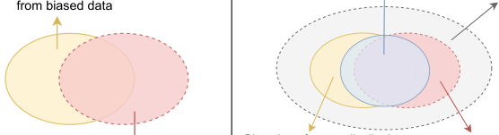
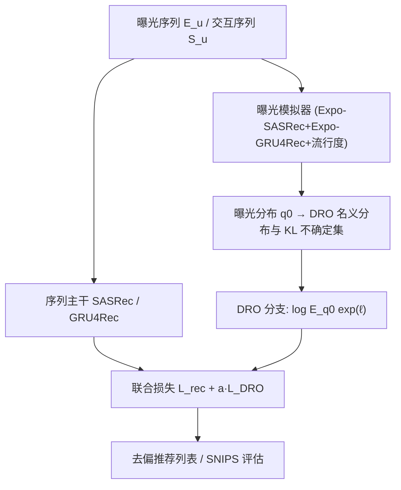

# Debiasing Sequential Recommenders through Distributionally Robust Optimization over System Exposure (基于系统曝光的分布鲁棒优化实现序列推荐去偏)

- **会议/期刊**: WSDM 2024
- **作者与机构**: Jiyuan Yang, Yue Ding, Yidan Wang, Pengjie Ren, Zhumin Chen, Fei Cai, Jun Ma, Rui Zhang, Zhaochun Ren, Xin Xin（山东大学、上海交通大学、国防科技大学、Leiden University 等）
- **推荐链路定位**: 召回（序列召回训练阶段去偏 + 离线评估）
- **研究方向**: 去偏公平、可信隐私与工业架构 / 序列与会话推荐
- **论文原文**: [论文原文链接](https://arxiv.org/abs/2312.07036v1)
- **开源代码**: [开源代码仓库链接](https://github.com/nancheng58/DebiasedSR_DRO)

## TL;DR (1分钟核心速览)

序列推荐器在「系统只曝光过部分物品」的反馈回路上训练，学到的用户偏好与真实偏好存在系统偏移，而既有 IPS 类方法只利用用户交互数据、方差极大且倾向估计不准。本文把**系统曝光数据**显式建模为曝光模拟器（SASRec + GRU4Rec + 流行度混合），以其输出分布作为 DRO 的名义分布与 KL 不确定集中心，并对高曝光物品加罚以抑制偏好高估，同时给出 SNIPS 去偏评估器。在 ZhihuRec / Tenrec 的 SNIPS 全库排序协议下，DRO 相对最优基线 Recall@20 提升 10.7% / 25.9%。

## Background & Motivation (背景与核心矛盾)

- **主流范式**: 序列推荐（GRU4Rec / SASRec 等）以 BCE 在用户点击序列上训练；去偏侧则普遍用 IPS/IPS-C/RelMF，靠**用户交互**反推曝光倾向再重加权。
- **前人局限**: ① 倾向分数只由稀疏点击估计，无界高方差，且忽略系统侧海量「曝光未点击」数据；② 曝光偏差本质是系统认为用户喜欢而用户并不喜欢，导致**偏好高估**，重加权无法刻画这一结构性偏移；③ 离线测试集本身被曝光污染，去偏效果难以公正衡量。
- **核心洞察 (Key Insight)**: 系统曝光分布可视作「系统视角的用户偏好」，它围绕真实偏好波动但不会远离，因此天然适合做 DRO 不确定集的**名义分布**；优化该集合内的最坏情形风险，即可为上界化真实偏好分布上的期望损失。
- **本文切入点**: 用曝光模拟器给出 $q_0$，把 KL 球约束下的 min-max 问题化为可解的单层 log-sum-exp 损失，联合 BCE 训练，模型无关。

<figure class="paper-figure" markdown="span">
  <figcaption>图1：用户偏好分布差距示意图（a）以及我们通过DRO框架提出的解决方案（b）。</figcaption>
</figure>

## Method (核心方法设计)

### 1. 整体框架 (Overall Architecture)

框架分用户侧与系统侧两条支流：用户侧由曝光物品产生有偏点击序列 $S_u$；系统侧用**曝光序列**$E_u$（含曝光未点击）预训练曝光模拟器，推理时改以$S_u$为输入，输出每物品的曝光概率$q_0(S_u,v)$。该分布既作为 DRO 的名义分布构造 KL 不确定集，又作为负样本的加权系数（高曝光 → 大惩罚）。序列推荐主干同时输出推荐打分$P$与共享参数、独立输出层的 DRO 打分$y$，二者经联合损失训练；离线评估则另建一个未见曝光片段上的模拟器给出倾向，代入 SNIPS 估计器。

### 2. 关键设计拆解 (Key Designs)

1. **基于 KL 球的 DRO 闭式化（把不可解 min-max 压成单层损失）**：原始目标为 $\max_{D(q\|q_0)\le\eta}\mathbb{E}_{q}[\ell]$，直接求解是内层无穷维优化。作者取 KL 散度作距离度量，通过变分对偶与 Radon–Nikodym 变换求得闭式解$ \mathcal{L}''_{DRO}(\theta)=\log \mathbb{E}_{(S_u,v)\sim q_0} e^{\ell(S_u,v;\theta)} $，其中$\eta$被吸收进常数项。直觉上 log-sum-exp 会对$q_0$ 下风险最大的样本放大权重，等价于对分布漂移做最坏情形上界，训练比 IPS 的乘性重加权更平滑、方差更低。

2. **高曝光惩罚的代理风险（抑制偏好高估）**：若沿用 BCE，模型仍会拟合被高估的标签。作者定义非对称风险：正样本 $\ell=1-y(S_u,v)$，负样本$\ell=y(S_u,v)$。代入上式后，$q_0$ 采样到的负样本若打分过高就被指数级放大惩罚，恰好对应「系统高曝光但用户不点」的偏差样本；曝光概率越高惩罚越强，从而让模型在热门曝光物品上持保守态度。

3. **训练目标、负采样与推理开销**：最终损失 $\mathcal{L}_{joint}=\mathcal{L}_{rec}+a\sum_{u}\sum_{j}\log\mathbb{E}_{(S_u^{<j},v)\sim q_0}e^{\ell}$，负样本为全物品集$|\mathcal{I}|-1$的全体非正样本（非采样），$a$控制去偏强度。曝光模拟器预训练后参数冻结，推理阶段只额外前向两个轻量序列编码器，主干与常规 SR 一致；$\mathcal{L}''_{DRO}$对$e^\ell$ 的期望在实际中以批内样本蒙特卡洛近似。

## Experimental Setup & Evaluation Protocol (实验设置与评估协议)

- **数据集与预处理**: 序列按时间戳排序，交互序列保留最近 50 个点击、曝光序列保留最近 200 条，不足补 padding。

| 数据集 | #Users | #Items | #Interactions | 稀疏度/密度 | 特征/场景说明 |
| :--- | :---: | :---: | :---: | :---: | :--- |
| ZhihuRec | 7,862 | 9,223 | 771,550 曝光 / 214,853 点击 | 曝光密度 1.09% | 知乎回答推荐，含 show/click 时间 |
| Tenrec | 31,722 | 24,653 | 1,738,116 曝光 / 912,812 点击 | 曝光密度 0.55% | Tenrec 短视频 feed 推荐 |

- **数据划分与防穿越**: 按**用户维度 8:1:1** 划分（train/valid/test，用户完全不重叠，避免同一用户偏好泄露）；曝光数据再切 70% 训练曝光模拟器、30% 训练**独立评估模拟器**，杜绝倾向估计的数据泄漏。
- **排名评测协议**: 采用**去偏 SNIPS 全库排序**（Unbiased Full-Ranking 的加权近似），指标为 SNIPS-Recall@K 与 SNIPS-NDCG@K，$K\in\{5,10,20\}$，倾向权重指数$k=0.1$（$k=1$ 完全无偏但方差过大）。
- **对比基线与超参设置**: 基线含 vanilla GRU4Rec/SASRec、IPS、IPS-C（截断取曝光概率中位数）、RelMF，主干嵌入维度 $d=64$，Adam，学习率 0.005，SASRec 2 头/64 隐维，GRU4Rec 1 层，流行度权重$\beta=0.3$，每个实验重复 3 次取均值。

## Key Experimental Results (实验关键数据)

### 1. 主实验对比 (Main Results)

以 SASRec 为统一主干、ZhihuRec 与 Tenrec 上的 SNIPS 指标：

| Dataset | Method | R@5 | N@5 | R@10 | N@10 | R@20 | N@20 |
| :--- | :--- | :---: | :---: | :---: | :---: | :---: | :---: |
| ZhihuRec | SASRec (None) | 0.0119 | 0.0089 | 0.0162 | 0.0104 | 0.0241 | 0.0123 |
| ZhihuRec | + IPS | 0.0109 | 0.0079 | 0.0210 | 0.0112 | 0.0450 | 0.0171 |
| ZhihuRec | + IPS-C | 0.0151 | 0.0097 | 0.0174 | 0.0104 | 0.0261 | 0.0126 |
| ZhihuRec | + RelMF | 0.0095 | 0.0074 | 0.0138 | 0.0088 | 0.0257 | 0.0116 |
| ZhihuRec | **+ DRO** | **0.0220** | **0.0131** | **0.0322** | **0.0162** | **0.0498** | **0.0205** |
| — | Improv. vs best baseline | +45.7% | +35.1% | +53.3% | +44.6% | +10.7% | +19.9% |
| Tenrec | SASRec (None) | 0.0337 | 0.0216 | 0.0638 | 0.0313 | 0.1044 | 0.0414 |
| Tenrec | + IPS | 0.0365 | 0.0223 | 0.0647 | 0.0314 | 0.1041 | 0.0414 |
| Tenrec | + IPS-C | 0.0410 | 0.0266 | 0.0735 | 0.0370 | 0.1143 | 0.0473 |
| Tenrec | + RelMF | 0.0363 | 0.0238 | 0.0499 | 0.0282 | 0.0752 | 0.0346 |
| Tenrec | **+ DRO** | **0.0517** | **0.0335** | **0.0902** | **0.0457** | **0.1439** | **0.0592** |
| — | Improv. vs best baseline | +26.1% | +25.9% | +22.7% | +23.5% | +25.9% | +25.2% |

### 2. 消融实验 (Ablation Study)

消融聚焦「曝光模拟器构成」这一核心组件（Tenrec，SASRec 主干，Expo-S 为单一 Expo-SASRec，Expo-M 为三模型混合）：

| 设置 | R@5 | N@5 | R@10 | N@10 | R@20 | N@20 |
| :--- | :---: | :---: | :---: | :---: | :---: | :---: |
| SASRec 无去偏 | 0.033 | 0.021 | 0.063 | 0.031 | 0.104 | 0.041 |
| IPS-C + Expo-S | 0.027 | 0.017 | 0.047 | 0.024 | 0.079 | 0.032 |
| DRO + Expo-S | 0.044 | 0.028 | 0.082 | 0.041 | 0.129 | 0.052 |
| IPS-C + Expo-M | 0.041 | 0.026 | 0.073 | 0.037 | 0.114 | 0.047 |
| **DRO + Expo-M** | **0.052** | **0.032** | **0.088** | **0.044** | **0.141** | **0.057** |

### 3. 关键实验发现 (Key Findings)

1. **DRO 的收益依赖主干表达力且与去偏强度耦合**：Tenrec 上 SASRec+DRO 相对 SASRec 的 R@20 提升 +37.8%，但 GRU4Rec+DRO（0.0748）仅略高于 GRU4Rec（0.0735），甚至低于 GRU4Rec+IPS-C（0.0802）——说明鲁棒上界在弱表征下不易转化为排序增益。
2. **曝光模拟器质量是去偏成败的分水岭**：同一 Expo-S 下，IPS-C 从 0.104 直接跌到 0.079（低于无去偏），而 DRO 仍达 0.129；换成 Expo-M 后 DRO 进一步升至 0.141 —— IPS 的乘性权重对倾向误差极度敏感，DRO 的最坏情形上界显著更稳。
3. **去偏强度存在明显甜区与崩塌区**：$a\in[0.01,10]$时 Tenrec（R@20/NDCG@20）持续优于 SASRec，$a\in\{100,1000\}$性能骤降（过度去偏牺牲个性化）；ZhihuRec 上$a=0.01$ 与 SASRec 持平，需按数据重新调参。此外覆盖率实验显示 DRO 的 Coverage@K 全面高于 vanilla SASRec，说明缓解曝光偏差可顺带削弱流行度偏差。

## Highlights & Limitations (亮点、对比与审稿批判)

- **与代表作对比 (vs. Prior Work)**: 相较 IPS / IPS-C / RelMF 仅在**用户交互**上反推倾向，本文首次把「曝光未点击」的系统侧数据显式建模为分布并纳入训练目标；相较 RelMF 的逐样本重加权，DRO 以分布级最坏情形上界替代方差爆炸的乘性权重；相较已有序列去偏工作（如时间感知 IPS），本文额外提供了可验证的 SNIPS 去偏评估闭环。
- **可迁移亮点**: ① 用「名义分布 + KL 球」的 DRO 框架替代 IPS 重加权，可作为任意推荐模型的正则模块；② 用**独立曝光片段**构造评估倾向以规避数据泄漏，这一协议设计对所有离线去偏评测都适用。
- **审稿级局限批判**: ① 曝光模拟器仅为 SASRec/GRU4Rec/流行度的线性 softmax 混合，对多路召回、页级曝光、位置效应的刻画过于简化，模拟误差会直接污染 $q_0$与倾向权重；② DRO 分支需对全物品集计算$e^{\ell}$期望，工业全库规模下的开销与数值稳定性（指数溢出）未被讨论；③ 仅两个中文数据集、无线上 A/B 与显著性检验，$a$ 跨数据集不迁移（0.01 在 ZhihuRec 已无收益）。

## Rating (四维评分)

- **方法创新性 (Novelty)**: ⭐⭐⭐⭐ （首次将 DRO 引入序列曝光去偏，KL 球闭式化为 log-sum-exp 的推导干净，非对称风险与高曝光惩罚的对应关系有清晰物理直觉）
- **评估协议与实验扎实度 (Protocol & Experiments)**: ⭐⭐⭐⭐ （独立曝光片段构造 SNIPS 倾向、用户级不重叠划分有效防泄漏，双数据集双主干覆盖充分；扣分于缺显著性检验与线上验证）
- **写作与数学规范度 (Clarity & Rigor)**: ⭐⭐⭐⭐ （DRO 对偶与 SNIPS 无偏性均在附录给出完整证明，符号统一；但 $q_0$归一化与$\eta$、$\alpha$ 的关系在正文略跳跃）
- **工业落地与复现价值 (Industrial & Practical Value)**: ⭐⭐⭐⭐ （模型无关、可直接套在现有序列召回上，代码与数据处理已开源；曝光模拟器需额外预训练与冻结推理，超大物品集下的期望计算是主要工程门槛）

