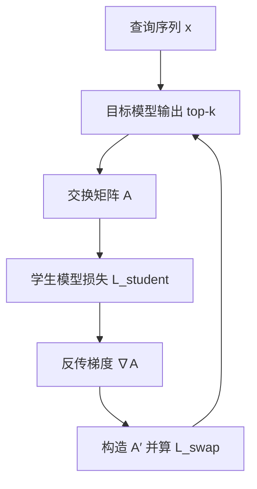
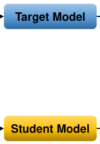

# Defense Against Model Extraction Attacks on Recommender Systems (面向推荐系统模型抽取攻击的梯度排序优化防御)

- **会议/期刊**: WSDM 2024
- **作者与机构**: Sixiao Zhang, Hongzhi Yin, Hongxu Chen, Cheng Long；NTU / University of Queensland
- **推荐链路定位**: 训练阶段防护 / 序列推荐 top-k 输出接口
- **研究方向**: 去偏公平、可信隐私与工业架构 / 序列与会话推荐
- **论文原文**: [论文原文链接](https://arxiv.org/abs/2310.16335v1)
- **开源代码**: [开源代码仓库链接](https://github.com/RinneSz/GRO-Gradient-based-Ranking-Optimization)

## TL;DR (1分钟核心速览)

已有推荐攻击多依赖白盒或外部知识，模型抽取攻击仅靠反复查询即可训练代理模型，却缺乏对应防御。本文提出 GRO：将 top-k 排序转为可微交换矩阵，用学生模型模拟攻击者，并以其损失梯度构造交换损失，迫使目标模型输出“欺骗性排序”。在 ML-1M/ML-20M/Steam 的全库排序协议下，GRO 显著压低代理模型 HR/NDCG，同时基本保持目标模型效用。

## Background & Motivation (背景与核心矛盾)

- **主流范式**: 序列推荐模型（如 Bert4Rec）经查询接口返回 top-k；黑盒模型抽取攻击用合成序列反复查询，以 top-k 为监督训练代理模型。
- **前人局限**: 分类任务防御依赖类别概率或 OOD 查询检测；推荐系统输出离散 top-k，OOD 序列难定义，水印也无法阻止窃取。Random/Reverse 后处理虽可扰动输出，但常以目标效用为代价，或防不住代理模型。
- **核心洞察 (Key Insight)**: 若目标模型训练时主动学习“让代理模型损失变大”的排序，即可在保持自身排序能力的同时污染抽取信号。
- **本文切入点**: 把防御写成双层优化，并利用可微 swap matrix 对 top-k 排序做梯度上升。

## Method (核心方法设计)

### 1. 整体框架 (Overall Architecture)

GRO 在目标序列模型训练阶段加入对抗闭环：目标模型对查询序列输出 top-k，转成 $k\times m$交换矩阵$A$；学生模型仅凭$A$选出的分数计算攻击者损失，反传得到$A$的梯度，据此构造更“毒”的$A'$；再用交换损失拉近目标模型输出与$A'$，同时用原目标损失维持推荐精度。推理时丢弃学生模型，目标模型结构/延迟不变。

<figure class="paper-figure" markdown="span">
  <figcaption>图 1：GRO 的工作流程。目标模型为输入查询生成排序列表。该排序列表被转换为交换矩阵 A。随后将 A 与学生模型的输出相乘，以计算其损失。我们反向传播该损失并获得 A 的梯度，再将其转换为新的交换矩阵 A′。利用 A 和 A′ 计算交换损失，以学习一个能够欺骗学生模型的目标模型。</figcaption>
</figure>

### 2. 关键设计拆解 (Key Designs)

1. **交换矩阵把不可微 top-k 变成可微选择算子**：排序列表是离散的，无法反传。将 top-k 表为 $A\in\{0,1\}^{k\times m}$，其中$A_{i,a_i}=1$、其余为0；学生分数向量$s_g$经$A s_g$后保持目标 top-k 顺序，从而可算攻击者损失并对$A$ 求梯度。
2. **梯度引导的“毒排序”与交换损失**：记 $G=\nabla_A \mathcal{L}_{student}$，令$A'_i=\arg\max_j G_{i,j}$，即每行选梯度最大物品；但直接拟合$A'$ 会产生重复位置并损伤效用，故设计  
$\mathcal{L}_{swap}=\frac{1}{k}\sum_{i=1}^{k}\max\big((A_i-A'_i)^\top s_t+m_{swap},0\big)$。  
引理说明：收敛后，$A'$ 中首次出现的物品保持原排名，重复槽由原 top-k 填充，兼顾欺骗性与效用。
3. **训练目标、负采样与推理效率**：总损失 $\mathcal{L}=\mathcal{L}_{target}+\mathcal{L}_{student}+\lambda\mathcal{L}_{swap}$。学生损失沿用攻击者 margin loss，对 top-k 外采样负例；目标模型用序列交叉熵。推理仅保留目标模型，在线开销不变，但训练需额外学生模型与二阶式反传。

## Experimental Setup & Evaluation Protocol (实验设置与评估协议)

- **数据集与预处理**: 原文未说明额外 5-core 过滤，沿用 Bert4Rec 数据处理。

| 数据集 | #Users | #Items | #Interactions | 稀疏度/密度 | 特征/场景说明 |
| :--- | :---: | :---: | :---: | :---: | :--- |
| ML-1M | 6040 | 3416 | 约 1M | 4.84% | 电影序列推荐 |
| ML-20M | 138493 | 18345 | 约 20M | 0.79% | 大规模电影序列 |
| Steam | 334542 | 13046 | 约 4.2M | 0.10% | 极稀疏游戏行为 |

- **数据划分与防穿越**: `Leave-One-Out`：每序列最后两个物品分别作验证/测试，其余作训练。
- **排名评测协议**: 无偏 `Full-Ranking`，对全库未交互物品排序，而非 100 负例采样；指标为 HR@k、NDCG@k。
- **对比基线与超参**: 仅 3 个基线 None、Random、Reverse；目标模型 Bert4Rec，代理模型同构 Bert4Rec 或异构 NARM；每次查询返回 100 个物品，默认 3000 条合成序列；$\lambda\in\{0.001,0.01,0.1,1\}$，batch 调 {16,32,64,128}；原文未报告显著性检验。

## Key Experimental Results (实验关键数据)

### 1. 主实验对比 (Main Results)

原文结果以柱状图给出，下表数值按图 2 坐标轴估读，仅反映趋势。

| 方法 | ML-1M 目标 HR@10 | ML-1M 代理 HR@10 | ML-20M 目标 HR@10 | ML-20M 代理 HR@10 |
| :--- | :---: | :---: | :---: | :---: |
| None | ≈0.024 | ≈0.008 | ≈0.016 | ≈0.011 |
| Random | ≈0.018 | ≈0.004 | ≈0.012 | ≈0.008 |
| Reverse | ≈0.017 | ≈0.004 | ≈0.011 | ≈0.008 |
| **GRO** | **≈0.023** | **≈0.002** | **≈0.015** | **≈0.004** |
| **Improv. (代理 HR@10)** | — | **↓约75%** | — | **↓约64%** |

Steam 上 GRO 的目标效用略低于 Random/Reverse，但 Random/Reverse 的代理模型接近甚至超过目标模型，防御失效；GRO 仍能明显压低代理模型。

### 2. 消融实验 (Ablation Study)

原文无模块级消融，以下为架构/超参/查询量变体分析。

| 变体/设置 | 目标模型效用 | 代理模型效用 | 结论 |
| :--- | :---: | :---: | :--- |
| 同构 B4R→B4R | 接近 None | GRO 最低 | 最坏同构仍防住 |
| 异构 B4R→NARM | 基本保持 | 明显下降 | 可跨架构迁移 |
| $\lambda=0.001/0.1/1$| 数据集相关 | 波动 | 最优$\lambda$ 与 swap loss 量级接近 |
| 查询数 1k/3k/5k | GRO 优于 Random/Reverse | GRO 稳定压低 | 不依赖固定查询量 |

### 3. 关键实验发现 (Key Findings)

1. 在 ML-1M 上，GRO 将代理 HR@10 从 None 的约 0.008 压到约 0.002，目标 HR@10 仅从约 0.024 降到约 0.023；ML-20M 同向，说明“训练期投毒排序”比后处理随机化更有效。
2. Steam 的极稀疏场景暴露后处理防御缺陷：Random/Reverse 下代理模型接近甚至超过目标模型；GRO 以少量目标效用损失换取代理模型显著下降。
3. 最优 $\lambda$ 随数据变化：ML-20M 约取 1.0、ML-1M 约取 0.1、Steam 约取 0.001，且与收敛 swap loss 量级接近；NARM 代理与 1k/5k 查询量实验也保持防御效果。

## Highlights & Limitations (亮点、对比与审稿批判)

- **与代表作对比 (vs. Prior Work)**: 分类防御 Reverse Sigmoid、bi-level 优化等假设攻击者可看类别概率；推荐 top-k 离散且无概率。水印只追溯不阻止窃取；Random/Reverse 为后处理扰动，易牺牲效用。GRO 首次把推荐模型抽取防御做成训练期可微优化。
- **可迁移亮点**: 交换矩阵将任意 top-k 排序变成可微选择算子，可用于列表级对抗训练、鲁棒排序与黑盒代理攻击模拟。
- **审稿级局限批判**: 训练需额外学生模型与反传，成本高于普通训练；$\lambda$ 靠数据调参且无选择理论；未评估知晓 GRO 的自适应攻击者、查询分数接口或线上 A/B，也未报告显著性检验。

## Rating (四维评分)

- **方法创新性 (Novelty)**: ⭐⭐⭐⭐ （首个推荐模型抽取防御，swap matrix 解决 top-k 不可微问题，机制新颖）
- **评估协议与实验扎实度 (Protocol & Experiments)**: ⭐⭐⭐⭐ （三数据集、全库排序、同构/异构代理较扎实，但基线仅 3 个且缺显著性/自适应攻击）
- **写作与数学规范度 (Clarity & Rigor)**: ⭐⭐⭐⭐ （双层优化与引理表述清晰，$\lambda$ 选择与复杂度分析偏弱）
- **工业落地与复现价值 (Industrial & Practical Value)**: ⭐⭐⭐ （代码开源、推理零改动；训练开销与自适应攻击风险限制落地）

