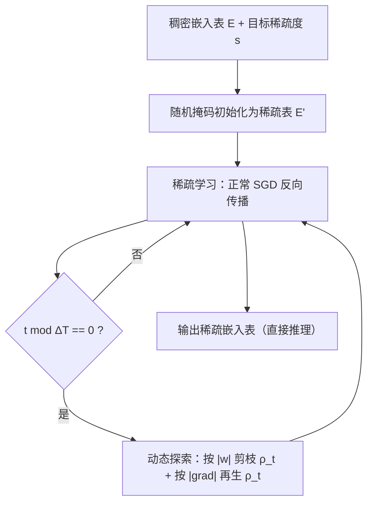

# Dynamic Sparse Learning: A Novel Paradigm for Efficient Recommendation (动态稀疏学习：面向高效推荐的新范式)

- **会议/期刊**: WSDM 2024
- **作者与机构**: Shuyao Wang, Yongduo Sui, Jiancan Wu, Zhi Zheng (USTC), Hui Xiong (HKUST-GZ / HKUST)
- **推荐链路定位**: 召回阶段模型压缩与高效训练（模型无关、即插即用）
- **研究方向**: 去偏公平、可信隐私与工业架构 / 冷启动与长尾推荐
- **论文原文**: [arXiv:2402.02855v1](https://arxiv.org/abs/2402.02855v1)
- **开源代码**: [shuyao-wang/DSL](https://github.com/shuyao-wang/DSL)

## TL;DR (1分钟核心速览)

工业推荐系统的嵌入表随用户/物品数线性膨胀，而现有蒸馏（KD）与剪枝（MP）方案都要先训练稠密模型再压缩，"省推理、费训练"。本文提出 DSL：从一个**随机稀疏掩码**出发，在**训练全程固定参数预算** $s$的前提下，每$\Delta T$ 步按权重幅值剪枝、按梯度幅值再生被剪权重，实现训练与推理双端高效。在 6 个基准数据集、6 个骨干模型上以 **Full-Ranking Recall@20/NDCG@20** 评估，训练 MACs 降低 29.3%–74.4%、推理 MACs 降低 33.2%–75.0%，性能与原稠密模型持平甚至局部反超。

## Background & Motivation (背景与核心矛盾)

- **主流范式**: 高效推荐分三条线——知识蒸馏（TKD/RKD）把大教师模型压到小学生模型；AutoML（AutoEmb/ESAPN）搜索逐用户/逐物品的嵌入维度；模型剪枝（LTH-MRS/PEP）用"训练-剪枝-重训"寻找 winning ticket。
- **前人局限**: ①KD 与 AutoML 都必须先预训练稠密教师/策略网络，训练开销反而增加 49.9%–97.7%（AutoML 甚至 +376%）；②MP 路线如 LTH-MRS 性能尚可，但多轮迭代重训使训练成本 +381.6%，且 PEP 的动态阈值导致训练不稳、性能掉 6.8%–9.0%。
- **核心洞察 (Key Insight)**: 稠密嵌入表对冷门用户/物品存在大量冗余权重，"同维度嵌入"本身就是过参数化；权重重要性在训练中是**随训练状态演化**的，因此掩码不应一次定死，而应在学习过程中被反复修正。
- **本文切入点**: 若能从一开始就在稀疏子网中训练并让模型自己"剪掉/复活"权重，则可同时省掉训练与推理成本（端到端效率），而非只省推理。

## Method (核心方法设计)

### 1. 整体框架 (Overall Architecture)

DSL 是一个模型无关的训练循环包装器：给定稠密嵌入表 $\mathbf{E}\in\mathbb{R}^{(N+M)\times d}$与目标稀疏度$s$，先用随机掩码得到稀疏表$\mathbf{E}'\leftarrow\mathbf{M}\odot\mathbf{E}$（$\lVert\mathbf{M}\rVert_0=\lVert\mathbf{E}\rVert_0(1-s)$），随后进入"稀疏学习 ↔ 动态探索"交替循环：每$\Delta T$步按余弦退火比例$\rho_t$ 执行一次剪枝+再生，其余步正常反向传播。训练结束即得可直接部署的稀疏嵌入表，**无需任何预训练或后剪枝**。

### 2. 关键设计拆解 (Key Designs)

1. **稀疏初始化 + 固定预算（消除"先稠密后压缩"）**：前人必须训练稠密模型才有可靠的剪枝信号，DSL 反其道而行——随机剪到 $s$后直接训练，且**全程固定$s$**，使训练峰值显存与推理成本均为原来的$(1-s)$倍。复杂度分析给出 LightGCN 的总开销从$\mathcal{O}((\lVert\mathbf{A}\rVert_0 L+NM)\cdot d)$降为$\mathcal{O}((\lVert\mathbf{A}\rVert_0 L+NM)\cdot d\cdot(1-s))$，即稀疏性对图卷积与相似度计算的收益是乘性的。

2. **幅值剪枝 + 梯度再生（regret 机制）**：纯随机剪枝（RP）会把重要权重永久丢弃且无法纠错。DSL 每次探索中剪掉 $|w|$最小的$\rho_t$比例权重（沿用 LTH 的幅值准则），同时**监测被剪权重的梯度幅值**，把梯度最大的$\rho_t$ 比例权重重新激活——梯度大意味着该位置一旦解冻就能快速降低损失。剪枝与再生比例严格相等，故预算恒定。这一"复活"机制相当于为贪心剪枝提供后悔补偿，也解释了为何 DSL 能超过稠密基线。

3. **余弦退火更新比例与训练目标**：探索幅度 $\rho_t$ 随训练进程衰减，
$$\rho_t=\frac{\rho_0}{2}\Bigl(1+\cos\Bigl(\frac{\pi t}{T_{\text{end}}}\Bigr)\Bigr),$$
训练早期大幅重构结构、后期小幅微调以保证收敛稳定。总损失即骨干模型原损失（BPR / 交叉熵）在稀疏参数上求导，**无额外正则项、无负采样策略改动、无额外网络参数**；推理时仅前向稀疏嵌入，无任何解码开销。

## Experimental Setup & Evaluation Protocol (实验设置与评估协议)

- **数据集与预处理**: 6 个基准，覆盖小规模与大规模；原文未逐数据集披露精确统计量，下表按标准版本列示（"—"表示原文未给出）：

| 数据集 | #Users | #Items | #Interactions | 稀疏度/密度 | 特征/场景说明 |
| :--- | :---: | :---: | :---: | :---: | :--- |
| MovieLens-1M | 6,040 | 3,706 | ~1.0M | 4.47% | 小规模、电影评分，测 NeuMF/ConvNCF/MultVAE/CDAE |
| CiteUlike | — | — | — | — | 小规模、文献收藏，稀疏度极高 |
| Foursquare | — | — | — | — | 小规模、LBS 签到 |
| Amazon-Book | 52,643 | 91,599 | 2.98M | 0.062% | 大规模、电商图书 |
| Yelp2018 | 31,668 | 38,048 | 1.56M | 0.130% | 大规模、本地生活 |
| Gowalla | 29,910 | 40,981 | 1.03M | 0.084% | 大规模、LBS 签到 |

- **数据划分与防穿越 (Splitting Strategy)**: 沿用 LightGCN 标准的 **Leave-One-Out**（每用户最后一条交互作测试、倒数第二条作验证），训练集仅保留其余交互，属严格时间序切分。
- **排名评测协议 (Ranking Protocol)**: 采用 **Full-Ranking（全库未交互物品排序）**，指标 Recall@20 / HR@20 / NDCG@20；成本侧用 **Training MACs / Inference MACs / Memory(M)** 三项理论乘加量与显存占用度量。
- **对比基线与超参设置**: 三大类共 10 个基线——KD（TKD, RKD）、AutoML（AutoEmb, ESAPN）、MP（RP, OMP, WR, PEP, LTH-MRS）；公平起见统一以同构稠密模型为起点，剪枝类固定 50% 稀疏度、蒸馏类学生模型为教师一半维度。骨干含 NeuMF / ConvNCF / MultVAE / CDAE / LightGCN($l$=3,4) / UltraGCN($d$=64,128)；结果取 5 次随机种子均值±标准差；$\rho_0\in[0.3,0.5]$、$\Delta T\in[2000,20000]$。

## Key Experimental Results (实验关键数据)

### 1. 主实验对比 (Main Results)

Yelp2018 + LightGCN，同压缩率（50% 稀疏 / 学生减半）下的横向对比：

| 类别 | 方法 | MACs(Tr.)$d$=64 | Memory | Recall@20 | NDCG@20 | MACs(Tr.)$d$=128 | Memory | Recall@20 | NDCG@20 |
| :--- | :--- | :---: | :---: | :---: | :---: | :---: | :---: | :---: | :---: |
| 稠密 | Baseline | 4.00e19 | 2103M | 0.0642 | 0.0528 | 8.01e19 | 2399M | 0.0673 | 0.0550 |
| KD | RKD | 6.00e19 | 2103M | 0.0558 | 0.0460 | 1.20e20 | 2399M | 0.0610 | 0.0493 |
| KD | TKD | 6.67e19 | 2103M | 0.0615 | 0.0514 | 1.34e20 | 2399M | 0.0645 | 0.0533 |
| AutoML | AutoEmb | 7.92e19 | 4210M | 0.0627 | 0.0511 | 1.58e20 | 4521M | 0.0654 | 0.0536 |
| AutoML | ESAPN | 1.91e20 | 4364M | 0.0638 | 0.0525 | 3.81e20 | 4675M | 0.0672 | 0.0545 |
| MP | RP (随机剪枝) | 2.67e19 | 1052M | 0.0557 | 0.0458 | 5.34e19 | 1199M | 0.0608 | 0.0498 |
| MP | OMP | 6.67e19 | 2103M | 0.0622 | 0.0509 | 1.33e20 | 2399M | 0.0661 | 0.0542 |
| MP | LTH-MRS | 1.93e20 | 2103M | 0.0635 | 0.0525 | 3.85e20 | 2399M | 0.0666 | 0.0545 |
| MP | **DSL (Ours)** | **2.67e19** | **1052M** | **0.0641** | **0.0527** | **5.34e19** | **1199M** | **0.0675** | **0.0553** |

跨骨干/跨数据集的端到端收益（Table 2 摘选）：

| 骨干 / 数据集 | MACs(Tr.) 稠密 → DSL | MACs(In.) 稠密 → DSL | 核心指标 稠密 → DSL |
| :--- | :---: | :---: | :---: |
| NeuMF / ML-1M | 3.13e13 → 2.09e13 (−33.2%) | 9.68e8 → 6.47e8 | NDCG 0.4478 → **0.4531** |
| ConvNCF / ML-1M | 1.50e15 → 0.38e15 (−74.7%) | 4.65e10 → 1.19e10 | Recall 0.7745 → **0.7990** |
| MultVAE / Foursquare | 4.61e13 → 3.69e13 (−20.0%) | 2.24e11 → 1.79e11 | NDCG 0.1639 → 0.1485 (−9.4%) |
| LightGCN($l$=3) / Amazon-Book | 1.59e20 → 0.95e20 (−40.3%) | 6.88e13 → 4.14e13 | Recall 0.0414 → **0.0416** |
| LightGCN($l$=4) / Yelp2018 | 5.34e19 → 3.34e19 (−37.5%) | 4.42e13 → 2.77e13 | Recall 0.0649 → **0.0651** |
| UltraGCN($d$=128) / Amazon-Book | 9.85e13 → 5.18e13 (−47.4%) | 1.25e12 → 0.31e12 | Recall 0.0712 → **0.0727** |

### 2. 消融实验 (Ablation Study)

| 消融维度 | 设置 | Amazon-Book Recall | Yelp2018 Recall | Gowalla Recall |
| :--- | :--- | :---: | :---: | :---: |
| 退火函数 (Table 4) | Cosine（默认） | **0.0406** | **0.0641** | **0.1812** |
| | Linear | 0.0409 | 0.0638 | 0.1803 |
| | No decay | 0.0394 | 0.0618 | 0.1773 |
| 更新间隔 $\Delta T$ (Fig.3 左) | 过小（<1000） | 参数未充分收敛即改结构，性能下降 | | |
| | 2000–20000（推荐） | 峰值区间 | | |
| | $\to\infty$（退化为 RP） | 最低（RP 同预算下掉 9.7%–13.2%） | | |
| 初始比例 $\rho_0$ (Fig.3 右) | <0.1 | 探索幅度过小，结构难改进 | | |
| | 0.3–0.5（推荐） | 峰值区间 | | |
| | >0.7 | 破坏关键权重，训练不稳 | | |

### 3. 关键实验发现 (Key Findings)

1. **"能不能改结构"比"剪多狠"更决定性能**：同预算（50% 稀疏、1052M 显存）下，静态随机剪枝 RP 的 Recall 掉到 0.0557（−13.2%），而 DSL 的 0.0641 与稠密基线 0.0642 基本无损，说明随机子网本身是"坏架构"，动态剪枝/再生才是增益来源。
2. **端到端效率是真差异，而非精度换成本**：LTH-MRS 精度与 DSL 相当（0.0635 vs 0.0641），但训练 MACs 高达 1.93e20（+381.6%）；DSL 仅 2.67e19（−33.3%）。在 d=128 上 DSL 反而全面超过稠密基线（Recall 0.0675 > 0.0673），验证"再生梯度大的权重"能发现优于原架构的子网。
3. **稀疏分布自发对齐流行度，等价于免搜索的非均匀嵌入维度**：按流行度分组统计（Fig.4），热门用户/物品的嵌入稀疏度显著更低（更稠密），冷门节点被大幅剪枝——DSL 在固定总预算下自动复现了 AutoEmb/ESAPN 追求的"热节点大维度、冷节点小维度"，但无需任何搜索空间与控制器。

## Highlights & Limitations (亮点、对比与审稿批判)

- **与代表作对比 (vs. Prior Work)**: 相较 LTH-MRS 的"多轮 train-prune-retrain"三段式，DSL 把剪枝嵌进训练循环，用单次训练同时完成结构搜索与参数学习；相较 PEP 的可学习阈值（训练不稳、掉点 6.8%），DSL 用固定预算 + 等比剪枝/再生保证预算可控；相较 AutoEmb/ESAPN，DSL 无额外控制器、无人工搜索空间，显存反而低于稠密基线（1052M vs 2103M）。
- **可迁移亮点**: ①"梯度最大即复活"的 regret 式再生长准则可直接搬到 GNN 邻接表稀疏化、序列模型大词表 embedding 剪枝、多模态塔的模态内稀疏；②余弦退火更新比例 $\rho_t$ 是一种通用的"早期大改、后期微调"结构搜索调度器，可复用于 NAS/稀疏化联合训练。
- **审稿级局限批判**: ①只稀疏**嵌入表**，MLP/交互层参数未压缩，对 LightGCN 类纯嵌入模型收益最大，对 DCN/深度交叉模型收益会被稀释；②元素级非结构化稀疏在 GPU 上无稀疏 kernel 就无法转化为真实墙钟加速，论文只报告理论 MACs，缺少 latency/吞吐实测；③$\Delta T$与$\rho_0$ 需按骨干与数据集调参，且 UltraGCN 在 Gowalla 上从 0.1858 掉到 0.1742（−6.3%），说明并非所有骨干都能无损稀疏。

## Rating (四维评分)

- **方法创新性 (Novelty)**: ⭐⭐⭐⭐ （把"从零训练稀疏子网"与周期性幅值剪枝/梯度再生结合，范式上真正消除预训练依赖，但剪枝与退火组件本身均为已有技术的巧妙组合，理论支撑限于复杂度分析而非收敛性证明）
- **评估协议与实验扎实度 (Protocol & Experiments)**: ⭐⭐⭐⭐ （6 数据集 × 6 骨干 + 10 个跨类别基线 + Full-Ranking + 5 次种子均值方差，覆盖全面；扣分点在于未做显著性检验、部分数据集统计量未披露、缺少真实时延与线上 A/B）
- **写作与数学规范度 (Clarity & Rigor)**: ⭐⭐⭐⭐ （三阶段流程与 Algorithm 1 清晰，$\rho_t$ 公式与 complexity 分析简洁到位；但 winning ticket 定义与实际算法之间缺少严格对应证明，成本仅以 MACs 估计略显单薄）
- **工业落地与复现价值 (Industrial & Practical Value)**: ⭐⭐⭐⭐ （代码已开源、模型无关即插即用、显存直接减半，对 embedding-dominated 的召回/双塔场景落地价值高；但需自建稀疏算子或结合结构化稀疏才能在服务端兑现加速）

