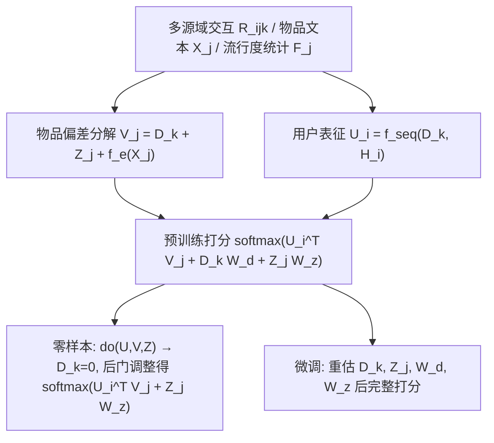
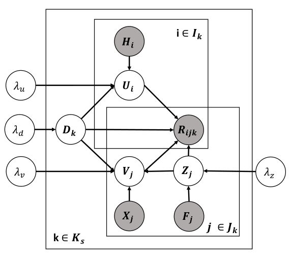

# Pre-trained Recommender Systems: A Causal Debiasing Perspective（预训练推荐系统：因果去偏视角的框架）

- **会议/期刊**: WSDM 2024
- **作者与机构**: Ziqian Lin, Hao Ding, Nghia Trong Hoang, Branislav Kveton, Anoop Deoras, Hao Wang（UW-Madison / AWS AI Labs / WSU）
- **推荐链路定位**: 召回（通用物品/用户表征 + 零样本迁移）
- **研究方向**: 去偏公平与工业架构 / 跨域与多场景推荐
- **论文原文**: [https://arxiv.org/abs/2310.19251v4](https://arxiv.org/abs/2310.19251v4)
- **开源代码**: [https://github.com/myhakureimu/PreRec](https://github.com/myhakureimu/PreRec)

## TL;DR (1分钟核心速览)

跨域预训练推荐的通用交互模式常被两类偏差掩盖：域内流行度偏差（热门物品冒充用户兴趣）和跨域隐式偏差（各地用户社区/品类/促销策略差异）。本文提出层次贝叶斯深度模型 PreRec，用显式混杂因子 $Z_j$（流行度）与隐式混杂因子$D_k$（域属性）显式建模两类偏差，并在零样本推理时对$U_i,V_j,Z_j$ 做 do-calculus 因果干预去除跨域偏差、保留目标域流行度。在 XMarket 跨市场与 Online Retail 跨平台协议下，Recall@K% 达 0.1036（澳洲，+87.7%）、0.1794（跨平台，+28.4%）。

## Background & Motivation (背景与核心矛盾)

- **主流范式**: ZESRec / UniSRec 用物品文本描述（Sentence-BERT）构建通用物品表征、序列模型聚合用户表征，在多域上预训练后零样本迁移到新域。
- **前人局限**: ① UniSRec 仅靠跨域对比学习，未处理域内流行度偏差与跨域分布漂移，在源域上过拟合噪声；② 物品 ID 嵌入是 transductive 的，且各域元数据 schema 不同，无法直接迁移。
- **核心洞察 (Key Insight)**: 跨域数据的偏差来源可正交拆分为「域内偏差（每物品独有，如流行度）」与「跨域偏差（域内所有用户/物品共享，如用户社区、促销活动）」，二者可用一个共享潜变量 + 一个物品级潜变量分别吸收，从而把「知识」与「偏差」解耦。
- **本文切入点**: 把偏差项作为因果混杂因子写入概率图模型，预训练时显式建模、推理时用后门调整把它们从打分函数中"减掉"。

## Method (核心方法设计)

### 1. 整体框架 (Overall Architecture)

输入为多源域交互 $R_{ijk}$、物品文本$X_j$与在线可得的流行度统计$F_j$。物品侧$f_e(\cdot)$= 多语言 Sentence-BERT + MLP 得通用物品嵌入$m_j$；用户侧$f_{seq}(\cdot)$= Transformer 解码器，域先验$D_k$被 padding 到序列首位充当"该域用户的先验行为模式"。物品隐向量按「域偏差 + 流行度偏差 + 内容语义」三项加性组装，用户隐向量按「域先验 + 历史序列」组装，打分经 softmax 后做 MAP 训练。三阶段工作流：多域预训练 → 目标域零样本（$D_k=0$干预）→ 目标域微调（重估$D_k$ 并恢复完整打分项）。

<figure class="paper-figure" markdown="span">
  <figcaption>图 1：我们 PreRec 的概率图模型（PGM）。U𝑖 和 H𝑖 分别表示用户 𝑖 及相应用户历史；V𝑗、X𝑗 和 Z𝑗 分别表示物品 𝑗、其文本描述（如电影简介）及其流行度效应；F𝑗 表示影响物品流行度的所有显著因素；D𝑘 表示领域 𝑘。𝐾𝑠 表示所有源领域，而 𝐽𝑘、𝐼𝑘 分别表示领域 𝑘 中的所有物品和所有用户。𝜆𝑢、𝜆𝑣、𝜆𝑑、𝜆𝑧 为与分布方差相关的超参数。</figcaption>
</figure>

### 2. 关键设计拆解 (Key Designs)

1. **双混杂因子分解（显式流行度 + 隐式域属性）**：痛点是把偏差与知识混在一起训练导致过拟合。本文令 $Z_j=f_{pop}(F_j)+\epsilon_{zj}$（显式、可解释）、$D_k\sim\mathcal{N}(0,\lambda_d^{-1}I)$（隐式、无监督），并把物品隐向量写成$V_j=\epsilon_{vj}+D_k+Z_j+m_j$。因为$D_k$被域内所有用户/物品共享，而$Z_j$是物品级的，梯度会自然把"共享分量"压进$D_k$、把"物品流行分量"压进$Z_j$，实现无监督解耦。
2. **跨域可比的流行度因子（p 次幂均值归一化）**：不同域的流量规模与物品总量差异使原始交互计数不可比。作者用前一时间窗的计数 $c_{T_l j}$除以幂均值归一化项$s_{T_l w}=\big(\sum_{j\in J_k}(c_{T_l j})^w/|J_k|\big)^{1/w}$构造$F_j$的每一维，使"占用率"在不同域间可比，再用$f_{pop}$映射到$Z_j$；同时用前一窗口统计防止时间泄漏。
3. **训练目标、去偏干预与推理开销**：总损失为负对数后验，即逐样本交叉熵（域内物品上 softmax）+ 四个高斯先验正则：
$\mathcal{L}=\sum_{k,i,j}-\log f_{softmax}(U_i^{\top}V_j+D_kW_d+Z_jW_z)+\frac{\lambda_z}{2}\|Z_j-f_{pop}(F_j)\|^2+\frac{\lambda_v}{2}\|V_j-f_e(D_k,Z_j)\|^2+\frac{\lambda_u}{2}\|U_i-f_{seq}(D_k,H_i)\|^2+\frac{\lambda_d}{2}\|D_k\|^2$。
零样本时执行 $do(U_i=f_{seq}(0,H_i))$、$do(Z_j=f_{pop}(F_j))$，代入后门公式后$D_k$项在 softmax 分子分母中约去，得$P(R_{ijk}|do(\cdot))=f_{softmax}(U_i^{\top}V_j+Z_jW_z)$——即"丢弃源域域偏差、保留由目标域实时统计得到的流行度偏差"。负采样采用域内物品上的 categorical（softmax）采样；推理仅需一次文本编码 + Transformer 前向，无额外近邻检索开销。

## Experimental Setup & Evaluation Protocol (实验设置与评估协议)

- **数据集与预处理**（用户按 4:3:3 随机切分，具体规模见原文附录）：

| 数据集 | 角色 | #Domains | 说明 |
| :--- | :--- | :---: | :--- |
| XMarket | 源域 | 3 | India / Spain / Canada，16 类商品的跨市场电商数据 |
| XMarket | 目标域（跨市场） | 4 | Australia / Mexico / Germany / Japan |
| Online Retail | 目标域（跨平台） | 1 | 英国电商平台，与 XMarket 无重叠 |

- **数据划分与防穿越**: 每域内用户随机 4:3:3 划分 train/valid/test；额外过滤掉与源域重叠的用户与物品，构造 `unseen test set` 以严格评估零样本泛化；目标域测试集同时报告 all / unseen 两种口径。
- **排名评测协议**: 以"下一个交互物品"为单一目标，对域内全部物品做 **Full-Ranking**（非采样排序），报告 `Recall@K%` 与作者提出的 `r-NDCG@K%`：$\text{r-NDCG}=\log a/\log\big(a+b\cdot\frac{rank-1}{N}\big)$，以物品数$N$归一化折扣，避免小物品域主导早停。超参$a=2,b=15000$；跨市场$K\%=0.04\%$、跨平台$K\%=0.5\%$。
- **对比基线与超参**: 不可学习基线 Random / POP / SBERT；可学习零样本基线 ZESRec、UniSRec；域内基线 GRU4Rec、SASRec（微调实验，从零训练）。物品/用户隐维统一为 $B$，用验证集平均 r-NDCG@K% 早停。PreRec$_n$ 为去掉两个偏差项的消融版本。

## Key Experimental Results (实验关键数据)

### 1. 主实验对比 (Main Results｜零样本，all 口径)

| 数据集 | 指标 | Random | POP | SBERT | ZESRec | UniSRec | PreRec$_n$ | **PreRec** | Improv.% |
| :--- | :--- | :---: | :---: | :---: | :---: | :---: | :---: | :---: | :---: |
| Australia | Recall@K% | 0.0004 | 0.0450 | 0.0552 | 0.0431 | 0.0404 | 0.0583 | **0.1036** | +87.7% |
| Australia | r-NDCG@K% | 0.0002 | 0.0261 | 0.0380 | 0.0287 | 0.0281 | 0.0396 | **0.0656** | +72.6% |
| Mexico | Recall@K% | 0.0004 | 0.0695 | 0.1509 | 0.1397 | 0.1521 | 0.1645 | **0.2316** | +40.8% |
| Mexico | r-NDCG@K% | 0.0002 | 0.0388 | 0.1095 | 0.0961 | 0.1134 | 0.1178 | **0.1557** | +29.7% |
| Germany | Recall@K% | 0.0004 | 0.1514 | 0.2737 | 0.2639 | 0.2703 | 0.2827 | **0.3526** | +24.7% |
| Germany | r-NDCG@K% | 0.0002 | 0.0936 | 0.2103 | 0.1886 | 0.2100 | 0.2103 | **0.2576** | +22.5% |
| Japan | Recall@K% | 0.0004 | 0.0657 | 0.2926 | 0.2259 | 0.2579 | 0.2817 | **0.3083** | +5.4% |
| Japan | r-NDCG@K% | 0.0002 | 0.0376 | 0.2016 | 0.1514 | 0.1776 | 0.1929 | **0.2033** | +0.8% |
| Online Retail | Recall@K% | 0.0050 | 0.0672 | 0.1383 | 0.0564 | 0.1147 | 0.1397 | **0.1794** | +28.4% |
| Online Retail | r-NDCG@K% | 0.0025 | 0.0362 | 0.0848 | 0.0316 | 0.0698 | 0.0841 | **0.1065** | +25.6% |

**全量微调对比（Recall@K% / r-NDCG@K%）**：Australia PreRec **0.1130/0.0715** vs SASRec$^*$0.0735/0.0495（+53.7%）；Germany **0.3935/0.2964** vs SASRec$^*$0.3428/0.2726；Japan **0.3813/0.2601** vs SASRec$^*$0.3645/0.2554；Online Retail **0.2992/0.1769** vs SASRec$^*$0.2728/0.1665；Mexico 0.2646/0.1825 vs SASRec$^*$ 0.2475/0.1813。UniSRec 微调后与域内模型持平（如 Online Retail 0.2513 < SASRec 0.2728）。

### 2. 消融实验 (Ablation｜PreRec vs. PreRec$_n$，Recall@K%)

| 配置 | Australia | Mexico | Germany | Japan | Online Retail |
| :--- | :---: | :---: | :---: | :---: | :---: |
| PreRec$_n$（无偏差项） | 0.0583 | 0.1645 | 0.2827 | 0.2817 | 0.1397 |
| **PreRec（双偏差 + 干预）** | **0.1036** | **0.2316** | **0.3526** | **0.3083** | **0.1794** |
| 相对增益 | +77.7% | +40.8% | +24.7% | +9.4% | +28.4% |
| BB（unseen 口径） | 0.0756 | 0.1469 | 0.2750 | 0.2741 | — |

### 3. 关键实验发现 (Key Findings)

1. **去偏项贡献远大于"是否预训练"**：仅去掉 $D_k,Z_j$的 PreRec$_n$ 在澳洲就从 0.1036 掉到 0.0583，甚至与不可学习的 SBERT（0.0552）几乎同水平——说明没有偏差分离的多域预训练几乎不带来增益，甚至不如直接用文本语义相似度。
2. **增益与源-目标域同质性正相关**：Australia（与最大源域 Canada 兴趣重合、英语）增益 +87.7%，Germany（同语言）+24.7%，Japan（无同语言源域、文化差异大）仅 +5.4%，r-NDCG 近乎持平，暴露了"通用知识"在文化远域上的迁移上限。
3. **零样本在冷启物品上仍占优，但优势收窄**：unseen 口径下澳洲 0.0756 vs SBERT 0.0619 仍领先，然而 Mexico unseen（0.1469）微低于 PreRec$_n$（0.1487），说明新物品缺目标域流行度统计时$Z_j$ 会引入负向噪声；微调阶段 PreRec 在 1e4 量级样本下仍显著领先（图 3），但差距随数据量增加而递减。

## Highlights & Limitations (亮点、对比与审稿批判)

- **与代表作对比**: ZESRec 只做单源单目标、以 GRU 聚合；UniSRec 引入跨域对比学习但仍把偏差与知识一起学（本文实测其微调后甚至不如域内 SASRec）；本文的核心差异是把"偏差"写成概率图里可识别的混杂因子并在推理期显式干预，而非靠数据增广或对比正则"洗掉"偏差。
- **可迁移亮点**: ① 用 p 次幂均值归一化的流行度因子 $F_j$使不同流量域的"占用率"可比，可直接用于跨业务线 popularity 特征对齐；② 域先验$D_k$ 作为可学习 padding token 注入序列模型首位，是极低成本的"域条件化"手段；③ r-NDCG 的按物品数归一化折扣，可作为多域联合训练时早停/模型选择的通用指标。
- **审稿级局限批判**: ① 物品隐向量采用 $D_k+Z_j+m_j$纯加性组装，无法刻画"域 × 流行度"交互效应（如某域促销只对特定品类生效）；② 零样本以$D_k=0$近似对$D_k$先验求期望，作者仅以"实践中效果相近"一笔带过，缺少更严格的期望近似或采样估计对照；③ 评估用随机用户切分而非全局时间戳，且仅以单个 next-item 为排名目标，召回口径$K\%=0.04\%$极小、$b=15000$ 手工设定，跨域可比性依赖该超参；④ 未报告显著性检验，Japan 上 +0.8% r-NDCG 的提升是否显著存疑。

## Rating (四维评分)

- **方法创新性 (Novelty)**: ⭐⭐⭐⭐ （把域内/跨域偏差写成显式/隐式混杂因子并在贝叶斯图模型中可识别、推理期后门调整，视角新颖且与流行度去偏文献自然衔接）
- **评估协议与实验扎实度 (Protocol & Experiments)**: ⭐⭐⭐⭐ （跨市场+跨平台、all/unseen 双口径、零样本/增量/全量微调三设置齐全，但缺显著性检验且随机用户切分弱于时间切分）
- **写作与数学规范度 (Clarity & Rigor)**: ⭐⭐⭐⭐ （生成过程、后门推导与损失函数链条完整清晰，$D_k=0$ 的近似与加性分解假设交代较轻）
- **工业落地与复现价值 (Industrial & Practical Value)**: ⭐⭐⭐⭐ （代码与多语言 SBERT 权重均开源；只需文本描述即可跨平台冷启，流行度统计实时可得，工程成本低）

