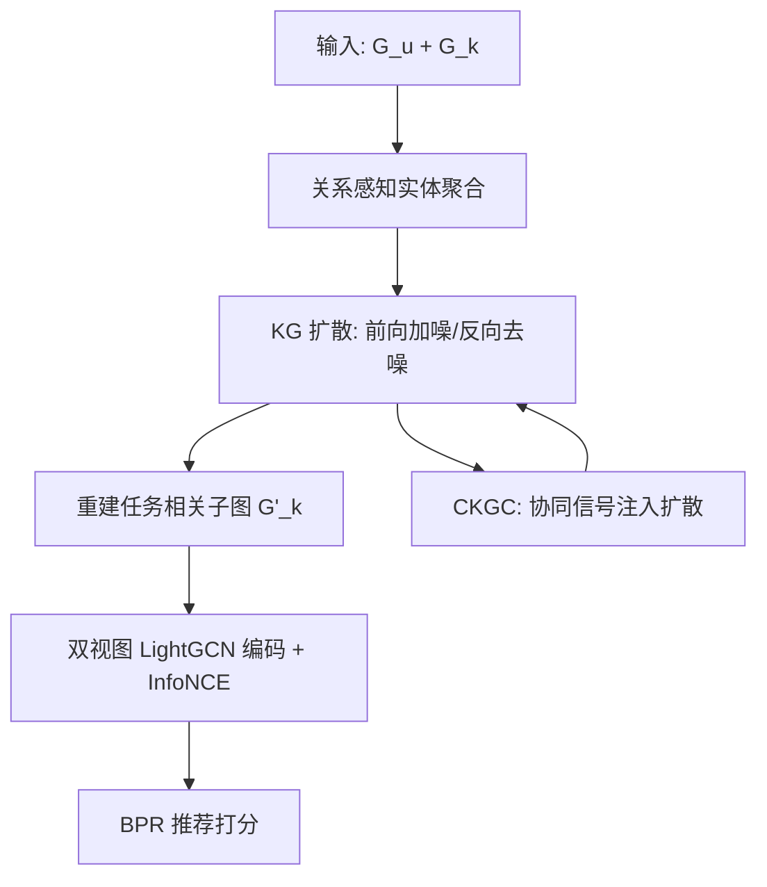
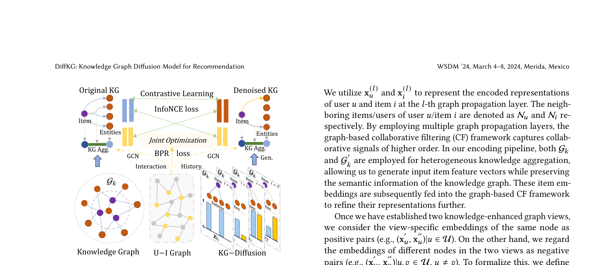
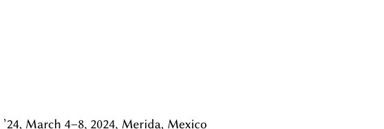

# DiffKG: Knowledge Graph Diffusion Model for Recommendation（知识图谱扩散推荐模型）

- **会议/期刊**: WSDM 2024 (Oral)
- **作者与机构**: Yangqin Jiang, Yuhao Yang, Lianghao Xia, Chao Huang；University of Hong Kong
- **推荐链路定位**: 召回（KG-enhanced top-N candidate retrieval）
- **研究方向**: 图神经网络与知识图谱推荐 / 自监督对比学习与交互去噪
- **论文原文**: [https://arxiv.org/abs/2312.16890v1](https://arxiv.org/abs/2312.16890v1)
- **开源代码**: [https://github.com/HKUDS/DiffKG](https://github.com/HKUDS/DiffKG)

## TL;DR (1分钟核心速览)

知识图谱推荐常被无关实体关系污染：KGAT/KGIN 全量聚合、KGCL 随机增广都未显式过滤任务无关边。DiffKG 用扩散模型对 KG 邻接关系做“加噪—去噪—重建”，生成任务相关子图 $G'_k$，再用协同知识图卷积把用户-物品监督注入扩散，并以双视图对比学习增强表征。三数据集 Full-Ranking 下 Recall@20 较最优基线提升 7.7%–43.4%。

## Background & Motivation (背景与核心矛盾)

- **主流范式**: KG-aware 推荐以 GNN 在用户-物品-实体图上传播聚合，或引入对比学习构造多视图。
- **前人局限**: ① KG 存在长尾与主题无关边，KGAT/KGIN 直接聚合会引入噪声；② KGCL/MCCLK 依赖随机图增广或直观跨视图对比，无法区分“任务相关”与“任务无关”关系。
- **核心洞察 (Key Insight)**: 只有部分 KG 关系对推荐任务有益；扩散的“破坏—重建”过程可学习关系去噪，同时保留 KG 结构信息。
- **本文切入点**: 用扩散生成推荐相关子图，并以协同信号指导去噪，实现 KG 语义与 CF 关系的对齐。

## Method (核心方法设计)

### 1. 整体框架 (Overall Architecture)

输入用户-物品图 $G_u$与知识图谱$G_k$。先经关系感知注意力聚合实体，得到知识增强物品表征；再对每个物品的 KG 邻接向量$\boldsymbol{\chi}_0$执行前向加噪与反向去噪，按 top-$k$关系重建任务相关子图$G'_k$。随后分别以$G_k$与$G'_k$ 构造两个 KG 视图，用 LightGCN 式传播编码用户/物品，并以 InfoNCE 对齐同节点双视图。最终联合 BPR、对比损失与扩散 ELBO/CKGC 损失训练。

<figure class="paper-figure" markdown="span">
  <figcaption>图1：所提出 DiffKG 模型的整体框架。</figcaption>
</figure>

图1给出 DiffKG 从异构知识聚合、KG 扩散到对比增广的整体闭环。

### 2. 关键设计拆解 (Key Designs)

1. **KG 扩散生成任务相关子图**：针对 KG 噪声边，前向过程对关系向量加高斯噪声，$q(\boldsymbol{\chi}_t|\boldsymbol{\chi}_{t-1})=\mathcal{N}(\boldsymbol{\chi}_t;\sqrt{1-\beta_t}\boldsymbol{\chi}_{t-1},\beta_t\mathbf{I})$；闭式采样为$q(\boldsymbol{\chi}_t|\boldsymbol{\chi}_0)=\mathcal{N}(\boldsymbol{\chi}_t;\sqrt{\bar{\alpha}_t}\boldsymbol{\chi}_0,(1-\bar{\alpha}_t)\mathbf{I})$。网络学习预测$\hat{\boldsymbol{\chi}}_0$，训练目标为$\mathcal{L}_{elbo}=\mathbb{E}_{t\sim U(1,T)}[\frac12(\frac{\bar{\alpha}_{t-1}}{1-\bar{\alpha}_{t-1}}-\frac{\bar{\alpha}_t}{1-\bar{\alpha}_t})\|\hat{\boldsymbol{\chi}}_\theta(\boldsymbol{\chi}_t,t)-\boldsymbol{\chi}_0\|_2^2]$。推理时从部分破坏的$\boldsymbol{\chi}_{T'}$出发确定性反演，避免纯噪声毁坏 KG 结构，再取 top-$k$关系重建$G'_k$。

<figure class="paper-figure" markdown="span">
  <figcaption>图2：结合知识图谱的扩散模型。</figcaption>
</figure>

图2展示 KG 加噪/去噪与子图重建流程。

2. **协同知识图卷积 CKGC**：仅优化关系重建不等于优化推荐。CKGC 将预测关系 $\hat{\boldsymbol{\chi}}_0$与用户-物品交互矩阵$\mathbf{A}$聚合，再与用户表征$\mathbf{E}_u$作用得到物品表征，并用 MSE 对齐原物品表征：$\mathcal{L}_{ckgc}=\|(\mathbf{A}\hat{\boldsymbol{\chi}}_0^\top)^\top\mathbf{E}_u-\mathbf{E}_i\|_2^2$。其直觉是让 CF 监督反向筛选 KG 边，使去噪后的子图更贴合用户偏好。

3. **训练目标、负采样与推理效率**：推荐侧用 BPR 的未观测物品负采样，并加 KG 双视图 InfoNCE：$\mathcal{L}_{cl}^{u}=\sum_{u\in\mathcal{U}}-\log\frac{\exp(s(\mathbf{x}'_u,\mathbf{x}''_u)/\tau)}{\sum_{v\in\mathcal{U}}\exp(s(\mathbf{x}'_u,\mathbf{x}''_v)/\tau)}$。总损失为$\mathcal{L}_{rec}=\mathcal{L}_{bpr}+\lambda_1\mathcal{L}_{cl}+\lambda_2\|\Theta\|_2^2$，扩散侧为$\mathcal{L}_{kgdm}=(1-\lambda_0)\mathcal{L}_{elbo}+\lambda_0\mathcal{L}_{ckgc}$。扩散步取$T=5$，推理步$T'=0$，兼顾效果与开销。

## Experimental Setup & Evaluation Protocol (实验设置与评估协议)

- **数据集与预处理**: 采用 10-core 过滤用户/物品，KG 分别来自 Freebase、Wikidata 与类目构建。

| 数据集 | #Users | #Items | #Interactions | 密度 | KG 三元组/场景 |
| :--- | :---: | :---: | :---: | :---: | :--- |
| Last-FM | 23,566 | 48,123 | 3,034,796 | 2.7e-3 | 464,567 / 音乐 |
| MIND | 100,000 | 30,577 | 2,975,319 | 9.7e-4 | 148,568 / 新闻 |
| Alibaba-iFashion | 114,737 | 30,040 | 1,781,093 | 5.2e-4 | 279,155 / 电商 |

- **数据划分与防穿越**: 原文正文仅明确 10-core 过滤与 Full-Ranking 评测，未展开划分细节；具体训练/测试切分应以开源代码为准，避免把测试交互用于构图。
- **排名评测协议**: 采用无偏 `Full-Ranking`（全库未交互物品排序），报告 `Recall@20` 与 `NDCG@20`。
- **对比基线与超参**: 覆盖 BPR/NeuMF/GC-MC/LightGCN/SGL、CKE/KTUP、KGNN-LS/KGCN/KGAT/KGIN、MCCLK/KGCL。最佳超参为 $\lambda_1=1,\tau=1,T=5,T'=0$；原文未报告$p$ 值或方差显著性。

## Key Experimental Results (实验关键数据)

### 1. 主实验对比 (Main Results)

| Model | Last-FM R@20 | Last-FM N@20 | MIND R@20 | MIND N@20 | Alibaba R@20 | Alibaba N@20 |
| :--- | :---: | :---: | :---: | :---: | :---: | :---: |
| LightGCN | 0.0738 | 0.0647 | 0.0419 | 0.0253 | 0.1058 | 0.0652 |
| SGL | 0.0879 | 0.0775 | 0.0429 | 0.0275 | 0.1141 | 0.0713 |
| CKE | 0.0845 | 0.0718 | 0.0387 | 0.0247 | 0.0835 | 0.0512 |
| KGCN | 0.0879 | 0.0694 | 0.0396 | 0.0302 | 0.0983 | 0.0633 |
| KGAT | 0.0870 | 0.0743 | 0.0340 | 0.0287 | 0.0957 | 0.0577 |
| KGIN | 0.0900 | 0.0779 | 0.0357 | 0.0225 | 0.1144 | 0.0723 |
| KGCL | 0.0905 | 0.0769 | 0.0399 | 0.0247 | 0.1146 | 0.0719 |
| **DiffKG** | **0.0980** | **0.0911** | **0.0615** | **0.0389** | **0.1234** | **0.0773** |
| **Improv.%** | **+8.29** | **+16.94** | **+43.36** | **+28.81** | **+7.68** | **+6.92** |

注：Improv.% 为相对各列最优基线的提升。

### 2. 消融实验 (Ablation Study)

| Variant | Last-FM R | Last-FM N | MIND R | MIND N | Alibaba R | Alibaba N |
| :--- | :---: | :---: | :---: | :---: | :---: | :---: |
| **DiffKG** | **0.0980** | **0.0911** | **0.0615** | **0.0389** | **0.1234** | **0.0773** |
| w/o CL | 0.0737 | 0.0638 | 0.0398 | 0.0246 | 0.1126 | 0.0700 |
| w/o DM (VAE 替代) | 0.0961 | 0.0891 | 0.0573 | 0.0358 | 0.1218 | 0.0767 |
| w/o CKGC | 0.0976 | 0.0905 | 0.0605 | 0.0378 | 0.1228 | 0.0770 |

### 3. 关键实验发现 (Key Findings)

1. **对比增广贡献最大**：去掉 CL 后 Last-FM Recall 从 0.0980 降至 0.0737（-24.8%），MIND 从 0.0615 降至 0.0398（-35.3%），说明双视图自监督是性能主引擎，也验证 KG 视图确能补充 CF 稀疏信号。
2. **扩散去噪在噪声更重的 KG 上收益更明显**：去除扩散（VAE 替代）后 MIND Recall 下降 6.8%、Last-FM 仅下降 1.9%，与 MIND KG 关系类型更多、噪声更重相符；注入 10% 噪声三元组后 DiffKG 的相对 Recall/NDCG 降幅最低。
3. **CKGC 注入协同监督但增益偏小**：去掉 CKGC 后 Last-FM/MIND/Alibaba Recall 分别下降 0.4%/1.6%/0.5%，幅度不大却一致，表明 CF 信号主要用于校准扩散去噪方向而非主导表征学习。

## Highlights & Limitations (亮点、对比与审稿批判)

- **与代表作对比 (vs. Prior Work)**: KGAT/KGIN 对全部 KG 边做注意力聚合，未显式剔除任务无关关系；KGCL 用随机增广+跨视图对比，增广噪声不可控；DiffKG 用生成式扩散重建任务相关子图，噪声过滤与表征学习一体化。
- **可迁移亮点**: ① 把扩散模型用作“异构图边去噪器”，可迁移到社交/多模态图；② 用下游任务监督（CKGC）反哺生成式去噪，避免生成目标与推荐目标脱节。
- **审稿级局限批判**: ① 扩散反演仍引入额外训练/推理开销，且 $T,T'$ 依赖数据集调参；② 正文未明确数据划分与显著性检验，CKGC 采用线性聚合，可能弱化复杂协同关系；③ 仅在三个公开 KG 场景验证，跨域 KG 缺失与冷启动极端场景仍待检验。

## Rating (四维评分)

- **方法创新性 (Novelty)**: ⭐⭐⭐⭐ （扩散用于 KG 关系去噪并结合 CF 监督，机制新颖；但扩散理论本身沿用 DDPM。）
- **评估协议与实验扎实度 (Protocol & Experiments)**: ⭐⭐⭐⭐ （三数据集 Full-Ranking、13 个基线、消融与噪声注入较完整；缺显著性检验与明确划分说明。）
- **写作与数学规范度 (Clarity & Rigor)**: ⭐⭐⭐⭐ （扩散 ELBO、CKGC 与对比损失定义清晰；部分训练细节与符号维度可再补全。）
- **工业落地与复现价值 (Industrial & Practical Value)**: ⭐⭐⭐⭐ （代码开源，$T=5$ 控制开销；但 KG 构建与扩散推理仍增加线上召回链路成本。）

