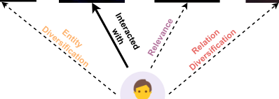
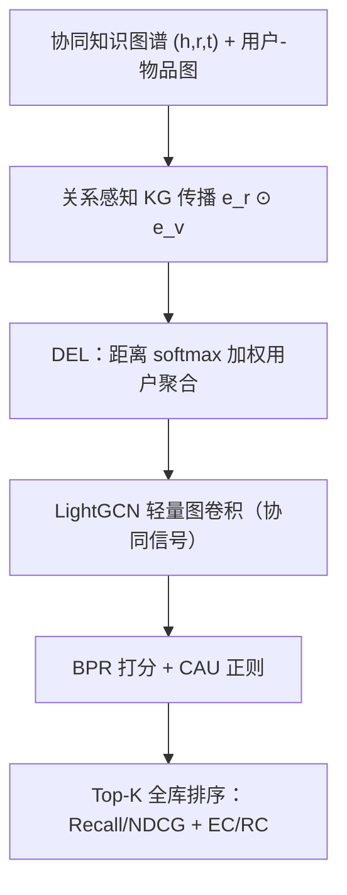
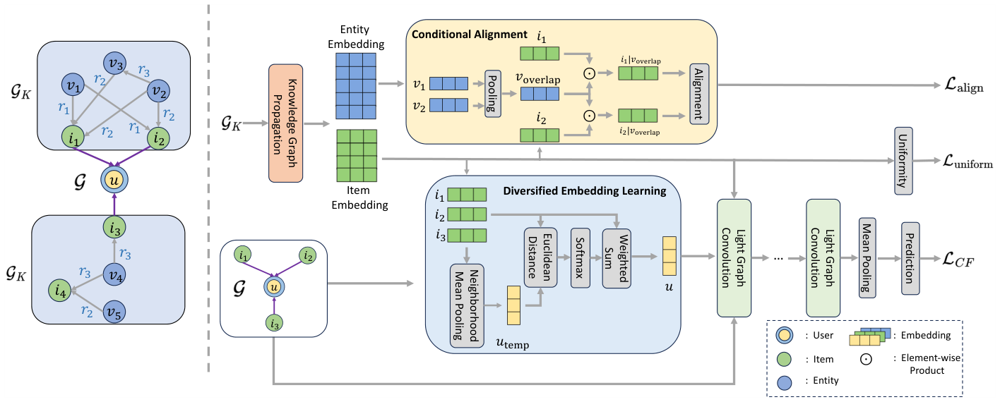

# Knowledge Graph Context-Enhanced Diversified Recommendation (知识图谱上下文增强的多样化推荐)

- **会议/期刊**: WSDM 2024（ACM 第 17 届网络搜索与数据挖掘国际会议）
- **作者与机构**: Xiaolong Liu, Liangwei Yang, Zhiwei Liu, Mingdai Yang, Chen Wang, Hao Peng, Philip S. Yu（University of Illinois Chicago / Salesforce AI Research / 北京航空航天大学）
- **推荐链路定位**: 召回（Top-K 检索）
- **研究方向**: 图神经网络与知识图谱推荐 / 自监督对比学习与交互去噪（对齐-均匀性正则）
- **论文原文**: [https://arxiv.org/abs/2310.13253v2](https://arxiv.org/abs/2310.13253v2)
- **开源代码**: [https://github.com/Xiaolong-Liu-bdsc/KG-diverse](https://github.com/Xiaolong-Liu-bdsc/KG-diverse)

## TL;DR (1分钟核心速览)

现有多样化推荐仅用**粗粒度物品类目覆盖**衡量多样性，无法区分"iPhone 14 vs Galaxy S23"与"iPhone 14 vs iPhone 14 Pro"（同类目则覆盖度相同），且 KG 实体不携带用户属性、难以生成多样性感知的用户表征。本文提出 KG-Diverse：以知识图谱上的 **Entity Coverage / Relation Coverage** 作为细粒度多样性度量，配合**距离加权的多样性感知用户聚合（DEL）**与**条件对齐-均匀性正则（CAU）**。在 10-core、逐用户 80/10/10 划分、全库排序协议下，Last.FM 上 EC@20 相对最优基线提升 **27.8%**、RC@20 提升 **17.6%**，Recall@20 仍保持次优。

## Background & Motivation (背景与核心矛盾)

- **主流范式**: 多样化推荐（DGCN、DGRec、DPP 重排、DUM 子模选择）多在**类目层面**做贪心重排或邻域重平衡，以类目覆盖度（category coverage）为多样性代理指标；KG 推荐（KGAT、KGIN）则专注提升精度。
- **前人局限**: ① 类目级指标粒度太粗，同一类目内的不同商品被视为"完全相同"，无法反映推荐列表在实体与其语义关系上的真实扩散程度；② KG 仅被当作精度增强的附属特征，实体不直接刻画用户属性，导致基于 KG 的用户表征天然缺失（无法"多样性感知"）。
- **核心洞察 (Key Insight)**: 多样性应定义在 **KG 上下文**上——推荐两部手机若分别触达"美国/韩国""Apple/三星""iOS/Android"等实体与关系，即使用户兴趣相似，其曝光面也显著不同。真正限制多样性的不是打分函数，而是**表征的局部化（localization）**：用户向量被大量相似物品拉近到其邻域实体的包围圈内，无法触及远端的实体与物品。
- **本文切入点**: 用 KG 覆盖度做度量、用"拉远相似物品"的用户聚合跳出局部化、再用条件对齐-均匀性保证 KG 嵌入的语义保真，三者构成精度-多样性的可控折中。

<figure class="paper-figure" markdown="span">
  <figcaption>图1：基于知识图谱的多样化 RecSys。</figcaption>
</figure>

## Method (核心方法设计)

### 1. 整体框架 (Overall Architecture)

输入为协同知识图谱 $G_K=\{(h,r,t)\}$与用户-物品二部图$G$。先做$L$ 层关系感知 KG 传播，得到实体上下文增强的物品向量；再由 DEL 模块按**与临时用户向量的距离**做 softmax 加权求和，生成跳出局部化的多样性感知用户向量；逐层求和后送入 LightGCN 式的轻量图卷积层编码协同信号，得到最终用户/物品表示并做内积打分。训练时以 BPR 为主损失，叠加 CAU 的**条件对齐损失**（把共享实体的物品按共享实体方向拉近）与**均匀性损失**（把物品向量在球面上推开），使嵌入既保语义又保分散，从而在 Top-K 全库排序中同时拿到覆盖度与精度。

<figure class="paper-figure" markdown="span">
  <figcaption>图2：KG-Diverse 的框架。最左侧图为协同知识图谱。</figcaption>
</figure>

### 2. 关键设计拆解 (Key Designs)

1. **关系-实体联合编码的 KG 传播（Relevant Context 建模）**：KGAT 类做法仅把关系 $r$放进注意力权重，忽略了同一实体对可以以**不同关系**连到同一物品（Chris Evans 既是 *Before We Go* 的 actor 又是 director）——只按实体聚合会把两种语义混为一谈。本文对$N_i=\{(r,v)\}$ 做逐元素门控聚合：
$\mathbf{e}_i^{(l)}=\frac{1}{|N_i|}\sum_{(r,v)\in N_i}\mathbf{e}_r\odot\mathbf{e}_v^{(l-1)}$。
把 $(r,v)$ 视为对物品的"投影/旋转"作用，使不同关系语义在表征中可分辨，这是关系覆盖度（RC）能提升的根本原因。

2. **DEL：距离加权而非相似度加权（跳出表征局部化）**：常规做法让用户向量逼近其交互物品，若交互物品高度同质，用户被锁死在 $i_1,i_2$ 与其邻接实体的邻域中。本文计算欧氏距离并**用距离做 softmax 权重**：
$d_i=\|\mathbf{e}_{u}^{temp}-\mathbf{e}_i\|_2,\quad a_i=\frac{\exp(d_i)}{\sum_{j\in N_u}\exp(d_j)},\quad \mathbf{e}_u^{(l)}=\sum_{i\in N_u}a_i\mathbf{e}_i^{(l)}$。
与"越相似权重越大"相反，**越远的交互物品权重越大**，相当于把用户表征从密集相似簇推向稀疏远端，从而显式触达新实体与新物品；叠加 $L$层即获得$L$ 跳邻域的多样性曝光。

3. **CAU 条件对齐 + 均匀性；训练目标与开销**：朴素对齐会把所有物品压成一团，丢失 KG 语境。本文先构造重叠实体投影 $\mathbf{e}_{i_1|v}=\mathbf{e}_{i_1}\odot\bar{\mathbf{e}}_{v_{overlap}}$（$O_{i_1,i_2}$为共有实体集，$\bar{\mathbf{e}}_{v_{overlap}}$ 为其均值），再对齐条件向量：
$\mathcal{L}_{align}=\mathbb{E}\|\mathbf{e}_{i_1|v}-\mathbf{e}_{i_2|v}\|_2,\quad \mathcal{L}_{uniform}=\log\mathbb{E}_{i,i'\in I}e^{-2\|\mathbf{e}_i-\mathbf{e}_{i'}\|^2}$。
总损失 $\mathcal{L}=\mathcal{L}_{CF}+\lambda_1\mathcal{L}_{align}+\lambda_2\mathcal{L}_{uniform}+\lambda_3\|\Theta\|_2^2$，其中$\mathcal{L}_{CF}$为 BPR、负样本从**未交互物品中均匀采样**（无难负采样、无额外负采样器）。推理为内积 Top-K，无重排阶段额外开销；主要成本在离线$L$层 KG 传播（$L=5$ 最优）。

## Experimental Setup & Evaluation Protocol (实验设置与评估协议)

- **数据集与预处理**（均采用 **10-core** 过滤，保留交互数 ≥ 10 的用户）：

| 数据集 | #Users | #Items | #Interactions | #Entities | #Relations | #Triplets |
| :--- | :---: | :---: | :---: | :---: | :---: | :---: |
| Amazon-Book | 70,679 | 24,915 | 846,434 | 113,487 | 39 | 2,557,746 |
| Last.FM | 1,872 | 3,846 | 42,346 | 9,366 | 60 | 15,518 |
| Movielens | 37,385 | 6,182 | 539,300 | 24,536 | 20 | 237,155 |

- **数据划分与防穿越 (Splitting Strategy)**: **比例划分**——每个用户历史交互按 **80% / 10% / 10%** 切分为 train / valid / test（逐用户随机划分，非全局时间戳切分，存在轻微未来信息穿越风险）。
- **排名评测协议 (Ranking Protocol)**: **Full-Ranking（全库未交互物品排序）**，报告 $k\in\{20,40\}$ 的 R@k、N@k；多样性指标为推荐集合覆盖的**去重实体数 EC** 与**去重关系数 RC**（越大越多样），并报告所有测试用户均值。
- **对比基线与超参设置**: 基线含通用模型（MF、LightGCN、DirectAU）、KG 模型（KGAT、KGIN）与多样化模型（DGCN、DGRec）；统一嵌入维度 $d=64$、Xavier 初始化、Adam，学习率网格$\{0.1,\dots,0.001\}$、权重衰减$\{10^{-4},\dots,10^{-7}\}$、KG/LGC 层数$\{1,\dots,6\}$、$\lambda_1,\lambda_2\in\{0.1,\dots,1.0\}$，以验证集早停（10 轮无提升）。

## Key Experimental Results (实验关键数据)

### 1. 主实验对比 (Main Results)

| 数据集 | 方法 | R@20 | N@20 | EC@20 | RC@20 |
| :--- | :--- | :---: | :---: | :---: | :---: |
| Amazon-Book | LightGCN | 0.1090 | 0.0558 | 64.1135 | 19.9618 |
| | DirectAU | 0.1225 | 0.0650 | 48.0056 | 18.0014 |
| | KGAT | 0.1245 | 0.0620 | 52.4172 | 18.4723 |
| | KGIN | **0.1281** | **0.0673** | 50.2582 | 18.3580 |
| | DGRec | 0.0920 | 0.0458 | 65.2395 | 21.9992 |
| | **KG-Diverse** | 0.1071 | 0.0547 | **67.8613** | **22.5242** |
| | Improv. (EC) | −16.4% vs KGIN | — | **+4.0%** vs DGRec | +2.4% |
| Last.FM | LightGCN | **0.3685** | **0.2016** | 67.0864 | 10.6190 |
| | KGIN | 0.3415 | 0.1635 | 66.1098 | 11.8299 |
| | DGRec | 0.2602 | 0.1294 | 60.5130 | 11.1902 |
| | **KG-Diverse** | 0.3539 | 0.1785 | **87.2005** | **13.9125** |
| | Improv. (EC) | −4.0% vs LightGCN | — | **+29.99%** vs LightGCN | **+17.6%** vs KGIN |
| Movielens | MF | 0.4065 | 0.2187 | 454.3015 | 17.1941 |
| | LightGCN | 0.4157 | 0.2236 | 452.7703 | 17.1809 |
| | KGIN | **0.4374** | **0.2386** | 447.2437 | 17.1909 |
| | **KG-Diverse** | 0.4132 | 0.2241 | **458.8848** | **17.1993** |
| | Improv. (EC) | −5.5% vs KGIN | — | **+1.0%** vs MF | +0.03% |

### 2. 消融实验 (Ablation Study, Amazon-Book)

| 变体 | R@20 | N@20 | EC@20 | RC@20 |
| :--- | :---: | :---: | :---: | :---: |
| KG-Diverse 完整 | 0.1071 | 0.0547 | **67.8613** | **20.5630** |
| w/o KG propagation layer | **0.1101** | **0.0577** | 63.3891 (−7.1%) | 20.1389 |
| w/o Relation encoding ($\mathbf{e}_r\odot\mathbf{e}_v$) | 0.0902 | 0.0452 | 66.4480 | 19.4177 (−5.9%) |
| w/o DEL（用均值池化 $\mathbf{e}_u^{temp}$） | 0.1027 (−4.3%) | 0.0511 (−7.0%) | 65.6006 (−3.4%) | 20.3592 (−2.1%) |
| w/o CAU | 0.0929 | 0.0456 | 64.7545 | 20.2670 |

### 3. 关键实验发现 (Key Findings)

1. **多样性增益主要来自"关系-实体联合编码 + 多层传播"而非牺牲精度换来的**：Last.FM 上 EC@20 从 LightGCN 的 67.09 跃升至 87.20（+29.99%），同期 Recall 仅由 0.3685 降至 0.3539（−4.0%），且仍显著优于 KGIN/DGRec，说明覆盖度提升并非以兴趣匹配崩塌为代价。
2. **DEL 与精度强耦合，"拉远"并不伤精度**：去掉 DEL 后 R@20 跌 4.3%、N@20 跌 7.0%，比去掉整个 KG 传播层（精度反而升至 0.1101）的伤害更大——说明精度损失的核心不在 KG 语义注入，而在用户表征被局部化锁死；KG 层数 $L$增大时 EC 单调升、Recall 单调降，$L=5$为覆盖度峰值，$L>5$ 出现过平滑。
3. **CAU 是 KG 嵌入质量的地基**：去掉 CAU 使 R@20 从 0.1071 降至 0.0929（−13.3%）、EC@20 降至 64.75，说明"条件对齐（按共有实体方向对齐）+ 均匀性（球面散开）"二者必须耦合；$\lambda_2\approx0.4$时 Recall 与 EC 同时最优，$\lambda_2$过大则均匀性压过对齐、KG 语义被破坏。案例（Amazon-Book 用户$u_{52279}$）中，KG-Diverse 推荐 *Echo Burning* 额外覆盖 (Genre, Suspense/Fiction)、(Subjects, Adventure/Texas) 等实体关系，而 KGIN 的 *The Affair* 仅覆盖 (Genre, Novel)、(Author, Lee Child) 两条。

## Highlights & Limitations (亮点、对比与审稿批判)

- **与代表作对比 (vs. Prior Work)**: DGRec/DGCN 在**类目粒度**上做子模邻域选择与对抗学习，多样性代理粗糙且依赖重排；KGAT/KGIN 把 KG 当作纯精度增益器，实体仅用于丰富物品表征；DirectAU 只做全局对齐-均匀性但**无 KG 条件**（故 EC 反而掉到 48.0）。本文首次把多样性度量下沉到 KG 实体/关系层，并让用户表征本身携带多样性意识。
- **可迁移亮点**: ① "距离 softmax"这一反向注意力技巧可直接移植到任一用户/物品池化层，作为跳出同质簇的低成本手段；② "条件对齐"（先按共有属性投影、再做对比）可用于多模态/跨域对齐中的细粒度语义保持。
- **审稿级局限批判**: ① **精度-多样性折中并非普适最优**——Amazon-Book 上 R@20 比 KGIN 低 16.4%、Movielens 上低 5.5%，"仅带来可忽略精度损失"的结论明显依赖数据集（Last.FM 尤其友好），缺少统一的 $\lambda$ 自适应或帕累托前沿分析；② 划分采用逐用户随机 80/10/10 而非全局时间戳切分，存在未来交互穿越，且未做显著性检验；③ EC/RC 为**绝对计数型指标**，会系统性偏好推荐冷门/长尾实体密集的物品（可能牺牲流行度与新鲜度），且未报告多样性指标与用户真实满意度/在线留存的关系。

## Rating (四维评分)

- **方法创新性 (Novelty)**: ⭐⭐⭐⭐ （以 EC/RC 把多样性度量下沉到 KG 实体-关系粒度，DEL 的"距离 softmax"与 CAU 的条件对齐均为简洁而有洞察的增量算子）
- **评估协议与实验扎实度 (Protocol & Experiments)**: ⭐⭐⭐ （三数据集 + 七个基线 + 完整消融与参数敏感性，但逐用户随机划分有穿越风险、无显著性检验、缺时间序列/线上验证）
- **写作与数学规范度 (Clarity & Rigor)**: ⭐⭐⭐⭐ （公式链条清晰、$L$/$\lambda_1$/$\lambda_2$敏感性分析完整；但 EC/RC 定义偏简、$\mathbf{e}_u$与$\mathbf{e}_u^{temp}$ 的符号复用略显混乱，部分指标说明与图表标注不够统一）
- **工业落地与复现价值 (Industrial & Practical Value)**: ⭐⭐⭐⭐ （代码开源、推理仅为内积 Top-K 无额外重排开销，KG 传播可离线预计算；但 EC/RC 与线上多样性/留存的对齐仍需业务侧二次验证，$\lambda_1,\lambda_2$ 需逐数据集调参）

