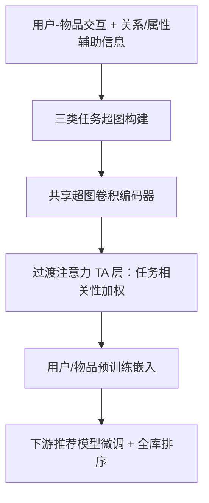
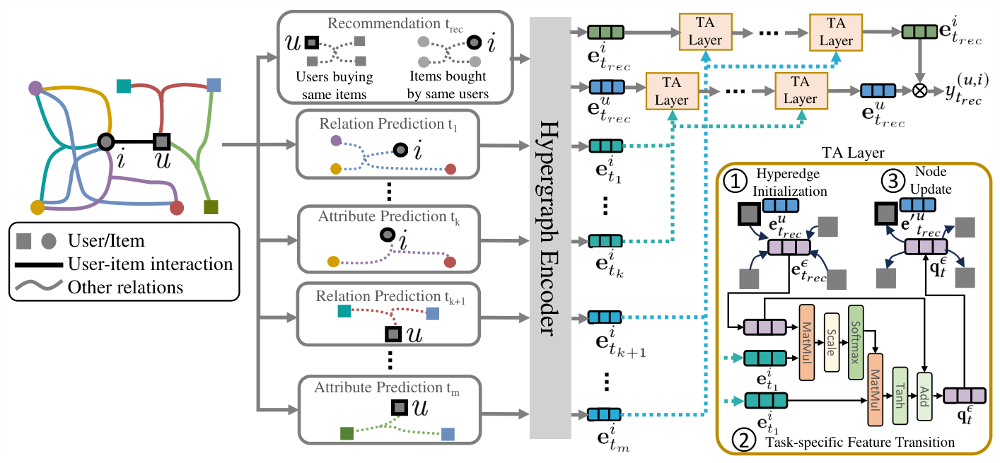
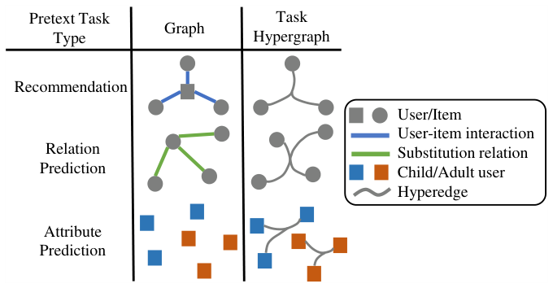

# Unified Pretraining for Recommendation via Task Hypergraphs (基于任务超图的推荐统一预训练)

- **会议/期刊**: WSDM 2024
- **作者与机构**: Mingdai Yang, Zhiwei Liu, Liangwei Yang, Xiaolong Liu, Chen Wang, Hao Peng, Philip S. Yu；UIC、Salesforce AI Research、北航等
- **推荐链路定位**: 召回（预训练表征）
- **研究方向**: 图神经网络与知识图谱推荐 / 自监督与去噪推荐
- **论文原文**: [论文原文链接](https://arxiv.org/abs/2310.13286v1)
- **开源代码**: [开源代码仓库链接](https://github.com/mdyfrank/UPRTH)

## TL;DR (1分钟核心速览)

针对 ID 依赖数据中预训练知识难跨数据集迁移、同数据同目标预训练易过拟合的痛点，UPRTH 将推荐、关系预测、属性预测统一为**任务超图上的超边预测**，并用**过渡注意力（TA）**按任务相关性判别式迁移到推荐。在 XMarket-CN/MX、Steam 的**全库排序**协议下，Recall@10 较最强基线 AttriMask 提升 **23.1%–139.1%**。

## Background & Motivation (背景与核心矛盾)

- **主流范式**: 图推荐依赖用户-物品二部图与 GNN；预训练路线分为自监督对比（GCC、SGL-PreRec）、属性掩码（AttriMask）与语言模型统一建模（P5、M6-Rec）。
- **前人局限**: 一是用户/物品 ID 在各数据集独立，纯交互预训练难以跨域迁移；二是在同一数据集上以同一推荐目标预训练+微调，容易记忆特定分布并过拟合。
- **核心洞察 (Key Insight)**: 语言化统一会引入“语言流畅性偏好”并丢失协同结构，且多数数据集缺乏文本；而**高阶关系天然适合超边**——一个超边可同时连接同类别物品、同组用户或同一关系中的多个节点。
- **本文切入点**: 用任务超图把异构预训练任务压成同一“超边预测”范式，再用 TA 层学习各辅助任务对推荐的相关性。

## Method (核心方法设计)

### 1. 整体框架 (Overall Architecture)

UPRTH 先按三类预训练任务分别构图：推荐任务以“物品”为超边连接购买它的用户；关系预测任务以“同质关系”为超边连接物品/用户；属性预测任务以“属性取值”为超边连接同属性节点。各任务超图经共享超图卷积编码器得到任务特定节点嵌入，再进入 TA 层：以推荐任务的物品超边为查询，对不同辅助任务下的物品表征做注意力加权，融合后回传更新用户嵌入。最终仅保留用户/物品初始嵌入供下游微调，模型对下游 GNN 完全不可知。

<figure class="paper-figure" markdown="span">
  <figcaption>图 2：(a) UPRTH 的整体框架；首先，我们根据不同的代理任务构建任务超图。接着，我们应用超图编码器从任务超图中学习任务特定嵌入。最后，我们使用 TA 层将知识从辅助代理任务判别式地迁移到推荐任务；(b) 过渡注意力（TA）层的示意图。</figcaption>
</figure>

### 2. 关键设计拆解 (Key Designs)

1. **任务超图统一（Task Hypergraph）**：前人把分类、关系预测、属性预测视为异构目标，难以共享结构。本文统一为“节点-超边连接预测”：属性任务中用属性值作超边，关系任务中用关系作超边，推荐任务中用物品作超边，从而所有任务共享同一超图卷积算子与同一套节点嵌入。核心卷积为 $\mathbf{E}'_{v_t}=(\mathbf{D}_{v_t})^{-1}\mathbf{H}_{v_t}(\mathbf{B}_{v_t})^{-1}(\mathbf{H}_{v_t})^\top\mathbf{E}_{v_t}$，其中$\mathbf{H}_{v_t}$ 为任务超图关联矩阵。其直觉是：超边把“同属性/同关系/共同购买”的协同信号一次性聚合，避免语言化带来的结构噪声。

<figure class="paper-figure" markdown="span">
  <figcaption>图 1：任务超图的构建。</figcaption>
</figure>

2. **过渡注意力层（TA）**：辅助任务并非都与推荐同等重要，简单求和会被弱相关任务稀释。TA 先由用户嵌入均值初始化物品超边 $\mathbf{e}_{\epsilon}^{rec}=\frac{1}{|\mathcal{N}_\epsilon|}\sum_{u^*\in\mathcal{N}_\epsilon}\mathbf{e}_{u^*}^{rec}$，再对同一物品在各辅助任务下的表征做 softmax 注意力$\alpha_{i,t}=\frac{\exp(\mathbf{e}_{\epsilon}^{rec}\cdot\mathbf{e}_i^t/\sqrt{d})}{\sum_{t^*\in T}\exp(\mathbf{e}_{\epsilon}^{rec}\cdot\mathbf{e}_i^{t^*}/\sqrt{d})}$，融合为$\mathbf{q}_\epsilon^t=\mathbf{e}_\epsilon^{rec}+\gamma\sigma(\sum_t\alpha_{i,t}\mathbf{e}_i^t)$，最后按用户连接的超边均值更新用户嵌入。直觉：注意力让与推荐语义一致的辅助任务（如“同类目”）获得更高权重，抑制噪声任务。

3. **训练目标、负采样与推理效率**：推荐预训练采用**对齐损失** $\mathcal{L}_{rec}=\sum_{(u,i)\in\mathcal{D}_r}\|\mathbf{e}_u^{rec}-\mathbf{e}_i^{rec}\|_2^2$，只拉近正对，不显式加均匀性项，判别性主要由辅助任务的 BPR 负样本承担；辅助任务用 pairwise BPR$\mathcal{L}_t=\sum_{(v,\epsilon,\epsilon')\in\mathcal{D}_a}-\log\sigma(\hat{y}_{(v,\epsilon)}^t-\hat{y}_{(v,\epsilon')}^t)$，负样本从非关联超边中采样。总损失$\mathcal{L}=\beta\mathcal{L}_{rec}+(1-\beta)\sum_{t\in T}\mathcal{L}_t+\lambda_\Theta\|\Theta\|_2^2$。可训练参数仅为用户/物品嵌入，复杂度$O(|V|^2)$，与矩阵分解同阶；下游推理直接复用嵌入，无额外在线开销。

## Experimental Setup & Evaluation Protocol (实验设置与评估协议)

- **数据集与预处理**: 三个真实数据集，未做 `5-core` 过滤；XMarket 来自 Amazon 中国/墨西哥站，Steam 为游戏商店交易记录。

| 数据集 | #Users | #Items | #Interactions | 密度 | 特征/场景说明 |
| :--- | :---: | :---: | :---: | :---: | :--- |
| XMarket-CN | 18,806 | 5,937 | 23,065 | 0.0207% | 类目、平均评分为属性任务；共同购买/替代关系为关系任务 |
| XMarket-MX | 221,890 | 35,235 | 305,569 | 0.0039% | 同上，另有替代关系任务，共 4 个辅助任务 |
| Steam | 50,292 | 1,809 | 65,379 | 0.0719% | 类目、发行商、用户组为属性任务；好友关系为关系任务 |

- **数据划分与防穿越 (Splitting Strategy)**: **随机比例划分**，非时间切分：XMarket-CN 与 Steam 按 80%/20% 划分训练/测试，XMarket-MX 按 70%/30%。预训练与微调共用同一训练交互集，存在“同数据预训练”设定下的过拟合风险，作者以辅助任务与不同损失函数缓解。
- **排名评测协议 (Ranking Protocol)**: **Full-Ranking（全库未交互排序）**，对测试用户在所有未交互物品上排序；指标为 Recall@{10,20}、NDCG@{10,20}。
- **对比基线与超参设置**: 对比 LightGCN、DirectAU、UltraGCN、HGNN、HCCF、DHCF，以及预训练基线 GCC、SGL-PreRec、AttriMask；UPRTH 作为**预训练插件**再与各下游模型组合。正文未报告统一嵌入维度 $d$、$\beta/\gamma$取值及显著性检验（如$p<0.05$），复现时需向作者代码核对。

## Key Experimental Results (实验关键数据)

### 1. 主实验对比 (Main Results)

下表保留 8 个代表性基线，指标为全库排序 R@10 / N@10；“Improv.”为 UPRTH 相对最强基线 AttriMask 的相对提升。

| 模型 | CN R@10 | CN N@10 | MX R@10 | MX N@10 | Steam R@10 | Steam N@10 |
| :--- | :---: | :---: | :---: | :---: | :---: | :---: |
| LightGCN | 0.0036 | 0.0015 | 0.0123 | 0.0073 | 0.0715 | 0.0358 |
| UltraGCN | 0.0031 | 0.0017 | 0.0017 | 0.0009 | 0.0416 | 0.0206 |
| HGNN | 0.0061 | 0.0029 | 0.0095 | 0.0046 | 0.0780 | 0.0418 |
| HCCF | 0.0023 | 0.0008 | 0.0077 | 0.0043 | 0.0976 | 0.0489 |
| DHCF | 0.0033 | 0.0022 | 0.0139 | 0.0073 | 0.1214 | 0.0566 |
| GCC | 0.0112 | 0.0068 | 0.0229 | 0.0146 | 0.1147 | 0.0565 |
| SGL-PreRec | 0.0036 | 0.0014 | 0.0102 | 0.0058 | 0.1120 | 0.0537 |
| AttriMask | 0.0387 | 0.0179 | 0.0500 | 0.0261 | 0.1398 | 0.0714 |
| **UPRTH** | **0.0801** | **0.0428** | **0.0822** | **0.0574** | **0.1721** | **0.0841** |
| **Improv.** | **+107.0%** | **+139.1%** | **+64.4%** | **+119.9%** | **+23.1%** | **+17.8%** |

此外，将 UPRTH 预训练嵌入注入 6 个下游模型均显著受益：LightGCN 的 CN R@10 从 0.0036 升至 0.0679，MX 从 0.0123 升至 0.0680，Steam 从 0.0715 升至 0.1522，说明其“模型无关预训练插件”定位成立。

### 2. 消融实验 (Ablation Study)

| 变体 | CN R@10 | CN N@10 | MX R@10 | MX N@10 | Steam R@10 | Steam N@10 |
| :--- | :---: | :---: | :---: | :---: | :---: | :---: |
| w/o 统一预训练 | 0.0545 | 0.0273 | 0.0539 | 0.0313 | 0.1441 | 0.0694 |
| UH w/o TA | 0.0744 | 0.0411 | 0.0798 | 0.0548 | 0.1645 | 0.0795 |
| UH-sum | 0.0770 | 0.0413 | 0.0818 | 0.0547 | 0.1690 | 0.0825 |
| UH-concat | 0.0800 | 0.0424 | 0.0796 | 0.0470 | 0.1235 | 0.0599 |
| **UPRTH** | **0.0801** | **0.0428** | **0.0822** | **0.0574** | **0.1721** | **0.0841** |

### 3. 关键实验发现 (Key Findings)

1. **稀疏场景收益最大**：XMarket-MX 密度仅 0.0039%，UPRTH 的 N@10 从 AttriMask 的 0.0261 提升到 0.0574（+119.9%）；而 Steam 密度高 18 倍，N@10 提升收窄至 +17.8%，说明多任务超图预训练主要补偿交互稀疏。
2. **统一超边范式优于“属性线性头”**：去掉统一预训练后，CN R@10 由 0.0801 降至 0.0545（-32.0%），Steam 由 0.1721 降至 0.1441（-16.3%），验证保持节点嵌入中不引入额外线性变换、可完整迁移辅助知识的设计。
3. **TA 的判别式加权不可替代**：UH-concat 在 Steam 上 R@10 跌至 0.1235，远低于 UH-sum 的 0.1690 与 UPRTH 的 0.1721；说明简单拼接+线性变换会破坏超边语义，而按任务相关性加权才能稳定增益。

## Highlights & Limitations (亮点、对比与审稿批判)

- **与代表作对比 (vs. Prior Work)**: 相比 P5/M6-Rec 的语言化统一，UPRTH 只用图结构，避免语言偏置与文本依赖；相比 GCC/SGL-PreRec 只做交互级自监督，它引入关系/属性高阶任务；相比 AttriMask 的“掩码+线性头”，它把所有任务压成超边预测，知识以节点嵌入形式无损迁移。
- **可迁移亮点**: ①“属性值/关系作超边”的构图方式可直接用于社交、POI、多模态辅助任务；②预训练用 alignment、微调用 BPR 的**异目标组合**，比两阶段同损失更抗过拟合，可迁移到其他预训练-微调管线。
- **审稿级局限批判**: ①随机比例划分而非全局时间切分，测试集可能包含“未来”交互，且预训练与微调共享训练图，存在隐性泄漏与乐观偏差；②TA 主要将**物品侧**辅助任务迁移到用户嵌入，用户侧辅助任务（如社交关系）迁移路径不完整；③正文缺少 $d$、$\beta$、$\gamma$ 的敏感性分析与显著性检验，且全库排序下 CN/MX 的绝对 Recall 仍低于 0.1，工业可用性需线上验证。

## Rating (四维评分)

- **方法创新性 (Novelty)**: ⭐⭐⭐⭐ （首次把多任务预训练统一为任务超图超边预测，TA 层给出任务相关性判别迁移的清晰机制）
- **评估协议与实验扎实度 (Protocol & Experiments)**: ⭐⭐⭐ （三数据集+全库排序+多下游模型验证较完整，但随机划分、无显著性检验、缺超参敏感性）
- **写作与数学规范度 (Clarity & Rigor)**: ⭐⭐⭐⭐ （超图卷积、TA 矩阵形式与损失定义完整，复杂度分析清楚；部分符号在正文与矩阵形式间略有不一致）
- **工业落地与复现价值 (Industrial & Practical Value)**: ⭐⭐⭐⭐ （代码与数据开源，仅训练嵌入、$O(|V|^2)$ 复杂度、可作为模型无关预训练插件，工程落地门槛低）

