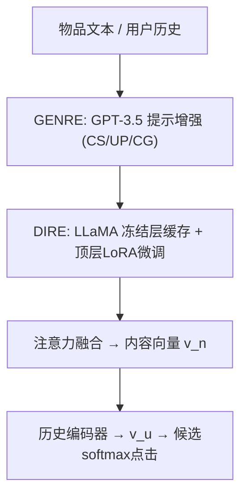
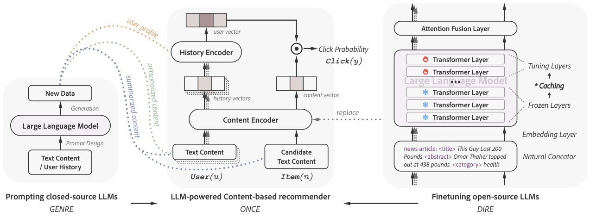

# ONCE: Boosting Content-based Recommendation with Both Open- and Closed-source Large Language Models (以开源与闭源大模型双重增强的内容推荐)

- **会议/期刊**: WSDM 2024
- **作者与机构**: Qijiong Liu, Nuo Chen, Tetsuya Sakai, Xiao-Ming Wu (香港理工大学 / 早稻田大学)
- **推荐链路定位**: 召回（内容编码与用户兴趣建模）
- **研究方向**: 大语言模型推荐 (LLM4Rec) / 冷启动与长尾推荐
- **论文原文**: [https://arxiv.org/abs/2305.06566v4](https://arxiv.org/abs/2305.06566v4)
- **开源代码**: [https://github.com/Jyonn/ONCE](https://github.com/Jyonn/ONCE)

## TL;DR (1分钟核心速览)

内容推荐的老瓶颈在于内容编码器"读不懂"物品文本：GloVe 只懂词面，BERT 级 PLM 缺少世界知识且表征维度有限（论文用三本"狮子"书目的相对相似度可视化佐证）。本文提出 ONCE 双路增强：开源侧 DIRE 把 LLaMA 深层当作内容编码器，配合部分冻结 + 隐状态缓存 + LoRA 微调；闭源侧 GENRE 用 GPT-3.5 提示生成摘要标题、用户画像与个性化合成内容。在 MIND / Goodreads 的 1:4 采样排序协议下，相对原模型 AUC 最高 +11.13%、N@5 最高 +24.60%，相对 PLM-NR (BERT-12L) 仍有最高 19.32% 提升。

## Background & Motivation (背景与核心矛盾)

- **主流范式**: 内容推荐 = 内容编码器 + 历史编码器 + 点击交互模块；编码器已从 CNN-GloVe 演进到 BERT 类 PLM 微调（PLM-NR）。
- **前人局限**: 其一，词级编码器对 "Al-Rassan" 这类低频实体无表征，误把 *The Lion King* 与 *The Lions of Al-Rassan* 判为高相似；其二，768 维小 PLM 的预训练语料与容量不足以区分同作者同题材书目。
- **核心洞察 (Key Insight)**: LLM 的千亿 token 预训练与数千维隐空间本身就存储了书名、作者、地理等世界知识，先用 LLaMA 生成描述再编码，即可让相似度结构恢复正常（书 A/B 相似度低于 B/C）。
- **本文切入点**: 开源 LLM 改善**嵌入级**（连续表征），闭源 LLM 改善**Token 级**（数据本身），二者互补而非替代。

## Method (核心方法设计)

### 1. 整体框架 (Overall Architecture)

先用闭源 GPT-3.5 做离线数据增强（GENRE，产出增强标题、用户兴趣画像、合成点击内容），再由开源 LLaMA 作为内容编码器（DIRE）编码增强后的文本，经注意力融合层压成内容向量 $v_n$，历史编码器（NRMS/Fastformer 等）聚合为用户向量$v_u$，最终在$1{+}k$ 候选上做 softmax 点击分类。训练时冻结 LLaMA 底层、只调顶层 + LoRA，推理端复用缓存。

<figure class="paper-figure" markdown="span">
  <figcaption>图3：我们提出的ONCE框架概览，该框架通过微调开源LLM（DIRE）并为闭源LLM（GENRE）使用提示，来增强基于内容的推荐。</figcaption>
</figure>

### 2. 关键设计拆解 (Key Designs)

1. **DIRE：把 LLM 变成可微内容编码器**：痛点是小 PLM 表征受限、而全量微调 7B/13B 成本爆炸。做法是用自然语言模板拼接多字段（"news article:" + `⟨title⟩`…）替代 `[CLS]/[SEP]` 分段，取最后一层隐状态做降维注意力池化：$\mathbf{Z}=\mathbf{E}_H \mathbf{W}+\mathbf{b}\in\mathbb{R}^{l\times d},\ \mathbf{z}=\mathrm{Attention}(\mathbf{Z})\in\mathbb{R}^{d}$，其中$d_n\gg d$。因底层语义通用、顶层任务相关，只调顶部$k$层并**预缓存**底层隐状态于全库内容，计算量降至$k/H\approx 2/32\approx 6\%$。
2. **GENRE：三类提示即三种"外部知识注入"**：GPT-3.5 不可微，只能改数据。① Content Summarizer 用标题+摘要+类别重写更信息密集的标题（MIND 标题 token 13.56→16.73）；② User Profiler 从浏览历史推断主题/地域（如 "Miami" → Florida），得到兴趣向量 $\mathbf{v}_i=[\mathrm{POOL}(\mathbf{E}_{topics});\mathrm{POOL}(\mathbf{E}_{regions})]$，再$\mathbf{v}_{iu}=\mathrm{MLP}([\mathbf{v}_u;\mathbf{v}_i])$；③ Personalized Content Generator 为新用户（历史 ≤5 条）生成 2 条合成点击补足序列；④ Chain-based：先画像再生成（UP→CG），让合成内容更贴合兴趣。
3. **训练目标与开销**：沿用候选 softmax 交叉熵 $\mathcal{L}=-\log\frac{\exp(\mathbf{v}_u^\top \mathbf{v}_c^{+})}{\exp(\mathbf{v}_u^\top\mathbf{v}_c^{+})+\sum_{j=1}^{k}\exp(\mathbf{v}_u^\top\mathbf{v}_c^{j})}$，负采样比$k=4$；非 LLM 模块嵌入维度 64，MIND 学习率 1e-3、Goodreads 1e-4，未用 LoRA 时 LLM 学习率 1e-5。

## Experimental Setup & Evaluation Protocol (实验设置与评估协议)

| 数据集 | #Users | #Items | #Interactions | 稀疏度/密度 | 特征/场景说明 |
| :--- | :---: | :---: | :---: | :---: | :--- |
| MIND | 94,057 | 65,238 | 347,727 正 / 8,236,715 负 | 新用户 20,110 | 新闻：title/abstract/category，平均 14.98 条/人 |
| Goodreads | 23,089 | 16,833 | 273,888 正 / 485,233 负 | 新用户 2,306 | 图书：仅书名（信息量极低，最考验知识） |

- **数据划分与防穿越**: 沿用 NRMS / PLM-NR 协议，每用户最后一次点击为测试、倒数第二次为验证（Leave-One-Out 式按时间序列切分，不使用未来交互）。
- **排名评测协议**: `Sampled Ranking`，每条正样本配 $k=4$ 负样本（1:4），未做全库 Full-Ranking；指标为 AUC、MRR、N@5、N@10。
- **对比基线与超参**: 骨干为 NAML / NRMS / Fastformer / MINER；对照 PLM-NR (BERT-12L)、单路 GENRE 各提示变体、单路 DIRE (LLaMA-7B/13B)；5 次独立运行取均值，$p<0.01$。

## Key Experimental Results (实验关键数据)

### 1. 主实验对比 (Main Results)

| 方法 (骨干 = MINER) | MIND AUC | MIND MRR | MIND N@10 | Goodreads AUC | Goodreads MRR | Goodreads N@10 |
| :--- | :---: | :---: | :---: | :---: | :---: | :---: |
| NAML (原始) | 61.75 | 30.60 | 37.85 | 66.47 | 75.75 | 82.20 |
| NRMS (原始) | 61.71 | 30.20 | 37.42 | 68.95 | 77.05 | 83.16 |
| Fastformer (原始) | 62.26 | 31.14 | 38.32 | 70.85 | 78.37 | 84.15 |
| MINER (原始) | 63.88 | 32.19 | 39.45 | 71.03 | 78.46 | 84.20 |
| PLM-NR (BERT-12L) | 65.82 | 32.77 | 40.19 | 73.36 | 80.08 | 85.25 |
| GENRE-ALL (仅闭源) | 66.46 | 34.20 | 41.48 | 73.21 | 79.91 | 85.29 |
| DIRE (LLaMA-7B) | 68.70 | 36.58 | 44.18 | 76.45 | 82.46 | 86.92 |
| **ONCE (双路)** | **68.92** | **36.74** | **44.48** | **77.82** | **83.35** | **87.85** |
| Improv.% vs 原始 | +7.89% | +14.13% | +12.75% | +9.56% | +6.23% | +4.33% |
| Improv.% vs BERT-12L | +4.71% | +12.11% | +10.67% | +6.08% | +4.08% | +3.05% |

（全文最大提升出现在 NRMS 骨干：ONCE 相对 BERT-12L 的 N@5 提升 **19.32%**；相对原始 NRMS 的 N@5 提升 **24.60%**。）

### 2. 消融实验 (Ablation Study)

| 配置 (NAML 骨干) | MIND AUC | MIND MRR | MIND N@10 | Goodreads AUC | Goodreads MRR | Goodreads N@10 |
| :--- | :---: | :---: | :---: | :---: | :---: | :---: |
| 原始 (无 PLM) | 61.75 | 30.60 | 37.85 | 66.47 | 75.75 | 82.20 |
| BERT-12L 全微调 | 65.32 | 33.16 | 40.35 | 70.68 | 78.17 | 83.99 |
| LLaMA-7B 32冻结/0调 | 67.78 | 35.17 | 42.78 | 69.29 | 77.32 | 83.37 |
| LLaMA-7B 31/1 | 68.34 | 35.80 | 43.48 | 73.82 | 80.34 | 85.61 |
| LLaMA-7B 30/2 | 68.18 | 36.09 | 43.65 | **77.01** | **82.74** | **89.39** |
| LLaMA-7B 30/2 **w/o LoRA** | 67.25 | 34.28 | 42.12 | **77.01** | **82.74** | **89.39** |
| + CG（新用户组 AUC） | 59.24 → **60.21** | — | — | — | — | — |
| + CG（老用户组 AUC） | 62.21 → **63.43** | — | — | — | — | — |

### 3. 关键实验发现 (Key Findings)

1. **"不微调也强"**：LLaMA-7B 完全冻结（32/0）时 MIND AUC 已达 67.78，比全微调 BERT-12L 高 2.46；说明增益主要来自 LLM 预训练知识与高维隐空间，而非任务微调本身。但 Goodreads 上冻结反而**低于**原始模型（69.29 < 66.47 仅微升，且远低于 30/2 的 77.01），证明"只有书名"的极端稀疏文本必须靠微调重塑语义。
2. **层数与 LoRA 存在数据集反转**：MIND 上 LLaMA-7B（68.34/68.55）多次反超 13B（68.23/68.51），且 LoRA 开优于关（68.34 vs 67.25）；Goodreads 上 13B 更强、LoRA 反而有害（75.00 vs 77.01），作者归因为书名短文本需要更"自由"的参数调整——即 LoRA 的低秩约束与任务偏移量不匹配。
3. **闭源增强的价值在于"加速"而非"叠加"**：ONCE 在 NRMS 上第 6 epoch 即达到 LLaMA-13B 第 8 epoch 的 AUC（≈25% 训练加速），在 Fastformer 上第 9 epoch 超过 13B 第 15 epoch（≈40% 加速）；且 CG 让新用户 AUC +0.97、老用户 +1.22，说明合成历史同时缓解了冷启动并间接改善热用户历史编码。

## Highlights & Limitations (亮点、对比与审稿批判)

- **与代表作对比**: vs PLM-NR（仅换 BERT 编码器）本文把编码器升级到 LLM 并从"改模型"扩展到"改数据"；vs 直接用 ChatGPT 做零样本推荐（已有工作指出仅与 MF 相当）本文不做端到端提示推荐，而是把闭源 LLM 降级为离线数据增强器，规避其不可微与不稳定；vs P5/TIGER 类生成式检索，本文坚持"LLM 增强 + 传统 CRM"的混合路线，工程可控性更高。
- **可迁移亮点**: ①"底层冻结 + 隐状态预缓存 + 顶层 LoRA"把 7B 模型训练压缩到约 6% 算力，可直接迁移到图文电商、短视频标题编码；②"用户画像 → 合成行为"的两段式 Chain 提示，是低成本补足冷启动序列的通用配方。
- **审稿级局限批判**: ① 全流程依赖 GPT-3.5 离线生成，数据规模大时 API 成本与可复现性成问题，且增强数据一旦固定即无法随模型迭代；② 评测仅为 1:4 采样排序，缺 Full-Ranking 与线上 A/B，AUC 对头部位置的敏感性弱于 N@1；③ 提示模板（CS/UP/CG）靠人工设计，缺少对提示措辞、生成长度、合成条数的敏感性分析。

## Rating (四维评分)

- **方法创新性 (Novelty)**: ⭐⭐⭐⭐ （"开源改嵌入 + 闭源改 Token"的双路正交增强视角清晰，但单点技术均为已有组件组合，理论支撑以可视化直觉为主）
- **评估协议与实验扎实度 (Protocol & Experiments)**: ⭐⭐⭐⭐ （4 骨干 × 2 数据集 × 多提示变体 + 层数/LoRA/新老用户三类消融完整、$p<0.01$，扣分在仅采样排序、无全库排序与线上验证）
- **写作与数学规范度 (Clarity & Rigor)**: ⭐⭐⭐⭐ （图 2 的相对相似度对齐示例极具说服力，公式简洁；但 Table 2/3 存在指标列标注 N@1/N@5 与表中 N@5/N@10 不一致的小瑕疵）
- **工业落地与复现价值 (Industrial & Practical Value)**: ⭐⭐⭐⭐⭐ （代码与增强数据全开源，缓存 + LoRA 把 LLM 训练成本降到 6%，对内容平台改造现有 NRMS 类模型路径最短）

