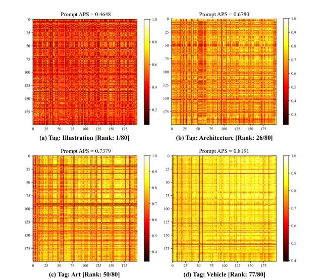
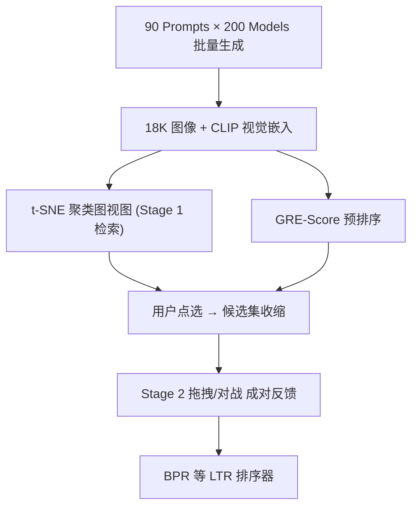

# GEMRec: Towards Generative Model Recommendation (面向生成模型推荐)

- **会议/期刊**: WSDM 2024 (Demo Track，4 页短文)
- **作者与机构**: Yuanhe Guo, Haoming Liu, Hongyi Wen（NYU Shanghai, SFSC of AI and DL）
- **推荐链路定位**: 召回（Prompt-Model Retrieval）+ 重排/交互式排序（Generative Model Ranking）
- **研究方向**: 多模态推荐 / 生成式推荐
- **论文原文**: [https://arxiv.org/abs/2308.02205v2](https://arxiv.org/abs/2308.02205v2)
- **开源代码**: [https://github.com/MAPS-research/GEMRec](https://github.com/MAPS-research/GEMRec)

## TL;DR (1分钟核心速览)

传统推荐在"有限候选集"里检索既有物品，而生成式模型让物品变成"无限"的新生成内容，用户真正要挑的是**模型**而非**物品**。本文把该任务形式化为「提示词→模型检索 + 生成内容列表排序」两阶段，发布 GEMRec-18K：200 个 Civitai/HuggingFace 文生图模型 × 90 个真实用法提示词组成的**稠密笛卡尔网格（1.8 万张图）**，并提出加权集成的 GRE-Score 做候选预排序。离线分析显示生成结果在具体物体域高度同质（Vehicle 平均成对相似度 0.4648 vs. Architecture 0.8191），据此论证现有精度/多样性指标无法刻画个体审美。作为 Demo Track 短文，本文不提供学习式基线的数值对比。

## Background & Motivation (背景与核心矛盾)

- **主流范式**: Retrieval-based Recommendation 假设候选集有限且物品已存在，召回-排序围绕既有 item 做个性化匹配；多模态侧则聚焦于"给定文本生成图像"本身的个性化（DreamBooth 类）与生成过程可控性。
- **前人局限**: 其一，生成模型是**黑盒**——其专长体现在构图/画风/质感等难以用 metadata 描述的维度，普通用户面对近万级开源模型无从选择；其二，本地部署大模型需高显存 GPU，普通用户不可持续，必须由系统侧先做模型筛选。
- **核心洞察 (Key Insight)**: 当同一 prompt 下 200 个模型能产出 200 张风格迥异的图时，"个性化"的目标物应从 item 上移到 **model**；且同质性随提示词域剧烈变化——具体物理对象（车、食物）模型输出趋同，抽象概念/插画/人物域则分化明显。
- **本文切入点**: 先用固定提示词网格离线铺开"模型能力画像"，用可视化聚类 + 可扩展指标把大语料压到小候选集，再在小候选集上以成对交互反馈学习细粒度排序。

<figure class="paper-figure" markdown="span">
  <figcaption>图 1：200 个模型生成图像的相似度热图。热图颜色越深、排名越高，表示图像多样性越高。模型按下载量从高到低索引。四幅热图的提示词：(a) 表 2(i)；(b) 表 2(ii)；(c) 表 2(iii)；(d) 表 2(v)。“Prompt APS”指所有图像对的平均成对相似度。</figcaption>
</figure>
图 1：200 个模型生成图像的相似度热图（颜色越深表示多样性越高，模型按下载量排序）；(c) 艺术域 APS=0.6780、(d) 车辆域 APS=0.4648。

## Method (核心方法设计)

### 1. 整体框架 (Overall Architecture)

离线阶段对 90 prompts × 200 models 做批量生成，得到 1.8 万张图及其元数据（模型名、版本、下载量、标签、触发词）；对每张图用 `clip-vit-large-patch14` 提取视觉嵌入，按提示词分组后以 t-SNE 降到二维构建**交互式图视图**（Stage 1），位置相近即视觉特征相近，同簇内按 GRE-Score 决定堆叠时谁置顶。用户点选/收藏即作为粗粒度偏好信号，把候选从 200 收缩到十余个；Stage 2 用拖拽排序或成对对战两种随机分配的交互模式采集 pair-wise 反馈，按 GRE-Score 升序逐轮替换未选中项以提升信息增益，最终在 dashboard 汇总细粒度模型偏好，可直接喂给 BPR 等 LTR 算法训练排序器。

### 2. 关键设计拆解 (Key Designs)

1. **GRE-Score：用指标集成替代单一 CLIP 相似度做候选预排序**：痛点在于 CLIP-Score 只看图文对齐、下载量只看人气，二者都可能把"高度同质但流行"的模型排到前面，压抑多样性。做法是把 $k$ 个指标归一化后线性集成，其中"越大越好"统一为正向：

$$\text{GRE-Score}=\sum_{k}\lambda_k\tilde{q}_k,\qquad \boldsymbol{\lambda}=(1.0,\,0.8,\,0.2)$$

   $\tilde{q}_k$ 依次取归一化 CLIP-Score（准确性）、补平均余弦相似度（独特性）、下载量（流行度）。直觉是：准确性决定"能不能画出 prompt"，独特性决定"是否与别人不同"，流行度仅作弱先验（权重 0.2）以免冷门好模型被永久埋没；三者互补可缓解单指标的偏置。
2. **提示词域分层与 NSFW 过滤的候选池构造**：痛点在于 prompt 抽样若偏向单一类别，热图结论会被域偏置污染。做法是 60 条取自 Parti Prompts（12 类各 5 条）+ 10 条 Civitai 高互动 + 20 条按 DreamStudio/Midjourney 指南手写并延展语义等价版本，生成后再以 NSFW 分数过滤，保证跨域可比。这一设计使后续的"域间异质性"结论具备统计基础。
3. **训练目标、负采样与推理开销**：本文为 Demo 系统，**未训练排序模型、未指定损失与负采样**；Stage 2 仅负责采集 pair-wise 偏好，供后续 BPR 类目标 $\mathcal{L}=-\sum_{(u,i,j)}\ln\sigma(\hat{s}_{ui}-\hat{s}_{uj})$ 使用。推理开销集中在离线批量生成（1.8 万次扩散采样，需 GPU 集群），在线侧仅有 CLIP 嵌入检索与 GRE-Score 加权求和，代价近似常数。

## Experimental Setup & Evaluation Protocol (实验设置与评估协议)

- **数据集与预处理**:

| 数据集 | #Prompts | #Models | #Images | 稀疏度/密度 | 特征/场景说明 |
| :--- | :---: | :---: | :---: | :---: | :--- |
| GEMRec-18K | 90 | 200 | 18,000 | 100%（完整 $90\times200$ 网格，无缺失） | 197 个 Civitai SD 微调模型（按下载量分布采样）+ 3 个 SD v1.4/v1.5/v2.1 基线；统一转 diffusers 格式 |

- **数据划分与防穿越 (Splitting Strategy)**: 本文**未设训练/测试划分**，全部 18K 样本用于离线描述性分析与 Demo 交互；不存在时序切分，也无防穿越设计（Demo Track 性质）。
- **排名评测协议 (Ranking Protocol)**: 非传统排名协议。离线评估采用**全网格成对比较**：对每个提示词计算 200×200 图像对的平均成对相似度 $\text{APS}=\frac{2}{N(N-1)}\sum_{i<j}\cos(\mathbf{e}_i,\mathbf{e}_j)$，作为"域多样性"的充分统计量；GRE-Score 的合理性仅作机制论证，未做线上/离线排序指标验证。
- **对比基线与超参设置**: 无学习式基线；弱对照为 3 个官方 SD checkpoint。图像嵌入固定为 `clip-vit-large-patch14`，GRE-Score 权重固定 $\boldsymbol{\lambda}=(1.0,0.8,0.2)$（**作者称"经验设定"，未给出调参曲线**），无显著性检验。

## Key Experimental Results (实验关键数据)

### 1. 主实验对比 (Main Results)

原文为描述性离线分析，下表为图 1 热图对应的**域级多样性度量**（APS 越低越多样，"多样性排名"为跨域相对位次）：

| 提示词域（表 2 编号） | 代表 Prompt | APS ↓ | 多样性排名 | 主流模型行为 |
| :--- | :--- | :---: | :---: | :--- |
| Illustration (ii) | 文字排版插画 | **0.7379** | 1/80 | 构图与风格高度分化 |
| Art (iii) | 达利风格跑车 | 0.6780 | 50/80 | 多数模型只画"普通跑车"，丢失风格 |
| Architecture (i) | 沙发上的笔记本电脑 | 0.8191 | 26/80 | 布局趋同，仅材质/光影微变 |
| Vehicle (v) | 赛博朋克东京红车 | **0.4648** | 77/80 | 具体物体域一致性强、多样性最低 |

> 注：原文无 P@K / NDCG 类指标与 SOTA 基线数值，凡出现"提升"均为相对作者自建的 SD 基线视觉观察，不构成统计显著性结论。

### 2. 消融实验 (Ablation Study)

GRE-Score 组件为**加权集成、无逐项移除实验**；下表按原文权重与机制梳理，数值栏标注未报告：

| 变体 | $\lambda$ | 作用 | 移除后预期后果 | 报告数值 |
| :--- | :---: | :--- | :--- | :---: |
| Full GRE-Score | (1.0, 0.8, 0.2) | 准确性+独特性+流行度 | — | 未报告 |
| w/o 独特性项 | (1.0, 0, 0.2) | 仅保 CLIP + 人气 | 同质化模型被置顶，热图多样性信号丢失 | 未报告 |
| w/o 流行度项 | (1.0, 0.8, 0) | 纯视觉质量 | 冷门但风格独特模型获得曝光 | 未报告 |
| w/o CLIP 项 | (0, 0.8, 0.2) | 纯多样 + 人气 | 可能推荐"跑题但独特"的图像 | 未报告 |

### 3. 关键实验发现 (Key Findings)

1. **同质性由语义域决定，而非模型能力**：Vehicle 域 APS=0.4648 与 Architecture 域 0.8191 相差约 0.35，说明在具体物体上 200 个模型的输出几乎不可区分，个性化收益只在抽象/风格域才显现——这直接解释了为何"按下载量排序"在车辆类提示词下几乎等价于随机。
2. **流行度分布极端长尾**：样本内最高 102,076 次下载与最低 39 次相差三个数量级，而 GRE-Score 仅赋予下载量 0.2 权重，等价于把长尾模型的可曝光概率显著抬升，是缓解马太效应的最小改动设计。
3. **稠密网格使"全库排序"离线复现成为可能**：$90\times200=18{,}000$ 无缺失交互意味着任何排序函数都可在完整 200 候选上计算无偏指标（无需负采样），这是该数据集相对 web-scraped 稀疏日志的核心价值，但作者未实际给出该协议下的排序数字。

## Highlights & Limitations (亮点、对比与审稿批判)

- **与代表作对比 (vs. Prior Work)**: 相较 DreamBooth/Textual-Inversion 等"用少量样本微调单一模型以实现个性化"的路线，本文不改进生成器本身，而是把"选模型"作为推荐问题；相较 Parti Prompts、HEIM 等生成模型评测基准，本文首次在**数百模型 × 跨域提示词**的规模上同时保留模型多样性与提示词多样性，并附交互界面而非仅静态指标。
- **可迁移亮点**: ① "指标集成 + 归一化加权"的 GRE-Score 是低成本可复用的冷启动排序器，可平移到 AIGC 视频/音乐模型市场；② 用 t-SNE 图视图 + 同簇内按质量分置顶的展示策略，是缓解黑盒候选"不可解释"的实用 UI 技巧。
- **审稿级局限批判**: ① **缺少真正的推荐实验**——无 LTR 训练、无 NDCG/P@K、无用户研究，GRE-Score 与个体审美的对齐性完全未验证，权重 (1.0,0.8,0.2) 属拍脑袋设定且无敏感性分析；② 成本与泛化受限：18K 张扩散采样需 GPU 集群，200 模型规模相对线上近万模型仍小两个量级；仅覆盖文生图，作者亦承认文本/音乐域的可迁移性待验证。

## Rating (四维评分)

- **方法创新性 (Novelty)**: ⭐⭐⭐⭐ （首次把"生成模型"而非"生成内容"作为推荐对象并给出两阶段任务形式化，问题定义新颖，但技术组件本身较常规）
- **评估协议与实验扎实度 (Protocol & Experiments)**: ⭐⭐ （Demo Track 无划分、无基线数值、无显著性检验与消融，仅靠 APS 描述性统计支撑结论）
- **写作与数学规范度 (Clarity & Rigor)**: ⭐⭐⭐⭐ （问题动机与两阶段流程表述清晰、图表自解释性强，但公式仅一条且权重来源未加论证）
- **工业落地与复现价值 (Industrial & Practical Value)**: ⭐⭐⭐⭐ （代码与 18K 数据集全开源、批量生成脚本可扩展，GRE-Score 可即插即用于 AIGC 模型市场，唯离线生成成本偏高）

