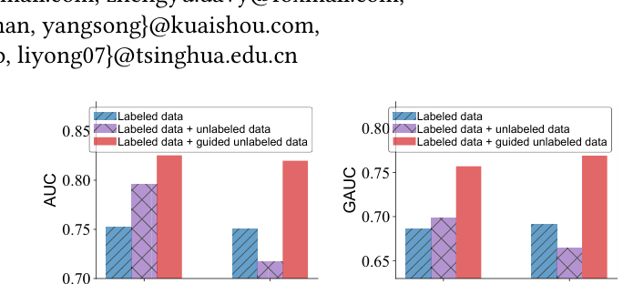
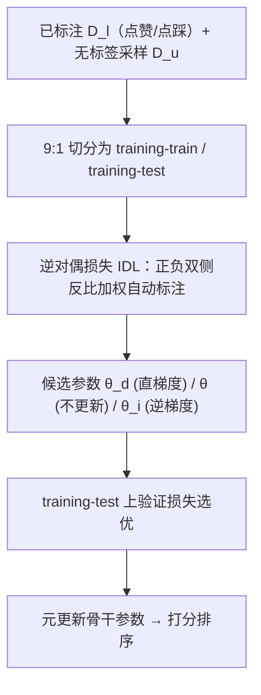
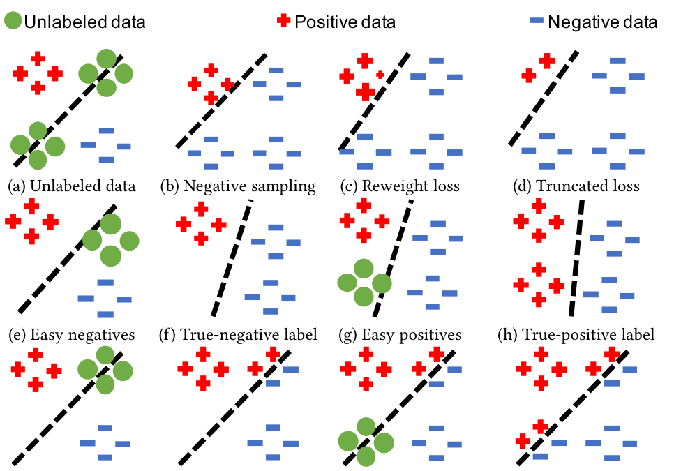

# Inverse Learning with Extremely Sparse Feedback for Recommendation (面向极稀疏反馈推荐的逆学习)

- **会议/期刊**: WSDM 2024
- **作者与机构**: Guanyu Lin (CMU), Chen Gao / Yu Zheng / Yong Li 等 (清华大学), Yinfeng Li 等 (快手)
- **推荐链路定位**: 精排（模型训练阶段，model-agnostic 训练策略）
- **研究方向**: 多模态推荐与内容理解（短视频/微视频信息流）/ 自监督与交互去噪
- **论文原文**: [论文原文链接](https://arxiv.org/abs/2311.08302v2)
- **开源代码**: [开源代码仓库链接](https://github.com/Guanyu-Lin/InverseLearning)

## TL;DR (1分钟核心速览)

在全屏微视频信息流（TikTok/Reels）中用户没有“点击”动作，可靠标签只有极稀疏的点赞/点踩（本数据仅 4.78%/0.08%），大量模糊反馈被随机采样当作负例，造成严重的**假负例噪声**；而 DenoisingRec 一类工作只对假正例去噪。本文提出逆学习框架：逆对偶损失 (IDL) 把每个无标签样本同时按正、负两条损失反比加权，实现无监督“软标注”；逆梯度 (IG) 借助元学习在 holdout 上仲裁“直梯度 / 逆梯度 / 不更新”三种方向，纠正硬样本的错标注。在 ML1M 与工业 Micro Video 上，GMF/NeuMF 双骨干平均 AUC 相对 SOTA 最高提升 9.25%（ML1M AUC 0.7671→0.8318）。

## Background & Motivation (背景与核心矛盾)

- **主流范式**: 隐式反馈推荐把已交互样本视为正例、从未交互池中随机/难负采样构造负例；去噪工作则对“大损失样本”重加权 (R-CE) 或截断 (T-CE)。
- **前人局限**: ① 负采样把真实正例误判为负例，假负例噪声量级远大于假正例，而 DenoisingRec 只处理假正例；② 难负采样虽减少假正例却放大假负例，在真实正负样本上评估时反而掉点。
- **核心洞察 (Key Insight)**: 图 1 显示——纯无监督地用无标签数据在 ML1M 涨点、在 Micro Video 掉点（不稳定）；若用部分已标注数据“引导”无标签学习，两个数据集都稳定涨点。即：无标签数据必须被**有监督地校准**，且噪声是双向的。
- **本文切入点**: 用损失反比加权自动标注无标签样本（IDL），再用元学习的梯度和方向仲裁修正错标注（IG），从正负两侧同时去噪。

<figure class="paper-figure" markdown="span">
  <figcaption>图 1：两种数据集下使用三种数据类型训练的性能比较。此处“有标签数据”指仅使用有标签数据训练；“有标签数据和无标签数据”指使用有标签数据进行监督训练并使用无标签数据进行无监督训练；“有标签数据与带引导的无标签数据混合”指划分部分有标签数据来指导对无标签数据的无监督学习。</figcaption>
</figure>

## Method (核心方法设计)

### 1. 整体框架 (Overall Architecture)

输入为用户-视频对与播放/完播行为，可靠标签 $\mathcal{D}_l$（点赞/点踩）极稀疏，$\mathcal{D}_u$为采样得到的无标签对（其真实标签未知，不再默认置 0）。训练前先把$\mathcal{D}_l$按 9:1 切成 training-train / training-test。每步先在 training-train 上做常规有监督更新；再对一批$\mathcal{D}_u$ 计算 IDL 双侧加权损失，并派生三个候选参数：沿直梯度、沿逆梯度、以及不更新；用 training-test 上的有监督损失挑最优者，最后用该 holdout 梯度执行一步元更新。推理阶段完全等同于原骨干网络（GMF/NeuMF），无任何额外开销。

### 2. 关键设计拆解 (Key Designs)

1. **逆对偶损失 IDL（把“是否为真标签”变成可微权重）**：痛点是无标签样本只被当成负例、且真值未知。IDL 对每个样本同时算正、负两条损失并反比加权：

$$\mathcal{L}_{dual}(\boldsymbol{\theta})=\frac{1}{|\mathcal{D}_u|}\sum_{(u,i)\in\mathcal{D}_u}\Big[w_1\,\ell(\hat{y}_{ui},1)+w_0\,\ell(\hat{y}_{ui},0)\Big],\quad w_1=\frac{\mathrm{sg}[\ell(\hat{y}_{ui},0)]}{z_w},\; w_0=\frac{\mathrm{sg}[\ell(\hat{y}_{ui},1)]}{z_w}$$

其中 $z_w=2\,\mathrm{sg}[\ell(\hat{y}_{ui},0)]\,\mathrm{sg}[\ell(\hat{y}_{ui},1)]$，$\mathrm{sg}[\cdot]$为 stop-gradient。关键洞察：代入化简后$w_1=1/(2\,\mathrm{sg}[\ell(\hat{y}_{ui},1)])$——**正类权重等于当前正损失的倒数**，模型越确信它是正例，正类权重越大，反之亦然；若去掉 stop-gradient，$w_1\ell_1+w_0\ell_0\equiv 1$ 梯度恒为零，因此 sg 是让权重成为“冻结的置信度系数”、梯度只流过被加权损失的**必要条件**。效果上等价于随训练收敛到 0/1 双峰的硬伪标签（图 4/5 权重分布由弥散收敛为两极）。

2. **逆梯度 IG（对 IDL 的错标注做方向级纠偏）**：IDL 依赖当前决策边界，遇到“难正/难负”样本会把约一半样本标反。IG 借用元学习：设 $\boldsymbol{\theta}_d=\boldsymbol{\theta}-\alpha\nabla\mathcal{L}_{dual}$、$\boldsymbol{\theta}_i=\boldsymbol{\theta}+\alpha\nabla\mathcal{L}_{dual}$，**Theorem 1** 证明在 holdout 上有$\mathcal{L}(\boldsymbol{\theta}_d)$与$\mathcal{L}(\boldsymbol{\theta}_i)$必然分居$\mathcal{L}(\boldsymbol{\theta})$ 两侧（一个变好、一个变差），因此

$$\boldsymbol{\theta}\leftarrow\arg\min_{\{\boldsymbol{\theta}_d,\boldsymbol{\theta},\boldsymbol{\theta}_i\}}\mathcal{L}_{test}(\cdot),\qquad \boldsymbol{\theta}\leftarrow\boldsymbol{\theta}-\gamma\nabla\mathcal{L}_{test}(\hat{\boldsymbol{\theta}})$$

即“总有一个方向是对的”，用 10% 干净数据当裁判即可救回被 IDL 标反的批次，甚至允许“整批丢弃”（近收敛时两向都会变差，则不更新）。理论收敛条件：$\alpha<\gamma$，保证逆梯度步长小于测试损失步长，避免在损失低谷处误触发梯度上升。

<figure class="paper-figure" markdown="span">
  <figcaption>图 2：现有方案以及我们的逆对偶损失的有效性与局限性的图示。（a）—（d）为现有方案的图示：（a）展示存在大量无标签数据；（b）展示传统负采样方法；（c）展示 DenoisingRec 的重加权损失；（d）展示 DenoisingRec 针对假负例调整的截断损失。（e）—（f）为我们的逆对偶损失在简单采样下有效性的图示：（e）展示采样到简单负例；（f）展示对采样实例进行标注</figcaption>
</figure>

3. **训练目标、负采样与推理效率**：总目标为 $\mathcal{L}=\mathcal{L}_{sup}(\mathcal{D}_l)+\mathcal{L}_{dual}(\mathcal{D}_u)$的元式交替优化；$\mathcal{D}_u$ 采用均匀随机采样（sampling rate = 1，即 1 正 1 负），**不使用难负采样**（避免进一步放大假负例）。开销集中在训练：每批无标签数据需 3 次候选参数评估（约 1.5–2× 训练成本）与 10% 有标签数据的 holdout 占用；在线推理与原骨干完全一致，零延迟增量。

## Experimental Setup & Evaluation Protocol (实验设置与评估协议)

- **数据集与预处理**: Micro Video 为快手工业微视频数据（9/11–9/22 下采样），用“完播率 >80%/ <20%”划分正负反馈（对比用播放时长分位阈值的 AUC 仅 0.751，故采用完播率）；ML1M 沿用 DenoisingRec 设定（评分 >3 为正、<2 为负，中间分丢弃）。

| 数据集 | #Users | #Items | #Interactions | 稀疏度/密度 | 特征/场景说明 |
| :--- | :---: | :---: | :---: | :---: | :--- |
| ML1M | 6,040 | 3,706 | 1,000,209 | 4.47% | 显式评分二值化，公开基准 |
| Micro Video | 原文未披露 | 原文未披露 | 8,008,965 | 点赞 4.78% / 点踩 0.08% | 全屏被动消费，仅播放/完播弱反馈 |

- **数据划分与防穿越**: 60% / 20% / 20% 的**随机比例划分**（非时间切分）；训练集内部再按 9:1 切为 training-train / training-test 供 IG 元验证。
- **排名评测协议**: 采用 `Sampled` 协议——随机采样负例（1:1）构造候选，报告 AUC、GAUC 与 NDCG@10；**未做 Full-Ranking 全库排序**。需注意：该采样本身即论文所攻击的“含假负例”分布，指标是在代理标签（完播率/评分阈值）下测得。
- **对比基线与超参设置**: 骨干 GMF、NeuMF（$d=32$，batch = 1024，Adam）；基线 None（标准 LogLoss）、NS、T-CE、R-CE（DenoisingRec SOTA）、IDL（本文单组件）。学习率$\gamma=10^{-4}$（ML1M）/$10^{-5}$（Micro Video），$\alpha=0.1\gamma$。

## Key Experimental Results (实验关键数据)

### 1. 主实验对比 (Main Results)

| 骨干 | 方法 | ML1M NDCG | ML1M AUC | ML1M GAUC | MV NDCG | MV AUC | MV GAUC |
| :--- | :--- | :---: | :---: | :---: | :---: | :---: | :---: |
| GMF | None | 0.9285 | 0.7671 | 0.6919 | 0.7365 | 0.8024 | 0.7558 |
| GMF | NS | 0.9400 | 0.7639 | 0.7200 | 0.7049 | 0.7802 | 0.7247 |
| GMF | T-CE | 0.9349 | 0.7612 | 0.7163 | 0.6994 | 0.6486 | 0.6956 |
| GMF | R-CE | 0.9391 | 0.7632 | 0.7192 | 0.7069 | 0.7820 | 0.7260 |
| GMF | IDL | 0.8996 | 0.7304 | 0.6400 | 0.7272 | 0.7858 | 0.7335 |
| GMF | **IG (本文)** | **0.9521** | **0.8318** | **0.7642** | 0.7773 | 0.8033 | 0.7593 |
| NeuMF | None | 0.9214 | 0.7524 | 0.6856 | 0.6649 | 0.7504 | 0.6916 |
| NeuMF | NS | 0.9298 | 0.7495 | 0.7088 | 0.6350 | 0.7191 | 0.6689 |
| NeuMF | T-CE | 0.9351 | 0.7587 | 0.7158 | 0.6725 | 0.7469 | 0.6911 |
| NeuMF | R-CE | 0.9349 | 0.7521 | 0.7117 | 0.6288 | 0.7038 | 0.6568 |
| NeuMF | IDL | 0.9212 | 0.7962 | 0.6984 | 0.6466 | 0.7174 | 0.6647 |
| NeuMF | **IG (本文)** | 0.9449 | 0.8253 | 0.7569 | **0.7809** | **0.8198** | **0.7689** |
| — | **Improv.%** (vs 最强基线) | +1.29% | **+8.88%** | +6.14% | +6.03% | **+9.76%** | +1.73% |

### 2. 消融实验 (Ablation Study)

| 配置 | ML1M-GMF AUC | ML1M-NeuMF AUC | MV-GMF AUC | MV-NeuMF AUC | ML1M-GMF GAUC |
| :--- | :---: | :---: | :---: | :---: | :---: |
| None（无去噪，仅 $\mathcal{D}_l$） | 0.7671 | 0.7524 | **0.8024** | 0.7504 | 0.6919 |
| w/o IG（仅 IDL） | 0.7304 | 0.7962 | 0.7858 | 0.7174 | 0.6400 |
| w/o IDL（纯 NS） | 0.7639 | 0.7495 | 0.7802 | 0.7191 | 0.7200 |
| IDL + IG（完整） | **0.8318** | **0.8253** | 0.8033 | **0.8198** | **0.7642** |

### 3. 关键实验发现 (Key Findings)

1. **鲁棒性来自“梯度仲裁”而不是“重加权”**：仅 IDL 在 GMF/ML1M 上把 AUC 从 0.7671 拉低到 0.7304（−4.8%），说明硬样本会让反比权重标反且自我强化；叠加 IG 后回升至 0.8318（较 None +8.43%，较 IDL +13.9%），证明 Theorem 1 的“双向必有一优”在 10% holdout 上是可操作的裁判信号。
2. **只对正例去噪在本场景近乎失效**：Micro Video 上 T-CE/R-CE 的 GMF AUC 仅 0.6486/0.7820，双双低于不做去噪的 0.8024，因为该场景噪声主体是负采样假负例（完播率处于中间模糊带的样本被强制判负）；本文双侧建模才把 NeuMF 从 0.7504 提到 0.8198（+9.24%）。
3. **$\alpha<\gamma$的收敛条件被实验精确验证**：在 Micro Video 上取$\alpha/\gamma=1,10$时全程只出现直梯度，$50\gamma$开始出现逆梯度，$100\gamma$ 出现 pass（梯度上升）——说明逆梯度必须“小步试探”，否则会破坏已收敛的骨干；同时权重分布从首轮弥散收敛为 0/1 双峰，验证 IDL 最终在学硬伪标签。

## Highlights & Limitations (亮点、对比与审稿批判)

- **与代表作对比 (vs. Prior Work)**: 相较 DenoisingRec（T-CE/R-CE 仅按大损失截断/降权假正例），本文不加任何人工阈值、同时处理假正例与假负例，ML1M AUC 领先 8.8%；相较难负采样（减少假正例却放大假负例，如 NS 在 Micro Video 掉到 0.7802），本文用“元验证方向”替代“样本难度启发式”。
- **可迁移亮点**: ① 反比加权 $w_1=1/(2\,\mathrm{sg}[\ell_1])$ 是一种即插即用的伪标签锐化算子，可直接搬到弱监督 CTR/CVR、多模态对齐等缺少干净标签的训练中；② “直梯度 / 逆梯度 / 不更新”三选一的 holdout 仲裁是模型无关的通用抗噪训练壳，任何带噪 batch 都可接入。
- **审稿级局限批判**: ① 训练开销约 1.5–2×（每批 3 次候选评估 + 额外 holdout 前反向），且收益不稳：GMF 在 Micro Video 上仅 +0.11% AUC，工业场景性价比存疑；② 评估本身建立在代理标签上（完播率 80%/20%、评分 >3/<2），附录表 5 显示换成播放时长分位阈值 AUC 就从 0.8024 掉到 0.751，标签阈值一变结论可能翻转；且全程 Sampled 1:1 评测、未做 Full-Ranking，泛化性与绝对排序质量的证据仍偏弱。

## Rating (四维评分)

- **方法创新性 (Novelty)**: ⭐⭐⭐⭐ （把“是否真标签”化为损失反比权重、再用 Theorem 1 的“双向必有一优”做梯度仲裁，思路干净且少见，但仍是重加权+元学习的组合创新）
- **评估协议与实验扎实度 (Protocol & Experiments)**: ⭐⭐⭐ （双骨干双数据集 + 学习率/权重分布/收敛曲线分析较完整，但仅 Sampled 1:1 评测、无全库排序、无显著性检验，且依赖代理标签）
- **写作与数学规范度 (Clarity & Rigor)**: ⭐⭐⭐⭐ （IDL 权重、Theorem 1、$\alpha<\gamma$ 收敛分析自洽，stop-gradient 的必要性隐含在归一化式中，若能显式指出“去 sg 则损失恒为 1”会更透彻）
- **工业落地与复现价值 (Industrial & Practical Value)**: ⭐⭐⭐⭐ （代码与最优超参开源、骨干无关、推理零额外开销，快手真实场景验证；扣分项是训练成本翻倍与阈值敏感）

