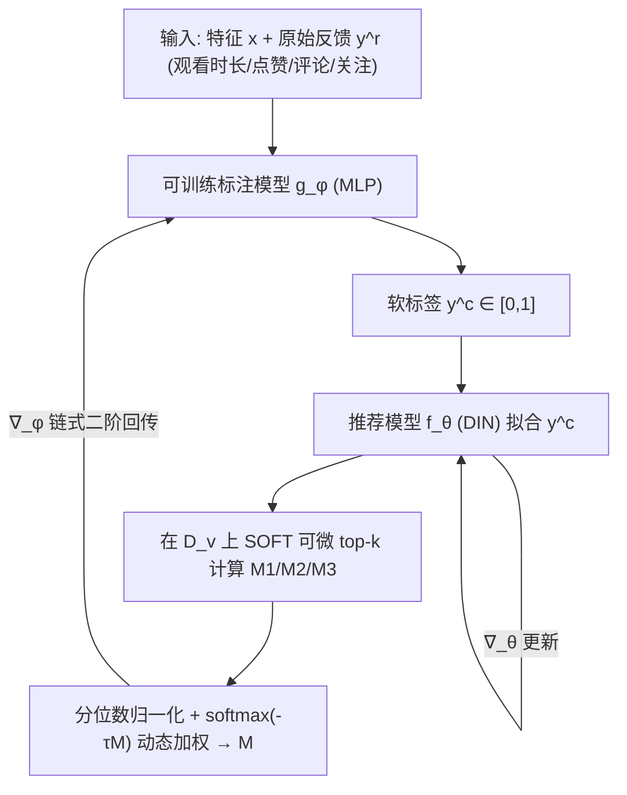
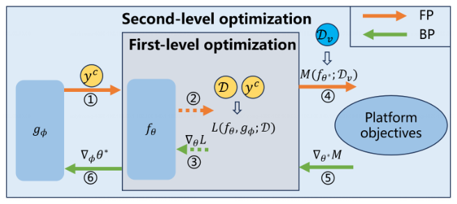
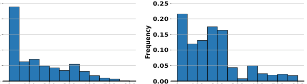

# LabelCraft: Empowering Short Video Recommendations with Automated Label Crafting (LabelCraft：以自动化标签构造赋能短视频推荐)

- **会议/期刊**: WSDM 2024
- **作者与机构**: Yimeng Bai, Yang Zhang, Fuli Feng 等（中国科学技术大学）；Jing Lu, Jianxin Chang, Xiaoxue Zang, Yanan Niu, Yang Song（快手科技）
- **推荐链路定位**: 精排模型的**训练标签生成层**（label crafting），下游为 DIN 精排
- **研究方向**: 多模态推荐与内容理解 / 去偏与工业架构
- **论文原文**: [https://arxiv.org/abs/2312.10947v2](https://arxiv.org/abs/2312.10947v2)
- **开源代码**: [https://github.com/baiyimeng/LabelCraft](https://github.com/baiyimeng/LabelCraft)

## TL;DR (1分钟核心速览)

短视频隐式反馈（观看时长）作为标签并不可靠：看 15 秒的 60 秒视频未必强于循环看 5 秒短视频，而人工规则标签（PC/PCR/D2Q/DVR）既费人力又与平台运营指标错位。LabelCraft 把「标签生成」重写为**推荐模型之上的一层双层优化**：用可训练标注模型 $g_\phi$融合全部反馈产出软标签，再以平台目标（观看时长增益、互动增益、时长多样性）经 SOFT 可微 top-$k$与 MAML 一阶近似反传梯度来学$g_\phi$。在 Kuaishou/Wechat 真实数据、DIN 骨干、top-10 列表模拟评估下，NWTG@10 相对最优基线分别提升 4.4%/2.3%，NEG@10 与 DS@10 同步领先，实现"精度与去偏"双赢。

## Background & Motivation (背景与核心矛盾)

- **主流范式**: 短视频推荐依赖混合反馈（观看时长 + 点赞/评论/关注），标签生成走"人工规则"路线——语义转换类（PC、PCR、Effective View）与偏差修正类（D2Q 的分位数后门调整、DVR 的观看时长增益）。
- **前人局限**: ①规则靠人写、难覆盖多因素交互（时长、完播、显式互动彼此耦合）；②规则目标与平台运营指标**不对齐**——文献已观测到 D2Q 类无偏时长标签会拉低"分享"等互动指标；③单规则标签在多任务 MMoE 中简单相加，仍会出现"提一个指标压另一个"的跷跷板。
- **核心洞察 (Key Insight)**: 标签没有 ground truth，因此不能"监督学"，只能"按下游效果学"。平台目标（使用时长 / 互动 / 留存）本身可测，可充当标签模型的**外部监督信号**，而推荐模型 $f_\theta$恰好是把该信号回传给$g_\phi$ 的可微桥梁。
- **本文切入点**: 把 $g_\phi$ 的学习写成 max-min 双层优化，用元学习近似求解，从而把"人工规则"换成"面向运营指标自动搜索的标签机制"。

## Method (核心方法设计)

### 1. 整体框架 (Overall Architecture)

输入为样本特征 $\boldsymbol{x}$（含视频时长$x_d$、用户历史、标签等）与原始反馈$\boldsymbol{y}^r$（观看时长$y_w$、点赞/评论/关注）。标注模型$g_\phi$（MLP 48×256×256×1）输出$[0,1]$连续软标签$y^c=g_\phi(\boldsymbol{x},\boldsymbol{y}^r)$；推荐模型$f_\theta$（DIN）仅拟合$y^c$。每轮迭代先"虚拟"更新$\theta$得$\theta'$，在留出集$D_v$上用 SOFT 可微 top-$k$计算三项平台目标并反传更新$\phi$；再用更新后的$g_\phi$重造标签正式更新$\theta$。推理阶段完全保持 DIN 原结构，仅标签生成多一次 MLP 前向。

<figure class="paper-figure" markdown="span">
  <figcaption>图1：LabelCraft概述，其利用平台目标指导标注模型𝑔𝜙的学习，并以推荐模型𝑓𝜃作为中间桥梁。</figcaption>
</figure>

### 2. 关键设计拆解 (Key Designs)

1. **双层优化 + MAML 近似求解（核心）**：痛点是无标签真值、目标不可直接对 $\phi$求导。上层最大化平台目标、下层最小化拟合损失：$\max_\phi M(f_{\theta^*};D_v)$s.t.$\theta^*=\arg\min_\theta L(f_\theta,g_\phi;D)$。不做$\theta$的完整训练（代价过高），改为一次虚拟步$\theta'=\theta-\eta_1\nabla_\theta L(f_\theta,g_\phi;D)$，再$\phi\leftarrow\phi+\eta_2\nabla_\phi M(f_{\theta'};D_v)$，梯度沿$M\to\theta'\to\nabla_\theta L\to\phi$链式回传。直觉：用"一步梯度下降后的模型表现"作为$\phi$ 的代理评价，把不可解嵌套优化降为一次二阶梯度。

2. **SOFT 可微 top-$k$与三目标可算化**：直接取 top-$k$不可导，无法把梯度传到$\phi$。引入 SOFT——用熵最优传输问题的解近似 top-$k$的 0/1 选择指示$\alpha_{u,\boldsymbol{x}}$，其梯度可由最优性条件高效求出。于是三项目标写作$M_1=\frac{1}{|U|}\sum_u\sum_{\boldsymbol{x}}\frac{\alpha_{u,\boldsymbol{x}}}{k}\,scale(y_w)$（使用时长）、$M_2=\cdot\,scale$版的显式反馈计数（互动）、$M_3=\big(\sum\frac{\alpha}{k}(scale(x_d)-E_{w,k})^2\big)^{-1/2}$（时长标准差代理留存/多样性）。

3. **分位数归一化 + 动态平衡**：三目标量纲不同且学习难度不同，直接相加会被大幅值项支配。先用**分段 min-max**（以第 $\beta=80$百分位为拐点）把长尾的观看时长/时长映到$[0,1]$且保证头部值不塌缩：$scale(y_w)=y_w/w_\beta\beta'$（$y_w\le w_\beta$），否则$1-(1-\beta')\frac{w_{max}-y_w}{w_{max}-w_\beta}$；再按$M=\sum_{i=1}^{3}\mathrm{softmax}(-\tau M_i)\cdot M_i$动态加权（$\tau=0.5$，权重不参与求导），使落后目标获得更大权重，避免单目标独大。**训练目标**即上述$M$，推荐侧损失为 MSE/BCE +$\lambda\|\theta\|^2$；无负采样环节（pointwise 回归），额外开销主要是每步一次$\phi$的二阶梯度与$D_v$ 上 SOFT 计算。

## Experimental Setup & Evaluation Protocol (实验设置与评估协议)

| 数据集 | #Users | #Items | #Interactions | 密度 | 特征/场景说明 |
| :--- | :---: | :---: | :---: | :---: | :--- |
| Kuaishou | 989 | 46,628 | 1,309,785 | 0.0284 | 两周真实推荐日志，20-core 过滤；含时长、标签、历史 |
| Wechat | 15,075 | 12,992 | 4,778,294 | 0.0244 | WeChat Big Data Challenge，120-core 过滤；点赞/评论/关注/收藏，仅保留三类正向反馈 |

- **数据划分与防穿越**: **时间切分**——前 12 天训练，最后两天分别作验证/测试；验证集直接充当双层优化的留出集 $D_v$。
- **排名评测协议**: **非全库排序**，属"已交互候选池 + 列表级模拟"协议——对每用户在 $D_v$ 中其交互过的视频打分取 top-10，用 NWTG@10（归一化观看时长增益，IDCG 由真实观看时长理想序给出）、NEG@10（归一化显式反馈增益）、DS@10（top-10 视频时长标准差，越大越去偏）三项指标，按用户平均。该协议不回放未交互物品，无法反映全库竞争。
- **对比基线与超参**: 单标签法 WT/EF/PC/PCR/D2Q/DVR 与多任务法 WT+EF/D2Q+EF/DVR+EF（MMoE，3 专家 2 门控）；全部统一 DIN 骨干，SGD、batch ∈ {4096, 8192, 16384}、学习率网格搜索、early stopping patience=5；$\tau\in\{0,0.1,\dots,1.0\}$。

## Key Experimental Results (实验关键数据)

### 1. 主实验对比 (Main Results)

| Method | Kuaishou NWTG@10 | DS@10 | NEG@10 | Wechat NWTG@10 | DS@10 | NEG@10 |
| :--- | :---: | :---: | :---: | :---: | :---: | :---: |
| PC | 0.2121 | 15 | 0.7902 | 0.4563 | 10 | 0.7776 |
| PCR | 0.2493 | 67 | 0.8005 | 0.4125 | 12 | 0.8109 |
| WT | 0.2939 | 113 | 0.7991 | 0.4972 | 15 | 0.8201 |
| EF | 0.2557 | 113 | 0.8097 | 0.4593 | 15 | 0.8261 |
| D2Q | 0.2722 | 122 | 0.7949 | 0.6202 | 23 | 0.8191 |
| DVR | 0.2814 | 135 | 0.7866 | 0.5300 | 18 | 0.8219 |
| WT+EF | 0.2631 | 119 | 0.8000 | 0.5195 | 21 | 0.8205 |
| D2Q+EF | 0.2800 | 111 | 0.7896 | 0.5790 | 22 | 0.8197 |
| DVR+EF | 0.2876 | 124 | 0.7862 | 0.5698 | 22 | 0.8232 |
| **LabelCraft** | **0.3003** | **137** | **0.8165** | **0.6343** | **24** | **0.8338** |
| Improv.% vs 最优基线 | +4.4% | +1.5% | +0.8% | +2.3% | +4.3% | +0.9% |

### 2. 消融实验 (Ablation Study)

| 变体 (Kuaishou) | NWTG@10 | DS@10 | NEG@10 | 说明 |
| :--- | :---: | :---: | :---: | :--- |
| LabelCraft | **0.3003** | **137** | **0.8165** | 完整模型 |
| w/o S（去归一化） | 0.2627 | 101 | 0.8165 | 量纲失衡，NEG 独占优化 |
| w/o B（去动态平衡） | 0.2710 | 122 | 0.7960 | 三目标简单等权相加 |
| w/o WI（去观看时长输入） | 0.2677 | 103 | 0.8151 | 时长信号缺失 |
| w/o DI（去视频时长输入） | 0.2935 | 127 | 0.7919 | 无法建模完播语义 |
| w/o EI（去显式反馈输入） | 0.3237 | 124 | 0.7927 | 精度升、互动降 |
| w/o WO（去使用时长目标） | 0.2785 | 112 | 0.8001 | — |
| w/o DO（去多样性目标） | 0.3290 | 128 | 0.7982 | — |
| w/o EO（去互动目标） | 0.3109 | 131 | 0.7962 | — |

### 3. 关键实验发现 (Key Findings)

1. **单规则标签无法三指标通吃**：DVR 的 DS@10 已达 135 逼近 LabelCraft 的 137，但 NEG@10 仅 0.7866（低于 EF 的 0.8097 约 2.9%）；EF 反之。说明"去偏"与"促互动"在人工规则下天然冲突，而 LabelCraft 靠 $M_2/M_3$ 联合优化同时拿到 0.8165 与 137。
2. **归一化是动态平衡的前置条件**：w/o S 使 NWTG@10 从 0.3003 跌至 0.2627（−12.5%）、DS@10 从 137 崩到 101，但 NEG@10 完全不变——证实未归一化时小量纲的显式反馈目标被 softmax 赋予极高权重而独霸优化，缩放与加权缺一不可。
3. **"输入侧"比"目标侧"更关键且存在方向性取舍**：去掉观看时长输入（w/o WI）对 NWTG@10 的打击（−10.9%）甚至大于去掉使用时长目标（w/o WO，−7.3%）；w/o EI 反而把 NWTG@10 抬到 0.3237 却牺牲 NEG@10，说明多源反馈的**全量输入**是标签质量的信息基础，而目标取舍决定最终偏向。

<figure class="paper-figure" markdown="span">
  <figcaption>图2：在Kuaishou上，由PC、D2Q、DVR和我们的LabelCraft生成的top-𝑘推荐视频列表中视频时长分布。</figcaption>
</figure>

## Highlights & Limitations (亮点、对比与审稿批判)

- **与代表作对比**: 相比 D2Q（对观看时长做分位数后门调整）与 DVR（按相似时长视频的均值做增益归一），二者都是在**标签定义层面手工注入因果假设**；LabelCraft 不做任何显式因果建模，而是让"去偏"作为 $M_3$ 多样性目标自动涌现——同样的去偏效果（图 2 中时长分布比 D2Q/DVR 更平缓）却换来更高的 NWTG/NEG。相比 MMoE 多任务拼接多标签，本文把多目标放进**上层优化的一次标量奖励**中，避免了任务间梯度拉扯。
- **可迁移亮点**: ①"可微 top-$k$ (SOFT) + 列表级指标作为上层奖励"这一组合，可直接搬到重排/生成式的离线策略优化；②按分位数拐点做长尾归一化再动态加权的配方，对任何多目标加权（如 CTR+CVR+时长）都实用。
- **审稿级局限批判**: ①**评估协议偏乐观**：候选池限于 $D_v$内用户已交互视频，既非全库排序也不含未交互负例，NWTG/NEG 的绝对值不可与常规 NDCG 类结果横向比较，且未报告方差与显著性检验；②**双层优化成本与稳定性**：每步需一次二阶梯度 +$D_v$上的 SOFT 求解，且$D_v$同时充当验证集与优化目标集，存在过拟合留出集的风险（论文自陈未来要"解耦标签学习与推荐学习"）；③消融符号存在笔误（正文定义$M_2$为显式反馈、$M_3$为多样性，消融段落却把 w/o DO 标为"移除$M_2$"），削弱可复现性；④$g_\phi$ 是纯 MLP，未利用视频内容多模态表征，短视频"内容-反馈"耦合仍未被真正建模。

## Rating (四维评分)

- **方法创新性 (Novelty)**: ⭐⭐⭐⭐ （把标签生成抬升为双层优化并用 MAML 近似，视角新颖；但 SOFT 可微 top-$k$ 与 softmax 动态加权均为借用组件）
- **评估协议与实验扎实度 (Protocol & Experiments)**: ⭐⭐⭐ （双真实工业数据集 + 9 组基线 + 8 组消融较完整，但候选池受限、缺显著性检验、留出集复用）
- **写作与数学规范度 (Clarity & Rigor)**: ⭐⭐⭐ （双层公式与三目标定义清晰，但 $M_2/M_3$ 在消融中的指代前后矛盾、部分符号排版错乱）
- **工业落地与复现价值 (Industrial & Practical Value)**: ⭐⭐⭐⭐ （代码开源、骨干不变、推理仅多一次 MLP 前向；主要门槛是训练期二阶梯度与平台目标的指标化设计）

